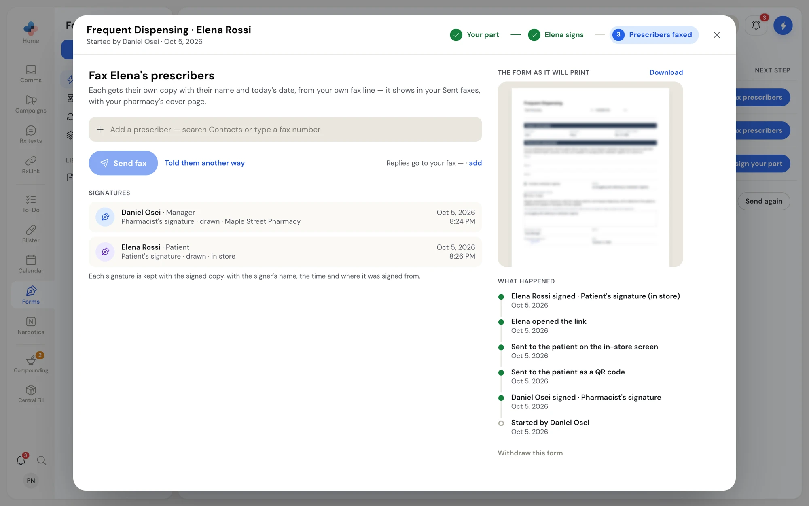
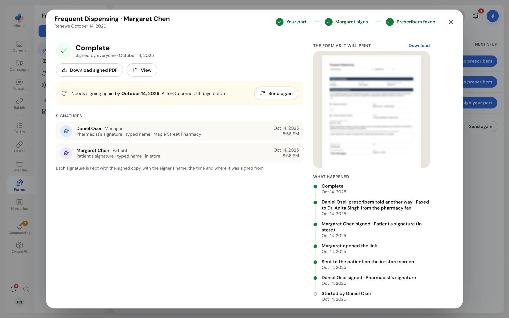

Once the patient has signed, the form comes back to your pharmacy for its last step. For Frequent Dispensing, that is faxing the prescribers. After that the form is **Complete**, and the signed PDF stays on file.

## Fax the prescribers

On the forms list, the patient's row shows **Fax prescribers**. Click it, or click the row.

<Frame caption="The fax step: add each prescriber, then send">

</Frame>

<Steps>
  <Step title="Add each prescriber">
    In **Add a prescriber — search Contacts or type a fax number**, type a name or number. Click a contact with a fax number, or type the full fax number to add it. Each prescriber needs a name; it goes on their copy.
  </Step>
  <Step title="Check the reply number">
    Beside **Send fax**, **Replies go to your fax** shows the number printed for replies. Click it (or **add**) to change it.
  </Step>
  <Step title="Send">
    Click **Send fax** (or **Send 2 faxes** for two prescribers). Each prescriber gets their own copy with their name and today's date, with your pharmacy's cover page.
  </Step>
</Steps>

If your pharmacy has its own fax line in PharmaTools, the faxes go from it and show in your sent faxes in Comms. Without one, they go from the PharmaTools notification line.

While the faxes go out, the window says "Faxing… the status updates here as it goes." Each fax shows under **Faxes** with its number, time, page count and status. Click the receipt icon on a fax to download its fax receipt. If a fax does not go through, **What happened** says "Fax didn't go through" with the reason.

### Told the prescriber another way

If you reached the prescriber another way, such as handing them the form in person or faxing from your own machine, click **Told them another way**, type how (for example "Handed to Dr. Singh in person") and click **Mark as told**. The note is kept on the form's history and the step is done.

## A completed form

When every step is done, the form shows **Complete** · "Signed by everyone" with the date.

<Frame caption="A completed Frequent Dispensing form, with its renewal date">

</Frame>

| Part | What it gives you |
| --- | --- |
| **Download signed PDF** | Saves the signed form to your computer. |
| **View** | Opens the signed form full size in PharmaTools. **Esc** or **×** closes it. |
| **Signatures** | Each signature with the signer's name, their role (for example Pharmacist, Patient or Agent / caregiver), how they signed (drawn, typed name, saved signature, or signed paper copy uploaded), where (on their phone, in store, or your pharmacy's name) and the date and time. |
| **Faxes** | Every fax sent for the form, with its status and receipt. |
| **What happened** | The form's history, newest first: started, filled in, signed, sent, opened, faxed, and completed, each with who and when. |

You can also download the PDF from the forms list: right-click the form and click **PDF**.

<Info>
Each signature is kept with the signed copy, with the signer's name, the time, and where it was signed from, so you can show who signed what if you are ever asked.
</Info>

## Renewals

Some forms must be signed again after a set time. Frequent Dispensing is valid for a year, so its template says **Renews yearly**.

- A completed form shows "Needs signing again by **October 14, 2026**. A To-Do comes 14 days before."
- 30 days before that date, the form appears on **Renewals** and on the first tab, with **Send again** as its next step. Its **Latest** column counts down, for example "Runs out Oct 14, 2026 · 12 days", then "Ran out 18 days ago".
- 14 days before, a task called **Renew Frequent Dispensing · Margaret Chen** appears in **To-Do**.

Nothing is sent to the patient by itself, because PharmaTools does not keep the patient's date of birth for the next link.

<Steps>
  <Step title="Click Send again">
    On the forms list, on the completed form, or in the right-click menu. PharmaTools starts a new copy of the form for the same patient and opens it. Last time's answers are filled in, with the note "Last time's answers are filled in. Check each one is still right before you sign."
  </Step>
  <Step title="Check, sign and send">
    Check each answer, sign your part, and choose how the patient signs, the same as a new form. See [Fill your part and send to the patient](/forms/send-a-form).
  </Step>
</Steps>

Sending again closes the renewal task in To-Do. The old form then shows **Renewal sent · open it**, which opens the new copy.
