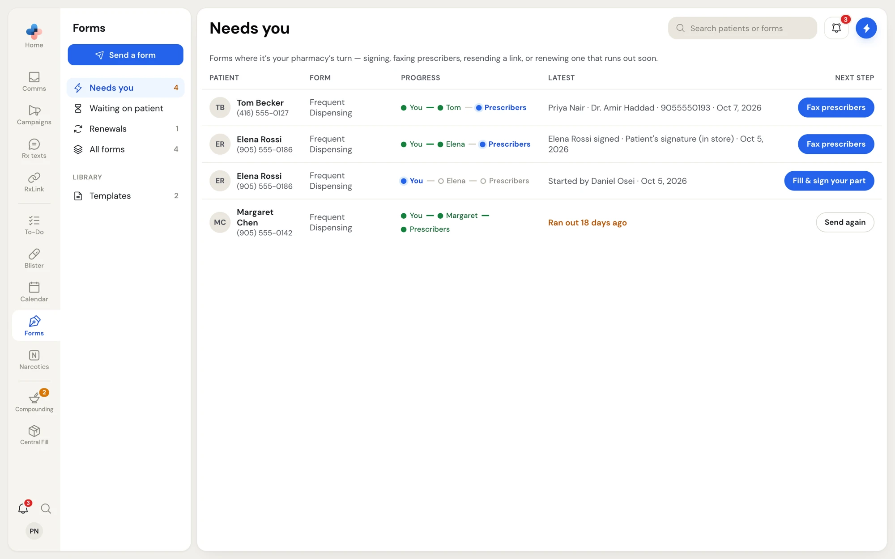
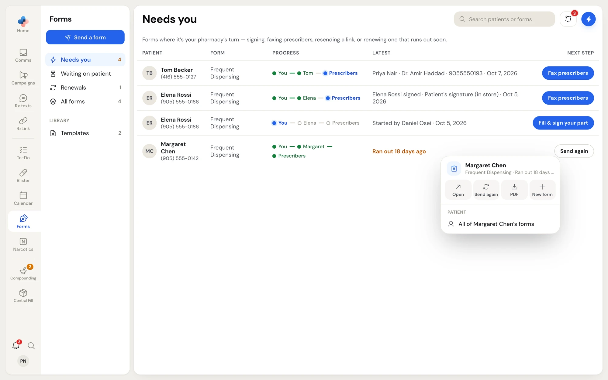

**Forms** sends patient forms that need a signature, such as the Frequent Dispensing consent, and walks each one through its steps: your pharmacy fills and signs its part, the patient signs on their own phone, on a tablet in the store or on paper, and PharmaTools faxes the prescribers. The signed PDF stays on file, and forms that must be signed again each year come back to you before they run out.

<Note>
Forms is an add-on. If your pharmacy does not have it, **Forms** in the side menu shows a padlock.
</Note>

## How a form moves

Every form is a short line of steps. The standard Frequent Dispensing form has three:

1. **Your part**: a pharmacist fills in the assessment and signs.
2. **The patient signs**: you choose how they sign (a texted link, a QR code at the counter, this device handed over, or paper).
3. **Prescribers faxed**: you pick the prescribers and PharmaTools faxes each one their own copy.

When every step is done, the form is **Complete**. A form you build yourself can have just the patient's part, your part and the patient's, and an optional fax step. See [Templates and the form builder](/forms/templates).

## Open Forms

Click **Forms** in the side menu.

<Frame caption="Forms open on the first tab: forms where it is your pharmacy's turn">

</Frame>

The left menu has **Send a form** and five tabs:

| Tab | Lists |
| --- | --- |
| First tab (lightning icon) | Forms where it is your pharmacy's turn: your part to fill and sign, prescribers to fax, a patient's link that ran out and needs resending, or a signed form that runs out soon. The number is amber. |
| **Waiting on patient** | Forms sent to the patient and not yet signed. |
| **Renewals** | Signed forms that run out in the next 30 days. |
| **All forms** | Every form your pharmacy has sent, including completed and withdrawn ones. |
| **Templates** (under **Library**) | The forms your pharmacy can send. See [Templates and the form builder](/forms/templates). |

When nothing is waiting on your pharmacy, Forms opens on **Waiting on patient** instead, or on **All forms**.

Search with **Search patients or forms** at the top. To see one patient's forms, right-click any of their rows and choose **All of … 's forms**; click **×** on the patient's name beside the title to see everyone again.

## The forms table

| Column | Shows |
| --- | --- |
| **Patient** | The patient's name and mobile number. |
| **Form** | Which form it is. |
| **Progress** | Each step as a dot: green when done, blue for the step it is on, empty for steps still to come. |
| **Latest** | The last thing that happened, for example "Opened, not signed yet · 2 min ago", "Texted to (905) 555-0142 · 10:14 AM" or "Ran out 18 days ago". |
| **Next step** | A button for what to do next. Blue buttons are your pharmacy's turn. |

The **Next step** buttons:

| Button | When it shows | What it does |
| --- | --- | --- |
| **Fill & sign your part** | Your part is next. | Opens the form at your part. |
| **Send to patient** | Your part is signed and the patient has not been sent it. | Opens the form at the patient's step. |
| **Resend link** | The patient's link ran out. | Opens the form so you can send it again. |
| **Upload signed copy** | The patient is signing on paper. | Opens the form so you can upload the scan. |
| **Fax prescribers** | The patient has signed. | Opens the form at the fax step. |
| **Send again** | A signed form runs out within 30 days, or has run out. | Starts a new copy for the same patient. |
| **Open** / **View** | Nothing to do right now, or the form is complete. | Opens the form. |

Click anywhere on a row to open the form. See [Fill your part and send to the patient](/forms/send-a-form) and [Faxing, completed forms and renewals](/forms/after-signing).

## Right-click a form

<Frame caption="The right-click menu on a form in the list">

</Frame>

| Item | What it does |
| --- | --- |
| **Open** | Opens the form. |
| **Send again** | Starts a new copy for the same patient. Shown on forms due for renewal. |
| **PDF** | Downloads the form's PDF as it stands. |
| **New form** | Opens **Send a form** with this patient already chosen. |
| **All of … 's forms** | Lists only this patient's forms. |
| **Withdraw** | Stops a form that is still in progress. Shown only on forms in progress. |

Withdrawing asks **Withdraw Frequent Dispensing for Margaret Chen?** · "Any link they have stops working. The form stays in All as withdrawn." Click **Withdraw** to confirm.

## Updates arrive by themselves

The list and an open form update on their own as things happen: when the patient opens their link, when they sign, and as each fax goes through. You do not need to refresh the page.

When the patient signs a form that has a fax step, the form moves to the first tab with **Fax prescribers**. When a signed form is 14 days from running out, a **Renew …** task also appears in **To-Do**. See [Renewals](/forms/after-signing#renewals).

## Who can do what

| Action | Who |
| --- | --- |
| Send a form, fill your part, send to the patient, fax prescribers, upload a paper copy, withdraw | Everyone |
| Sign a part marked "pharmacist signs" (the Frequent Dispensing assessment) | Pharmacists, Managers and Admins. Anyone else sees "Only a pharmacist can sign this." |
| Create, edit, import and delete templates | Everyone |
| Return from the in-store hand-over screen | Anyone with an employee PIN |

## In this section

<CardGroup cols={2}>
  <Card title="Fill your part and send to the patient" icon="send" href="/forms/send-a-form">
    Start a form, sign your part, and choose how the patient signs.
  </Card>
  <Card title="What the patient sees" icon="smartphone" href="/forms/patient-view">
    The birthday check, one question per screen, and signing.
  </Card>
  <Card title="Faxing, completed forms and renewals" icon="file-check" href="/forms/after-signing">
    Fax prescribers, download the signed PDF, and send again each year.
  </Card>
  <Card title="Templates and the form builder" icon="layout-template" href="/forms/templates">
    Edit the standard forms, build your own, or import a PDF.
  </Card>
</CardGroup>
