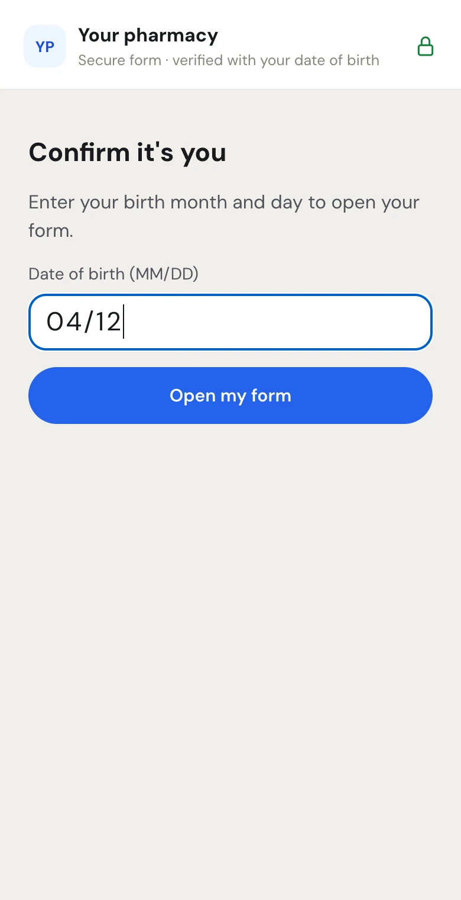

Patients do not need an account or an app. They open the form in their phone's web browser from the text or the QR code, or on the device you hand them in the store. This page shows what they see so you can help them at the counter or on the phone.

<Tip>
To see your own form through the patient's eyes before you send it, open it in the form builder and click **Patient's phone**. See [Preview the patient's side](/forms/templates#preview-the-patients-side).
</Tip>

## Opening the form

<Steps>
  <Step title="Tap the link or scan the code">
    From a text, the patient taps the link. At the counter, they point their phone camera at the QR code in the form window and tap the link that appears.
  </Step>
  <Step title="Confirm it's you">
    The page shows your pharmacy's name, "Secure form · verified with your date of birth", and **Confirm it's you**. The patient types their birth month and day in **Date of birth (MM/DD)** and taps **Open my form**. It must match the month and day staff entered when sending.
  </Step>
</Steps>

<Frame caption="The birthday check on the patient's phone">

</Frame>

On the hand-over screen in the store there is no birthday check; the header says "Secure form · in store".

## Answering, one screen at a time

The form shows one question per screen, with a progress bar along the top and "Step 2 of 5 · Frequent Dispensing" above the question. The wording that comes before a question on the printed form (for example what the patient is agreeing to) shows in a box above it.

- **Short and long answers**: a box to type in. Questions that are not required say "(optional)".
- **Dates**: a date picker.
- **Tick boxes**: a box with the sentence beside it.
- **Choices**: one button per choice; tapping one picks it.

The patient taps **Next** to move on and **Back** to go back. A required question that is left empty shows "Please answer this question." or "Please choose one."

Only the parts the patient fills show. Your pharmacy's part is already filled in and signed, and boxes filled in automatically (such as the date signed) are not asked.

## Signing

The last screen is **Sign below**.

1. **Your full name** is filled in from the pharmacy's record; the patient can correct it.
2. The patient picks **Draw** and signs in the box with a finger (**Clear** starts over), or **Type** and types their name.
3. **Review the whole form first** opens the whole form as a PDF in a new tab.
4. They tap **Sign and send**.

Under the button: "By signing you agree this electronic signature is yours. The time and your device's address are kept with the signed form."

### A caregiver signing for the patient

When the form has an agent or caregiver signature (Frequent Dispensing does), the signing screen shows "Signing for someone else? **I'm their caregiver**". Tapping it changes the screen to **Sign as their caregiver** and asks for **Your name and relationship to the patient**, for example "Mary Ellis (daughter)". **I'm the patient** switches back.

## After signing

The patient sees **Thank you** and "Frequent Dispensing is signed and sent to Maple Street Pharmacy." On their own phone they can tap **View the completed form** to open the signed PDF. On the hand-over screen, it asks them to hand the device back to the pharmacy team.

On your side, the form moves on by itself: the **Progress** dot turns green and the next step (usually **Fax prescribers**) shows. See [Faxing, completed forms and renewals](/forms/after-signing).

## Messages a patient might see

| Message | Why | What to do |
| --- | --- | --- |
| A wrong date of birth message on **Confirm it's you** | The month and day do not match what staff entered. | Check the birthday with the patient. If it was entered wrong, send a new link from the form window. |
| "This form was withdrawn by the pharmacy." | Staff withdrew the form. | Start a new form if one is still needed. |
| "This form isn't ready for you yet. The pharmacy will let you know." | Your pharmacy's part is not signed yet. | Fill and sign your part. |
| The link no longer opens the form | The link ran out (after the **Link open for** time). | Open the form and click **Resend text** or **Show QR code**. |
