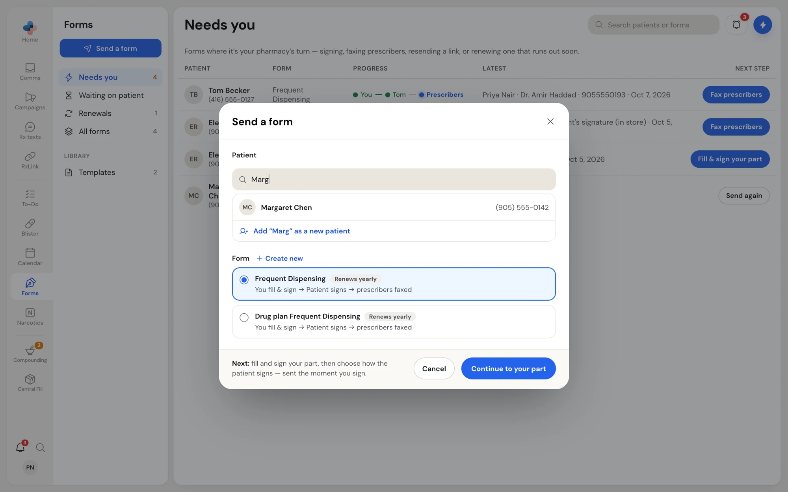
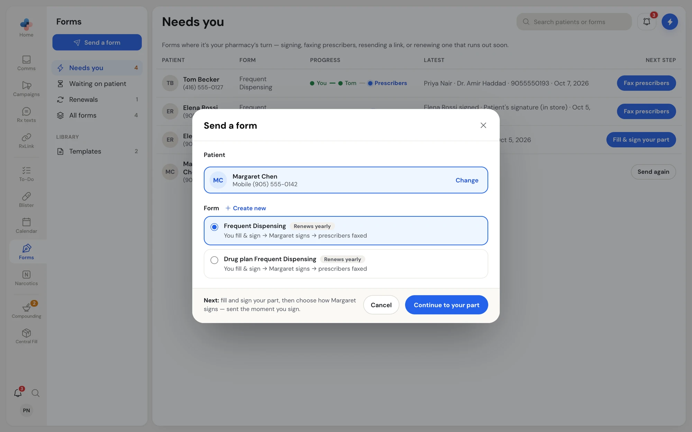
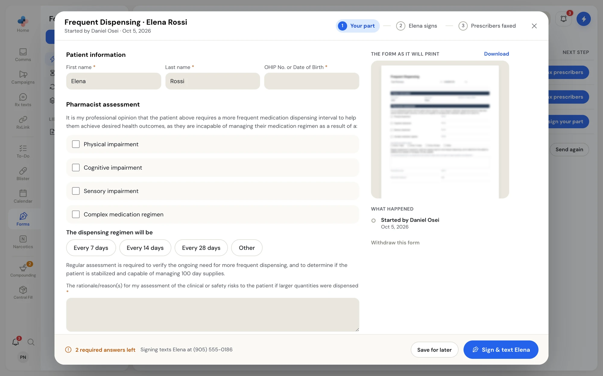
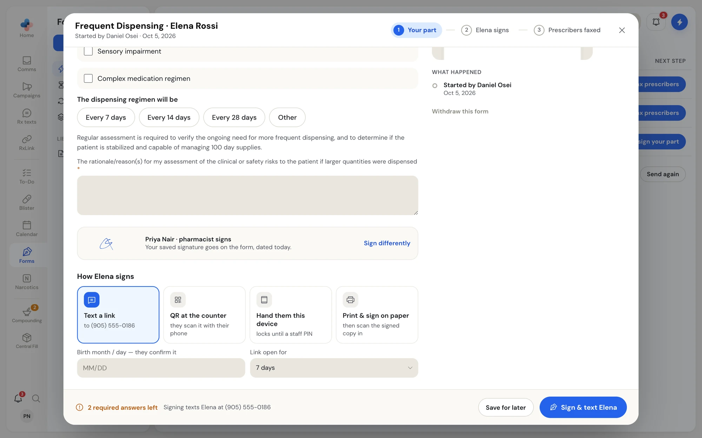

Sending a form takes two screens: **Send a form**, where you pick the patient and the form, and the form's own window, where you fill and sign your part and choose how the patient signs. A form that has only the patient's part goes out straight from **Send a form**.

<Warning>
Texts and faxes from Forms go to real patients and prescribers. Check the patient's mobile number and the prescriber's fax number before you sign or send.
</Warning>

## Start a form

<Steps>
  <Step title="Open Send a form">
    Click **Send a form** at the top of the Forms menu. You can also click **Send** on a template, or right-click a patient's form and choose **New form**.
  </Step>
  <Step title="Choose the patient">
    Under **Patient**, type a name or phone number. Click the patient in the list. If they are not in your contacts, click **Add "…" as a new patient**, then type their **Full name** and **Mobile number**; they are added to Contacts when you continue. **Change** picks a different patient.
  </Step>
  <Step title="Choose the form">
    Under **Form**, tick the form. Each one shows its steps, for example "You fill & sign → Margaret signs → prescribers faxed", and **Renews yearly** if it must be signed again. **Create new** opens the form builder instead.
  </Step>
  <Step title="Continue">
    For a form with a staff part, click **Continue to your part**. The form opens at **Your part**. For a form that is only the patient's, see [Forms with only the patient's part](#forms-with-only-the-patients-part).
  </Step>
</Steps>

<Frame caption="Send a form: search your contacts, or add a new patient">

</Frame>

<Frame caption="Patient chosen, Frequent Dispensing picked">

</Frame>

## Fill and sign your part

The form window shows the steps across the top, your part on the left, and on the right **The form as it will print** (click it to see it full size, or **Download**) and **What happened**.

<Frame caption="Your part of the Frequent Dispensing form">

</Frame>

<Steps>
  <Step title="Answer the questions">
    Fill in each box. A red star marks a required answer. Your answers save as you type, so you can close the window and come back.
    - Tick a reason, such as **Cognitive impairment**, and its card opens with the details that apply under it and an **Other details** box. Unticking a reason clears everything under it.
    - Pick one choice, such as **Every 7 days**, **Every 14 days**, **Every 28 days** or **Other**. **Other** opens a box to type in.
    - Some long-answer boxes offer ready-made reasons to tick; each one you tick adds its sentence to the box.
    - A box with a limit counts down, for example "15 characters left", so the answer fits the printed form.
  </Step>
  <Step title="Check your signature">
    Under the questions, your name shows with "pharmacist signs" when the part needs a pharmacist. With a saved signature, it goes on the form, dated today. Without one, you draw or type it when you sign. **Sign differently** lets you draw or type a new one this time.
  </Step>
  <Step title="Choose how the patient signs">
    Under **How … signs**, pick one of the four ways described below, and fill in what it asks for.
  </Step>
  <Step title="Sign">
    The bar at the bottom says how many required answers are left and what signing will do, for example "Signing texts Elena at (905) 555-0186". Click the button, which names the next action: **Sign & text Elena**, **Sign & show QR code**, **Sign & hand over** or **Sign & print**.
  </Step>
</Steps>

**Save for later** closes the window and keeps your answers.

When you draw a signature, tick **Save this signature to my profile for one-click signing** to skip drawing next time. The signing window offers **Draw**, **Type**, **Saved** (once you have one) and, on forms that allow it, **Upload signed copy** for a page you signed on paper.

<Frame caption="The bottom of your part: your signature and how the patient signs">

</Frame>

## How the patient signs

| Way | What happens | You enter |
| --- | --- | --- |
| **Text a link** | PharmaTools texts the patient a link. The text reads like "Maple Street Pharmacy sent you a form to complete: Frequent Dispensing (open until Nov 9, 2026). You'll be asked for your date of birth." | Their mobile number (filled in from Contacts), their birth month and day, and how long the link stays open. |
| **QR at the counter** | A QR code shows in the form window. The patient scans it with their phone camera and signs on their own phone. | Their birth month and day, and how long the link stays open. |
| **Hand them this device** | This computer or tablet switches to a full-screen form for the patient, locked until a staff PIN. | Nothing more. |
| **Print & sign on paper** | Your computer's print window opens with the form, your signature already on it. You then scan the signed copy back in. | Nothing more. |

**Birth month / day — they confirm it** is how a texted or QR link is protected: the patient must type the same month and day (MM/DD) before the form opens. If the birthday is already on file from an earlier send, the field says "Their birthday is on file from before."

**Link open for** sets how long the link works: **1 day**, **2 days**, **3 days**, **7 days**, **14 days** or **30 days**. The form's default is marked "(form default)".

<Note>
If your pharmacy has its own texting number, the patient's text comes from it and their replies come back to that number. Without one, the text comes from the PharmaTools notification line, and the text says replies are not read.
</Note>

## Hand the device to the patient (in-store mode)

Use **Hand them this device** for a patient at the counter who does not want to use their own phone.

<Steps>
  <Step title="Sign and hand over">
    Click **Sign & hand over** (or **Hand over this device** on the patient's step). The screen changes to the patient's form, full screen, with nothing of PharmaTools behind it and no birthday check.
  </Step>
  <Step title="The patient fills and signs">
    Hand the tablet or turn the screen to the patient. They go through one question per screen and sign with a finger or the mouse. See [What the patient sees](/forms/patient-view).
  </Step>
  <Step title="Take the device back">
    When they finish, the screen says **Thank you** · "Please hand the device back to the pharmacy team." Click **Staff: return to PharmaTools**, or the **Staff** button in the top corner at any time.
  </Step>
  <Step title="Enter your PIN">
    In **Staff only**, enter your employee PIN and click **Unlock**. You go back to **Forms**. A wrong PIN shows "That PIN isn't right."
  </Step>
</Steps>

<Info>
The browser's back button does nothing on the hand-over screen, so a patient cannot wander into the pharmacy's records. Only an employee PIN unlocks it.
</Info>

## Sign on paper and upload the scan

<Steps>
  <Step title="Print">
    Choose **Print & sign on paper** and click **Sign & print**. The print window opens with your part already signed.
  </Step>
  <Step title="The patient signs the paper">
    The form window now shows **Signing on paper**, with **Upload signed copy** and **Print again**.
  </Step>
  <Step title="Upload the signed copy">
    Scan the signed pages and click **Upload signed copy**. PDF or pictures (JPG, PNG, TIFF) are fine, and several files for several pages. The scan is what goes to the prescribers.
  </Step>
</Steps>

Changed your mind? Under **Or send it another way instead**, click **Text a link**, **Show QR code** or **Hand over this device**.

## While the form is with the patient

Open the form to see where it stands. The step's heading reads **With Margaret**, and the line under it says how it was sent and what happened, for example "Texted to (905) 555-0142 · 10:14 AM · Not opened yet", "Margaret opened it 5 min ago and hasn't signed yet." or "The link ran out without being opened."

From there you can:

- **Resend text** or **Text a link**, **Show QR code**, **Hand over this device**, **Print to sign on paper**, or **Upload signed copy** (if they signed a paper copy after all). Sending a new link asks for the birth month and day again when it is not on file.
- **Withdraw this form** (under **What happened**) to stop it. Any link the patient has stops working, and the form stays in **All forms** as withdrawn.

On the list, **Latest** shows the same line, and **Next step** becomes **Resend link** when the link runs out.

## Forms with only the patient's part

A form you build with no staff part skips **Your part**. In **Send a form**, after you pick the patient and form, **How they sign** shows the four ways, and the footer says "Margaret has the only part, so it goes out now." The button names what happens: **Text Margaret**, **Show the QR code**, **Hand over this device** or **Print it**.
