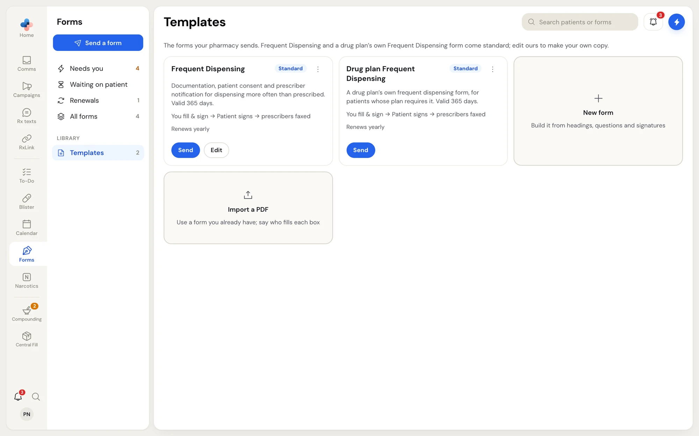
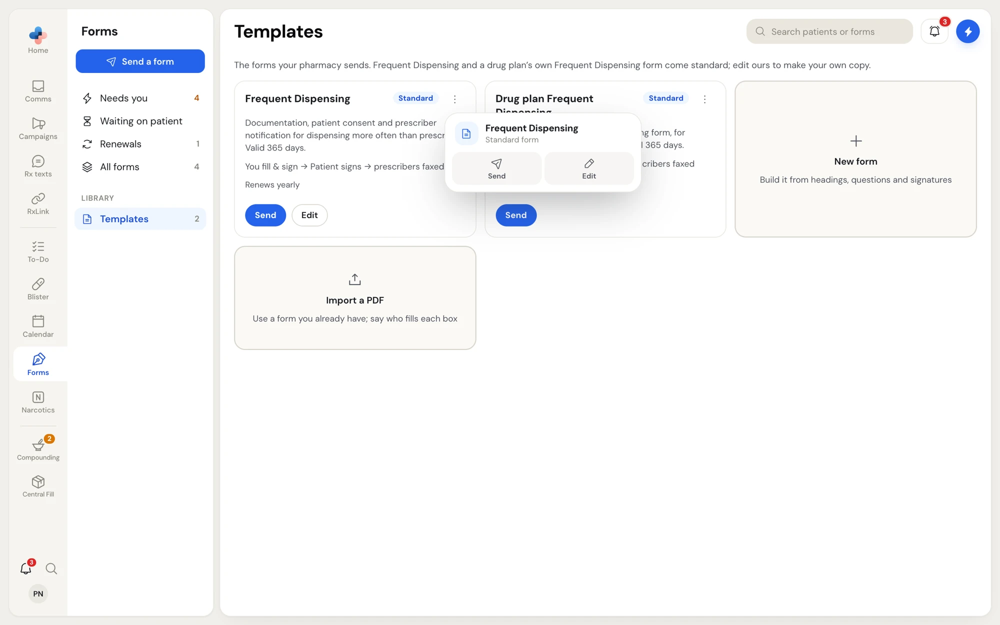
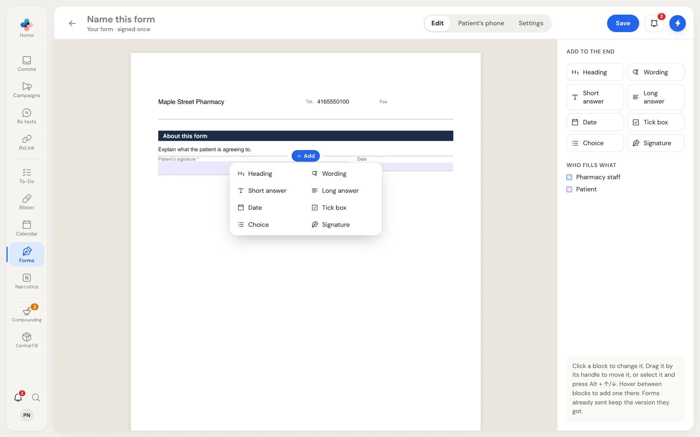
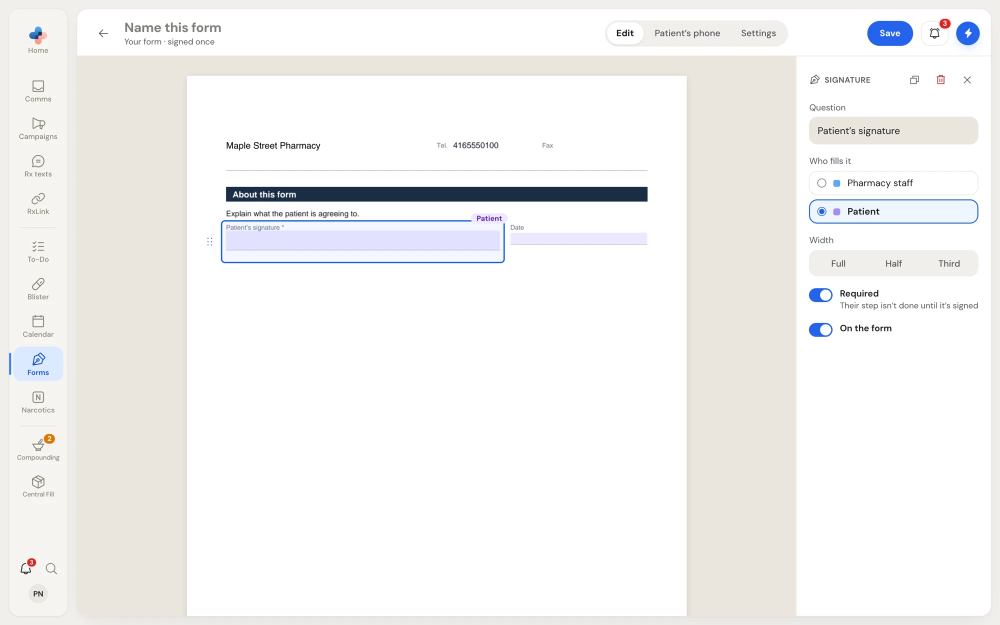
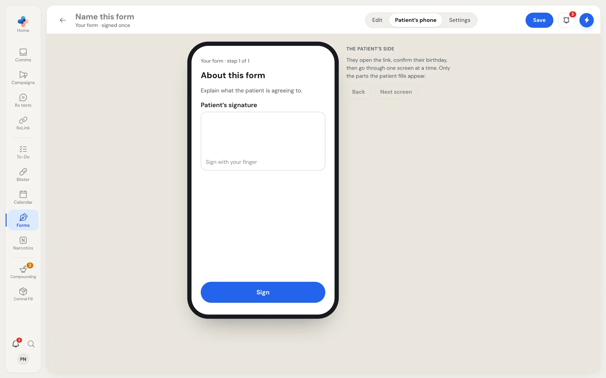
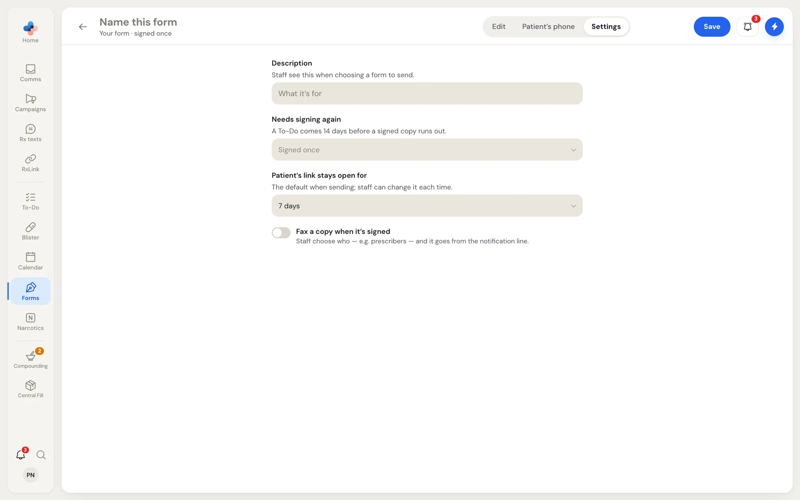
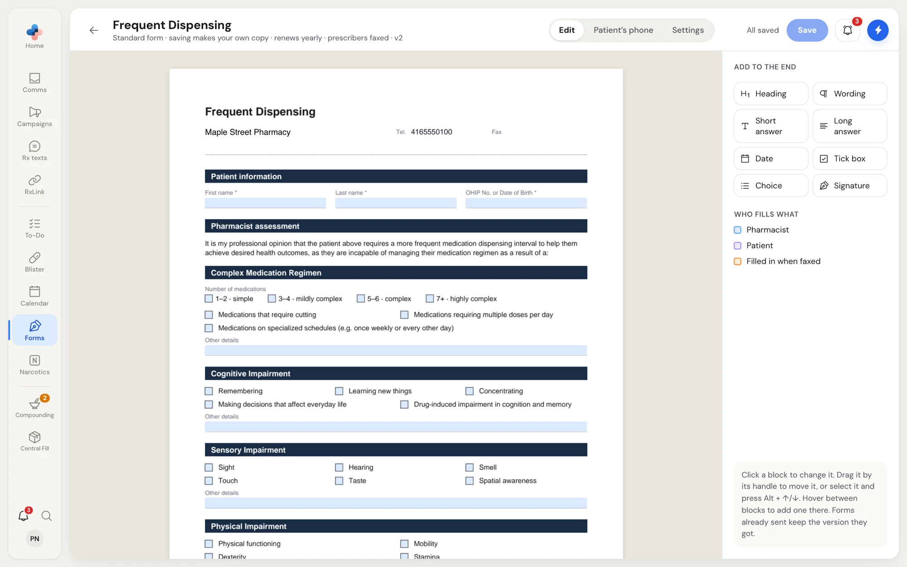

Templates are the forms your pharmacy can send. Two come standard. You can make your own copy of the standard Frequent Dispensing form, build a new form from blocks, or import a PDF you already use.

<Note>
Changing a template never changes forms already sent. Each form keeps the version it was sent with.
</Note>

## The Templates tab

Click **Templates** under **Library** in the Forms menu.

<Frame caption="Templates: the two standard forms, New form and Import a PDF">

</Frame>

Each card shows the form's name, a badge (**Standard**, or **Your copy** once you edit a standard form), its description, its steps (for example "You fill & sign → Patient signs → prescribers faxed"), and how often it renews (**Renews yearly**, **Renews every 6 months** or **Signed once**). Imported forms also say "imported PDF".

| Button | What it does |
| --- | --- |
| **Send** | Opens **Send a form** with this form picked. |
| **Edit** | Opens the form builder. |
| **⋯** or right-click | The template menu: **Send**, **Edit**, and **Reset to standard** (your copy of a standard form) or **Delete template** (a form of your own). |
| **New form** | Builds a form from headings, questions and signatures. |
| **Import a PDF** | Uses a PDF you already have; you then say who fills each box. |

<Frame caption="The template menu">

</Frame>

### The standard forms

- **Frequent Dispensing**: documentation, patient consent and prescriber notification for dispensing more often than prescribed. Valid 365 days. A pharmacist fills and signs the assessment, the patient (or their caregiver) signs, and the prescribers are faxed. You can edit it; saving makes your pharmacy's own copy, and **Reset to standard** removes your copy.
- The second standard form is a drug plan's own frequent dispensing form, for patients whose plan requires it. It follows the same steps and cannot be edited.

## Build a new form

Click **New form**. The builder opens with a starter form: a heading, a line of wording, the patient's signature and the date.

The builder has three tabs at the top: **Edit**, **Patient's phone** and **Settings**. Name the form in **Name this form** beside the back arrow. The line under the name sums it up, for example "Your form · signed once".

### Edit the page

The middle of the builder is the form as it will print, with your pharmacy's name, phone, fax and address at the top. The colour of each box shows who fills it: blue for pharmacy staff, purple for the patient, orange for boxes filled in when faxed.

<Frame caption="Hover between blocks and click Add to put a block there">

</Frame>

| To | Do this |
| --- | --- |
| Add a block at the end | Click a block type under **Add to the end** on the right. |
| Add a block in a spot | Hover between two blocks and click **Add**, then pick a type. |
| Change a block | Click it on the printed page. Its settings open on the right. |
| Move a block | Drag it by its handle on the left, or select it and press **Alt + ↑** or **Alt + ↓**. |
| Delete a block | Select it and press **Delete**, or click the bin in its settings. |
| Stop editing a block | Press **Esc**, click **×** in its settings, or click empty space. |

### Block types

| Block | Use it for |
| --- | --- |
| **Heading** | A section title in a dark band, such as "Patient information". On the patient's phone it titles the screens under it. |
| **Wording** | A paragraph of text, such as what the patient agrees to. It shows above the next question on the patient's phone. |
| **Short answer** | A one-line answer, such as a name or health card number. |
| **Long answer** | A few lines of text, such as a reason. |
| **Date** | A date. |
| **Tick box** | A box with a sentence beside it, such as "I agree". |
| **Choice** | Pick one from a list, such as **Every 7 days** or **Every 14 days**. Needs at least two choices. |
| **Signature** | A signature line. |

### Block settings

<Frame caption="A selected signature block and its settings">

</Frame>

| Setting | What it does |
| --- | --- |
| **Heading** / **Question** / **Wording** | The text of the block. |
| **Sentence beside the box** | For a tick box: the sentence printed next to it. |
| **Choices, one per line** | For a choice: one option per line. **Also offer "Other"** adds an **Other** option with a box to type in. |
| **Who fills it** | **Pharmacy staff** or **Patient**. On your copy of Frequent Dispensing: **Pharmacist**, **Patient** or **Filled in when faxed**. |
| **Width** | **Full**, **Half** or **Third**. Blocks narrower than full share a line on the printed page. |
| **Required** | The answer must be filled before that person can sign. For a signature: their step is not done until it is signed. |
| **Fill in automatically** | Fills the box for you: the patient's first, last or full name, the signer's name, the date signed, or (for fax boxes) the prescriber's name, the date faxed, or a tick when faxed. Boxes filled when the patient signs are not asked on their phone. |
| **Start a new page** | For headings and wording: starts a new printed page at this block. |
| **On the form** | Turn off to leave a block off the form without deleting it. Left-off blocks are listed under **Left off the form** below the page; click one to turn it back on. |

The icons at the top of the settings are **Duplicate**, **Delete** and **Done**.

### Reasons with sub-options

On a tick box, you can add blocks under it, such as the reasons under **Cognitive impairment** on Frequent Dispensing. Hover just under the tick box's band and click **Add** to add a sub-option. When staff fill the form, the sub-options and an **Other details** box only open after they tick the reason, and unticking the reason clears them.

## Preview the patient's side

Click **Patient's phone** to see the form as the patient will on their phone: one screen at a time, only the parts the patient fills. Use **Back** and **Next screen** to step through. If no block is given to the patient, it says "Nothing for the patient to fill yet."

<Frame caption="Patient's phone: the patient's screens before you send the form">

</Frame>

## Form settings

Click **Settings**.

<Frame caption="Settings for a form of your own">

</Frame>

| Setting | What it does |
| --- | --- |
| **Description** | What the form is for. Staff see it when choosing a form to send. |
| **Needs signing again** | **Signed once**, **Every 3 months**, **Every 6 months**, **Every year** or **Every 2 years**. A To-Do comes 14 days before a signed copy runs out. |
| **Patient's link stays open for** | The default link time when sending: 1, 2, 3, 7, 14 or 30 days. Staff can change it each time. |
| **Fax a copy when it's signed** | Adds a fax step after the patient signs. Staff choose who, for example prescribers, and it goes from the notification line. On Frequent Dispensing, prescribers are always faxed. |
| **Delete** / **Reset to standard** | At the bottom of **Settings** on a saved form. Click once, then **Click again to confirm**. |

## Save the form

The top right shows **Unsaved changes** while you have changes, and **All saved** after saving. Click **Save**. Saving a standard form the first time says "Saved as your pharmacy's own copy".

If you click the back arrow with unsaved changes, PharmaTools asks **Leave without saving?** Click **Keep editing** to stay or **Leave** to drop the changes.

## Edit the standard Frequent Dispensing form

Click **Edit** on the **Frequent Dispensing** card. The line under the name says "Standard form · saving makes your own copy". Change wording, add or hide blocks, and click **Save**. The card then shows **Your copy**.

<Frame caption="The standard Frequent Dispensing form in the builder">

</Frame>

To go back to the standard form, choose **Reset to standard** in the template menu or in **Settings**. PharmaTools asks **Reset to the standard form?** first.

## Import a PDF

<Steps>
  <Step title="Choose the PDF">
    On **Templates**, click **Import a PDF** and pick the file. PharmaTools finds the boxes in it and opens the builder: "PDF imported · say who fills each box".
  </Step>
  <Step title="Say who fills each box">
    Boxes found in the PDF start as the patient's. Click a box to change its **Label**, set **Who fills it** to **Patient** or **Pharmacy staff**, and turn **Required** on or off. Drag across the page to select several boxes and change them together.
  </Step>
  <Step title="Add missing boxes">
    Pick a box type (**Signature**, **Text / initials**, **Date signed (auto)** or **Name (filled in)**) and click the page where it goes. **Remove box** deletes one.
  </Step>
  <Step title="Check Settings and save">
    On **Settings**, **Who fills every box** sets all boxes to **Patient** or **Staff** at once. Set renewal, link time and faxing, then click **Save**.
  </Step>
</Steps>

An imported form keeps the PDF's own layout. Its builder has **Boxes** and **Settings** tabs, without **Patient's phone**.
