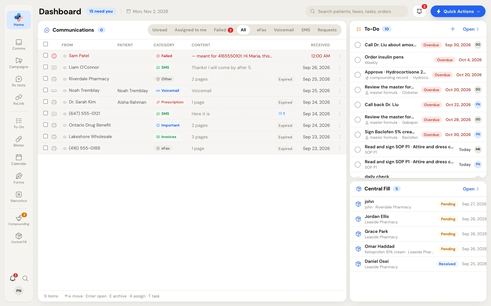
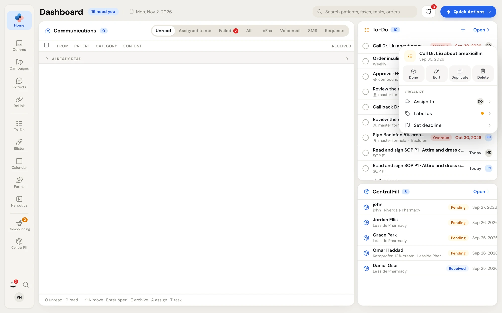
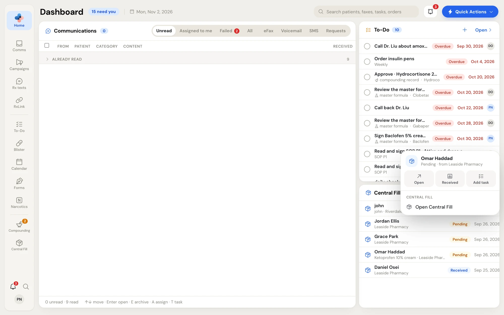

The **Dashboard** is the first page you see after signing in. It brings the day's work together: everything arriving in **Communications** on the left, and your **To-Do** tasks and **Central Fill** orders on the right. Get back to it from any page by clicking **Home** (the PharmaTools logo) at the top of the rail, or by pressing **Alt+D**.

<Frame caption="The Dashboard with the All filter: Communications on the left, To-Do and Central Fill on the right">
  
</Frame>

## The header

| Part | What it does |
| --- | --- |
| **Dashboard** and the blue count | The count adds up your unread Communications items, your open To-Do tasks and your unread Central Fill items. |
| Today's date | For example **Mon, Nov 2, 2026**. |
| **Search patients, faxes, tasks, orders** | Finds faxes, texts, voicemail, patient requests, tasks and Central Fill orders. Click a result to open it. The same search opens from any page with **Ctrl+K** (see [Search](/getting-started/finding-your-way#search)). |
| Bell | Opens **Notifications** (**Shift+N**). See [Notifications](/getting-started/notifications). |
| **Quick Actions** | Create an order, send a fax, start a text, add a task or manage labels. See [Quick Actions](/getting-started/finding-your-way#quick-actions). |

On a narrow window the header folds up: **Quick Actions** shrinks to its bolt, then the date goes, then search shrinks to a magnifying glass.

## The Communications card

The left card lists what has come in: eFax, SMS, voicemail and patient requests. Filters across the top choose what you see:

| Filter | Shows |
| --- | --- |
| **Unread** | Unread items first. Items you've read fold under **Already read** at the bottom. |
| **Assigned to me** | Items assigned to you. |
| **Failed** | Faxes and texts that didn't go through, with a red count. A failed fax shows under **Failed** only. |
| **All** | Everything. |
| **eFax**, **Voicemail**, **SMS**, **Requests** | One kind at a time. **Requests** are refills, transfers and new prescriptions sent from your website. |

Columns are **From**, **Patient**, **Category**, **Content** and **Received**. The footer counts the items and lists the keyboard shortcuts.

### Work with items

- **Open an item**: click it. Its preview opens on the right, in place of the To-Do and Central Fill cards. Opening an item marks it read. Drag the preview's left edge to make it wider or narrower, and close it with its **×**.
- **Already read**: click the **Already read** row to fold or unfold the items you've read. PharmaTools remembers your choice on every computer you sign in on.
- **Row menu**: right-click a row, or click its **⋮**, for its actions (assign, label, add a task, archive and more).
- **Several at once**: tick the boxes on the left, or the box in the header to select every row shown. A bar appears with **Mark read**, **Mark unread**, **Archive** and **Delete**.

The row menu, the preview and the bulk bar work the same way as in Comms. See [Working with items](/communications/working-items).

### Keyboard shortcuts on the Dashboard

| Key | Does |
| --- | --- |
| **↑** / **↓** | Move between rows. |
| **Enter** | Open the highlighted row. |
| **E** | Archive the ticked rows, or the highlighted or open one. |
| **A** | Open **Assign** for the highlighted or open row. |
| **T** | Open the To-Do flyout to add a task linked to the open or highlighted item. |

## The To-Do card

The **To-Do** card lists your tasks and the tasks nobody is assigned to, with the number still open. Turn on **Show All tasks** in **Settings › Profile** to see every task at the pharmacy instead.

Each row shows the task, any repeat (**Weekly**, **Monthly**) or linked item (for example a compounding record or master formula), a red **Overdue** tag when it's late, the due date and the assignee's initials.

- Click the circle to mark a task done. Click it again to reopen it.
- Click a task to open it in **To-Do**. A task to sign a master formula opens the formula.
- Click **+** (**Add a task**) to open the To-Do flyout's quick add.
- Click **Open** to go to the To-Do page.
- Right-click a task for its menu.

<Frame caption="Right-click a task: Done, Edit, Duplicate, Delete, and Assign to, Label as and Set deadline">
  
</Frame>

| Menu item | Does |
| --- | --- |
| **Done** / **Reopen** | Marks the task done, or not done. |
| **Edit** | Opens the task in To-Do. |
| **Open** | Opens the item the task is linked to (shown only for a linked task). |
| **Duplicate** | Makes a copy. |
| **Delete** | Deletes the task. |
| **Assign to**, **Label as**, **Set deadline** | Changes who it's for, its label and its due date. |

When there's nothing to do, the card says **Nothing due today.** Tasks are explained in full in [To-Do](/todo/overview).

## The Central Fill card

Pharmacies with Central Fill see a **Central Fill** card under To-Do. It lists orders in progress with the patient, the other pharmacy, the compound, the status (**Pending**, **Received**) and the date. Requests from other pharmacies to connect are listed on this card too. The count shows how many are unread.

- Click a row to open the order. Click **Open** to go to Central Fill.
- Right-click an order for **Open**, **Received** or **Completed** (to move an incoming order on), **Add task** and **Open Central Fill**. An incoming order also offers **Move back to** its previous status.

<Frame caption="Right-click a Central Fill order: Open, Received, Add task and Open Central Fill">
  
</Frame>

When nothing is moving, the card says **Nothing in progress.**

## Banners at the top of the Dashboard

- **Finish setting up**: for Managers and Admins of a new pharmacy with Setup steps left. Click **Continue setup**. See [Set up your pharmacy](/getting-started/setup#after-setup).
- **Your last payment didn't go through** or **Your bank returned a payment**: shown when a payment failed. See [When a payment fails](/getting-started/plan-and-billing#when-a-payment-fails).

Click **×** on a banner to hide it for now.
