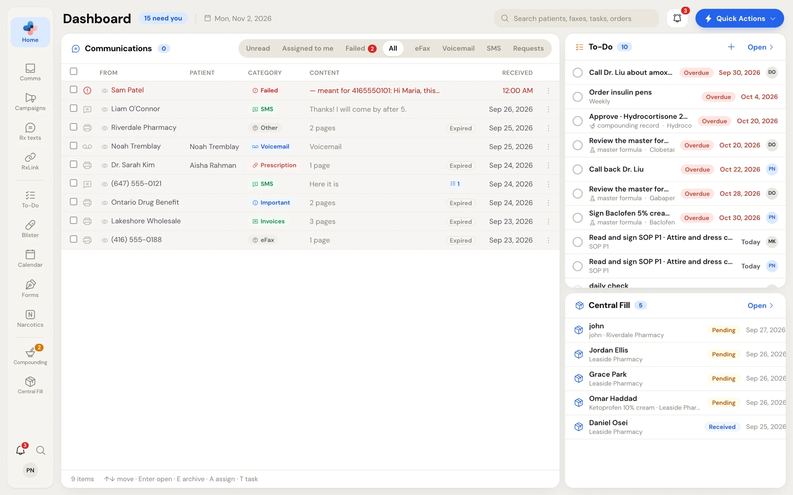
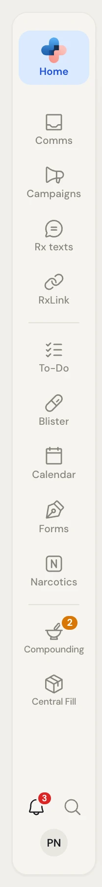
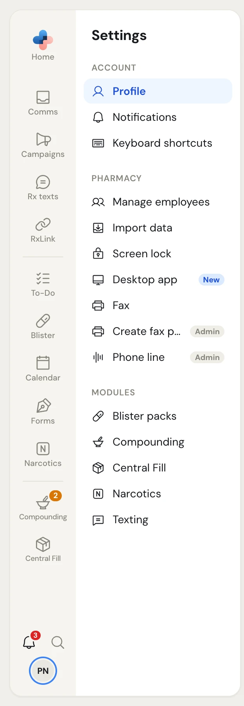
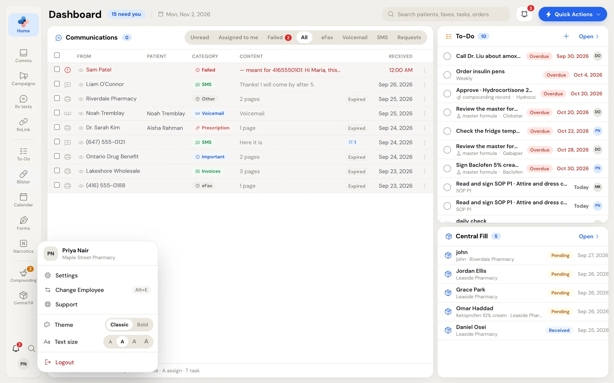
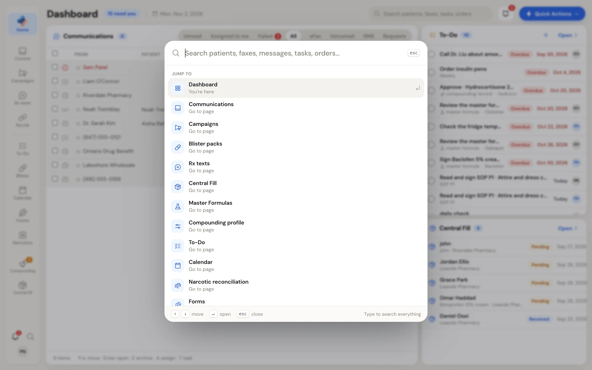
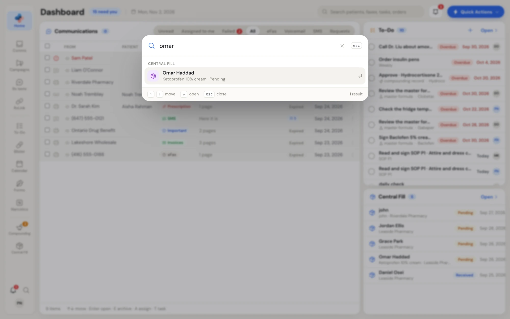
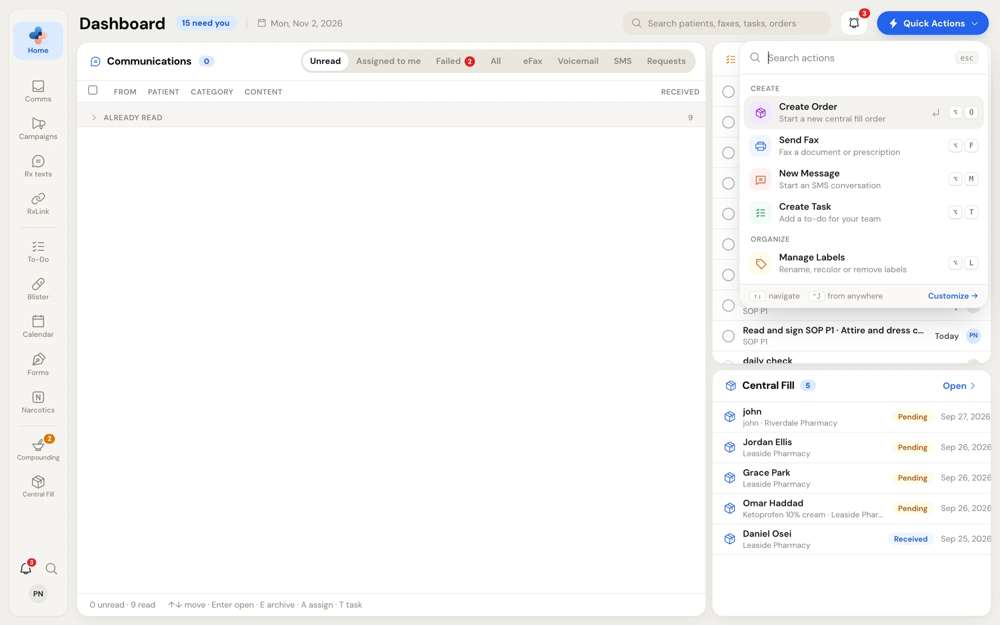
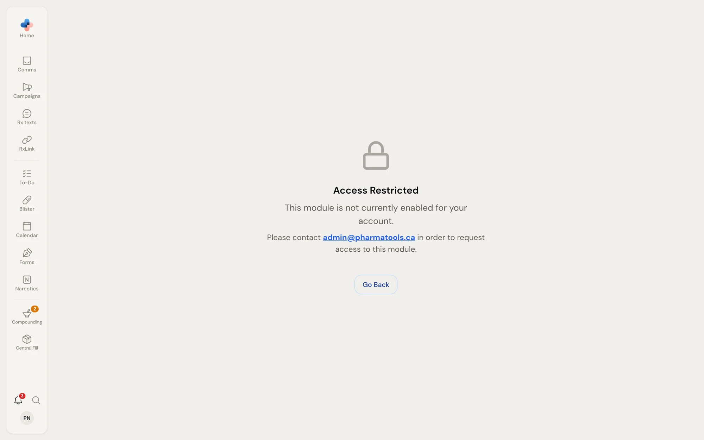

Every page in PharmaTools has the same frame: the **rail** down the left edge, a module's **side menu** beside it, and the page itself on the right. This page explains each part and the tools you can open from anywhere.

<Frame caption="The PharmaTools frame: the rail on the left and the Dashboard on the right">
  
</Frame>

## The rail

The rail lists your modules in three groups (communications, daily operations, compounding and Central Fill), with a short name under each icon. The page you're on is highlighted.

<Frame caption="The rail: Home at the top, the modules in three groups, then the To-Do bell, search and your initials">
  
</Frame>

| Tile | Opens |
| --- | --- |
| **Home** (the PharmaTools logo) | The [Dashboard](/getting-started/dashboard). Shortcut **Alt+D**. |
| **Comms** | The Communications inbox: faxes, texts, voicemail and patient requests. See [Comms inbox](/communications/overview). |
| **Campaigns** | Text campaigns to opted-in patients. Only shown when your pharmacy has Campaigns. See [Campaigns](/campaigns/overview). |
| **Rx texts** | Ready-for-pickup texts and refill reminders. Only shown when it's available to your pharmacy. See [Rx texts](/rx-texts/overview). |
| **RxLink** | Team chat between employees, and your connections with other pharmacies. See [RxLink](/rxlink/overview). |
| **To-Do** | Your pharmacy's tasks. See [To-Do](/todo/overview). |
| **Blister** | Blister pack fills and checks. Only shown when it's available to your pharmacy. See [Blister packs](/blister-packs/overview). |
| **Calendar** | To-Do tasks by week or month. See [Calendar](/todo/calendar). |
| **Forms** | Patient forms signed on a phone. See [Forms](/forms/overview). |
| **Narcotics** | Narcotic reconciliation. See [Narcotic reconciliation](/narcotics/overview). |
| **Compounding** | Master formulas, compounding records, calculators and compounding setup. See [Compounding](/compounding/overview). |
| **Central Fill** | Orders between your pharmacy and its central fill partners. See [Central Fill](/central-fill/overview). |

### What the marks on a tile mean

- **A number** on **RxLink** counts your unread Team chat messages. A number on **Compounding** counts the formulas and records waiting for you (to sign, fix, check or approve). Hover over the tile to see what they are.
- **A dot** on **Comms** means there are unread items or a pharmacy is asking to connect. A dot on **RxLink** or **Central Fill** means a pharmacy is asking to connect.
- **A padlock** means the module isn't in your plan. Hovering says **not included in your plan**. Clicking it opens the **Access Restricted** page (see [Locked modules](#locked-modules)).

On a short screen or with a large text size, the rail drops the names and shows icons only. Hover over an icon to see its name and its count.

### The bottom of the rail

| Control | What it does |
| --- | --- |
| **Bell** (To-Do) | Opens the To-Do flyout over the page, with the count of your open tasks (red when one is overdue). Shortcut **Shift+T**. See [The To-Do flyout](/todo/flyout). |
| **Magnifying glass** | Opens search. Shortcut **Ctrl+K**. See [Search](#search). |
| **Your initials** | Opens your account menu. A red dot means PharmaTools Support replied to one of your tickets. |

<Note>
  The bell on the rail is the **To-Do flyout**. The bell in the top-right corner of a page is **Notifications**. See [Notifications](/getting-started/notifications).
</Note>

## A module's side menu

Most modules have a side menu next to the rail. It lists the module's views and sections, often with counts, and the selected rail tile joins onto it like a folder tab. For example, **Settings** lists **Account**, **Pharmacy** and **Modules** sections.

<Frame caption="A side menu: Settings, with the selected section highlighted">
  
</Frame>

Click a row to open that view. Some side menus have a main button at the top (for example, a **New** button) and items you can right-click for more actions. Each module's guide covers its own side menu.

## Your account menu

Click your initials at the bottom of the rail.

<Frame caption="The account menu: Settings, Change Employee, Support, Theme, Text size and Logout">
  
</Frame>

| Item | What it does |
| --- | --- |
| Your name and pharmacy | Who is signed in now, and at which pharmacy. |
| **Settings** | Opens Settings. See [Settings overview](/settings/overview). |
| **Change Employee** | Hands the computer to someone else (**Alt+E**). See [Switch employee](/getting-started/signing-in#switch-employee). |
| **Support** | Your pharmacy's tickets with the PharmaTools team. Shows **New reply** when the team answered. See [Get help from Support](/getting-started/support). |
| **Theme** | **Classic** (warm paper, white headers, blue actions) or **Bold** (navy rail and headers, coral actions). |
| **Text size** | Four sizes, from small to extra large. |
| **Logout** | Ends your session. The computer stays signed in to your pharmacy. |

Your theme and text size are saved for you and follow you to every computer you sign in on. More choices (font and row spacing) are in [Appearance](/settings/appearance).

## Search

Press **Ctrl+K** on any page, or click the magnifying glass on the rail, to open search over the page.

<Frame caption="Search before you type: pages to jump to and everyday actions">
  
</Frame>

- **Before you type**, it lists **Jump to** (every page you can open) and **Actions**: **New message**, **Send fax**, **New task**, **New campaign** (with Campaigns) and **Contact support**.
- **As you type**, it finds patients, faxes, messages, tasks and Central Fill orders, grouped under **Communications**, **Tasks**, **Central Fill** and **Pages**.
- Use **↑** and **↓** to move, **Enter** to open and **Esc** to close. The **×** clears what you typed.

<Frame caption="Search results grouped by where they were found">
  
</Frame>

The Dashboard also has its own search box in its header, **Search patients, faxes, tasks, orders**, with the same results.

## Quick Actions

The blue **Quick Actions** button (a lightning bolt) sits at the top right of most pages, next to the notification bell. On a narrow page it shrinks to the bolt alone. Press **Ctrl+J** to open it from anywhere.

<Frame caption="Quick Actions: create and organize from any page, each with its own shortcut">
  
</Frame>

| Action | Shortcut | What it does | Shown when |
| --- | --- | --- | --- |
| **Create Order** | Alt+O | Starts a new Central Fill order. | Your pharmacy has Central Fill. |
| **Send Fax** | Alt+F | Opens the fax composer. | Always. |
| **New Message** | Alt+M | Starts a text conversation with a patient. | Your pharmacy has its own texting number. |
| **Create Task** | Alt+T | Opens the To-Do quick add. | Always. |
| **Manage Labels** | Alt+L | Rename, recolour or remove labels. | Always. |

Type in **Search actions** to filter the list, use the arrow keys and **Enter** to run one, and **Esc** to close. The action shortcuts work from any page, even with the menu closed. Click **Customize** to change the keys. See [Keyboard shortcuts](/settings/keyboard-shortcuts).

## Shortcuts that work everywhere

| Keys | Does |
| --- | --- |
| **Ctrl+K** | Open or close search. |
| **Ctrl+J** | Open Quick Actions (you can change this key). |
| **Alt+D** | Go to the Dashboard. |
| **Alt+E** | Change employee. |
| **Alt+N** | Open the full new-task form. |
| **Shift+T** | Open or close the To-Do flyout. |
| **Shift+N** | Open or close Notifications. |
| **Alt+O**, **Alt+F**, **Alt+M**, **Alt+T**, **Alt+L** | Run a Quick Action (see the table above). |

On a Mac, press **Option** for Alt. Single-key shortcuts don't fire while you're typing in a box.

## Locked modules

If your pharmacy doesn't have a module, its rail tile shows a padlock. Opening it shows **Access Restricted**: "This module is not currently enabled for your account." To add it, a Manager or Admin turns it on in **Settings › Plan & modules** (see [Plan, modules and billing](/getting-started/plan-and-billing)), or you email admin@pharmatools.ca as the page says. Click **Go Back** to return to the page you were on.

<Frame caption="Access Restricted: shown when you open a module your pharmacy doesn't have">
  
</Frame>

<Info>
  While a new pharmacy is still in Setup, every module is padlocked and only **Setup** and **Support** open. See [Set up your pharmacy](/getting-started/setup#when-pharmatools-opens).
</Info>
