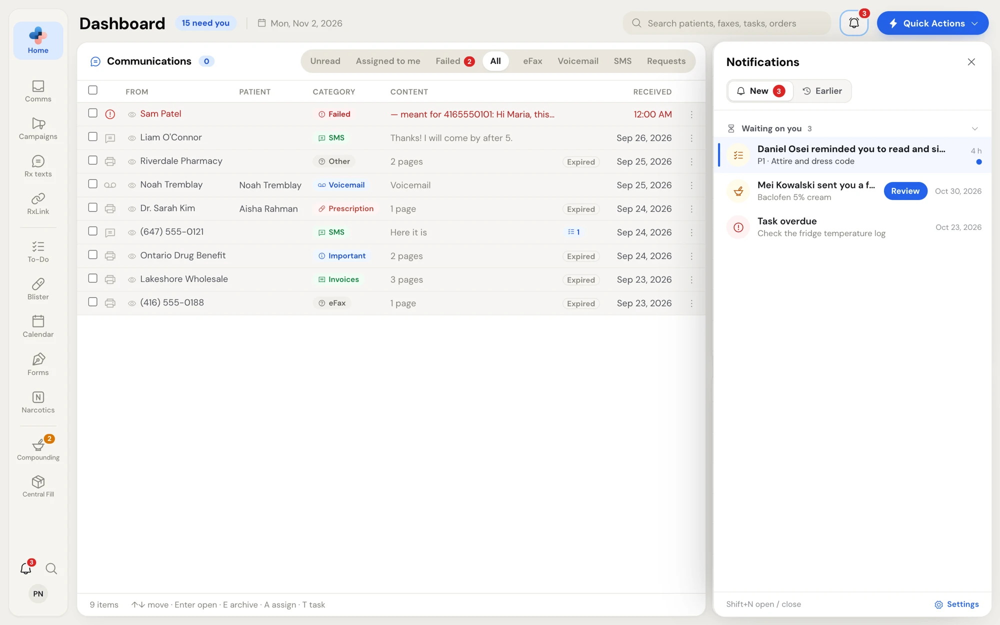
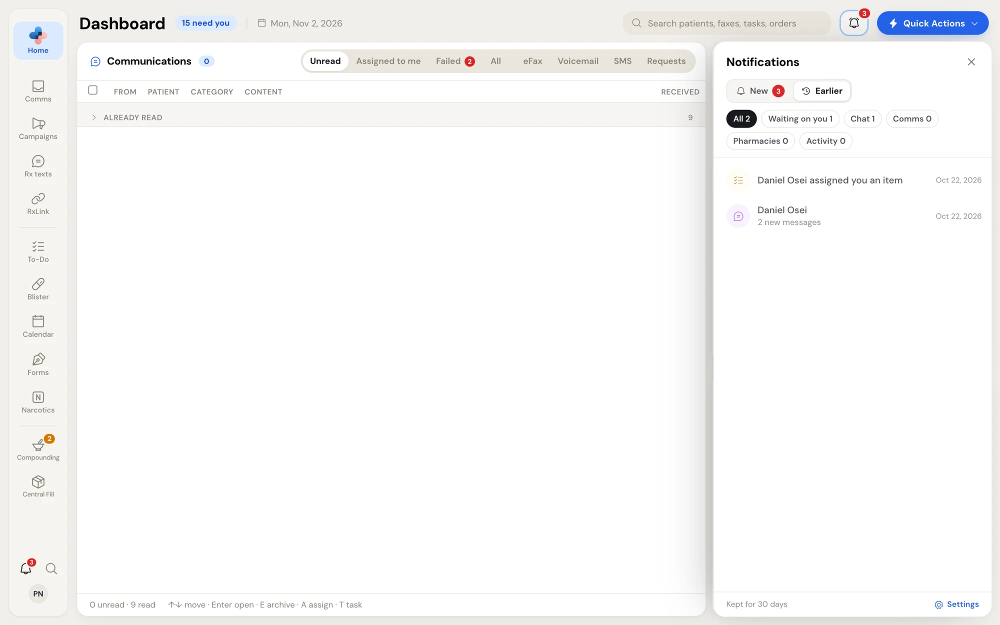

PharmaTools tells you about new faxes, texts, voicemail, patient requests, Team chat messages, tasks and records waiting for you, connection requests and support replies. Each one lands in the **Notifications** drawer, and most also pop up for a moment in the bottom corner of the screen.

## Open Notifications

Click the **bell** at the top right of a page, next to **Quick Actions**, or press **Shift+N** on any page. A red number on the bell counts what's new. The drawer opens on the right without covering the page you're working on. Close it with **×** or **Esc**.

<Note>
  The bell at the bottom of the rail is a different one: it opens the To-Do flyout. See [The To-Do flyout](/todo/flyout).
</Note>

## New

**New** holds unread news and the work still waiting for you, grouped by kind. Click a group name to fold it away.

<Frame caption="Notifications › New: work waiting for you comes first">
  
</Frame>

| Group | What lands there |
| --- | --- |
| **Waiting on you** | Compounding records and master formulas waiting for you, tasks assigned to you, and tasks that went overdue (once, the morning they go overdue). |
| **Team chat** | Messages to you or to your groups. |
| **Communications** | New eFax, text messages, voicemail and patient requests from your website. |
| **Pharmacies & support** | RxLink and Central Fill connection requests, and replies from PharmaTools Support. |
| **Your activity** | Something you did didn't go through: a fax or text that didn't send, or a save that failed. |

Each row shows what happened, the detail (the contact's name, the start of the text, the formula), and how long ago. Unread rows are tinted with a blue edge and a dot.

- **Click a row** to go straight to the item: the fax, the conversation, the task, the record.
- **A button on the row** leads to the thing to do: **Review** (a record or formula to check), **Fix** (a formula sent back to you), **View** (a connection request) or **Open**.
- **×** on a row (**Clear — move to Earlier**) moves news out of New.
- **Clear all** moves everything that isn't work to do to **Earlier**.
- On a read fax, text, voicemail or patient request, hover the **eye** to see who opened it and when, for example **Opened by** and the time.

<Info>
  Work waiting for you (a record to sign, a task) can't be cleared by hand. It stays under **Waiting on you** until it's done.
</Info>

When New is empty it says **You're all caught up**, with a link to **See Earlier** if there's anything there.

## Earlier

**Earlier** keeps read and finished notifications for 30 days, newest first.

<Frame caption="Notifications › Earlier: the last 30 days, with a chip for each group">
  
</Frame>

Click a chip to filter: **All**, **Waiting on you**, **Chat**, **Comms**, **Pharmacies** or **Activity**. Every chip keeps its count, so you can see what a filter hides. On a row, **Move back to New** undoes a clear.

## Pop-ups in the corner

A new notification also pops up as a small dark card in the bottom corner of the screen.

- It shows who it's from and what kind it is, for example a new eFax from a clinic with its page count. It never shows the text of a message or a patient's name, because the screen may face the counter. The full detail is in the drawer.
- Click the card to open the item, or use its button (**Review** for a record, **View** for a fax or connection request). Click **×** (**Dismiss**) to close it.
- Up to three cards show at once. After that a line such as **+4 more** counts the rest, and they wait in the drawer.
- The same corner shows short confirmations from your own actions, such as **Archived** with **Undo**.

## Choose what pops up and what rings

Each person chooses, for each kind of notification, whether it pops up and whether it plays a sound. Click **Settings** at the bottom of the drawer, or go to **Settings › Notifications**. Out of the box, everything pops up except overdue tasks, and only voicemail and patient requests play a sound. Every notification is kept in the drawer whatever you choose. See [Notification settings](/settings/notifications).

## Keyboard

| Key | Does |
| --- | --- |
| **Shift+N** | Open or close Notifications. |
| **Esc** | Close the drawer. |
