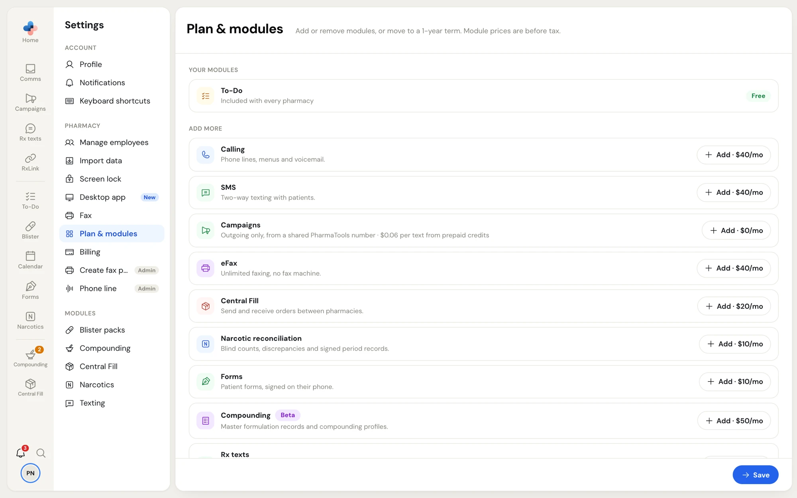
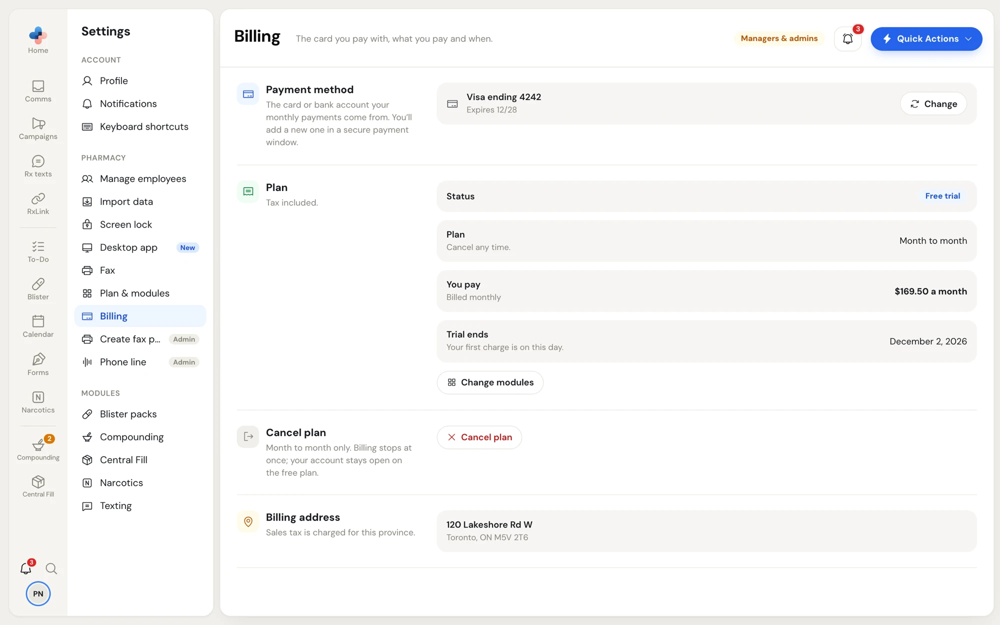
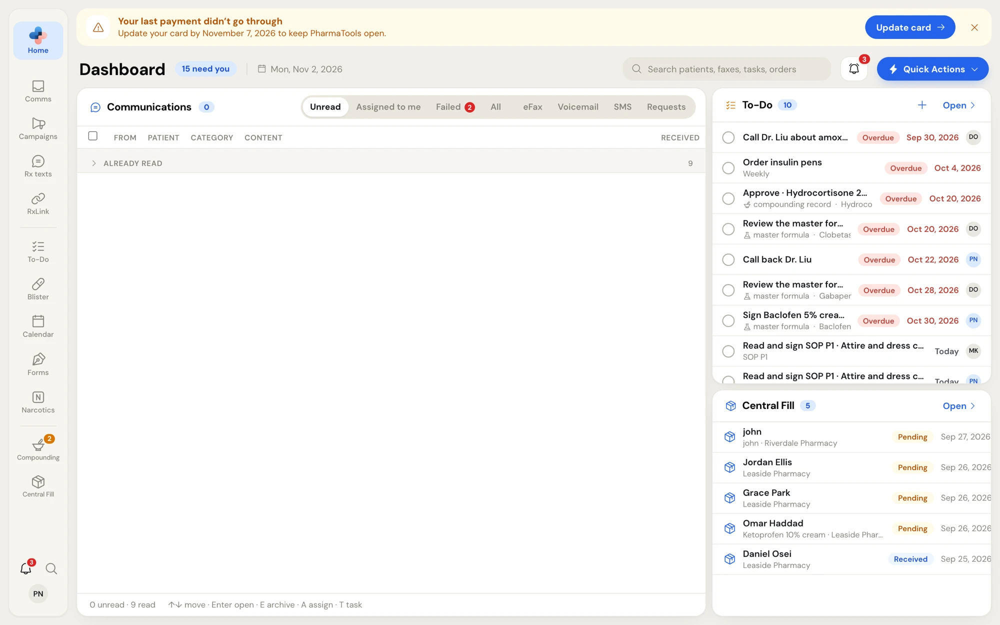
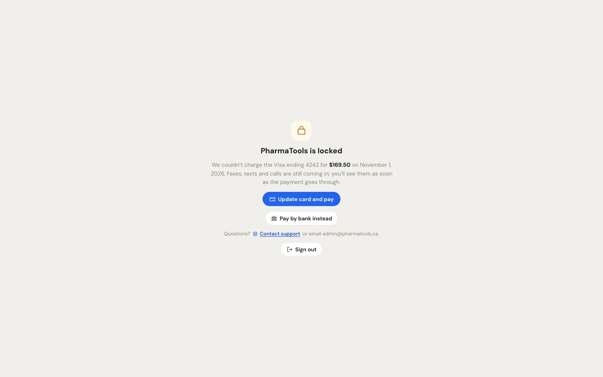

Two Settings sections handle what your pharmacy pays for:

- **Settings › Plan & modules**: which modules you have and your billing term.
- **Settings › Billing**: the card or bank account you pay with, what you pay and when, and cancelling.

Both are for **Managers** and **Admins**. Other staff don't see them in Settings. A new pharmacy picks its first modules in [Setup](/getting-started/setup) instead.

## Plan & modules

Open **Settings › Plan & modules**. Prices on this page are before tax.

<Frame caption="Settings › Plan & modules: what you have under Your modules, and what you can add under Add more">
  
</Frame>

The page has three parts:

- **Billing term**: **Month to month** (add or remove modules any time) or **1-year term** (phone lines are $30 instead of $40, and modules can't be removed until the term ends; you can still add modules and lines). A 1-year term moves to month to month by itself when it ends.
- **Your modules**: what your pharmacy has now. **To-Do** is included with every pharmacy.
- **Add more**: the modules you could add, each with its monthly price. Desktop add-ons are listed under **For PharmaTools Desktop** (Fax sender, Fax downloader and Windows Fax interceptor); each needs the PharmaTools Desktop app on a PC, with a **Get the app** link.

For module prices and options, see the table in [Set up your pharmacy](/getting-started/setup#step-1-modules).

### Change your modules

<Steps>
  <Step title="Mark your changes">
    Click **Add** on a module under **Add more**, or **Remove** on one under **Your modules**. Adjust options and quantities (such as **Phone lines**, **Fax lines** or **Sender seats**) on the module's card. Each card is marked with what changes and what it does to your monthly price.
  </Step>
  <Step title="Check the total">
    The footer counts your changes and shows the monthly amount before and after, and what is charged today. Click **Discard** to undo every change.
  </Step>
  <Step title="Save">
    If you pay by card or bank account, click **Review changes**. The **Review your plan change** window shows what changes, the new monthly amount and anything **Charged today**. Click **Confirm change**, or **Pay $… and confirm** when something is charged today.

    If you're billed by invoice, click **Save changes**.
  </Step>
</Steps>

What to expect:

- **Adding** a module switches it on once confirmed. The part of the month already started may be charged today.
- **Removing** a module keeps it on until the end of the period you've paid for; its card shows **Stays on until** that date.
- **Campaigns** is included with SMS and can't be removed on its own while you have SMS. If you remove SMS, Campaigns stays on and texts go out one way from a shared PharmaTools number.
- **Compounding**: turning it off ends the $50 a month beta price. Turning it on again later is $100 a month.
- **Central Fill**: a pharmacy on a 1-year term can't switch to only sending until the term ends.

<Note>
  A pharmacy billed by invoice sees "You're billed by invoice." on this page. Changes you save go to the PharmaTools team, who switch modules on and update your invoice.
</Note>

## Billing

Open **Settings › Billing**. It appears once your pharmacy pays by card or bank account.

<Frame caption="Settings › Billing: payment method, plan, cancelling and the billing address">
  
</Frame>

| Section | What it shows | What you can do |
| --- | --- | --- |
| **Payment method** | The card (with its expiry) or bank account (**Pre-authorized debit**) your monthly payments come from. | **Change** opens a secure payment window to add a new card or bank account. PharmaTools never sees the numbers. |
| **Plan** | **Status** (**Free trial**, **Active**, **Payment due**, **Cancelled**, or **Ends** and a date), the plan (**Month to month** or **1-year term to** a date), **You pay** (tax included, billed monthly), **Trial ends** or **Next charge**. | **Change modules** opens Plan & modules. |
| **Cancel plan** | Month to month plans only. | See [Cancel your plan](#cancel-your-plan). |
| **Billing address** | The address on file. Sales tax is charged for this province. | |

A new bank account starts paying once the payer approves the pre-authorized debit agreement emailed to them. Until then the page shows the payment as waiting for that approval.

### Cancel your plan

1. In **Cancel plan**, click **Cancel plan**.
2. Read the note: nothing more is charged, and your paid modules stay on until the end of your trial or the period you've paid for, then switch off.
3. Type the **Pharmacy password** (the one the pharmacy signs in with) and click **Yes, cancel**. Click **Keep my plan** to back out.

After cancelling, the status shows **Ends** and the date. Until then you can click **Undo cancellation**. Your account stays open on the free plan; To-Do keeps working.

To come back later, click **Start paid modules again**: you choose modules in Setup and pay again. There's no new free trial. A 1-year term can't be cancelled before it ends.

## When a payment fails

If a charge doesn't go through, Managers and Admins see a banner at the top of every page:

<Frame caption="The banner after a declined card, with the date PharmaTools locks unless it's paid">
  
</Frame>

- **Your last payment didn't go through**: click **Update card**. Updating the card charges the missed payment right away. You can also pay it from a bank account instead.
- **Your bank returned a payment**: click **Pay now** to pay what's owed by card or bank account. It includes a $5 returned-payment fee. Your monthly payments then come from whichever you use.

The banner says the date by which to pay to keep PharmaTools open. Click **×** (**Hide for now**) to hide it for a while.

### PharmaTools is locked

If the payment still isn't made by that date, PharmaTools locks for everyone at the pharmacy and only the billing screen opens.

<Frame caption="PharmaTools is locked: pay what's owed to open it again">
  
</Frame>

- Faxes, texts and calls still come in. You'll see them as soon as the payment goes through.
- A Manager or Admin clicks **Update card and pay** or **Pay by bank instead** (or **Pay what's owed** after a returned bank payment). PharmaTools opens again once the payment goes through.
- Anyone else sees "Ask a manager at your pharmacy to update the card." (or to pay what's owed).
- **Contact support** opens a new support ticket, and **Sign out** signs you out.

<Tip>
  Questions about a charge? Open a ticket under **Billing & plan** from [Support](/getting-started/support), or email admin@pharmatools.ca.
</Tip>
