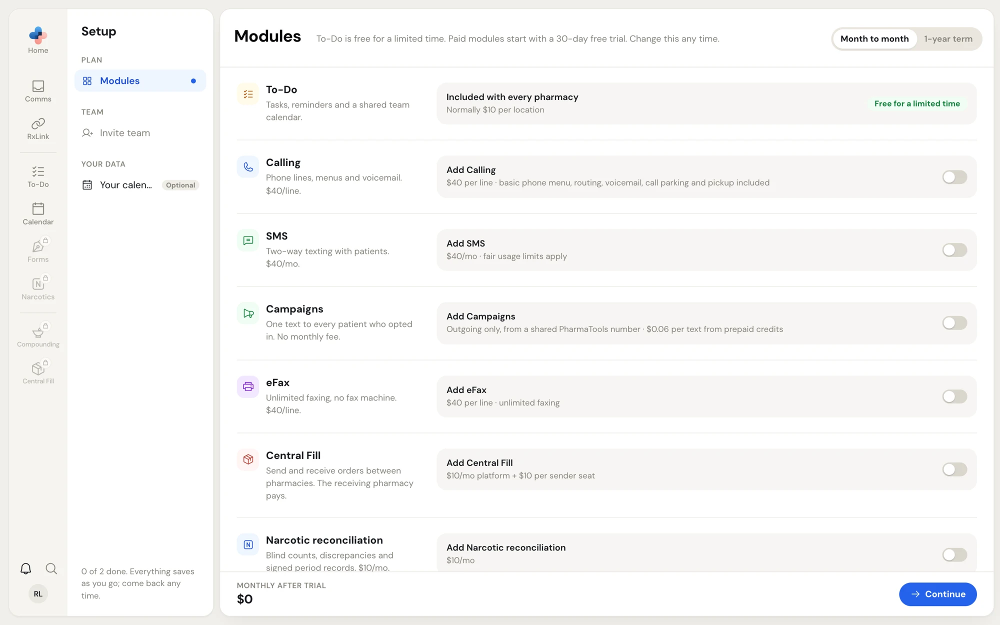
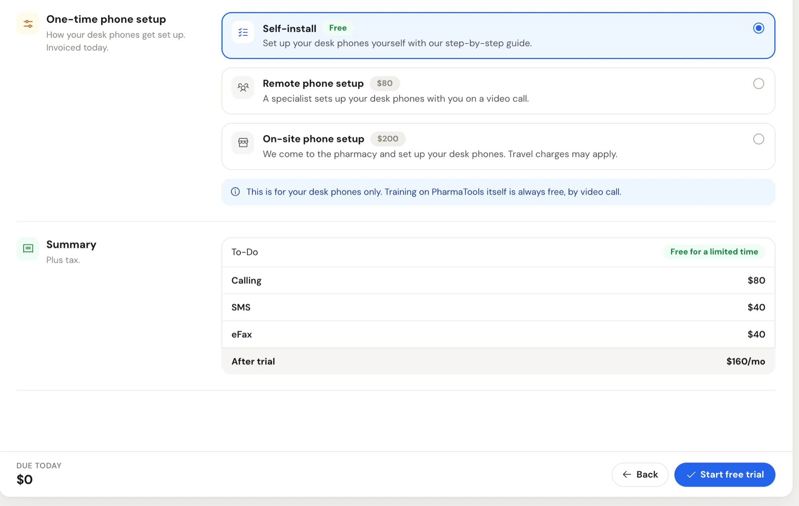
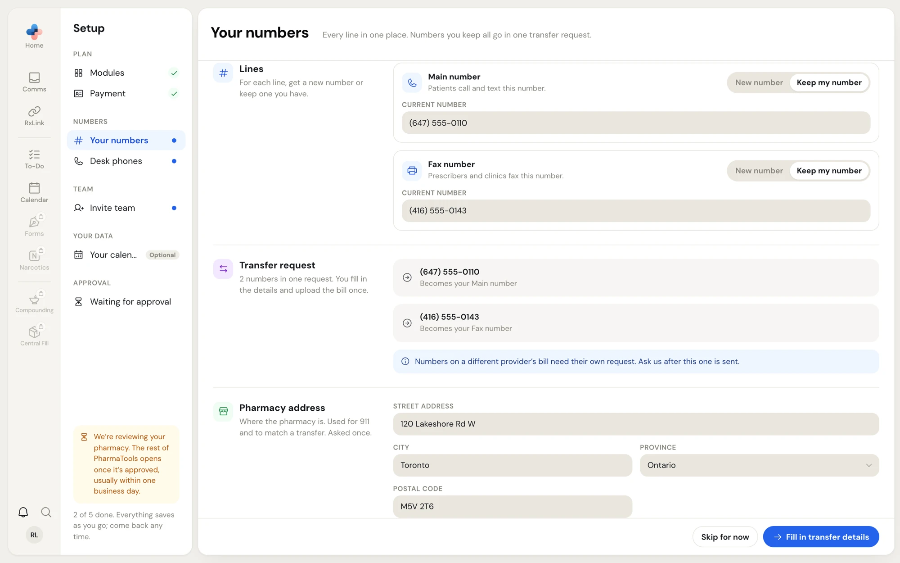
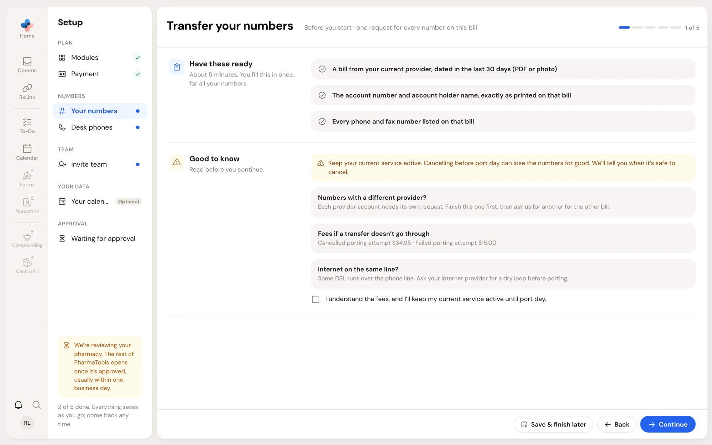
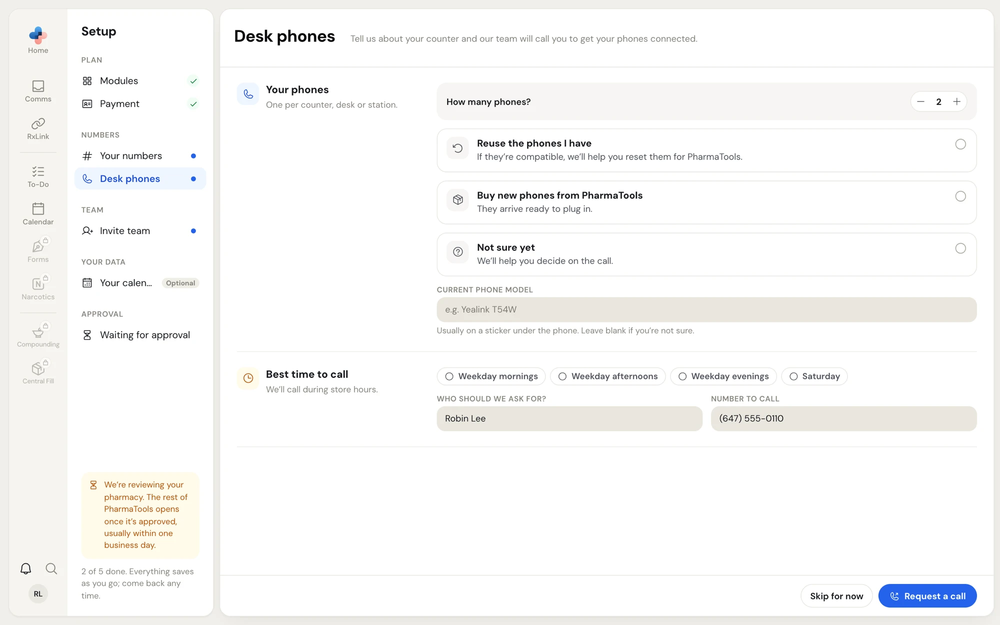
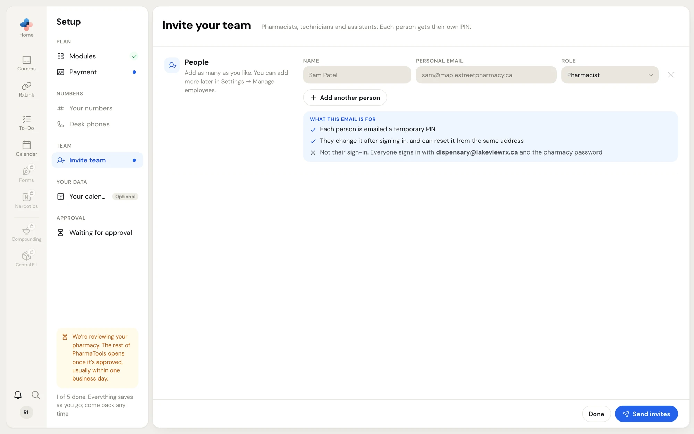
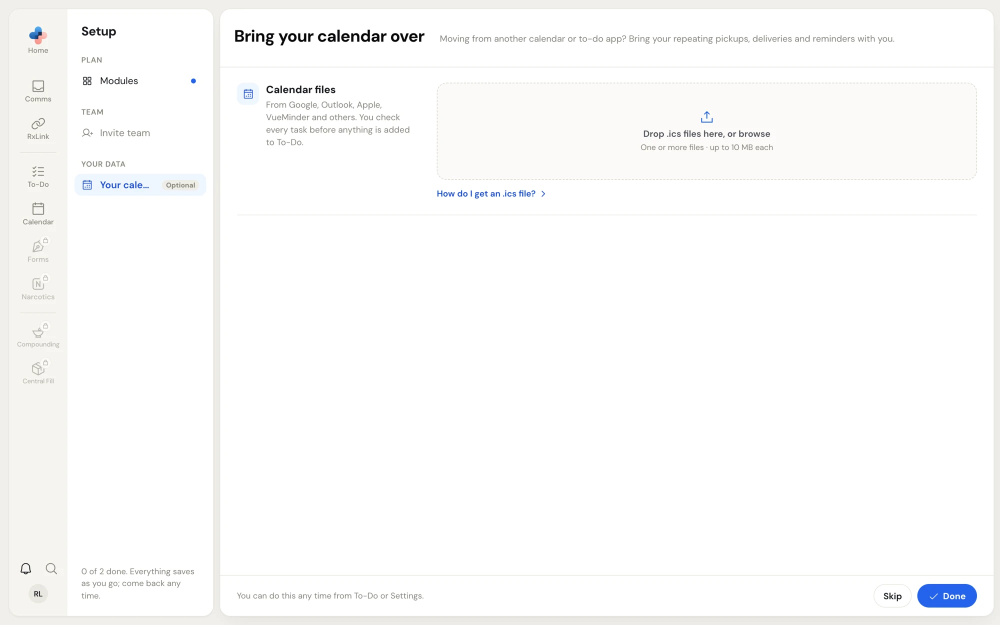
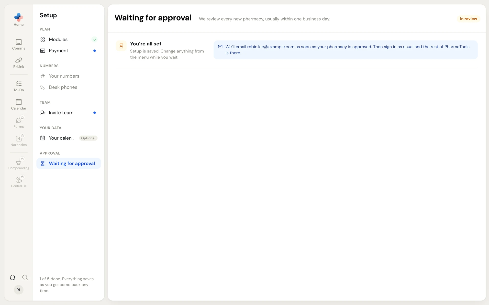

**Setup** is the checklist a new pharmacy finishes after [signing up](/getting-started/sign-up). It opens by itself the first time you sign in. Every step saves as you go, so you can leave and come back from any computer.

<Frame caption="Setup › Modules: the steps on the left, the module list on the right and the monthly total at the bottom">
  
</Frame>

## Who can do Setup

Only a **Manager** or **Admin** can work on Setup, because it changes what the pharmacy pays for and signs. Anyone else who signs in before the pharmacy opens sees **Setup is for managers** and a note to ask a manager or admin to finish it.

## How Setup works

The menu on the left lists the steps in groups. Which steps appear depends on the modules you choose:

| Group | Step | Appears when |
| --- | --- | --- |
| **Plan** | **Modules** | Always. |
| **Plan** | **Payment** | Your plan costs something (any paid module, or a paid phone setup). |
| **Numbers** | **Your numbers** | You chose Calling, SMS or eFax. |
| **Numbers** | **Desk phones** | You chose Calling. |
| **Team** | **Invite team** | Always. |
| **Your data** | **Your calendar** | Always for a Manager or Admin. Marked **Optional**. |
| **Approval** | **Waiting for approval** | Until PharmaTools has approved your pharmacy. |

Each step shows a mark on the right:

- A **green tick**: the step is done.
- A **blue dot**: the step still needs doing.
- An **amber** mark: you sent it and someone else is acting on it (for example, a number transfer waiting on your current phone provider).
- **Greyed out**: not available yet. Payment and Invite team open after you save your modules. Your numbers and Desk phones open after the Payment step.

The bottom of the menu counts your progress, for example **2 of 5 done**. The optional calendar step isn't counted.

<Note>
  Until your pharmacy is approved, Setup and **Support** are the only pages you can open. The other tiles on the left rail show a padlock. See [When PharmaTools opens](#when-pharmatools-opens).
</Note>

## Step 1: Modules

Turn on each module you want with the switch on its card. When a module has options, they appear under it once it's on.

| Module | Price | Options |
| --- | --- | --- |
| **To-Do** | Free for a limited time (normally $10 per location) | Included with every pharmacy. |
| **Calling** | $40 per phone line a month ($30 on a 1-year term) | **Phone lines** (how many calls can happen at once), **Hold message** (first script free, then $15 per change), **Visual voicemail**, **Refill line**, **Conversational AI phone menu**. |
| **SMS** | $40 a month | **MMS**, **Secure portal**, **AI chatbot**. Uses the same number as Calling. |
| **Campaigns** | No monthly fee | $0.06 per text from prepaid credits. Included with SMS. Without SMS, texts go out one way from a shared PharmaTools number. |
| **eFax** | $40 per fax line a month | **Fax lines** (one fax number per line), **AI/OCR fax sorting**. |
| **Central Fill** | $10 a month platform fee plus $10 per sender seat | **Your pharmacy**: **Receives orders** or only sends. A pharmacy that only sends pays nothing; the receiving pharmacy pays. |
| **Narcotic reconciliation** | $10 a month | |
| **Forms** | $10 a month | |
| **Compounding** (Beta) | $50 a month beta price for the first 20 pharmacies, $100 a month after that | You keep the $50 price as long as Compounding stays on. |

At the top right, pick **Month to month** or **1-year term**. A 1-year term lowers phone lines to $30, but modules can't be removed until the term ends.

The bottom of the page shows **Monthly after trial**, the total you'll pay each month once the trial ends. Click **Continue** to save your choice. PharmaTools emails the summary to its team.

<Tip>
  You can change modules any time later in **Settings › Plan & modules**. See [Plan, modules and billing](/getting-started/plan-and-billing).
</Tip>

## Step 2: Payment

The Payment step only appears when your plan costs something.

<Frame caption="Setup › Payment: how your desk phones get set up and the summary of what you'll pay after the trial">
  
</Frame>

<Steps>
  <Step title="Choose your one-time phone setup (Calling only)">
    - **Self-install**: free. You set up your desk phones yourself with a step-by-step guide.
    - **Remote phone setup**: $80. A specialist sets up your desk phones with you on a video call.
    - **On-site phone setup**: $200. Someone comes to the pharmacy. Travel charges may apply.

    This covers your desk phones only. Training on PharmaTools itself is always free, by video call.
  </Step>
  <Step title="Add your billing address">
    Fill in **Billing street address**, **City**, **Province** and **Postal code**. Sales tax is charged for this province.
  </Step>
  <Step title="Check the summary and agree to the terms">
    **Summary** lists each module and the monthly total after the trial. **Due today** shows what is charged now: $0, or the phone setup fee if you chose one. Tick the box under the summary to agree to the charges. **Read the Terms of Service** opens the payment terms in a new tab.
  </Step>
  <Step title="Add your payment method">
    Click **Add payment and start trial** (or **Pay $… and start trial** when something is due today). A secure payment window opens where you enter a card or a bank account. PharmaTools never sees the numbers.
  </Step>
</Steps>

What happens next:

- **Card:** the trial starts at once and the step shows **Trial started**. PharmaTools opens for your team right away. Click **Continue**.
- **Bank account:** you get an email asking you to approve a pre-authorized debit agreement. The button reads **Waiting for bank approval** until you approve it. The trial starts, and your modules switch on, the day you approve it.
- **Closed the payment window:** nothing is changed or charged. Try again when you're ready.

<Note>
  Paying online isn't available in Saskatchewan yet. A Saskatchewan pharmacy emails admin@pharmatools.ca to set up billing.
</Note>

<Info>
  If online payment isn't switched on for your pharmacy, the Payment step instead says the trial starts today and that an invoice is emailed to the owner before the trial ends. Click **Start free trial**.
</Info>

## Step 3: Your numbers

**Your numbers** lists every phone and fax line your modules need:

- **Main number** (Calling and SMS share it), or **Calling number** or **Texting number** when you have only one of them.
- **Fax number** (one per fax line).

<Frame caption="Setup › Your numbers with both lines set to Keep my number: the numbers go into one transfer request">
  
</Frame>

For each line, choose:

- **New number**: pick **By area code** (type the 3-digit **Area code**) or **By city** (pick **Province** and **City**). Local numbers are included with your line.
- **Keep my number**: type the **Current number**. Every number you keep goes into one **Transfer request**, and each row says which line it becomes, for example **Becomes your Fax number**.

Then fill in the **Pharmacy address**. It's used for 911 calls and to match a transfer, and you only enter it once.

Click the button at the bottom right:

- **Request number** or **Request numbers** sends the new-number request. The line shows **Requested** and the note "We're setting it up and will email you the number."
- **Fill in transfer details** opens the transfer form for the numbers you keep.
- **Skip for now** leaves the step for later.

### Transfer the numbers you keep

The transfer form has five parts. **Save & finish later** keeps what you typed; continue it from **Setup › Your numbers** with **Continue transfer (step N of 5)**.

<Frame caption="Transfer your numbers, part 1 of 5: what to have ready and the fees if a transfer doesn't go through">
  
</Frame>

<Steps>
  <Step title="Before you start">
    Have a bill from your current provider dated in the last 30 days (PDF or photo), the account number and account holder name exactly as printed on it, and every phone and fax number listed on that bill. Read **Good to know**:

    - Keep your current service active. Cancelling before port day can lose the numbers for good. PharmaTools tells you when it's safe to cancel.
    - Numbers on a different provider's bill need their own request. Finish this one first, then ask PharmaTools for another.
    - Fees if a transfer doesn't go through: cancelled porting attempt $34.95, failed porting attempt $15.00.
    - If your internet runs over the same phone line (some DSL does), ask your internet provider for a dry loop before porting.

    Tick **I understand the fees, and I'll keep my current service active until port day.**
  </Step>
  <Step title="Current provider">
    **Current provider**, **Account number** and **Account holder name** exactly as printed on your bill (a mismatch is the most common reason a provider rejects a transfer). Add a **Service address** if the lines are installed somewhere other than the billing address, and who authorizes the transfer: **Name** and **Email for transfer updates**.
  </Step>
  <Step title="Numbers on the bill">
    Check the numbers **Moving to PharmaTools**. Leave **Move texting (SMS) too** on so patients can text the number they already know. Under **Other numbers on the same bill**, add every other number on that bill and choose what happens to it, such as **Keep with current provider**. Providers reject requests that leave numbers out.
  </Step>
  <Step title="Upload bill">
    Upload the **Recent bill**: one bill covers every number in this request. It must be dated in the last 30 days and be under 10 MB.
  </Step>
  <Step title="Review & sign">
    Check the details against your bill. Pick a **Port date**: **As soon as possible** (your provider sets the first available business day) or a date of your own (business days only). Type your full name to sign the **Letter of authorization**, tick **I've checked the details and authorize this transfer.**, then click **Submit transfer**.
  </Step>
</Steps>

After you submit, **Your numbers** shows the request as **Waiting on provider**, then **Approved**, then **Moved** once the numbers are on PharmaTools. Updates are emailed to the address you gave.

## Step 4: Desk phones

This step appears with Calling. Tell PharmaTools about your counter and its team calls you to get the phones connected. Everything else works in the meantime; calls start once your phones are connected.

<Frame caption="Setup › Desk phones: how many phones, whether to reuse or buy them, and when to call you">
  
</Frame>

1. Set **How many phones?** (one per counter, desk or station).
2. Pick **Reuse the phones I have**, **Buy new phones from PharmaTools** or **Not sure yet**. When reusing, add the **Current phone model** if you know it (usually on a sticker under the phone).
3. Pick one or more **Best time to call**: **Weekday mornings**, **Weekday afternoons**, **Weekday evenings** or **Saturday**.
4. Fill in **Who should we ask for?** and **Number to call**.
5. Click **Request a call**, or **Skip for now**.

The step then shows **Call requested** with what happens next. Click **Edit details** to change them.

## Step 5: Invite team

Add the pharmacists, technicians and assistants who work with you. Each person gets their own PIN.

<Frame caption="Setup › Invite team: name, personal email and role for each person">
  
</Frame>

1. For each person, type their **Name** and **Personal email**, and pick a **Role**: **Pharmacist**, **Technician**, **Assistant** or **Manager**.
2. Click **Add another person** for more rows, or the **×** to remove a row.
3. Click **Send invites**.

Each person is emailed a temporary PIN. They choose their own the first time they sign in, and can reset it from the same address. The email isn't their sign-in: everyone signs in on a computer with the pharmacy email and password, then picks their name. Invited people appear under **Invited**. Click **Done** when you've finished.

If someone already uses PharmaTools at another pharmacy, add them from **Settings › Manage employees** instead, where they type their own PIN. You can add, change or remove people there any time. See [Manage employees](/settings/manage-employees). Admins are added there too.

## Optional: Your calendar

**Bring your calendar over** imports repeating pickups, deliveries and reminders from another calendar or to-do app (Google, Outlook, Apple and others) as To-Do tasks.

<Frame caption="Setup › Your calendar: drop .ics files to bring your tasks into To-Do">
  
</Frame>

Drop one or more `.ics` files (up to 10 MB each) on **Drop .ics files here, or browse**. Click **How do I get an .ics file?** for instructions. You review every task before anything is added. Imported files then show under **Imported**. Click **Done** or **Skip**. You can also import later from To-Do or **Settings › Import data** (see [Import data](/settings/import-data)).

## When PharmaTools opens

When you finish the last step without opening PharmaTools by card, Setup shows **Waiting for approval** with the tag **In review**.

<Frame caption="Waiting for approval: PharmaTools emails the owner when the pharmacy is approved">
  
</Frame>

- PharmaTools reviews every new pharmacy, usually within one business day, and emails the owner when it's approved. Then sign in as usual and the rest of PharmaTools is there.
- **Skip the wait:** with a paid plan, click **Go to Payment** and add your card or bank account; your trial starts and PharmaTools opens right away. With a free plan, fill in the billing address and click **Add a card**. Nothing is charged; the card only confirms who you are.
- While you wait, you can still change any step from the menu and open **Support**.

## After Setup

Once your pharmacy is open, any steps you skipped stay on the **Dashboard** as a **Finish setting up** card for Managers and Admins. It shows how many steps are done and the next one. Click **Continue setup** to go back to it, or **×** (**Hide for now**) to hide the card until the next time you open the browser.
