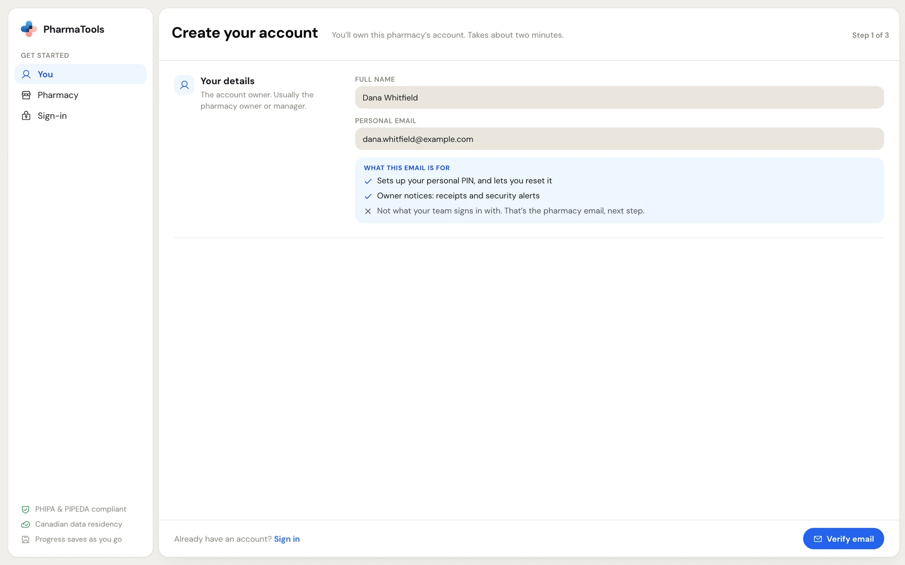
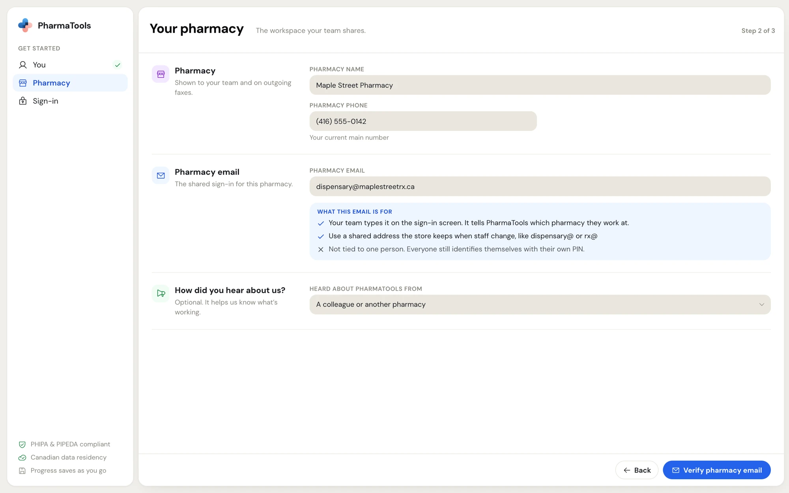
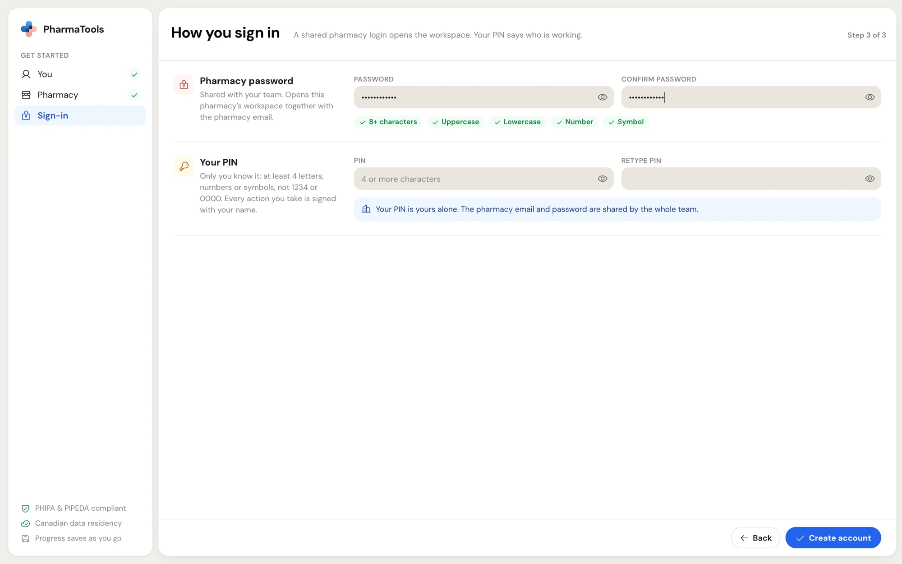

Signing up creates one PharmaTools workspace for your pharmacy and makes you its owner. It takes about two minutes. When you finish, PharmaTools signs you straight in and opens **Setup**, where you pick your modules and start the 30-day free trial.

<Info>
  Sign up once per pharmacy. Staff never sign up: the owner or a manager adds them from **Setup › Invite team** or **Settings › Manage employees**. See [Manage employees](/settings/manage-employees).
</Info>

## Before you start

Have these ready:

- **Your personal email.** It sets up your own PIN and lets you reset it. Receipts and security alerts for the owner go there too.
- **A shared pharmacy email** that the store keeps when staff change, such as `dispensary@` or `rx@`. Your whole team types it on the sign-in screen, so don't use a personal address. PharmaTools refuses the same address for both.
- **The pharmacy's main phone number** (10 digits).
- Access to both inboxes. PharmaTools emails a 6-digit code to each address to check it.

## The three steps

Go to [pharmatools.ca/signup](https://pharmatools.ca/signup). The menu on the left shows the three steps: **You**, **Pharmacy** and **Sign-in**. A tick appears beside each finished step, and **Step 1 of 3** sits in the top-right corner.

<Steps>
  <Step title="You: your details">
    Type your **Full name** and **Personal email**, then click **Verify email**.

    <Frame caption="Step 1, Create your account: the owner's name and personal email">
      
    </Frame>
  </Step>
  <Step title="Type the code from your personal inbox">
    The page changes to **Check your inbox**. Type the 6-digit code from the email into the boxes. The code expires in 15 minutes.

    - Didn't get it? Click **Resend code**.
    - Typed the wrong address? Click **Change email** or **Back**.
  </Step>
  <Step title="Pharmacy: your pharmacy's details">
    Fill in:

    | Field | What it is for |
    | --- | --- |
    | **Pharmacy name** | Shown to your team and on outgoing faxes. |
    | **Pharmacy phone** | Your current main number. |
    | **Pharmacy email** | The shared sign-in for the pharmacy. It tells PharmaTools which pharmacy your team works at. |
    | **Heard about PharmaTools from** | Optional. Pick **Something else** to type your own answer. |

    Click **Verify pharmacy email**, then type the 6-digit code sent to the pharmacy inbox.

    <Frame caption="Step 2, Your pharmacy: name, phone, the shared pharmacy email and the optional How did you hear about us? question">
      
    </Frame>
  </Step>
  <Step title="Sign-in: the pharmacy password and your PIN">
    This step sets up two different things:

    - **Pharmacy password.** Shared with your team. Together with the pharmacy email it opens the pharmacy's workspace on a computer. It needs 8 or more characters with an uppercase letter, a lowercase letter, a number and a symbol. Each rule turns green as you meet it.
    - **Your PIN.** Yours alone. It says who is working, and every action you take is signed with your name. Use at least 4 letters, numbers or symbols. PharmaTools refuses easy PINs such as 1234 and 0000.

    Type each one twice, then click **Create account**.

    <Frame caption="Step 3, How you sign in: the shared pharmacy password with its five rules, and your own PIN">
      
    </Frame>
  </Step>
</Steps>

PharmaTools creates the account, signs you in and opens **Setup › Modules**. Continue with [Set up your pharmacy](/getting-started/setup).

<Tip>
  What you type is kept in this browser as you go (except the password and PIN). If you reload the page or leave to check your inbox, you come back to the same step.
</Tip>

## If you already use PharmaTools at another pharmacy

When your personal email already belongs to someone at another PharmaTools pharmacy, the Sign-in step asks for **Your existing PIN** instead of a new one. The new pharmacy is added to your one account, and you sign in to both with the same PIN. Nothing changes at the other pharmacy.

## Shared and personal sign-in, side by side

<CardGroup cols={2}>
  <Card title="Pharmacy email and password" icon="store">
    Shared by the whole team. Typed once on each computer to sign that computer in to your pharmacy.
  </Card>
  <Card title="Your name and PIN" icon="key-round">
    Personal. Typed every time you start work, switch employee or unlock the screen. It records who did what.
  </Card>
</CardGroup>

<Warning>
  Never share your PIN. The activity log, signatures and audit trails in every module use it to name the person who acted.
</Warning>

## The 30-day free trial

- **To-Do** is included with every pharmacy and is free for a limited time.
- Every paid module starts with a **30-day free trial**. The trial starts the day you finish the **Payment** step of Setup. If you pay from a bank account, it starts the day you approve the pre-authorized debit agreement that is emailed to you. The **Payment** step shows the date of your first charge.
- Nothing is charged for modules during the trial.
- A one-time phone setup for your desk phones (Remote or On-site) is charged on the day you choose it. Self-install is free.
- A pharmacy that cancels and comes back later doesn't get a second free trial.

Prices, plans and the 1-year term are explained in [Plan, modules and billing](/getting-started/plan-and-billing).

## Problems signing up

| What you see | What to do |
| --- | --- |
| **Use a shared pharmacy address, not your personal email** | The pharmacy email matches your personal email. Use the store's shared address. |
| **That code didn't match, or it expired.** | Click **Resend code** and use the newest email. |
| **Too many codes asked for. Wait a minute and try again.** | Wait one minute before asking for another code. |
| **We couldn't create the account. If this pharmacy email is already registered, sign in instead.** | The pharmacy already has an account. Click **Sign in** at the bottom of step 1. |
| You're sent back to step 1 or 2 with a message | A code check is older than a day. Verify that address again. |
