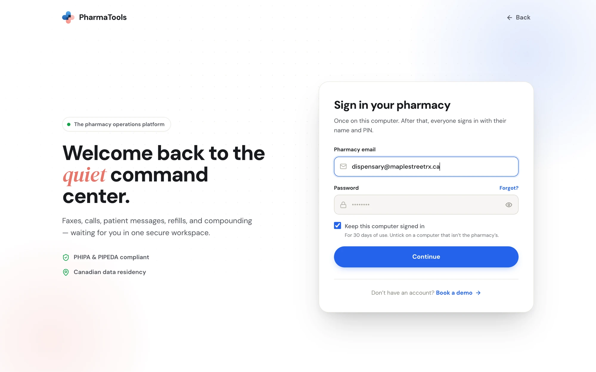
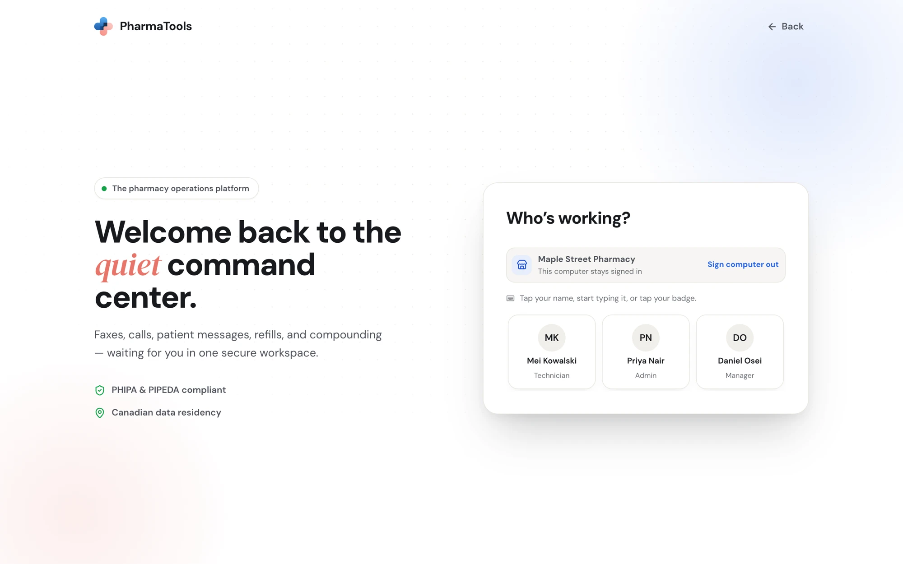
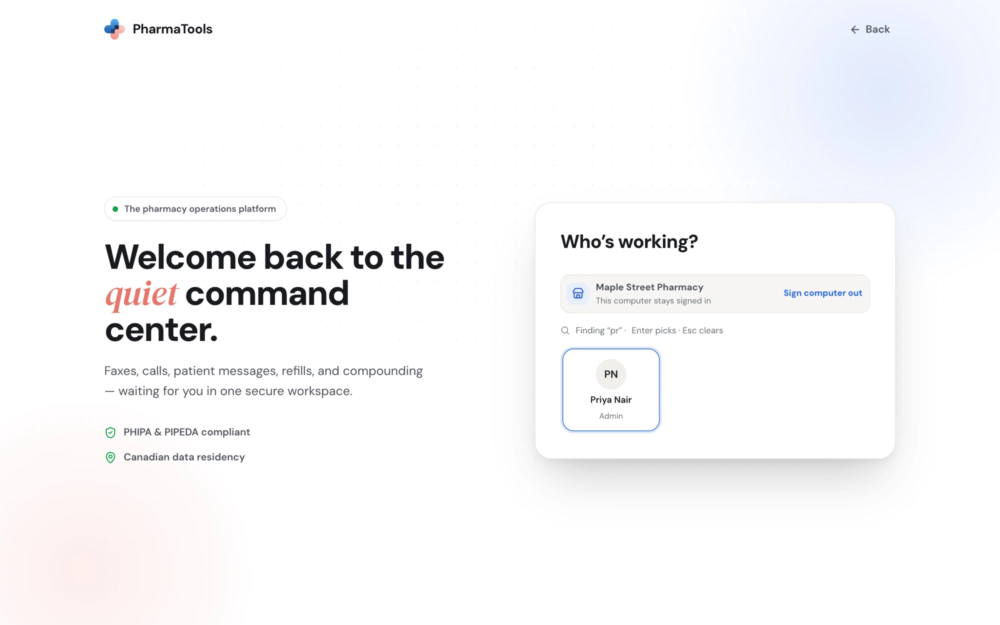
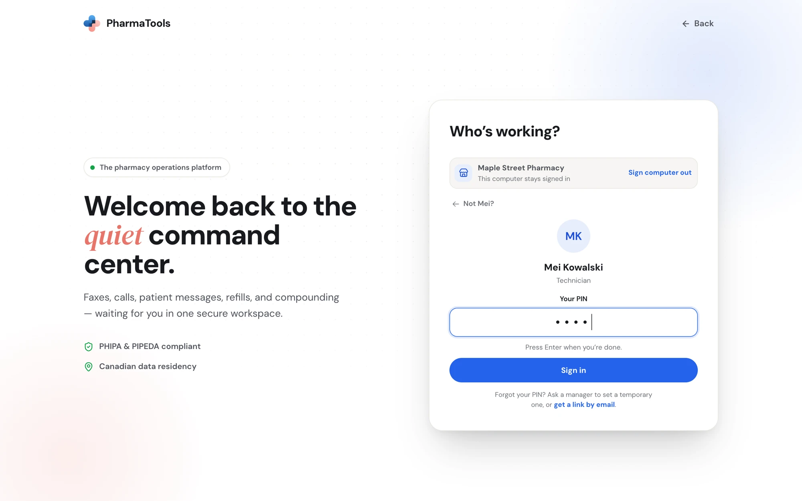
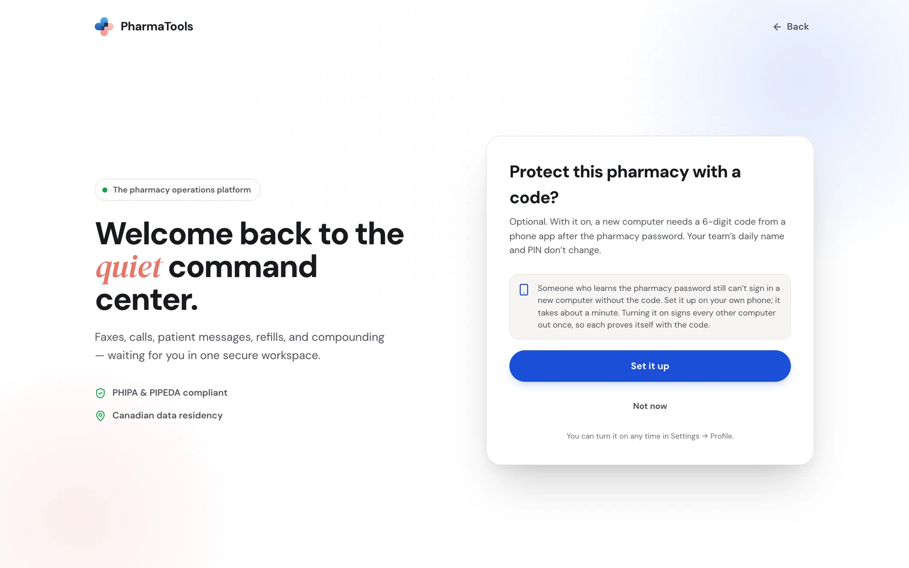
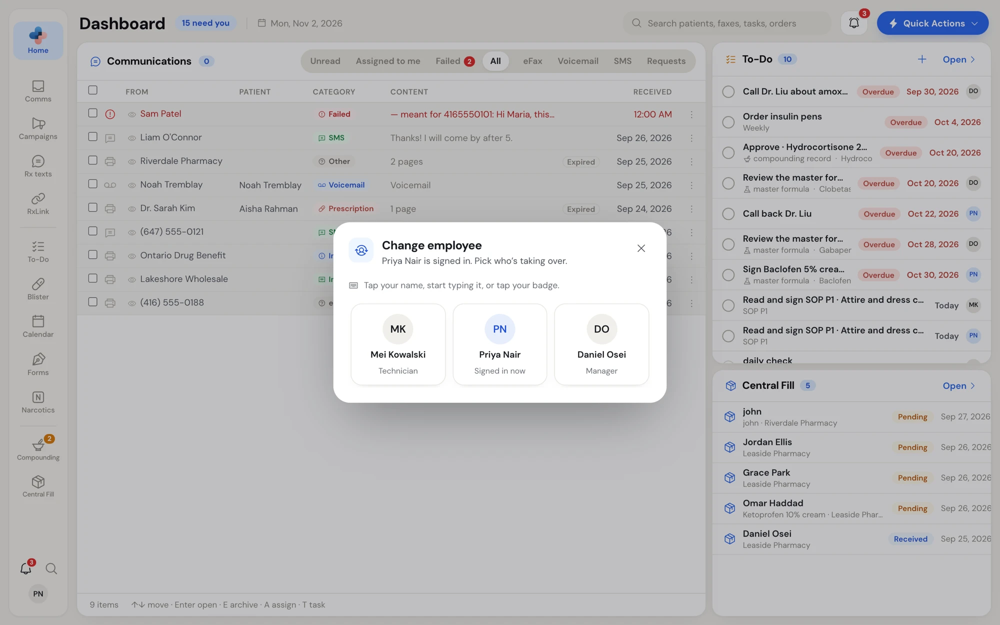
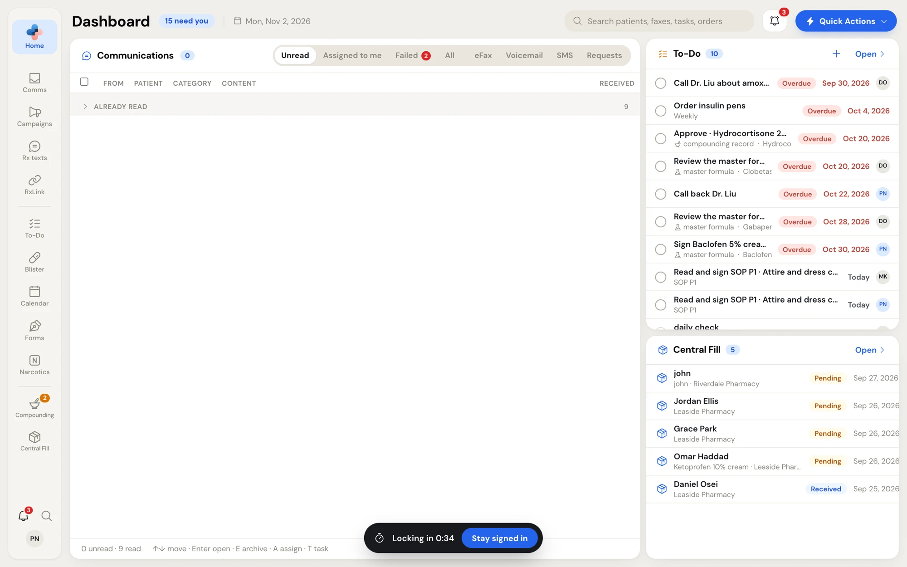
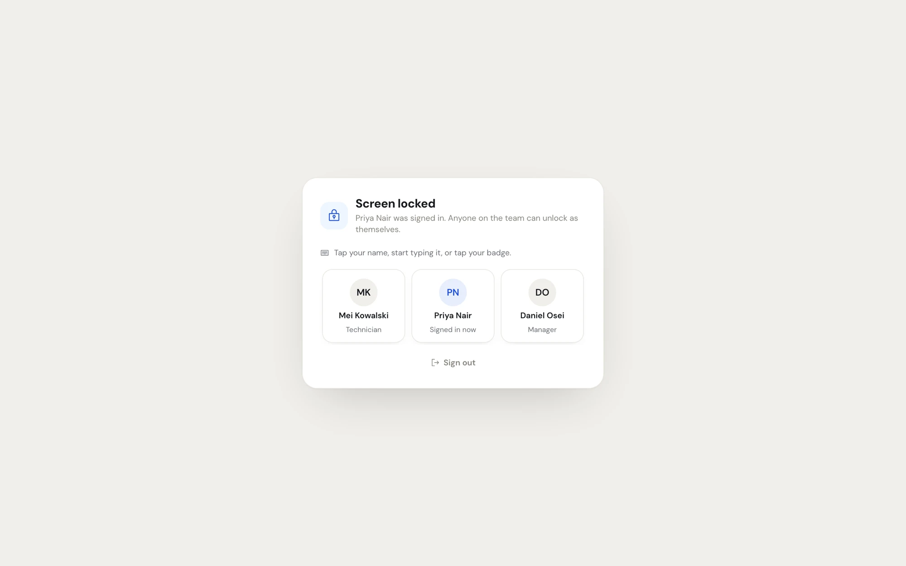
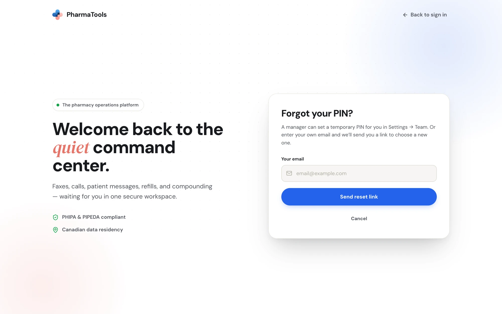
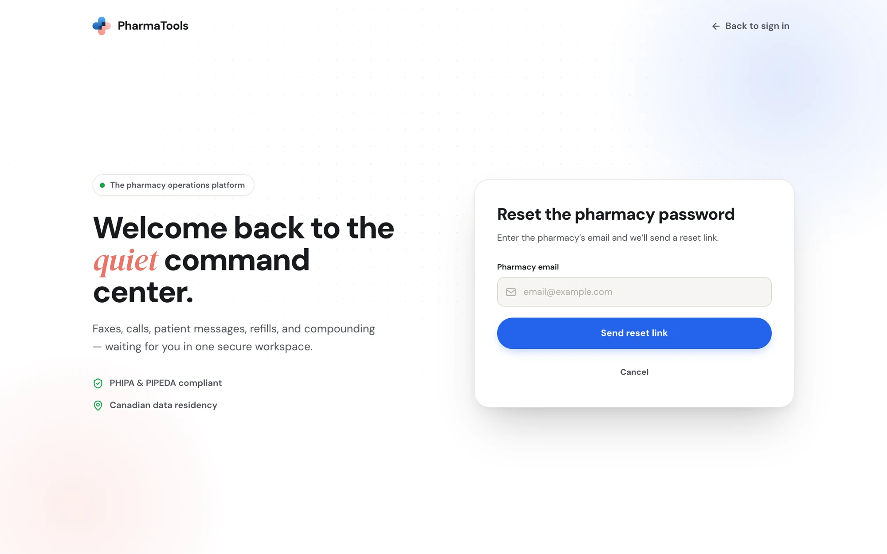

Signing in to PharmaTools has two parts:

1. **The pharmacy, once per computer.** Someone types the pharmacy email and password. The computer then stays signed in to your pharmacy.
2. **You, every time.** Pick your name on **Who's working?** and type your PIN, or tap your badge. Your PIN is what puts your name on everything you do.

The same name-and-PIN screen is used to sign in, to switch employee and to unlock a locked screen, so there's only one thing to learn.

## Sign a computer in to your pharmacy

Go to [pharmatools.ca/signin](https://pharmatools.ca/signin). On a computer that hasn't been signed in before you see **Sign in your pharmacy**.

<Frame caption="Sign in your pharmacy: done once on each computer">
  
</Frame>

<Steps>
  <Step title="Type the pharmacy's email and password">
    Use the shared **Pharmacy email** and **Password** your pharmacy chose at sign-up. Ask your owner or manager if you don't have them.
  </Step>
  <Step title="Decide whether the computer stays signed in">
    **Keep this computer signed in** is ticked by default. The computer then stays signed in to your pharmacy for 30 days of use. Untick it on a computer that isn't the pharmacy's; the pharmacy sign-in then ends when the browser closes.
  </Step>
  <Step title="Click Continue">
    **Who's working?** opens.
  </Step>
</Steps>

You might see one of these on the way:

- **Choose a new password.** The password you used was one PharmaTools emailed to you. Type a **New password** (at least 8 characters, with upper and lower case, a number and a symbol), type it again in **Type it again**, then click **Save and continue**.
- **Enter your code.** Your pharmacy uses two-step sign-in. Open your authenticator app and type the 6-digit code for PharmaTools in **Code from your app**, then click **Verify**. Lost the phone? Type one of your backup codes instead.

<Note>
  Don't have an account yet? The sign-in page links to **Book a demo**. To create a pharmacy account, see [Create your pharmacy's account](/getting-started/sign-up).
</Note>

## Sign yourself in: Who's working?

**Who's working?** shows your pharmacy's name and one tile per person on the team, with their role.

<Frame caption="Who's working?: tap your name, start typing it, or tap your badge">
  
</Frame>

<Steps>
  <Step title="Find your name">
    - Click your tile, **or**
    - Start typing your name anywhere on the screen. Only matching names stay, and the first is highlighted. Press **Enter** to pick it, the arrow keys to move, **Backspace** to delete a letter and **Esc** to clear.

    <Frame caption="Typing pr narrows the list to Priya Nair">
      
    </Frame>
  </Step>
  <Step title="Type your PIN">
    Your tile opens with **Your PIN**. Type it and press **Enter** or click **Sign in**. PharmaTools never sends the PIN until you do, so a typo can be fixed first. Picked the wrong name? Click **Not [your first name]?** to go back.

    <Frame caption="The PIN step for the person you picked">
      
    </Frame>
  </Step>
</Steps>

PharmaTools opens the **Dashboard**. A new pharmacy that hasn't finished Setup opens **Setup** instead.

### Tap a badge instead

If your pharmacy uses a badge reader at the counter, tap your badge on the reader on **Who's working?**, on the PIN step, on the lock screen or in **Change employee**. You're signed in without picking your name. Your badge is linked to you in **Settings › Profile** (see [Profile](/settings/profile)).

### Names with No PIN yet

A dimmed tile with a dashed border and **No PIN yet** belongs to someone who hasn't set a PIN. Clicking it explains that a manager can set a temporary PIN in **Settings › Manage employees**, or the person can set one themselves with a link by email.

### Your first sign-in with a temporary PIN

A PIN emailed to you when you were invited, or set for you by a manager, is temporary. After you type it, **Choose your own PIN** opens:

1. Type a **New PIN**: at least 4 letters, numbers or symbols, and not 1234 or 0000.
2. Type it again in **Type it again**.
3. Click **Save and continue**.

You use this PIN from now on to sign in, switch and unlock.

## Two-step sign-in offer

The first time the pharmacy's top person signs in (the Admin, or a Manager when the pharmacy has no Admin), PharmaTools may ask **Protect this pharmacy with a code?**

<Frame caption="The optional two-step sign-in offer, shown once to the pharmacy's top role">
  
</Frame>

With two-step sign-in on, signing in a **new computer** needs a 6-digit code from a phone app after the pharmacy password. Your team's daily name and PIN don't change.

- **Set it up**: scan the code with an authenticator app on the owner's or manager's phone (or type the key shown), type the 6-digit code the app shows, and click **Turn on**. Save the backup codes shown next (**Copy codes** or **Print**) somewhere away from the computer; each works once if the phone is lost. Turning it on signs every other computer out once, so each proves itself with the code.
- **Not now**: carry on without it. You can turn it on any time from **Settings › Profile**. See [Sign-in security](/settings/sign-in-security).

## Switch employee

When someone else takes over the keyboard, switch rather than signing out:

1. Click your initials at the bottom of the rail and choose **Change Employee**, or press **Alt+E** on any page.
2. In **Change employee**, pick who's taking over (the current person is marked **Signed in now**).
3. They type their PIN and click **Switch**, or tap their badge.

A message confirms **Switched to [name]**. The page you were on stays open.

<Frame caption="Change employee: pick who's taking over and type their PIN">
  
</Frame>

## The screen lock

Counter computers are shared, so PharmaTools locks a computer nobody is using. The delay is 15 minutes unless a Manager or Admin changed it in **Settings › Screen lock** (see [Sign-in security](/settings/sign-in-security)).

Only a person counts as activity: a click, a key, the mouse wheel, a touch or moving the mouse. Faxes and messages arriving don't keep the screen awake. All PharmaTools tabs on the computer share one timer and lock together.

<Steps>
  <Step title="The last minute">
    A dark bar at the bottom of the screen counts down: **Locking in 0:59**. Click **Stay signed in** to keep working.

    <Frame caption="The countdown bar in the last minute before the screen locks">
      
    </Frame>
  </Step>
  <Step title="Screen locked">
    The screen shows **Screen locked** and who was signed in. Your page stays open underneath, so unsaved work isn't lost, but nothing on it can be reached until someone unlocks.

    <Frame caption="Screen locked: anyone on the team can unlock as themselves">
      
    </Frame>
  </Step>
  <Step title="Unlock">
    Pick your name and type your PIN, then click **Unlock** (or tap your badge). Anyone on the team can unlock as themselves. If it wasn't the person who was signed in before, PharmaTools switches to them and shows **Switched to [name]**.
  </Step>
</Steps>

**Sign out** at the bottom of the lock screen ends the session and returns to the sign-in page.

If the session itself has ended while the screen was locked, the lock screen shows **Your session has ended** with **Sign in again** instead.

## Sign out

| Action | Where | What it does |
| --- | --- | --- |
| **Logout** | Your initials on the rail › **Logout** | Ends your session. The computer stays signed in to the pharmacy, so the next person goes straight to **Who's working?**. |
| **Change Employee** | Your initials › **Change Employee**, or **Alt+E** | Hands the computer to someone else without signing out. |
| **Sign computer out** | **Who's working?**, beside the pharmacy name | Forgets the pharmacy on this computer. The next sign-in needs the pharmacy email and password again. |

Managers and Admins can also sign out computers remotely from **Settings › Profile**. See [Sign-in security](/settings/sign-in-security).

## Forgot your PIN?

Pick your name on **Who's working?**. Under the PIN box:

- **Ask a manager** to set a temporary PIN for you in **Settings › Manage employees**. You then choose your own the next time you sign in.
- **Or click get a link by email.** On **Forgot your PIN?**, type **Your email** (the personal email on your employee profile) and click **Send reset link**. Open the email and set a **New PIN** on the **Reset Employee PIN** page, type it again in **Confirm New PIN**, and click the button to save it. You're returned to the sign-in page.

<Frame caption="Forgot your PIN?: get a link to choose a new one by email">
  
</Frame>

For security the page always answers "If that email belongs to someone on a team, a link to choose a new PIN has been sent.", whether or not the address is known.

## Forgot the pharmacy password?

On **Sign in your pharmacy**, click **Forgot?** next to **Password**. On **Reset the pharmacy password**, type the **Pharmacy email** and click **Send reset link**. The email opens **Create New Password**, where you type a **New Password** and **Confirm New Password**.

<Frame caption="Reset the pharmacy password: a reset link goes to the pharmacy email">
  
</Frame>

<Warning>
  Changing the pharmacy password affects everyone, because the whole team uses it to sign computers in. Only the pharmacy's top role can change it from Settings. See [Sign-in security](/settings/sign-in-security).
</Warning>

Reset requests are limited. If you see **Too many reset requests. Please wait and try again.**, wait before trying again.

## After several wrong passwords: unlock sign-in

After repeated wrong passwords, PharmaTools makes sign-in wait and sends an email alert about the failed sign-ins, with an unlock link. The link opens **Unlock sign-in**:

- Click **Unlock sign-in on this browser** to let this browser sign in at once, even while sign-in from other browsers is still waiting. The page then shows **Sign-in unlocked**; click **Go to sign in**.
- The link works once. If you weren't trying to sign in, close the page: nobody has signed in to your account.

## Keyboard shortcuts on the sign-in screens

| Key | Where | Does |
| --- | --- | --- |
| Letters | **Who's working?**, lock screen, **Change employee** | Find a name. |
| **Enter** | Same | Pick the highlighted name; on the PIN step, sign in. |
| Arrow keys | Same | Move between names. |
| **Esc** | Same | Clear the search (in **Change employee**, a second **Esc** closes it). |
| **Alt+E** | Anywhere in the app | Open **Change employee**. |
