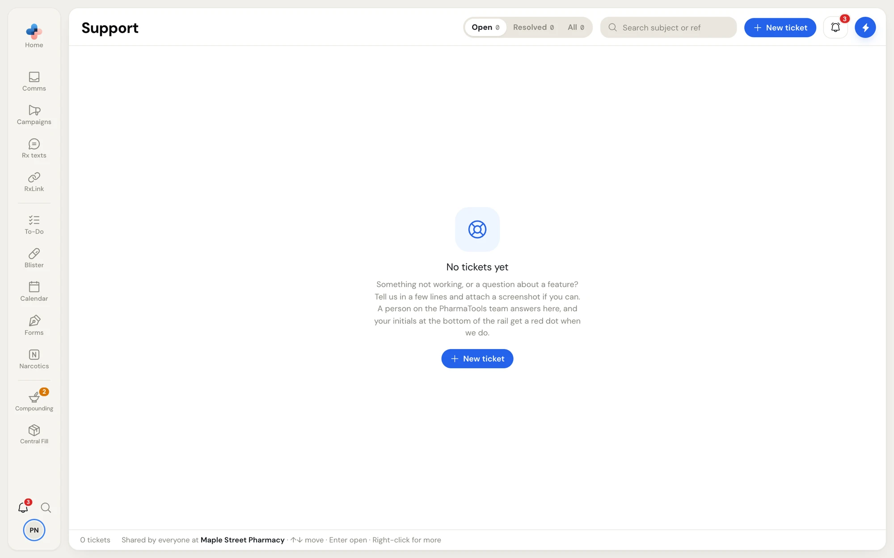
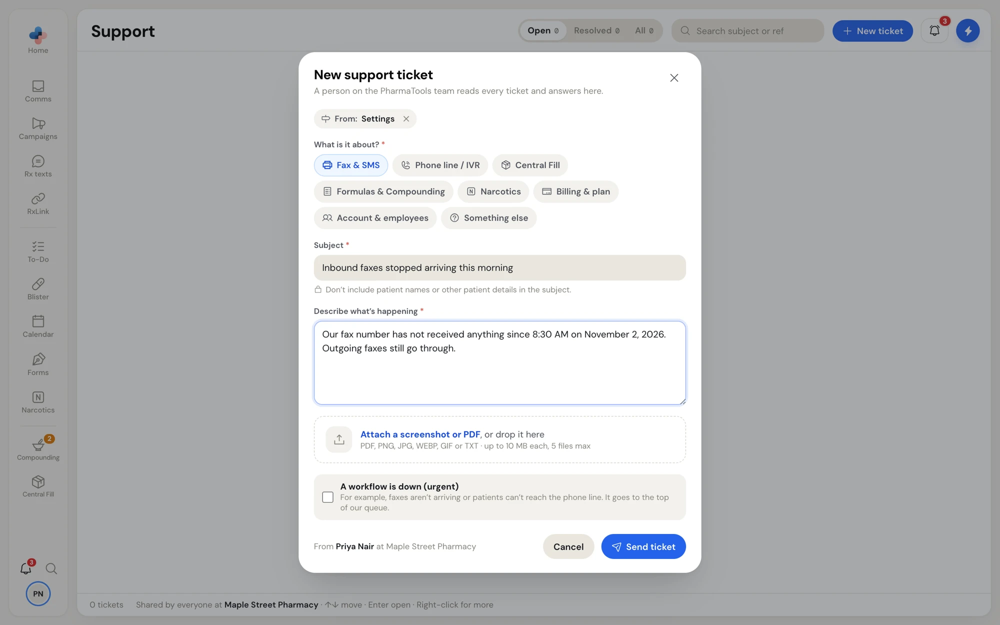

**Support** is where your pharmacy talks to the PharmaTools team. A person on the team reads every ticket and answers in the ticket. Everyone at your pharmacy sees the same tickets, and each message shows who wrote it.

Support is open to every role, also while a new pharmacy is still in Setup and while PharmaTools is locked for a missed payment.

## Open Support

- Click your initials at the bottom of the rail and choose **Support**.
- Or press **Ctrl+K** and choose **Contact support** to start a new ticket straight away.
- Or click the link in a "PharmaTools replied" email to open that ticket.

When the team has replied and nobody has read it yet, your initials on the rail carry a red dot and the **Support** menu item shows **New reply**. A notification also lands under **Pharmacies & support** in [Notifications](/getting-started/notifications).

## The ticket list

<Frame caption="Support before your pharmacy's first ticket, with the New ticket button at the top right">
  
</Frame>

| Part | What it does |
| --- | --- |
| **Open**, **Resolved**, **All** | Filter the tickets. Each shows its count. |
| **Search subject or ref** | Find a ticket by its subject or reference number. |
| **New ticket** | Start a ticket. |
| Columns | **Ticket** (area icon and subject), **Status**, **Last message** and **Updated**. Urgent tickets carry an **Urgent** tag. |

A ticket's **Status** is one of:

- **Sent**: the ticket is with the PharmaTools team.
- **Waiting on you**: the team answered and is waiting for your reply.
- **Resolved**: the ticket is closed. Write back to reopen it.

Use **↑** and **↓** to move through the list and **Enter** to open a ticket. Right-click a ticket for **Open**, **Resolve** or **Reopen**, **Add task** (a To-Do task to follow up on the ticket), **Copy ref** and **Copy subject**.

## Open a new ticket

<Steps>
  <Step title="Click New ticket">
    The **New support ticket** window opens. A **From:** tag shows the page you were on before Support, so the team knows where to look. Click its **×** if you don't want to send it.
  </Step>
  <Step title="Choose what it's about">
    Under **What is it about?**, pick one: **Fax & SMS**, **Phone line / IVR**, **Central Fill**, **Formulas & Compounding**, **Narcotics**, **Billing & plan**, **Account & employees** or **Something else**.
  </Step>
  <Step title="Write a subject and describe what's happening">
    Type a short **Subject**. Don't include patient names or other patient details in it. Under **Describe what's happening**, say what you expected, what happened instead, and since when. Order numbers, fax numbers and screenshots help the team answer faster.
  </Step>
  <Step title="Attach files (optional)">
    Click **Attach a screenshot or PDF**, or drop files on it. PDF, PNG, JPG, WEBP, GIF or TXT, up to 10 MB each and 5 files at most.
  </Step>
  <Step title="Mark it urgent only when a workflow is down">
    Tick **A workflow is down (urgent)** when, for example, faxes aren't arriving or patients can't reach the phone line. Urgent tickets go to the top of the team's queue.
  </Step>
  <Step title="Send">
    Click **Send ticket**, or press **Ctrl+Enter**. The bottom of the window shows who it's from and which pharmacy.
  </Step>
</Steps>

<Frame caption="New support ticket: area, subject, description, attachments and the urgent option">
  
</Frame>

**Send ticket** stays greyed out until you've chosen an area and filled in the subject and description.

## Follow a ticket

Click a ticket to open it in a pane beside the list. Drag the pane's left edge to resize it. On a narrow window the list and the ticket take turns; use **Back to tickets** to return.

- The conversation shows each message with who wrote it: someone from **Your pharmacy** (with their name) or **PharmaTools Support**. Attachments open in a new tab.
- Type in **Reply to PharmaTools Support…** and click **Send** (or **Ctrl+Enter**). You can attach files to a reply too.
- **Resolve** closes the ticket once your problem is fixed. **Reopen** opens it again for the team.
- **Add task** creates a To-Do task to follow up on the ticket.
- Right-click a message to **Copy** its text or **Add task** with it.

When the ticket is resolved, the reply box reads **Write back to reopen…** and the button becomes **Send & reopen**. When the team is waiting for you, the ticket says **PharmaTools Support is waiting for your reply.**

<Tip>
  You can also email admin@pharmatools.ca. A ticket keeps the whole conversation in one place where everyone at your pharmacy can see it.
</Tip>
