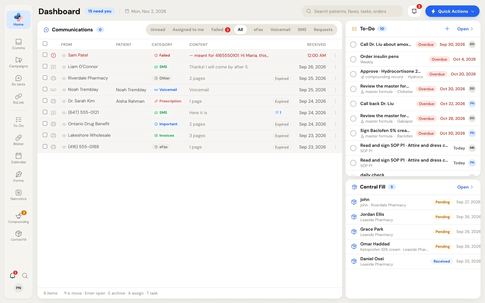

PharmaTools brings your pharmacy's faxes, texts, voicemail, tasks, patient forms, compounding, narcotic counts, blister packs and central fill orders into one place. Everyone at the pharmacy signs in on the same computer with their own name and PIN, so every action is recorded against the person who took it.

<Frame caption="The Home dashboard: your communications on the left, your To-Do list and Central Fill orders on the right.">
  
</Frame>

## New to PharmaTools?

<CardGroup cols={3}>
  <Card title="Create your account" icon="user-plus" href="/getting-started/sign-up">
    Sign up and start your 30-day free trial.
  </Card>
  <Card title="Set up your pharmacy" icon="list-checks" href="/getting-started/setup">
    Pick modules, set up your numbers and invite your team.
  </Card>
  <Card title="Sign in and switch" icon="log-in" href="/getting-started/signing-in">
    Sign the computer in once, then pick your name and enter your PIN.
  </Card>
  <Card title="Find your way around" icon="compass" href="/getting-started/finding-your-way">
    The side menu, search, Quick Actions and shortcuts.
  </Card>
  <Card title="Roles and permissions" icon="shield-check" href="/getting-started/roles-and-permissions">
    What Admins, Managers, Pharmacists, Technicians and Assistants can do.
  </Card>
  <Card title="Manage employees" icon="users" href="/settings/manage-employees">
    Add staff, set roles and reset PINs.
  </Card>
</CardGroup>

## Modules

<CardGroup cols={2}>
  <Card title="Comms" icon="inbox" href="/communications/overview">
    Receive and send faxes, text patients, listen to voicemail and handle online refill requests from one inbox.
  </Card>
  <Card title="RxLink" icon="link" href="/rxlink/overview">
    Chat with your team, message linked pharmacies and keep your contacts.
  </Card>
  <Card title="Campaigns" icon="megaphone" href="/campaigns/overview">
    Text a list of patients who agreed to hear from you, and see who it reached.
  </Card>
  <Card title="Rx texts" icon="message-square-text" href="/rx-texts/overview">
    Text patients when a prescription is ready for pickup or due for a refill.
  </Card>
  <Card title="To-Do and Calendar" icon="list-checks" href="/todo/overview">
    Assign tasks, set due dates and repeats, and see the week or month at a glance.
  </Card>
  <Card title="Forms" icon="pen-line" href="/forms/overview">
    Send forms for patients to sign on their phone or at the counter, then fax them to prescribers.
  </Card>
  <Card title="Compounding" icon="flask-conical" href="/compounding/overview">
    Set up your rooms, write and sign master formulas, keep compounding records, logs, SOPs and training.
  </Card>
  <Card title="Narcotics" icon="shield-check" href="/narcotics/overview">
    Import purchases and sales, count, reconcile and close each period.
  </Card>
  <Card title="Blister packs" icon="pill" href="/blister-packs/overview">
    Bill, prepare, check and hand off each patient's weekly packs.
  </Card>
  <Card title="Central Fill" icon="package" href="/central-fill/overview">
    Send compounding orders to a central fill pharmacy, or fill orders your partners send you.
  </Card>
  <Card title="PharmaTools Desktop" icon="monitor" href="/desktop/overview">
    Fax from any Windows program and connect your pharmacy software.
  </Card>
  <Card title="Settings" icon="settings" href="/settings/overview">
    Your profile, employees, sign-in security, notifications, texting and more.
  </Card>
</CardGroup>

## For partners

<Card title="Partner portal" icon="building-2" href="/partner-portal/overview" horizontal>
  Set up fax profiles for your customers and move their numbers to PharmaTools.
</Card>

<Tip>
  Stuck on something this guide doesn't answer? In PharmaTools, click your initials at the bottom of the side menu and choose **Support** to send a ticket to the PharmaTools team. See [Get help from Support](/getting-started/support).
</Tip>
