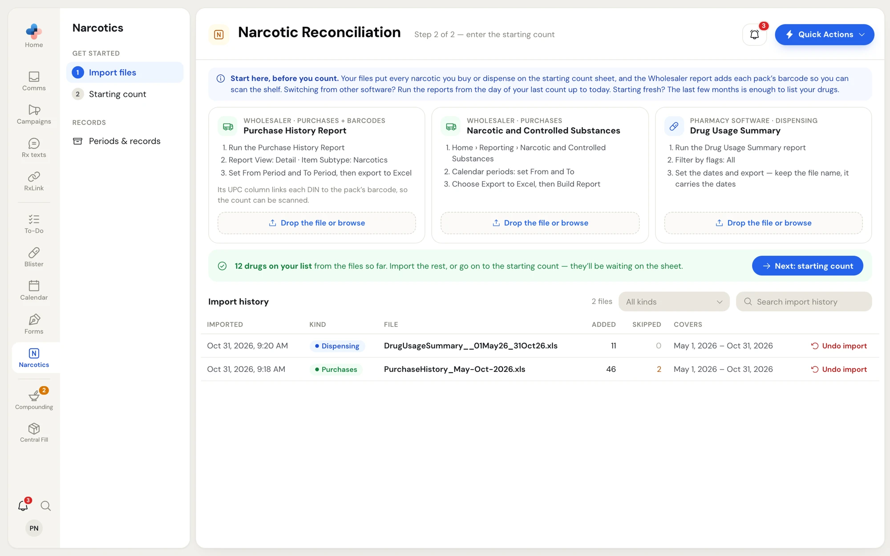
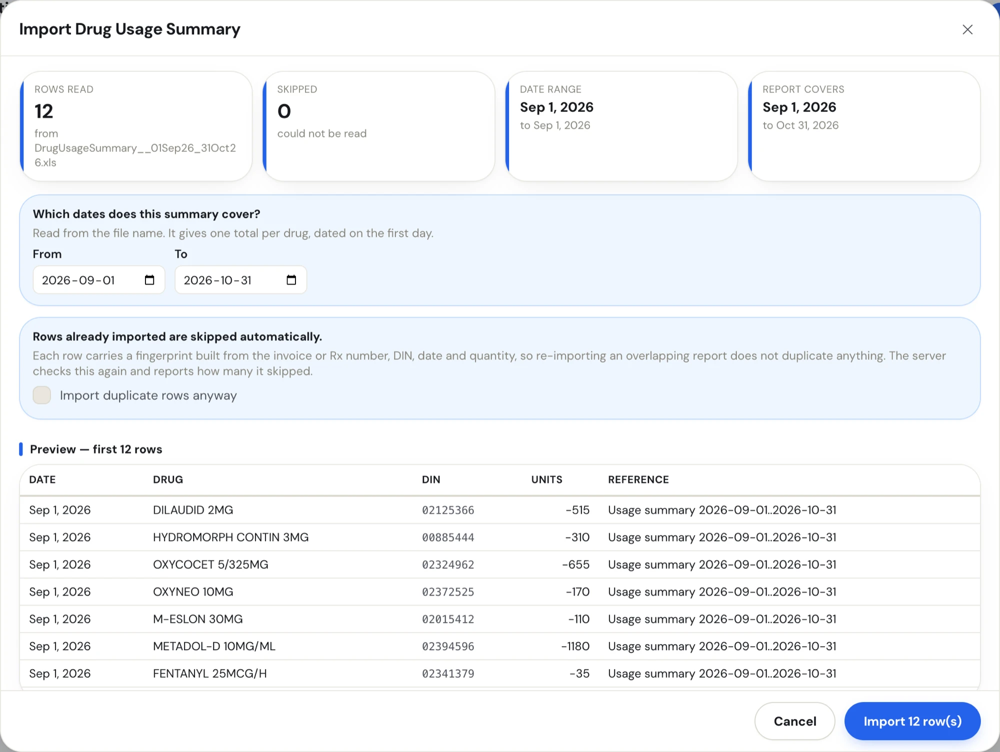
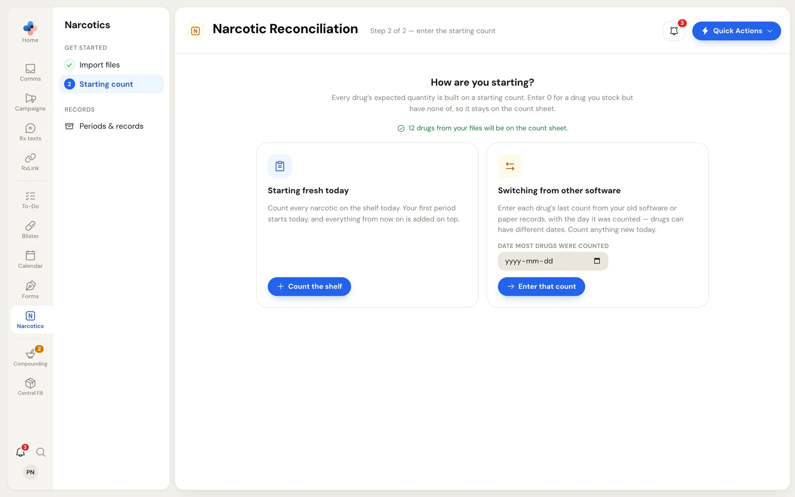
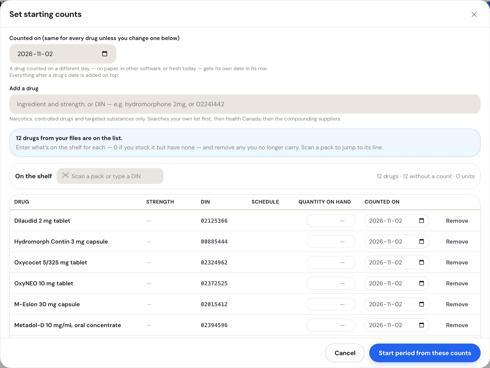

Before your first count, the Narcotics side menu shows **Get started** with two steps: **1. Import files** and **2. Starting count**. Do them in that order. The files put every narcotic you buy or dispense on the count sheet, with the pack barcodes, so you don't add drugs one at a time.

## Step 1: Import files

Open **Narcotics** in the left rail and click **Import files** under **Get started**.

<Frame caption="Get started › Import files, after two reports are imported">
  
</Frame>

The blue box at the top, **Start here, before you count.**, tells you which dates to run the reports for:

- **Switching from other software or paper:** run the reports from the day of your last count up to today.
- **Starting fresh:** the last few months is enough to list your drugs.

### The three report cards

Each card names the exact report to run and the settings to pick, because a general "purchases export" usually gives the wrong report.

| Card | From | Adds | How to run it |
|---|---|---|---|
| **Purchase History Report** | Your wholesaler | Purchases and pack barcodes | Run the Purchase History Report. **Report View: Detail**, **Item Subtype: Narcotics**. Set **From Period** and **To Period**, then export to Excel. Its UPC column links each DIN to the pack barcode, so you can scan the shelf when you count. |
| **Narcotic and Controlled Substances** | Your wholesaler's online ordering portal | Purchases (no barcodes) | **Home › Reporting › Narcotic and Controlled Substances**. Set the **From** and **To** calendar periods. Choose **Export to Excel**, then **Build Report**. |
| **Drug Usage Summary** | Your pharmacy software | Dispensing | Run the Drug Usage Summary report with **Filter by flags: All**. Set the dates and export. Keep the file name as it is: it carries the dates. |

To import a file, drag it onto any card, or click **Drop the file or browse** and pick it. You can drop several files at once; they are queued and reviewed one at a time.

<Tip>
  You don't have to match card and file. PharmaTools recognises which report a file is, whichever card you drop it on, and tells you when it reads it as a different one.
</Tip>

#### Accepted file types

- Excel exports with the `.xls` extension, including the older XML-style and text-style `.xls` files report writers produce
- `.xlsx` workbooks
- Tab- or comma-separated text
- HTML table exports

A PDF can't be imported. Export the report to Excel instead.

### Review the file before it is saved

Nothing is saved when you drop a file. A review window opens first, titled after the report (for example **Import Drug Usage Summary**).

<Frame caption="The review window for a dispensing summary, before anything is saved">
  
</Frame>

<AccordionGroup>
  <Accordion title="The four boxes at the top" icon="layout-grid">
    - **Rows read** — rows PharmaTools could read, and the file name.
    - **Skipped** — rows that could not be read. They are listed below with the reason and the original row so you can check them against the report.
    - **Date range** — the first and last transaction date in the file.
    - **Report covers** — the stretch of days the report was run for.
  </Accordion>
  <Accordion title="Which dates does this summary cover?" icon="calendar">
    Only for the dispensing summary. It gives one total per drug, with no Rx dates, so the dates come from the file name. Check **From** and **To** and correct them if the file was renamed. Each drug's total is dated on the first day.
  </Accordion>
  <Accordion title="Warnings you may see" icon="triangle-alert">
    - **These dates don't match the reconciliation** — run the Drug Usage Summary again for exactly the reconciliation dates. A summary can't be split by day.
    - **This overlaps dispensing you already imported** (red) — the shared days would be counted twice. Undo the older import first, or run this summary for the days after it.
    - **N row(s) fall outside the open period** — those rows won't affect this period's expected counts.
    - **Nothing has been counted yet, so these rows don't change any numbers.** — shown before your first count. The drugs go on your starting count sheet.
    - **N pack barcode(s) in this report will be linked to their DINs** — those packs can be scanned during a count.
  </Accordion>
  <Accordion title="Duplicates" icon="copy">
    **Rows already imported are skipped automatically.** Each row carries a fingerprint built from the invoice or Rx number, DIN, date and quantity, so importing an overlapping report never doubles anything. Tick **Import duplicate rows anyway** only if you are sure the repeated rows are real.
  </Accordion>
</AccordionGroup>

Check the **Preview — first 12 rows** table, then click **Import N row(s)**. Click **Cancel** to drop the file. After an import, a message at the bottom of the page says how many rows went in, how many were already imported or unreadable, and how many barcodes were linked.

### Import history

Every file you import is listed under **Import history** with:

| Column | Shows |
|---|---|
| **Imported** | Date and time of the import |
| **Kind** | **Purchases** or **Dispensing** |
| **File** | The file name. Click it to download the original file, which is kept as the evidence behind its rows. |
| **Added** / **Skipped** | Rows saved, and rows skipped |
| **Covers** | The dates the report covers |

Use **All kinds** to show only **Purchases** or **Dispensing**, and **Search import history** to find a file by name.

A pharmacist, manager or admin can click **Undo import** on a row to remove the rows that file added. The undo is refused if any of those rows sit inside a closed period.

When the files are in, the green bar reads **N drugs on your list**. Click **Next: starting count**.

<Note>
  You can skip the import and add each drug by hand on the starting count instead. The files save typing and add the pack barcodes.
</Note>

## Step 2: Starting count

Click **Starting count** under **Get started**. The page asks **How are you starting?**

<Frame caption="Get started › Starting count: two ways in">
  
</Frame>

Every drug's expected quantity is built on its starting count. Only a pharmacist, manager or admin can enter starting counts; anyone else sees **A pharmacist or manager enters the starting counts.**

<Tabs>
  <Tab title="Starting fresh today">
    Use this when you count every narcotic on the shelf today. Your first period starts today, and everything from now on is added on top.

    Click **Count the shelf**. The **Set starting counts** window opens with today's date.
  </Tab>
  <Tab title="Switching from other software">
    Use this when your old software or paper records already have a count.

    1. In **Date most drugs were counted**, pick the date of that last count.
    2. Click **Enter that count**. The **Your last count from the old system** window opens.
    3. Type each drug's quantity exactly as the old record has it. A drug counted on another day gets its own date in its row. Count anything new today and give it today's date.

    Each drug adds only purchases, dispensing and transactions dated after its own date.
  </Tab>
</Tabs>

If you skipped the import, an amber box offers **1. Import files** and **Just my drug list and barcodes**. The second opens **Add drugs from a purchase report**: drop a wholesaler purchase report run for the last 6 to 12 months, and only the drug list and pack barcodes are saved. No purchases are recorded.

### Enter the counts

<Frame caption="Set starting counts, with the drugs from your files already listed">
  
</Frame>

<Steps>
  <Step title="Check the date">
    **Counted on** applies to every drug unless you change a drug's own **Counted on** date in its row. If some rows have their own date, **Use this date for every drug** puts them all back on the top date.
  </Step>
  <Step title="Add any missing drug">
    Type in **Add a drug** (ingredient and strength, or DIN, for example `hydromorphone 2mg` or `02241442`). Only narcotics, controlled drugs and targeted substances are offered. The search looks at your own list first, then Health Canada, then the compounding supplier catalogues. Click **Add** on the right result.

    For a compound or raw ingredient Health Canada doesn't list, click **Add as custom** or **Add a custom drug**. Enter the **Number from your software** (the same number your pharmacy software gives it, so it matches the imported reports), the **Name** and the **Strength**.
  </Step>
  <Step title="Type each quantity">
    Type the units on hand in **Quantity on hand**. Scan a pack in **Scan a pack or type a DIN** to jump to its line. The bar above the table counts drugs, drugs without a count, and total units.
  </Step>
  <Step title="Remove what you don't carry">
    Click **Remove** on a drug you no longer stock.
  </Step>
  <Step title="Start the period">
    Click **Start period from these counts**. This opens your first period and puts the drugs on the count sheet.
  </Step>
</Steps>

<Warning>
  A blank quantity and a 0 mean different things. A drug that isn't on the list stays off the reconciliation entirely. Enter **0** for a drug you stock but have none of right now, so it stays on the count sheet and someone checks the shelf next time.
</Warning>

<Info>
  What you type is kept on this computer until you save (**Kept on this computer until you save** shows next to the buttons). If you close the window or the browser, reopening it shows **Your unsaved counts are back.** with the time. Click **Discard and start over** to clear them.
</Info>

## Next

<CardGroup cols={2}>
  <Card title="Transactions and opening balances" icon="arrow-left-right" href="/narcotics/transactions">
    Record the day's returns, destructions, losses and adjustments.
  </Card>
  <Card title="Run a reconciliation" icon="clipboard-check" href="/narcotics/reconciliation">
    When it's time to count the shelf.
  </Card>
</CardGroup>
