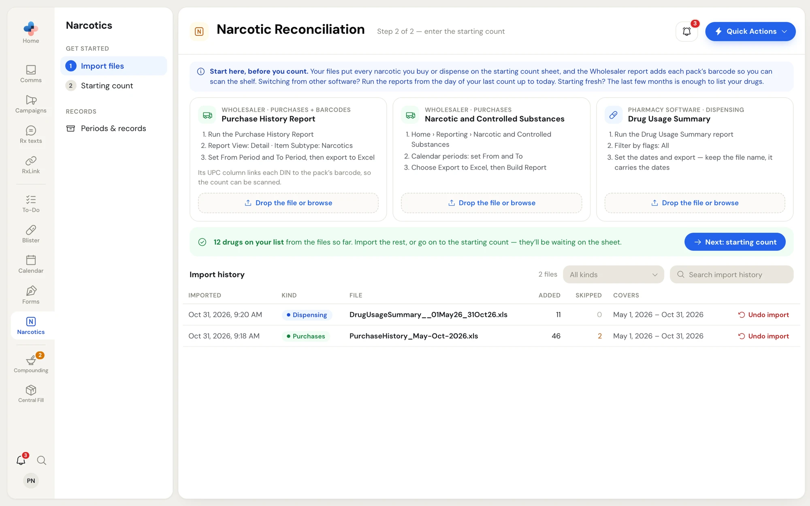
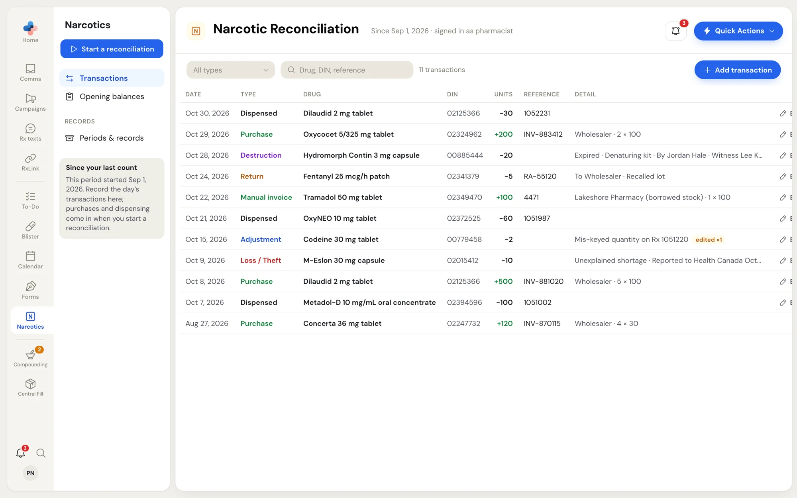
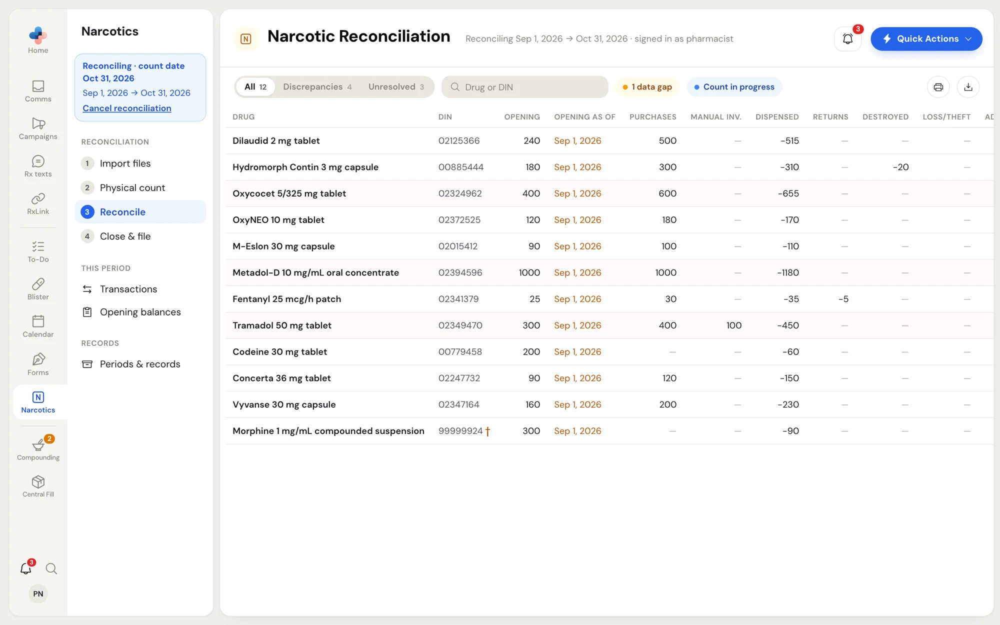
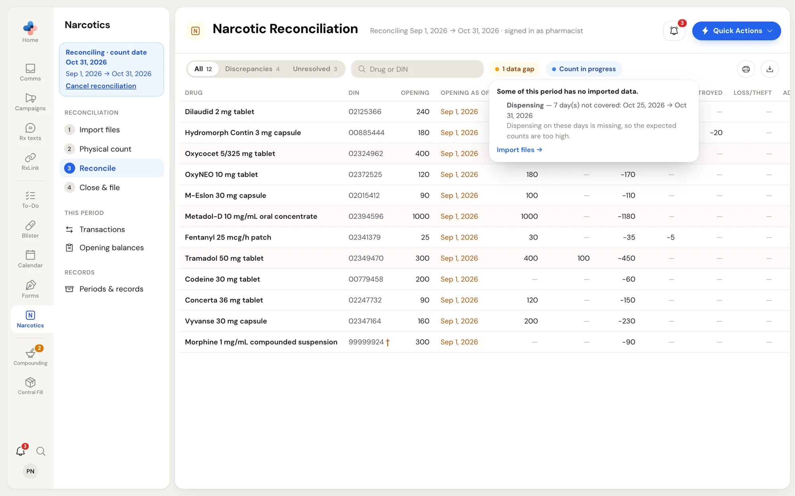

**Narcotics** keeps a running record of every narcotic, controlled drug and targeted substance your pharmacy stocks. It adds up what you bought (from your wholesaler's purchase report), what you dispensed (from your pharmacy software's dispensing report) and what you recorded by hand (returns, destructions, losses, adjustments), compares that with a physical count of the shelf, and files a signed record for each period.

## Open Narcotics

Click **Narcotics** in the left rail. The page is called **Narcotic Reconciliation**. The line under the title tells you where you are, for example **Reconciling Sep 1, 2026 → Oct 31, 2026 · signed in as pharmacist**.

The drug list and the pharmacy details printed on records live in a separate place: **Settings › Narcotics**. See [Records and settings](/narcotics/records-and-settings).

## How the module is organised

The side menu next to the rail changes with what you are doing. There are three stages.

<Tabs>
  <Tab title="Before your first count">
    The side menu shows **Get started** with two numbered steps, and **Records**:

    1. **Import files** — your purchase and dispensing reports, which build your drug list.
    2. **Starting count** — what is on the shelf when you begin.

    The line under the title reads **Step 1 of 2 — import your purchase and dispensing files**, then **Step 2 of 2 — enter the starting count**. Saving the starting count opens your first period.

    <Frame caption="Get started: step 1, Import files, with the three report cards">
      
    </Frame>
  </Tab>
  <Tab title="Between reconciliations">
    Most of the time a period is open and no count is under way. The side menu shows:

    - **Start a reconciliation** (blue button at the top)
    - **Transactions** — the day's returns, destructions, losses, adjustments and manual invoices
    - **Opening balances** — what was on the shelf when this period began
    - **Periods & records**

    A grey box, **Since your last count**, says when the period started.

    <Frame caption="Between reconciliations: Transactions, Opening balances and the Start a reconciliation button">
      
    </Frame>
  </Tab>
  <Tab title="While reconciling">
    Once you click **Start a reconciliation** and pick a count date, a blue box at the top of the side menu reads **Reconciling · count date** with the date range and a **Cancel reconciliation** link. Under it, the four steps of a reconciliation:

    1. **Import files** — purchases and dispensing up to the count date
    2. **Physical count** — count the shelf
    3. **Reconcile** — resolve differences
    4. **Close & file** — file the signed record

    A step turns into a green tick when it is done. **Physical count** and **Reconcile** show a red number when differences have no reason yet. **This period** (Transactions, Opening balances) and **Records** stay below the steps.

    <Frame caption="While reconciling: the four numbered steps in the side menu">
      
    </Frame>
  </Tab>
</Tabs>

<Note>
  Each view has its own address (for example `/narcotics?tab=count`), so a page reload, a bookmark or the browser's Back button brings you to the same step.
</Note>

## What you do, start to finish

<Steps>
  <Step title="Import your files">
    Drop your wholesaler's purchase report and your pharmacy software's dispensing report. They put every narcotic you buy or dispense on the count sheet. See [Get started](/narcotics/getting-started).
  </Step>
  <Step title="Enter the starting count">
    Count the shelf today, or type the last count from your old system. This opens the first period.
  </Step>
  <Step title="Record the day's transactions">
    Returns to suppliers, destructions, losses and thefts, adjustments and manual invoices go on **Transactions** as they happen. See [Transactions and opening balances](/narcotics/transactions).
  </Step>
  <Step title="Reconcile">
    When it is time to count, start a reconciliation: import the files up to the count date, count the shelf blind, explain each difference, and close the period. See [Run a reconciliation](/narcotics/reconciliation).
  </Step>
  <Step title="Print and keep the records">
    Every closed period, destruction, return and loss prints as a signature-ready document from **Periods & records**. See [Records and settings](/narcotics/records-and-settings).
  </Step>
</Steps>

## Who can do what

What you can do depends on your role in **Settings › Manage employees**.

| Action | Pharmacist, Manager, Admin | Technician, Assistant |
|---|---|---|
| Import purchase and dispensing files | Yes | Yes |
| Start or cancel a reconciliation | Yes | Yes |
| Count the shelf, type count notes, resolve a difference | Yes | Yes |
| Print count sheets, reports and records | Yes | Yes |
| Enter or edit starting counts and opening balances | Yes | No |
| Add, edit or delete a transaction | Yes | No |
| Undo an import | Yes | No |
| Close a period and file the record | Yes | No |
| Rename a drug, change units per pack, remove a drug, link a pack barcode | Yes | No |
| Import from the standalone tool | Yes | No |

When you can't do something, the button is missing or greyed out, and its tooltip says who can (for example, **A pharmacist or manager closes the period**).

## Warning chips

Small round chips sit in the toolbar of some steps. Each one has a coloured dot and a short label. Click a chip to read the full explanation; click outside it or press **Esc** to close it.

<Frame caption="The 1 data gap chip opened on the Reconcile step">
  
</Frame>

| Chip | Where | What it means |
|---|---|---|
| **N data gap(s)** (amber) | Reconcile | Part of the period has no imported purchases or dispensing. It lists the missing days and links to **Import files →**. |
| **Count in progress** (blue) | Reconcile | Someone is counting blind on **Physical count**. The Reconcile table shows the expected figures, so don't read it over the counter's shoulder. |
| **N opening dates** (blue) | Reconcile, Opening balances | Drugs started on different dates (common after switching from another system). Each drug adds only what happened from its own date. A full count and close puts them all on one date. |
| **No period open** (amber) | Import files | Files are saved, but they don't affect any numbers until you enter a starting count. |

## Related pages

<CardGroup cols={2}>
  <Card title="Get started" icon="play" href="/narcotics/getting-started">
    Import files and enter your starting count.
  </Card>
  <Card title="Transactions and opening balances" icon="arrow-left-right" href="/narcotics/transactions">
    Record destructions, returns, losses, adjustments and manual invoices.
  </Card>
  <Card title="Run a reconciliation" icon="clipboard-check" href="/narcotics/reconciliation">
    Import, count, resolve and close.
  </Card>
  <Card title="Records and settings" icon="archive" href="/narcotics/records-and-settings">
    Printed records, the old-system archive and the drug list.
  </Card>
</CardGroup>
