A reconciliation compares what should be on the shelf with what is there, for the time since the period started. You start one on purpose, with the day you count the shelf. Its four steps then appear in the Narcotics side menu: **1. Import files**, **2. Physical count**, **3. Reconcile**, **4. Close & file**.

## Start a reconciliation

<Steps>
  <Step title="Click Start a reconciliation">
    The blue button sits at the top of the Narcotics side menu between reconciliations.
  </Step>
  <Step title="Pick the count date">
    In **Count date — the day you count the shelf**, pick the day you count. It can't be in the future or before the period started. The window lists what comes next.

    <Frame caption="Start a reconciliation">
      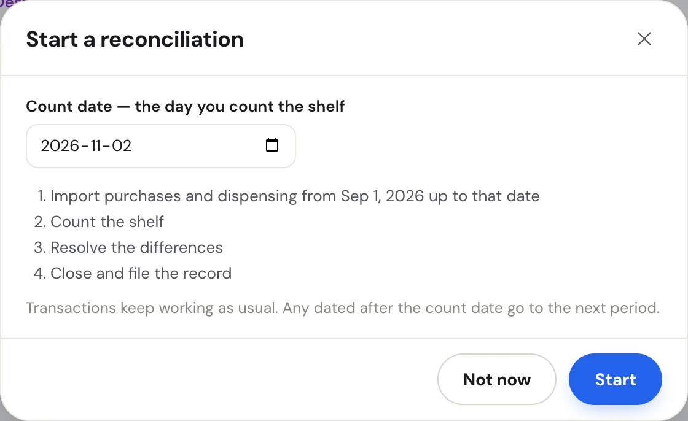
    </Frame>
  </Step>
  <Step title="Click Start">
    The side menu now shows **Reconciling · count date** and the four steps, and the page opens **Import files**. Click **Not now** to close the window without starting.
  </Step>
</Steps>

<Info>
  Transactions keep working during a reconciliation. Any dated after the count date go to the next period. To change the count date, cancel the reconciliation and start a new one. Cancelling clears any shelf count already entered.
</Info>

### Cancel a reconciliation

Click **Cancel reconciliation** in the blue box at the top of the side menu, then **Cancel reconciliation** in the confirmation. Nothing is filed. The shelf count taken for that count date is cleared; imported files and transactions stay.

<Frame caption="Cancelling a reconciliation">
  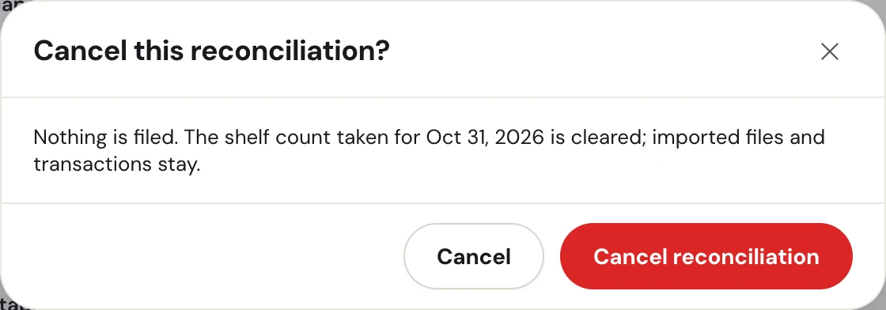
</Frame>

## Step 1: Import files

The blue box says exactly which dates to use: **Run each report from** the start of the period **to** the count date. The Drug Usage Summary has to match those dates exactly, because it gives one total per drug: a longer range would count dispensing from outside the period.

<Frame caption="Reconciliation step 1: the report cards, coverage and import history">
  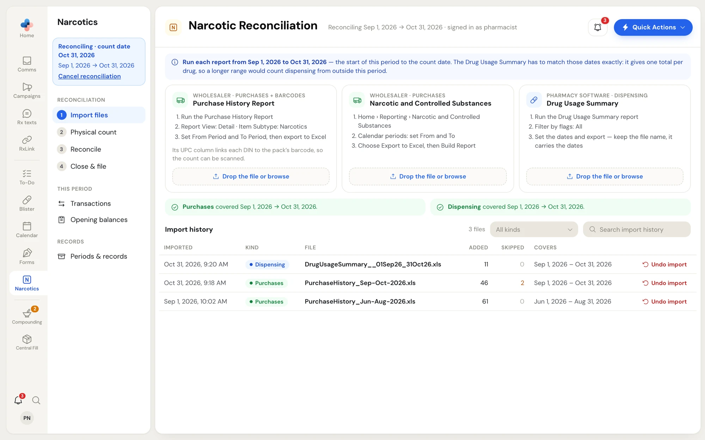
</Frame>

Import the files the same way as when you set up: drag each onto its card, review it, then click **Import N row(s)**. See [Get started › Import files](/narcotics/getting-started#step-1-import-files) for the three reports, accepted file types and the review window.

Under the cards, two boxes show whether the files cover the whole period:

- Green **Purchases covered Sep 1, 2026 → Oct 31, 2026.** (and the same for **Dispensing**) — nothing is missing.
- Amber **not covered:** with the missing days, and which way the expected counts would be off (too high or too low) — import the missing report.

The step gets a green tick in the side menu once both are covered.

## Step 2: Physical count

Click **Physical count**. The count sheet lists every drug on the period.

<Frame caption="Physical count while counting blind">
  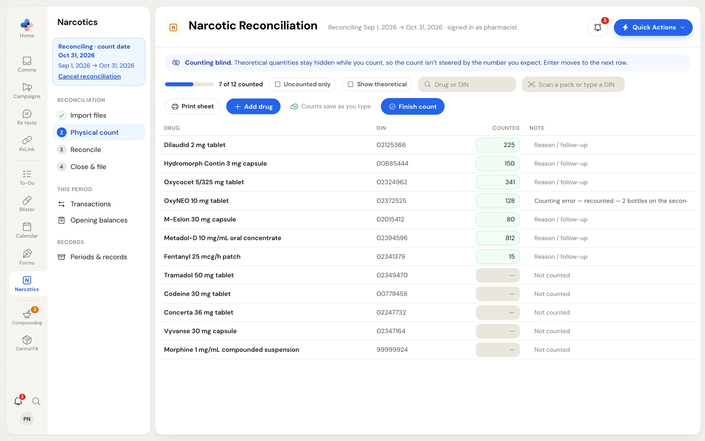
</Frame>

### Count blind

The blue box reads **Counting blind.** The expected (theoretical) quantities stay hidden while you count, so the number you write down isn't steered by the number you expect. The drug panel is hidden too (**Hidden while counting blind**).

### Enter the counts

- Type each drug's quantity in **Counted**. Press **Enter** to save and move to the next row.
- Each count saves on its own when you leave the box, press Enter, or stop typing for a moment. A small tick next to the box shows it saved.
- Use **Note** for a reason or follow-up on a drug.
- The bar shows **N of M counted**. Tick **Uncounted only** to see what's left.
- Search with **Drug or DIN**.

The status next to **Finish count** tells you where your counts are:

| Status | Meaning |
|---|---|
| **Counts save as you type** | Nothing typed yet |
| **Saving…** | A count is being saved |
| **All counts saved · 2:14 pm** | Every count is saved |
| **N not saved — retrying** (red) | The connection dropped. PharmaTools keeps retrying; click the status to retry now. |

<Tip>
  Counts that weren't confirmed (the tab closed mid-save, the connection dropped) are kept in this browser. When you reopen the sheet, a message says **N counts from last time weren't saved — sending them now**.
</Tip>

### Scan packs

Click into **Scan a pack or type a DIN** and scan a pack barcode, or type a DIN. PharmaTools brings that drug's line into view and puts the cursor in its **Counted** box. A scan never enters a quantity, because it can't tell how many tablets are left in an open bottle.

Barcodes come from the wholesaler Purchase History Report. A pack scanned for the first time shows **New pack** and asks which drug it is; a pharmacist, manager or admin picks the drug once, and the barcode is remembered. If you scan into a **Counted** box by mistake, PharmaTools recognises the barcode and jumps to that drug instead of saving it as a count.

### Other tools on the count sheet

- **Print sheet** opens a blank count sheet in a new browser tab to review and print. The quantity and note columns are empty, so a paper count is blind too.
- **Add drug** puts a drug on the sheet that isn't there yet. Search by drug name, strength or DIN, or click **Have a purchase report?** to add drugs and their barcodes from a wholesaler report.

<Frame caption="Add drug on the count sheet">
  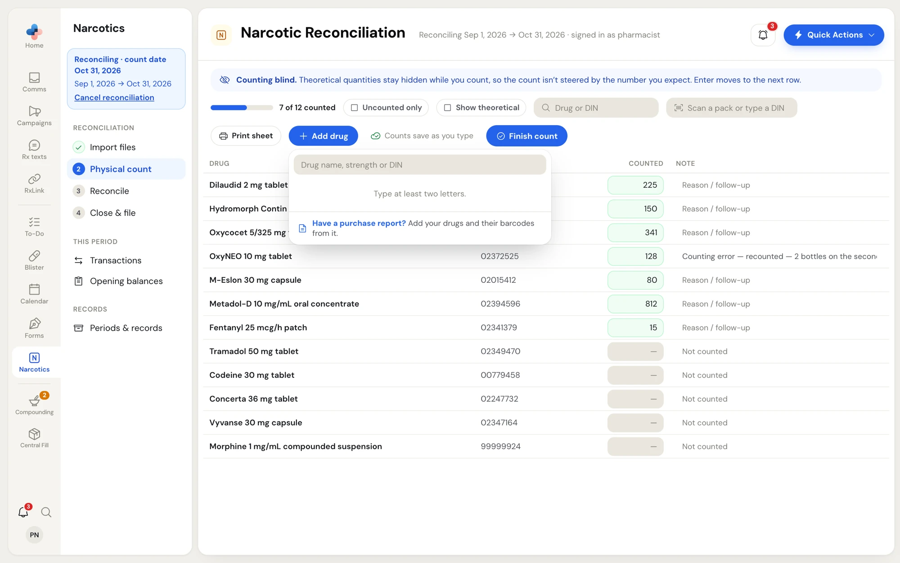
</Frame>

### Finish the count

Click **Finish count**. If every drug has a count, the theoretical figures appear (**Count finished · theoretical revealed**). If not, the message says how many are counted.

You can also tick **Show theoretical** at any time. The sheet then adds **Theoretical** and **Difference** columns, and two more filters: **Discrepancies** and **Unresolved**.

<Frame caption="The count sheet with Show theoretical on">
  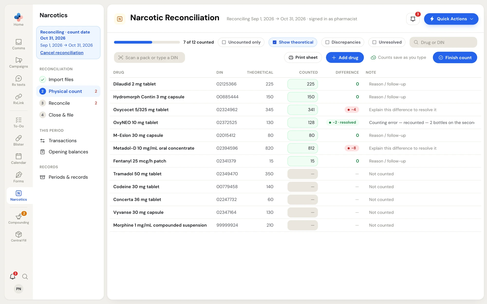
</Frame>

A difference shows as a red pill (for example **−4**). The Note box on that row then reads **Explain this difference to resolve it**: typing an explanation there resolves it, the same as the Reconcile step.

## Step 3: Reconcile

Click **Reconcile**. The table shows every drug's movement for the period and how its expected quantity is built.

<Frame caption="Reconciliation step 3: the full table">
  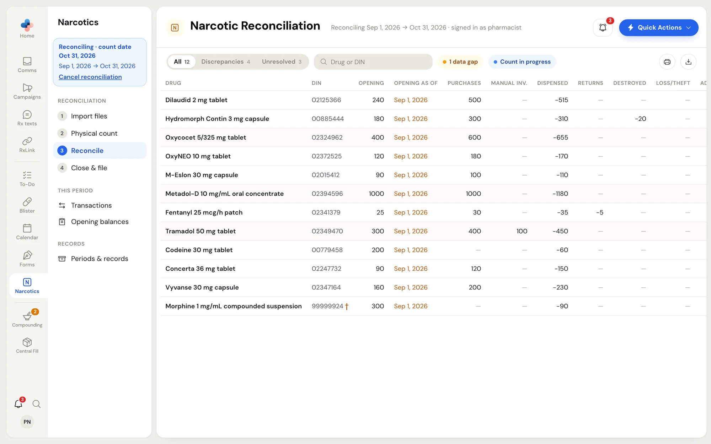
</Frame>

| Column | Meaning |
|---|---|
| **Opening** / **Opening as of** | The opening balance and the date it was counted |
| **Purchases**, **Manual inv.** | Stock in |
| **Dispensed**, **Returns**, **Destroyed**, **Loss/Theft** | Stock out (shown as negative numbers) |
| **Adjust.** | Corrections, in or out |
| **Theoretical** | What should be on the shelf: the opening plus everything after it |
| **Counted** | The physical count |
| **Difference** | Counted minus theoretical: green **0**, a red pill, or a green pill with **resolved** |

- **All**, **Discrepancies** and **Unresolved** filter the table; each shows its count.
- **Drug or DIN** searches.
- The totals on the right show how many drugs, discrepancies and unresolved differences there are.
- **Print** prints the table as it is filtered on screen; **Export CSV** downloads it as a spreadsheet file.
- A **†** after a DIN means it isn't a Health Canada DIN: it's the number your pharmacy software gives a compound or raw ingredient.
- Unresolved rows have a light red background.

Warning chips (**data gap**, **Count in progress**, **opening dates**) can appear in the toolbar. See [Warning chips](/narcotics/overview#warning-chips).

### Explain a difference

Click a drug's row. Its panel opens on the right.

<Frame caption="The drug panel with Resolve discrepancy open">
  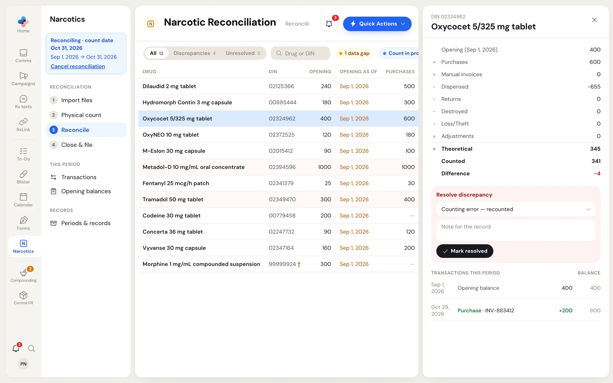
</Frame>

The top of the panel shows the sum line by line: opening, plus purchases and manual invoices, minus dispensed, returns, destroyed and loss/theft, plus or minus adjustments, equals **Theoretical**, then **Counted** and **Difference**.

<Steps>
  <Step title="Pick a reason">
    In **Resolve discrepancy**, pick a reason: **Counting error — recounted**, **Unrecorded dispense**, **Wholesaler short-shipped**, **Loss or theft** or **Other**.
  </Step>
  <Step title="Add a note">
    Type what you found in **Note for the record**, for example "found 2 in the return bin".
  </Step>
  <Step title="Click Mark resolved">
    The reason and note are written onto the drug's count and go into the closed record. The panel then shows a green **Resolved** line with your reason. Click **Change** to edit it.
  </Step>
</Steps>

<Warning>
  Picking **Loss or theft** reminds you to report it to Health Canada within 10 days and to record it as a **Loss / Theft** transaction. Resolving the difference doesn't record the transaction for you.
</Warning>

<Frame caption="A resolved drug, with its transactions and the archive from the previous system">
  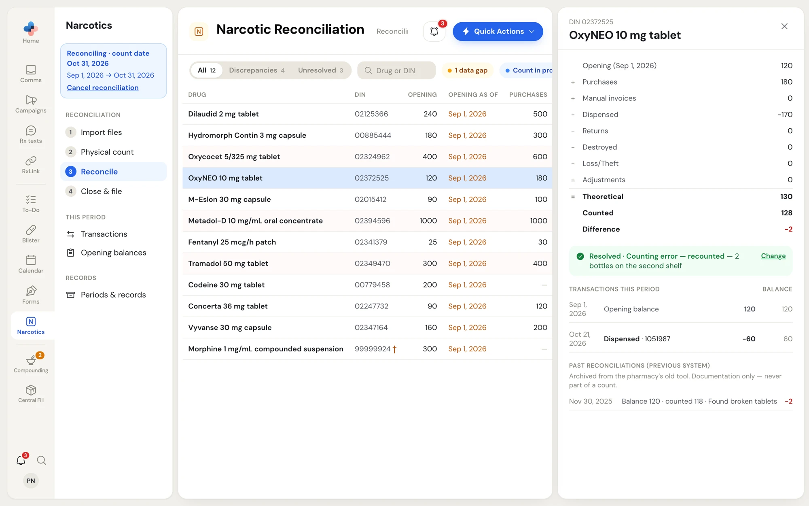
</Frame>

Below, **Transactions this period** lists each transaction with a running **Balance**. **Show N earlier** reveals transactions from before the opening date, which are already inside the opening balance. **Past reconciliations (previous system)** shows archived counts brought over from your old tool; they are documentation only and never part of a count. Click **×** to close the panel.

## Step 4: Close & file

Click **Close & file**. Four boxes summarise the period: drugs counted, differences, differences without a reason, and the count date. An amber line warns about drugs not counted and differences without a reason.

<Frame caption="Reconciliation step 4: Close & file">
  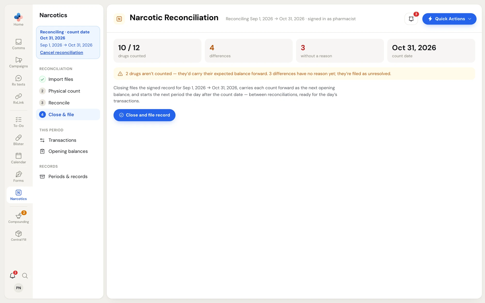
</Frame>

Only a pharmacist, manager or admin can close. Click **Close and file record**.

<Frame caption="Close reconciliation period">
  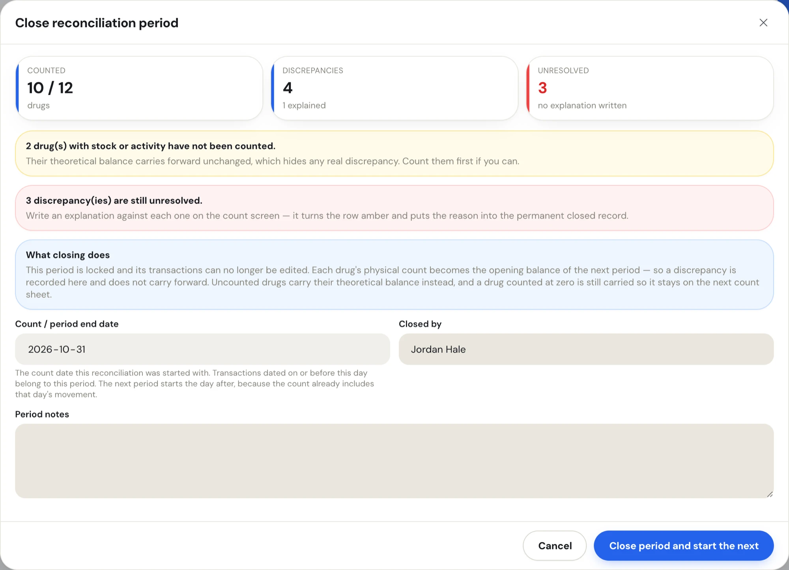
</Frame>

<Steps>
  <Step title="Read the warnings">
    - **N drug(s) with stock or activity have not been counted.** Their theoretical balance carries forward unchanged, which hides any real discrepancy. Count them first if you can.
    - **N discrepancy(ies) are still unresolved.** Unresolved differences don't stop you closing (an investigation is often still open), but they are filed as unresolved.
  </Step>
  <Step title="Check the date and your name">
    **Count / period end date** is the count date the reconciliation started with and can't be changed in this window. **Closed by** starts with the designated manager from **Settings › Profile**; change it to the person signing.
  </Step>
  <Step title="Add period notes">
    Type anything the record should carry in **Period notes**.
  </Step>
  <Step title="Click Close period and start the next">
    The page moves to **Periods & records** and says how many drugs were carried forward.
  </Step>
</Steps>

### What closing does

- The period is locked. Its transactions show **locked** and can't be edited or deleted.
- Each drug's physical count becomes the opening balance of the next period, so a discrepancy is recorded in this period and doesn't carry forward.
- Uncounted drugs carry their theoretical balance instead. A drug counted at zero is still carried, so it stays on the next count sheet.
- The next period starts the day after the count date, because the count already includes that day's movement. The side menu goes back to **Transactions** and **Start a reconciliation**.

<Warning>
  Closing is the one action in Narcotics you can't undo. Check the counts and reasons before you click **Close period and start the next**.
</Warning>
