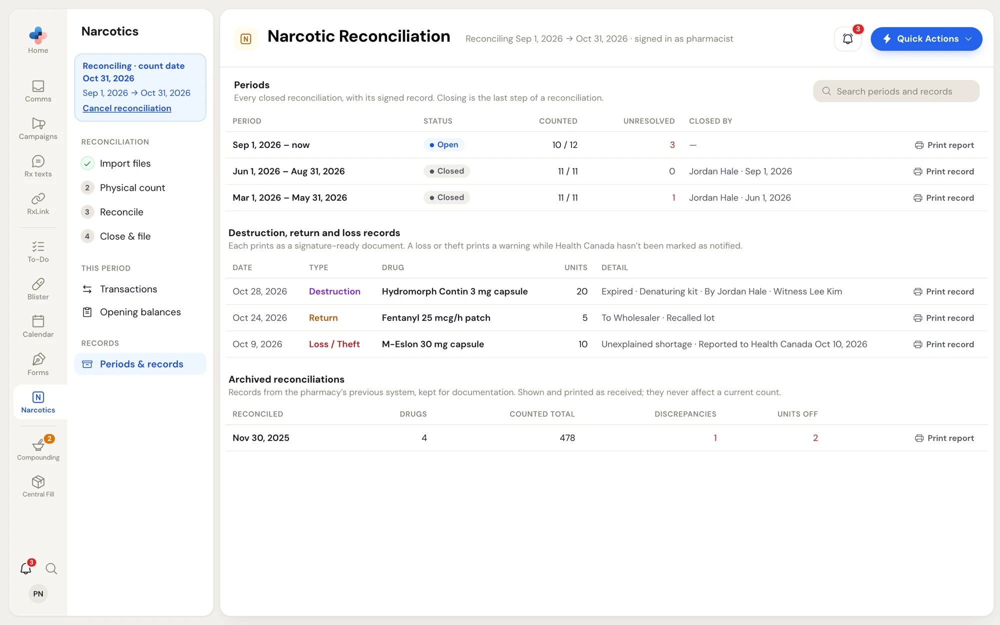
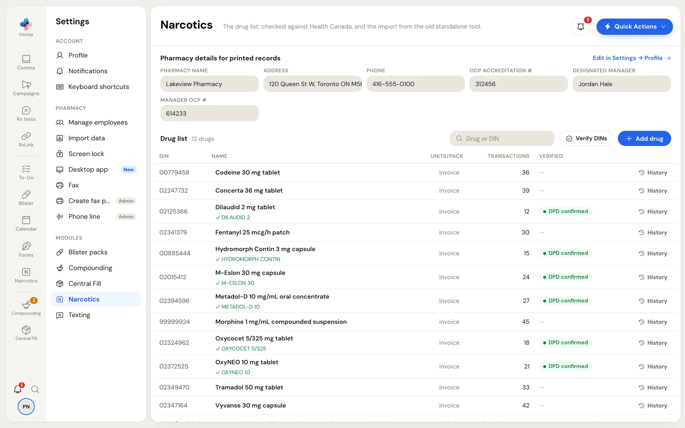
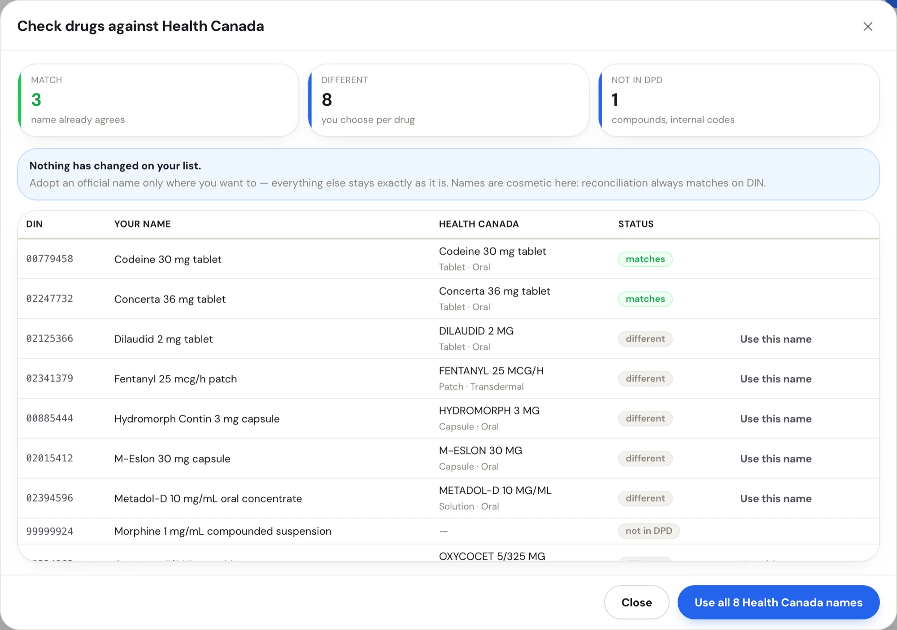

## Periods & records

Click **Periods & records** under **Records** in the Narcotics side menu. One search box at the top, **Search periods and records**, filters all three lists: Periods, the destruction, return and loss records, and the archive.

<Frame caption="Narcotics › Periods & records">
  
</Frame>

Every **Print** button opens the document in a new browser tab first, so you can check the pharmacy name and dates before you print. The pharmacy details on each document come from **Settings › Profile** (see [Pharmacy details](#pharmacy-details-for-printed-records)).

### Periods

Every reconciliation period, newest first.

| Column | Shows |
|---|---|
| **Period** | Start and end date (**now** for the open period) |
| **Status** | **Open** or **Closed** |
| **Counted** | Drugs counted out of drugs on the period |
| **Unresolved** | Differences filed without a reason (red when above 0) |
| **Closed by** | Who closed it and when |

- **Print report** on the open period prints the figures as they stand now.
- **Print record** on a closed period prints the signed record, frozen as it was when the period was closed.

### Destruction, return and loss records

Every destruction, return to supplier and loss or theft, with the date, drug, units and details. The 100 most recent show; the line under the heading says when there are more. Click **Print record** for a signature-ready document:

- A destruction prints two signature blocks, for the person who destroyed the stock and the witness.
- A return prints who it was returned to and who released it.
- A loss or theft prints a warning while **Reported to Health Canada OCS** isn't ticked on the transaction.

To record a new one, use **Add transaction** on **Transactions**. See [Transactions](/narcotics/transactions#add-a-transaction).

### Archived reconciliations

If you brought your history over from the standalone narcotic tool, the old system's reconciliations are listed by date with the number of drugs, the counted total, discrepancies and units off. They are kept for documentation, shown and printed as received, and never affect a current count. Click **Print report** to print one date.

## Settings › Narcotics

Go to **Settings** and click **Narcotics** under **Modules**. Clicking a drug name or **History** in this list opens that drug's panel on the Narcotics page.

<Frame caption="Settings › Narcotics: pharmacy details and the drug list">
  
</Frame>

### Pharmacy details for printed records

**Pharmacy name**, **Address**, **Phone**, **OCP accreditation #**, **Designated manager** and **Manager OCP #** print on every count sheet, report and record. They are read-only in **Settings › Narcotics**. Click **Edit in Settings → Profile** to change them. The designated manager also fills **Closed by** when you close a period.

### Drug list

Every drug PharmaTools tracks for your pharmacy. Drugs arrive on their own from imported reports and starting counts.

| Column | What you can do |
|---|---|
| **DIN** | Click it to open the drug's history. |
| **Name** | Click into the name and type to rename it. It saves when you leave the box or press **Enter**. A green line under the name shows the Health Canada name once confirmed. |
| **Units/pack** | Set it only for products invoiced in a different unit than you dispense, for example a pack of 2 pumps invoiced as 120 doses. Empty (**invoice**) means the invoice's pack size is used. Saving recomputes imported purchases in open periods; closed periods are signed records and stay as they are. |
| **Transactions** | How many transactions the drug has |
| **Verified** | **DPD confirmed** once checked against Health Canada's Drug Product Database |
| **History** / **Remove** | **History** opens the drug's panel. **Remove** appears only for a drug with no transactions, and takes it off the count sheet. |

Renaming a drug, changing units per pack, removing a drug and **Add drug** are for pharmacists, managers and admins. Use **Drug or DIN** to search the list.

<Note>
  Names are for display only. Reconciliation always matches on DIN, so renaming never touches a transaction, a count or a balance.
</Note>

### Verify DINs with Health Canada

Click **Verify DINs**. The **Check drugs against Health Canada** window looks up every DIN in Health Canada's Drug Product Database.

<Frame caption="Check drugs against Health Canada">
  
</Frame>

- **Match** — your name already agrees.
- **Different** — Health Canada uses another name. You choose per drug.
- **Not in DPD** — compounds and internal codes Health Canada doesn't list.

Nothing on your list changes until you say so. Click **Use this name** on a row to take Health Canada's name for that drug, or **Use all N Health Canada names** to rename every drug marked different (you confirm first). Click **Close** when done.

### Import from the standalone tool

If your pharmacy used the older standalone narcotic reconciliation tool, a pharmacist, manager or admin can bring its data across once.

1. In the old tool, use **Download JSON backup**.
2. In **Settings › Narcotics**, click **Choose backup file** under **Import from the standalone tool** and pick the backup.
3. If PharmaTools already has narcotic data, it asks **Merge this backup into existing data?** Rows already present are matched and skipped, never replaced. Click **Merge the backup**.

Drugs, transactions, periods, opening dates, counts and notes, edit history and archived reconciliations all come across. A green **Import complete.** box lists what was added and skipped. It's safe to run twice; nothing is duplicated.
