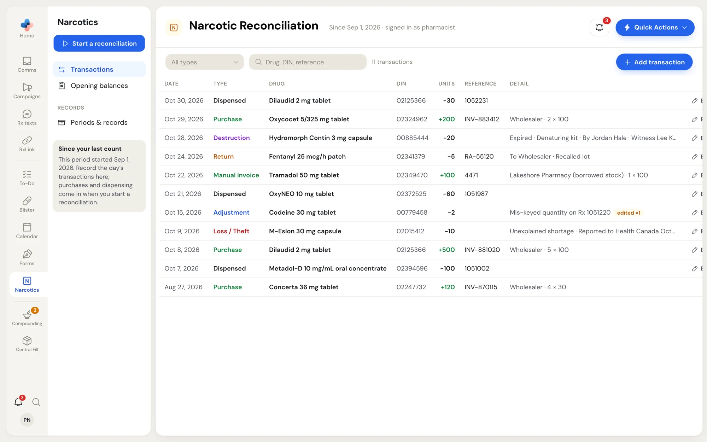
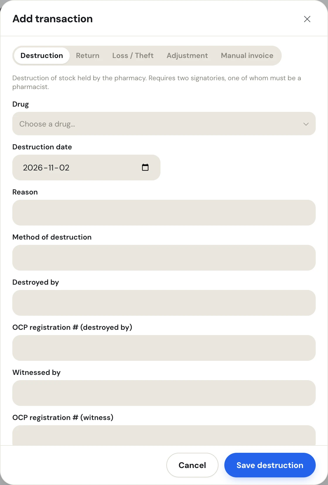
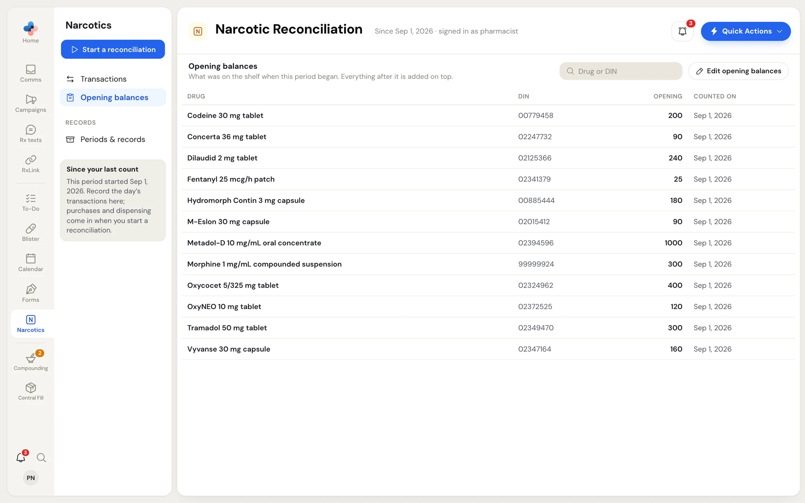

Between counts, the Narcotics page is your daily log. Purchases and dispensing come in from your files when you start a reconciliation; everything else that moves stock is recorded by hand on **Transactions**.

## The Transactions list

Click **Transactions** in the Narcotics side menu (under **This period** while a reconciliation is running).

<Frame caption="Narcotics › Transactions, newest first">
  
</Frame>

Every purchase, dispense, return, destruction, loss and adjustment on record is listed, newest first. More rows load as you scroll.

| Column | Shows |
|---|---|
| **Date** | The transaction date |
| **Type** | **Purchase**, **Manual invoice**, **Dispensed**, **Return**, **Destruction**, **Loss / Theft** or **Adjustment** |
| **Drug** | Click the name to open the drug's panel: how its expected quantity is built and every transaction this period with a running balance |
| **DIN** | The drug's DIN |
| **Units** | Green with a **+** for stock in; stock out shows with a **−** |
| **Reference** | Invoice number, Rx number, or credit note / authorization number |
| **Detail** | Supplier, pack size, reason, method, who destroyed and witnessed, Health Canada reporting |

- **All types** filters the list to one type.
- **Drug, DIN, reference** searches the list.
- The count next to the search says how many transactions match.

A row that was changed after it was recorded shows an amber **edited ×N** pill. Hover it to see each change, when it was made and the old and new values.

## Add a transaction

Only a pharmacist, manager or admin sees **Add transaction**.

<Frame caption="Add transaction, with Destruction picked">
  
</Frame>

<Steps>
  <Step title="Pick the type">
    Click **Add transaction**, then pick the type along the top: **Destruction**, **Return**, **Loss / Theft**, **Adjustment** or **Manual invoice**. The line under it explains when to use it.
  </Step>
  <Step title="Pick the drug and date">
    Choose the drug in **Drug** (**Choose a drug…** lists every drug on your list with its DIN) and set the date. The date label changes with the type, for example **Destruction date** or **Date of loss**.
  </Step>
  <Step title="Fill in the type's fields">
    See the table below. Fields left out that are required glow and the first one is named at the top of the window.
  </Step>
  <Step title="Enter the quantity and save">
    Enter **Units** in tablets, capsules or millilitres: the same unit the count is in. Add **Notes** if needed, then click **Save destruction** (or **Save return to supplier**, **Save loss or theft**, **Save adjustment**, **Save manual invoice**).
  </Step>
</Steps>

### What each type asks for

| Type | Use it for | Fields | Required |
|---|---|---|---|
| **Destruction** | Destroying stock held by the pharmacy | **Reason**, **Method of destruction**, **Destroyed by**, **OCP registration # (destroyed by)**, **Witnessed by**, **OCP registration # (witness)** | Destroyed by and Witnessed by. PharmaTools refuses the same name in both. The rule is two signatories, one of them a pharmacist. |
| **Return** (Return to supplier) | Stock sent back to a distributor, manufacturer or another pharmacy | **Credit note / authorization #**, **Returned to**, **Reason**, **Released by**, **OCP registration # (released by)** | Returned to |
| **Loss / Theft** | Unexplained shortages, thefts, break-ins and forgeries | **Type of incident**, **Date discovered**, **Reported to Health Canada OCS** (tick box), **Date reported to Health Canada**, **Reported to OCP** (tick box), **Date reported to OCP**, **Police file number** | — |
| **Adjustment** | A known correction: a mis-keyed quantity, a missing invoice line, a data entry error | **Reason**. **Units (+ adds stock, − removes)** takes a signed number, for example `-30`. | Reason |
| **Manual invoice** | Stock received outside the wholesaler file: from another pharmacy, a second supplier, or an invoice you enter by hand | **Invoice number**, **Supplier / received from**, **Packs**, **Units per pack** | Invoice number and Supplier / received from |

For a manual invoice, **Total units** is worked out as packs × units per pack. Tick **Part pack — I'll type the total units myself** for a broken or partly used carton, and type the total.

<Warning>
  Health Canada's Office of Controlled Substances must be notified of a loss or theft within 10 days of discovery. Until **Reported to Health Canada OCS** is ticked, the Detail column shows **NOT reported to Health Canada** and the printed loss record carries a warning.
</Warning>

## Edit or delete a transaction

A pharmacist, manager or admin sees **Edit** and **Delete** at the end of each row.

- **Edit** opens the same window with the saved values, titled **Edit destruction** (or the type). A row that was edited before shows **Edited N time(s) before.** with the last change date; every edit is kept on the record. Click **Save changes**.
- **Delete** asks **Delete this transaction?** with the type, units, drug and date. Click **Delete transaction** to remove it.

Purchases and dispensing normally come from your files. You can still edit one to correct an error in the source data. The window then says **This row came from an imported file.** Your change is kept even if the same file is imported again: the row is still recognised, so it doesn't come back as a duplicate.

<Note>
  A row inside a closed period shows **locked** instead of Edit and Delete. Closed periods are signed records. Record a correction as an **Adjustment** in the open period instead.
</Note>

<Info>
  While a reconciliation is running, keep recording transactions as usual. Any dated after the count date go to the next period.
</Info>

## Opening balances

Click **Opening balances** in the side menu to see what was on the shelf when this period began. Everything after it is added on top.

<Frame caption="Narcotics › Opening balances">
  
</Frame>

The table lists each drug with its **DIN**, **Opening** quantity and **Counted on** date. Use **Drug or DIN** to search. Click a drug name to open its panel.

After you close a period, each drug's physical count becomes the next period's opening balance, so you rarely edit these by hand. To correct one, a pharmacist, manager or admin clicks **Edit opening balances**. The window works like the starting count (see [Get started](/narcotics/getting-started#enter-the-counts)) with one warning:

<Warning>
  **A period is already open.** Saving replaces its opening balances. Its physical counts and all transactions are kept, but the expected (theoretical) totals change. Click **Save opening balances** only when you are sure.
</Warning>

When drugs have different starting dates, a blue **N opening dates** chip appears next to the title. Each drug adds only transactions dated from its own date. A full physical count and closing the period puts every drug on a single date.
