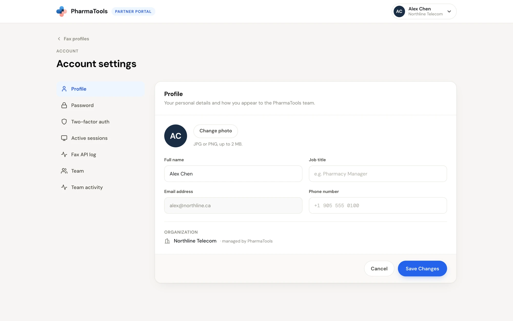
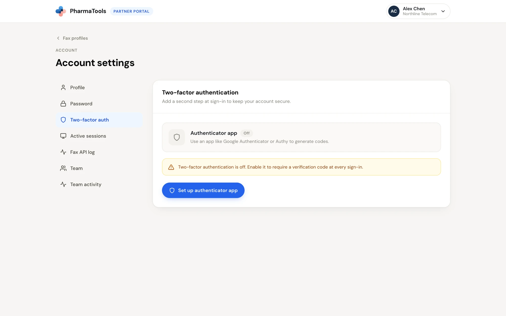
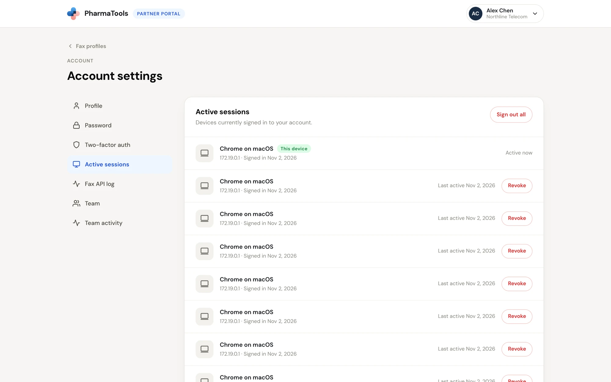
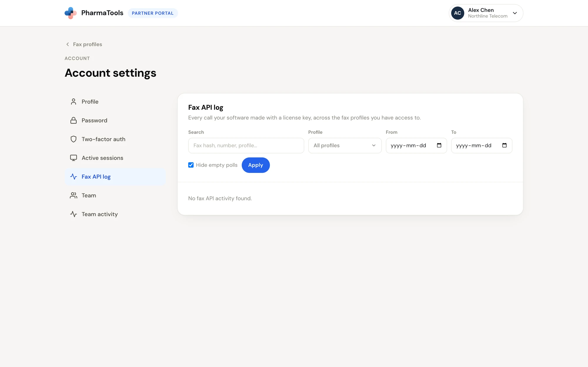
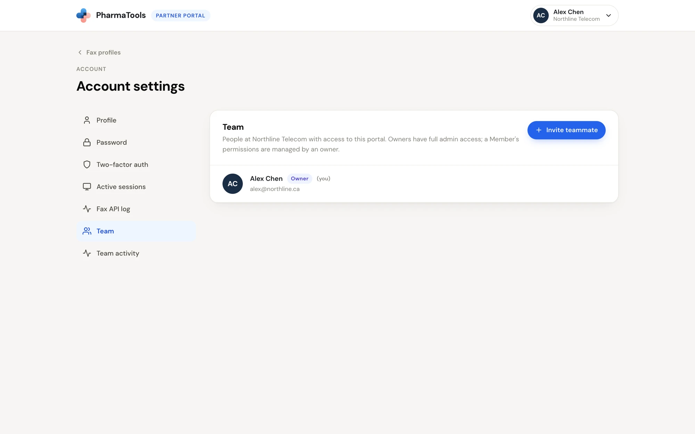
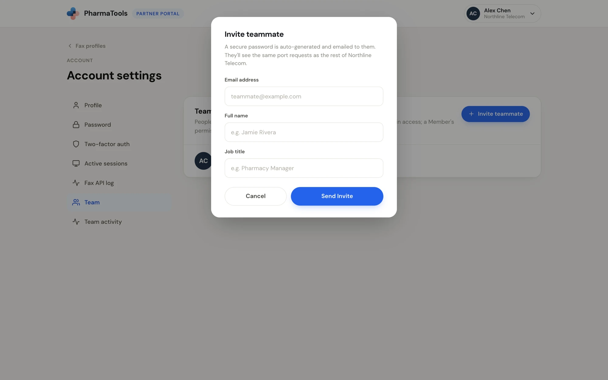
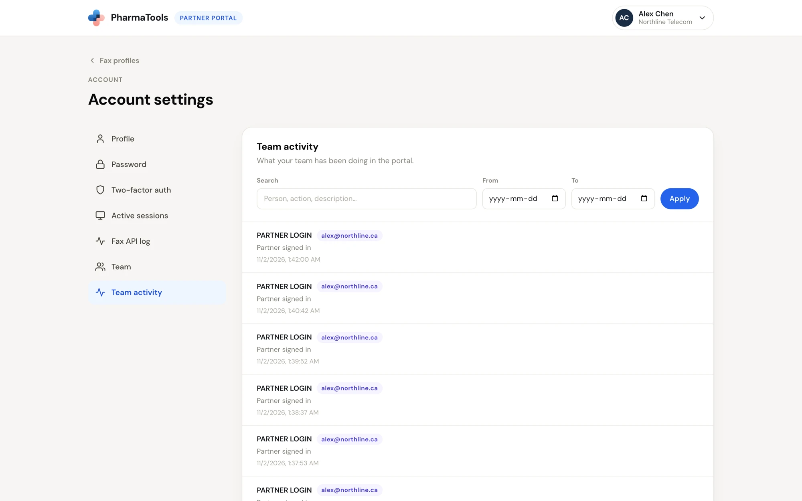

Open **Account settings** from your name at the top right of the Partner portal. **Fax profiles** at the top left takes you back.

The menu on the left has:

| Item | Who sees it |
| --- | --- |
| **Profile**, **Password**, **Two-factor auth**, **Active sessions**, **Fax API log** | Everyone |
| **Team**, **Team activity** | Owners |

## Profile

**Profile** holds your personal details and how you appear to the PharmaTools team.

<Frame caption="Account settings › Profile">
  
</Frame>

- **Change photo**: upload a JPG or PNG, up to 2 MB.
- **Full name**, **Job title** and **Phone number** can be changed. Click **Save Changes**, or **Cancel** to undo.
- **Email address** can't be changed in **Profile**. Ask your PharmaTools account manager.
- **Organization** shows your company, **managed by PharmaTools**.

## Password

Enter your **Current password**, a **New password** and **Confirm new password**, then click **Update Password**. The new password needs at least 8 characters, a number and a symbol; each rule turns green as you meet it. Use a password you don't use anywhere else.

## Two-factor authentication

Two-factor authentication adds a second step at sign-in: a 6-digit code from an authenticator app on your phone.

<Frame caption="Two-factor auth, switched off">
  
</Frame>

<Steps>
  <Step title="Start the setup">
    Click **Set up authenticator app**.
  </Step>
  <Step title="Scan the QR code">
    **Step 1 of 2 — Scan QR code**: open your authenticator app and scan the code. Can't scan? Copy the code shown under it into the app by hand. Click **Continue →**.
  </Step>
  <Step title="Verify">
    **Step 2 of 2 — Verify code**: type the 6-digit code the app shows and click **Enable 2FA**.
  </Step>
  <Step title="Save your backup codes">
    PharmaTools shows your backup codes **only once**. Store them somewhere safe. Each one signs you in if you lose your phone.
  </Step>
</Steps>

Once it is on, the page shows the **Method** (**Authenticator app**) and your **Backup codes**:

- **Regenerate now** makes new backup codes. Enter a current code from your app and click **Regenerate**. The old codes stop working.
- **Disable two-factor authentication** removes it. Enter your current password and click **Confirm Disable**.

## Active sessions

**Active sessions** lists every device signed in to your account: the browser and system, the network address, when it signed in and when it was last active. **This device** is the one you're using.

<Frame caption="Account settings › Active sessions">
  
</Frame>

- **Revoke** signs one device out.
- **Sign out all** signs out every device except this one.

Revoke any session you don't recognize, then change your password.

## Fax API log

**Fax API log** shows fax API activity across your fax profiles, the same events as each profile's **API log** tab: faxes queued, checks for new faxes, and files downloaded.

<Frame caption="Account settings › Fax API log">
  
</Frame>

Narrow it with **Profile** (or **All profiles**), **From** and **To**, and **Hide empty polls**, then click **Apply**.

## Team

Owners see **Team**: the people at your organization with access to the Partner portal. Owners have full admin access; a member's access is managed by an owner.

<Frame caption="Account settings › Team">
  
</Frame>

### Invite a teammate

<Steps>
  <Step title="Open the invite">
    Click **Invite teammate**.
  </Step>
  <Step title="Enter their details">
    Fill in **Email address**, **Full name** and **Job title**.
  </Step>
  <Step title="Send it">
    Click **Send Invite**. PharmaTools generates a secure password and emails it to them. They see the same port requests as the rest of your organization.
  </Step>
</Steps>

<Frame caption="Invite teammate">
  
</Frame>

New teammates join as **Member**. To give them a fax profile, open the profile and switch them on in **Team access** (see [Team access](/partner-portal/fax-profiles#team-access)).

### Change a role or remove someone

Each person shows their role, **Owner** or **Member**, and **(you)** beside your own name. To change someone's role, pick **Owner** or **Member** in the menu on their row. To remove someone, click **Remove** on their row, then **Confirm remove**.

## Team activity

Owners see **Team activity**: what everyone at your organization did in the portal, such as **Partner signed in**, with the person and the time. Search with **Person, action, description…** and narrow by date with **From** and **To**.

<Frame caption="Account settings › Team activity">
  
</Frame>
