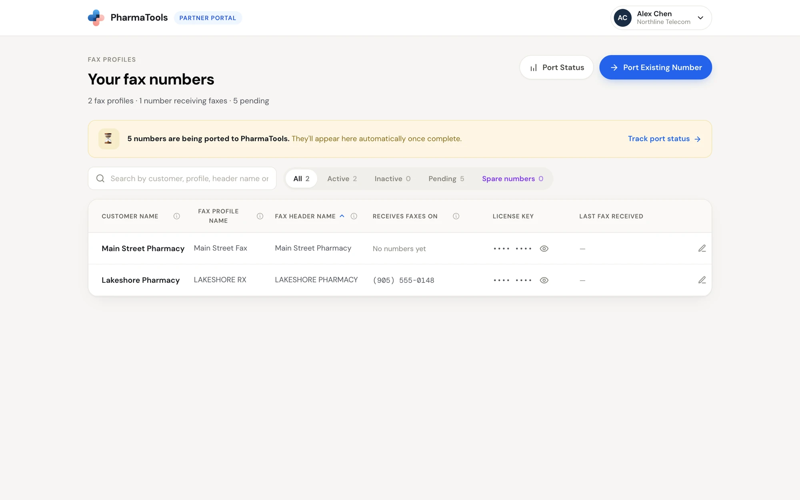
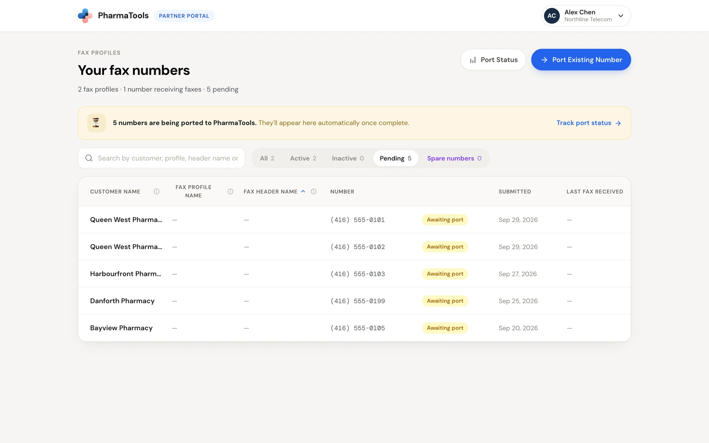
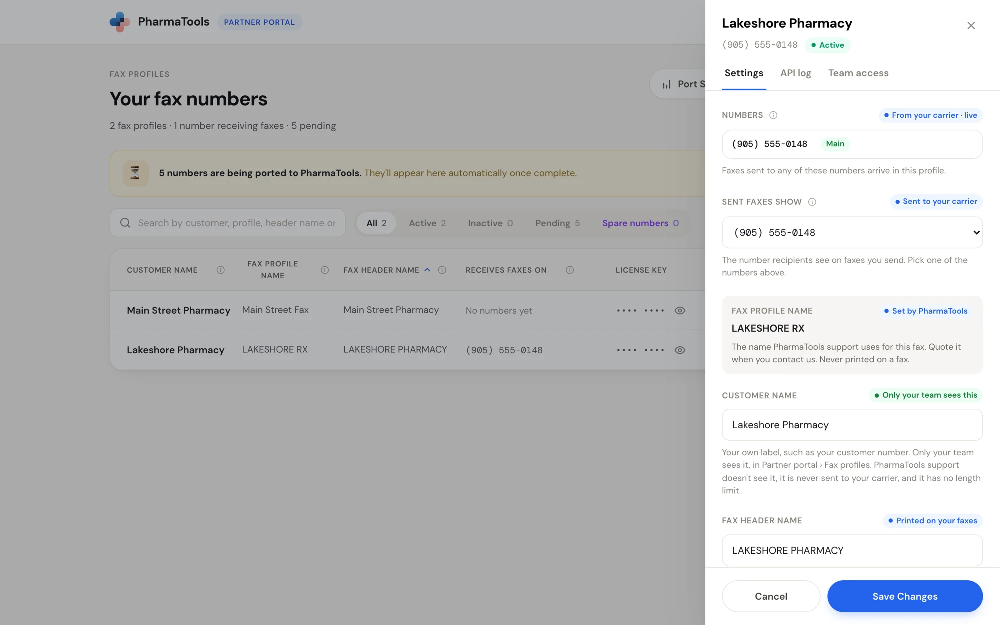
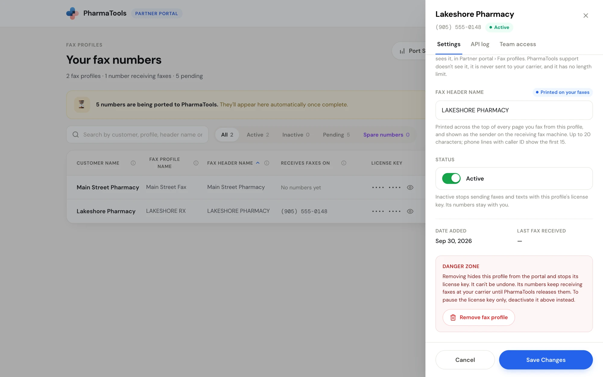
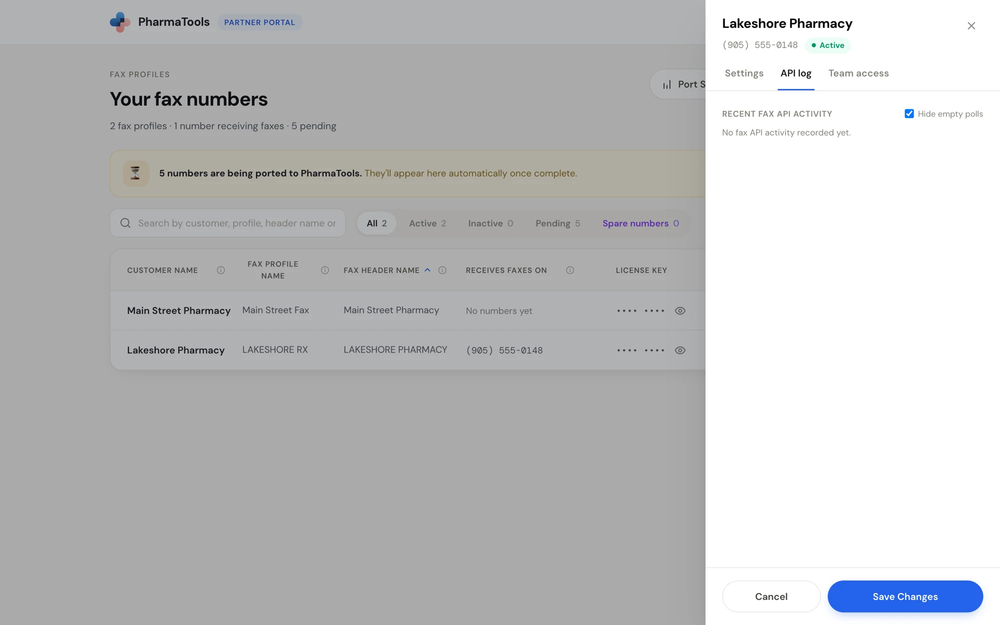
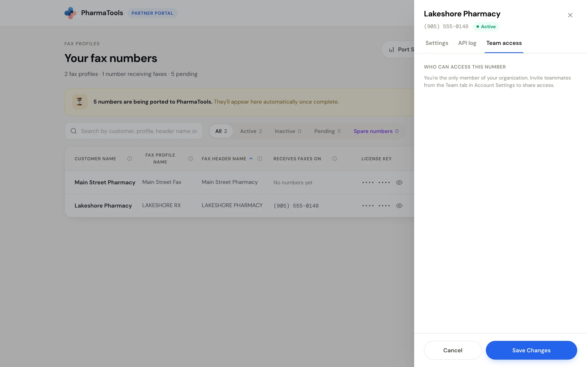
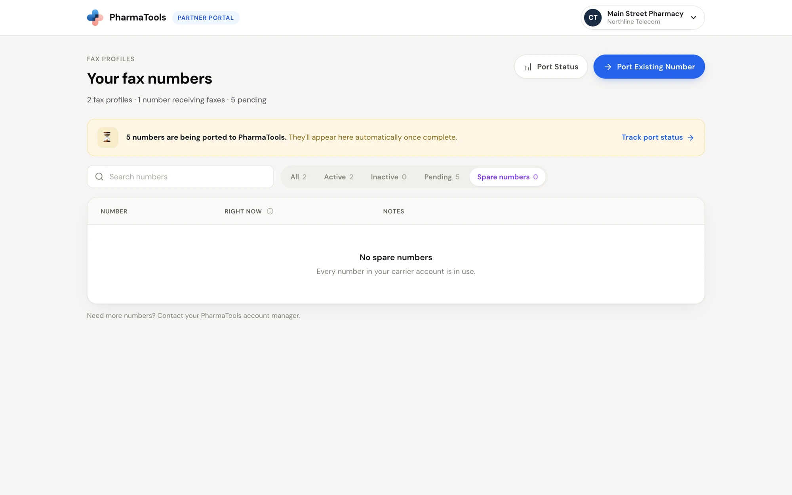

**Your fax numbers** is the first screen after you sign in. Each row is a **fax profile**: one customer's fax line, with the numbers that receive faxes on it and the license key that switches faxing on in the customer's software.

The line under the title counts your fax profiles, the numbers receiving faxes, and the numbers still being ported. While a port is in progress, a banner says how many numbers **are being ported to PharmaTools**; they appear in the list on their own once the port completes. Click **Track port status** to follow them.

<Frame caption="Your fax numbers: every fax profile with its three names, its numbers and its license key">
  
</Frame>

## The list

| Column | What it shows |
| --- | --- |
| **Customer name** | Your own label for the profile. See [The three names](/partner-portal/overview#the-three-names-of-a-fax-profile). |
| **Fax profile name** | The name PharmaTools uses for this fax. Quote it when you contact PharmaTools support. |
| **Fax header name** | The name printed on every faxed page and shown on the receiving fax machine |
| **Receives faxes on** | The first number that delivers faxes to this profile, read live from your carrier. **+N** means more numbers; a chip also shows when sent faxes show a different number. Click a chip to see every number, which one sent faxes show, and any spare number lent to the profile. **No numbers yet** means none deliver faxes to it yet. |
| **License key** | The key the customer enters in their software. Hidden by default. |
| **Last fax received** | When the last fax arrived on this profile |

Hover the **ⓘ** beside a column name for what it means. Click a column name to sort by it; click again to reverse the order.

### Find a profile

Type in **Search by customer, profile, header name or any number**. Any of a profile's numbers matches, not only the first one.

The tabs filter the list:

| Tab | What it shows |
| --- | --- |
| **All** | Every fax profile |
| **Active** | Profiles whose license key works |
| **Inactive** | Profiles you or PharmaTools deactivated |
| **Pending** | Numbers in a port that hasn't completed yet, marked **Awaiting port**, with the date the port was submitted |
| **Spare numbers** | Numbers in your carrier account that nothing uses. See [Spare numbers](#spare-numbers). |

<Frame caption="The Pending tab: numbers waiting for their port to complete">
  
</Frame>

### Find a license key

In the **License key** column, click the eye icon to show the key, and click it again to hide it. Click the copy icon to copy the key; it says **Copied!**. Keys are hidden by default so they aren't exposed on a shared screen.

## Open a fax profile

Click the pencil at the end of a row. The profile opens in a drawer on the right, with the profile's number and its status (**Active** or **Inactive**) under the name. It has three tabs: **Settings**, **API log** and **Team access** (owners only).

<Frame caption="A fax profile's Settings tab: its numbers, the number sent faxes show, and its names">
  
</Frame>

### Numbers

**Numbers** lists every number that delivers faxes to this profile, marked **From your carrier · live**. Faxes sent to any of them arrive in this profile. The main number is marked **Main**.

- To stop a number delivering faxes to this profile, click **Remove** beside it, then **Remove number**, or **Keep it** to cancel. If it is the profile's only number, PharmaTools warns that the profile will receive no faxes until another number is added.
- To add a number, click **＋ Add a spare number**. It shows when your carrier account has spare numbers and you can manage this profile. See [Assign a spare number](#assign-a-spare-number).

These changes go to your carrier straight away. They don't wait for **Save Changes**.

### Sent faxes show

**Sent faxes show** is the number recipients see on faxes sent from this profile (its caller ID), marked **Sent to your carrier**. Pick one of the profile's own numbers. When it saves, the line under it says **Saved. Sent faxes now show** the number. If sent faxes show a number the profile doesn't receive on, PharmaTools says so and asks you to pick one of the profile's numbers.

### Names

- **Fax profile name** is **Set by PharmaTools**. You can't change it.
- **Customer name** is marked **Only your team sees this**. It has no length limit.
- **Fax header name** is marked **Printed on your faxes**. Up to 20 characters; phone lines with caller ID show the first 15.

### Status

The **Status** switch turns the profile's license key on (**Active**) or off (**Inactive**). Inactive stops sending faxes and texts with this profile's license key. Its numbers stay with you.

Switching it off asks **Deactivate this fax profile?**: software and integrations using the key get errors until you turn it back on. Click **Yes, deactivate**, or **Keep active** to cancel.

<Frame caption="The bottom of the Settings tab: Status, the dates, and the Danger zone">
  
</Frame>

Under the switch, **Date added** and **Last fax received** show when the profile was set up and when it last received a fax.

### Save or cancel

Changes to **Customer name**, **Fax header name** and **Status** take effect when you click **Save Changes**. **Cancel** closes the drawer without saving them.

### Danger zone

**Remove fax profile** hides the profile from the portal and stops its license key. It can't be undone. Its numbers keep receiving faxes at your carrier until PharmaTools releases them.

<Warning>
To pause a customer for a while, deactivate the profile with the **Status** switch instead. Removing is permanent.
</Warning>

### API log

**API log** shows **Recent fax API activity** on this profile: each fax queued (**Fax queued**), each check for new faxes (**Polled for new faxes**) and each file downloaded (**File downloaded**), with the time. Leave **Hide empty polls** ticked to hide checks that found nothing. Click **Load more** for older activity.

Use it to check whether a customer's software is reaching PharmaTools. If a fax the customer says they sent isn't in the **API log**, it never reached PharmaTools: check the customer's software and license key.

<Frame caption="The API log tab">
  
</Frame>

### Team access

Owners see **Team access**: **Who can access this number**. Switch each member on or off for this profile. Owners always have access. If you are the only member of your organization, invite teammates first (see [Team](/partner-portal/account-settings#team)).

<Frame caption="The Team access tab, for an organization with only one member">
  
</Frame>

## Spare numbers

The **Spare numbers** tab lists the numbers in your carrier account that nothing uses, and the ones you lent to a profile for a while.

<Frame caption="Spare numbers">
  
</Frame>

| Column | What it shows |
| --- | --- |
| **Number** | The number |
| **Right now** | **Spare**: nothing receives on it. **Lent to** a profile: it is receiving faxes for that profile for a while. |
| **Notes** | How long a lent number stays with its profile, and the number's city |

- **Assign to a profile** on a spare number opens **Assign a spare number**.
- **End now** on a lent number stops it receiving for that profile and makes it spare again. Confirm with **End now**, or click **Keep it**.

If the tab says **No spare numbers to show yet**, your account manager hasn't linked your carrier account yet. Need more numbers? Contact your PharmaTools account manager.

### Assign a spare number

A spare number is useful while a customer's number is being ported: lend the spare to the customer's profile so faxes keep arriving, and ask the old provider to forward the old line to it.

<Steps>
  <Step title="Open the dialog">
    In a profile's drawer, click **＋ Add a spare number**. Or, on **Spare numbers**, click **Assign to a profile** on a number.
  </Step>
  <Step title="Choose the profile and the number">
    Pick the **Fax profile** that should receive faxes on the number, and the number under **Spare numbers**.
  </Step>
  <Step title="Choose how long">
    Under **How long**, pick one of your pending ports or **Until I remove it**. If you pick a port, the spare follows that port's date: when the port completes, the ported number joins this profile and the spare becomes spare again. If the port date moves, the end date moves with it.
  </Step>
  <Step title="Add it">
    Click **Add number**, then **Done**.
  </Step>
</Steps>

<Tip>
**Forwarding an old fax line?** Ask the old provider to forward it to the spare number. Forwarding is set at their end, not in the Partner portal.
</Tip>

## Common questions

<AccordionGroup>
  <Accordion title="A customer says faxes aren't sending. What do I check first?">
    Open the profile and check that **Status** is **Active**. Then open **API log**: if the customer's fax isn't there, it never reached PharmaTools, so check the customer's software and license key.
  </Accordion>
  <Accordion title="Should I deactivate or remove a profile?">
    Deactivate for anything temporary, such as a billing hold. Removing is permanent and stops the license key for good.
  </Accordion>
  <Accordion title="A number I ported isn't in the list.">
    Ported numbers join the list on their own once the port is **Completed**. Until then they show on the **Pending** tab and on **Port status**.
  </Accordion>
  <Accordion title="Which name do I give PharmaTools support?">
    The **Fax profile name**. PharmaTools never sees your **Customer name**.
  </Accordion>
</AccordionGroup>

<Card title="Next: port a number" icon="arrow-right" href="/partner-portal/starting-a-port">
  Move a customer's existing number to PharmaTools.
</Card>
