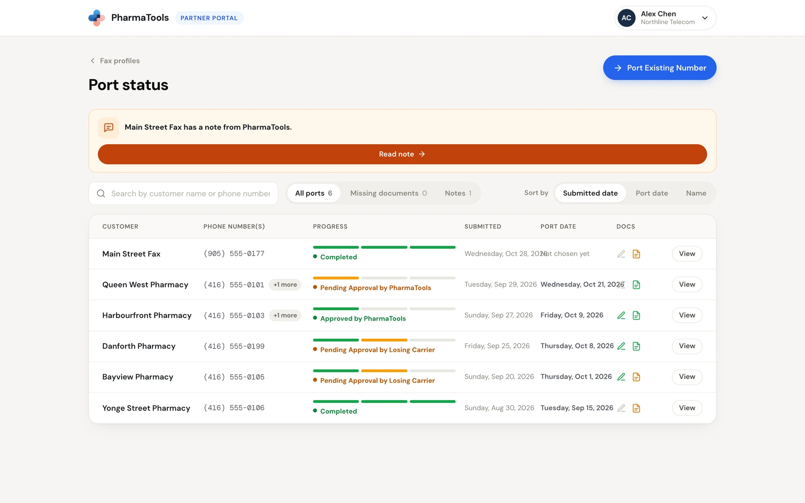
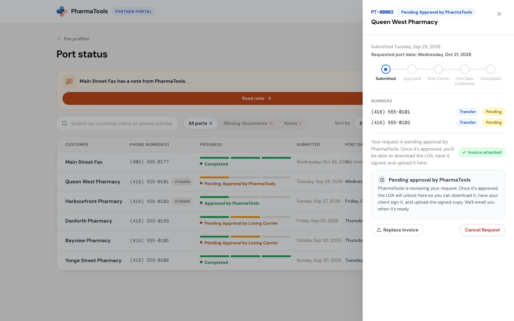
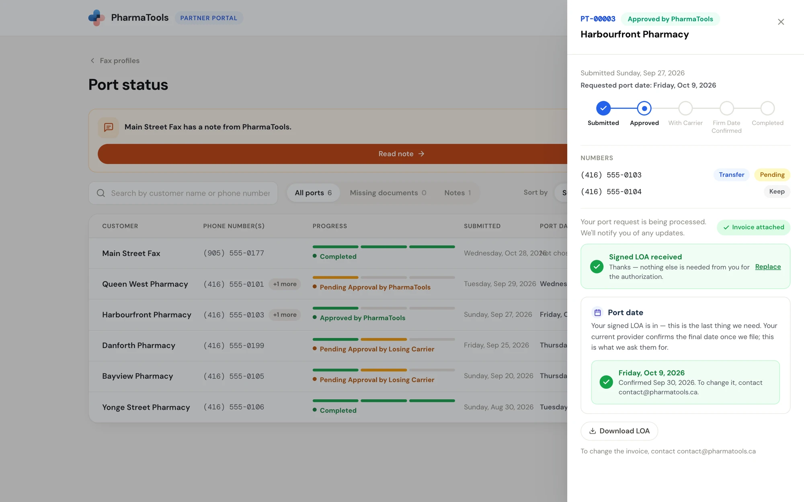
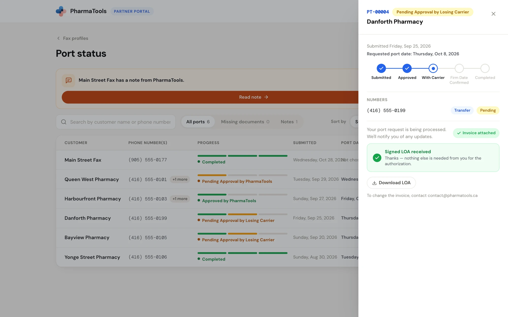

**Port status** lists every port request your organization has submitted. Open it with **Port Status** on **Your fax numbers**, or **Track port status** on the port banner. **Fax profiles** at the top left takes you back.

<Frame caption="Port status: every request with its progress, dates and documents">
  
</Frame>

## Cards for requests that need a fix, a date or a document

Cards above the port list name each request that is waiting on you, the partner, and give you a button to act on it:

| Card | Button |
| --- | --- |
| A request **needs changes before approval**, or **was rejected by the carrier** | **Edit & Resubmit** (opens the form), **Fix now** or **Review** |
| A request **has a note from PharmaTools** | **Read note**, or **Show these** for several |
| A request **needs a port date** | **Choose Port Date**, or **Review** for several |
| A request **is missing a signed LOA** | **Upload LOA**, or **Show these** for several |

## The list

Search with **Search by customer name or phone number**. Filter with **All ports**, **Missing documents** (approved requests still waiting for the signed LOA) and **Notes** (requests with a note from PharmaTools). Use **Sort by** for **Submitted date**, **Port date** or **Name**.

| Column | What it shows |
| --- | --- |
| **Customer** | The pharmacy name from the request |
| **Phone number(s)** | The first number, and **+N more** for the rest. Hover for all of them. |
| **Progress** | Three bars, for PharmaTools' approval, the current carrier, and the port itself, with the exact status under them. Amber is in progress, green is done, red needs attention, grey is cancelled. |
| **Submitted** | When you submitted the request |
| **Port date** | The port date. **Set after LOA** before approval; **Not chosen yet** once it is yours to choose. |
| **Docs** | The pen is the signed LOA, the page is the invoice. Each turns green once PharmaTools has it. Hover for **Signed LOA received**, **Signed LOA required**, **Invoice attached** or **Invoice missing**. |

Click **View** to open the request in a drawer.

## Port statuses

| Status | What it means | What you do |
| --- | --- | --- |
| **Pending Approval by PharmaTools** | PharmaTools is checking the details. | Nothing. You can replace the invoice or cancel. |
| **Requires Modification** | PharmaTools needs some details changed before it can approve. | Read **What needs to change** and click **Edit & Resubmit**. |
| **Approved by PharmaTools** | Approved. The LOA can be downloaded. | Get the LOA signed, upload it, choose the port date. |
| **Pending Approval by Losing Carrier** | The request is with the current provider. | Nothing. Wait for the firm date. |
| **Firm Date Confirmed** | The current provider committed to a cutover date. | Tell the customer the date, and not to cancel anything with the old provider. |
| **Completed** | The numbers are on PharmaTools. | Check that the old provider carried out the Transfer, Leave as is and Disconnect choices. |
| **Rejected by Losing Carrier** | The current provider refused the port. | Contact PharmaTools support for the details. |
| **Cancelled** | The request was cancelled. | Nothing |

The drawer's step tracker shows the same path: **Submitted**, **Approved**, **With Carrier**, **Firm Date Confirmed**, **Completed**.

## The port drawer

The drawer shows the request ID (such as **PT-00003**), its status and the pharmacy name, then **Submitted** and **Requested port date**, the step tracker, and **Numbers**: each number with its choice (**Transfer**, **Keep** or **Disconnect**) and, for transferred numbers, **Pending** or **Ported**.

<Frame caption="A request waiting for PharmaTools' approval">
  
</Frame>

What comes next depends on the status.

### While PharmaTools reviews it

The box **Pending approval by PharmaTools** says the LOA unlocks once the request is approved, and that PharmaTools emails you when it's ready.

- **Replace Invoice** uploads a newer invoice.
- **Cancel Request** asks **Cancel this request?**. Click **Confirm Cancel** to cancel it.

### When PharmaTools asks for changes

The status is **Requires Modification**. The drawer shows **Changes needed before approval** and **What needs to change**, PharmaTools' note. Click **Edit & Resubmit**: the form opens as **Update your port request**, with your original details filled in. Change what was asked (and the invoice, if that is what changed), click **Resubmit for Review**, go through the checklist and click **Confirm & Resubmit**. Nothing else is lost. **Discard Changes** leaves without resubmitting.

### Get the LOA signed

Once the request is **Approved by PharmaTools**, the drawer shows **Signed LOA required**:

<Steps>
  <Step title="Download the LOA">
    Click **Download LOA**. The details are already filled in; only the signature box is blank.
  </Step>
  <Step title="Have your client sign it">
    Send it to your client to print, sign and date the signature box, then return it to you.
  </Step>
  <Step title="Upload the signed PDF">
    Drop the signed LOA on the box, or click **browse**. PDF only, up to 10 MB.
  </Step>
</Steps>

The drawer then shows **Signed LOA received**. Click **Replace** to upload a different copy.

### Choose the port date

After the signed LOA is in, the **Port date** box asks for the date to request from the current provider.

- **As soon as possible**, with the earliest date shown. Recommended: it is the earliest date PharmaTools can ask the current provider for, 6 business days from today.
- **Request a specific date**: a weekday later than the earliest date. Useful if the customer needs staff on site for the switchover.

Click **Confirm Port Date**. **This can't be changed once confirmed.** The box then shows the date and when you confirmed it. To change it afterwards, contact contact@pharmatools.ca.

<Frame caption="An approved request with the signed LOA received and the port date confirmed">
  
</Frame>

The current provider confirms the final date once PharmaTools files the request. The status then moves to **Firm Date Confirmed**.

### With the carrier and after

From **Pending Approval by Losing Carrier** on, the drawer says the request is being processed and that PharmaTools will notify you of any updates. **Download LOA** stays available. To change the invoice now, contact contact@pharmatools.ca.

<Frame caption="A request with the current carrier">
  
</Frame>

A **Note from PharmaTools** shows in the drawer when PharmaTools wrote one.

## After the port completes

- The ported numbers join the customer's fax profile on **Your fax numbers** on their own. If you lent a spare number to that profile until this port, the spare goes back to **Spare numbers**.
- Ask the customer to check with the old provider that the **Transfer**, **Leave as is** and **Disconnect** choices were carried out, so disconnected numbers stop billing.

## Common questions

<AccordionGroup>
  <Accordion title="Why can't I download the LOA yet?">
    The request is still **Pending Approval by PharmaTools** or **Requires Modification**. Before approval the details it prints can still change, so it stays locked. **Download LOA** appears once the request is approved.
  </Accordion>
  <Accordion title="Can the customer sign electronically?">
    The LOA needs the signature box signed and dated. Have the customer print, sign and date it, then upload the scanned PDF.
  </Accordion>
  <Accordion title="The request has been Approved for a while.">
    Check the **Docs** column. A port doesn't go to the current provider until the signed LOA is uploaded and the port date is confirmed.
  </Accordion>
  <Accordion title="What does Firm Date Confirmed mean for the customer?">
    The current provider committed to a cutover date. Tell the customer to expect a short interruption that day, and not to cancel anything with the old provider before it.
  </Accordion>
  <Accordion title="A request was rejected by the carrier.">
    Contact PharmaTools support with the request ID. A failed porting attempt can carry a fee (see [the checklist](/partner-portal/starting-a-port#the-pre-submission-checklist)).
  </Accordion>
</AccordionGroup>
