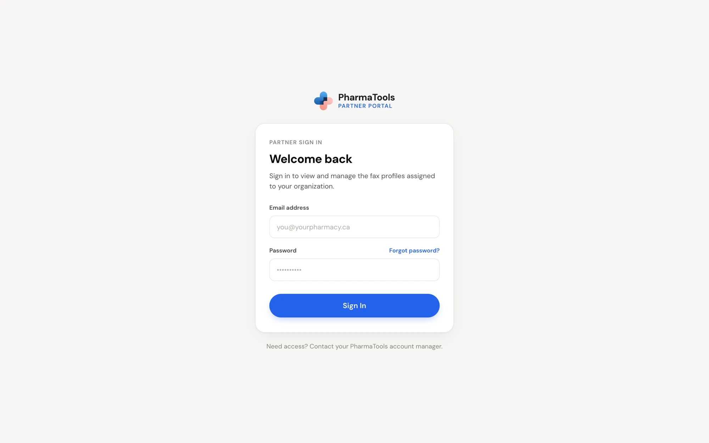
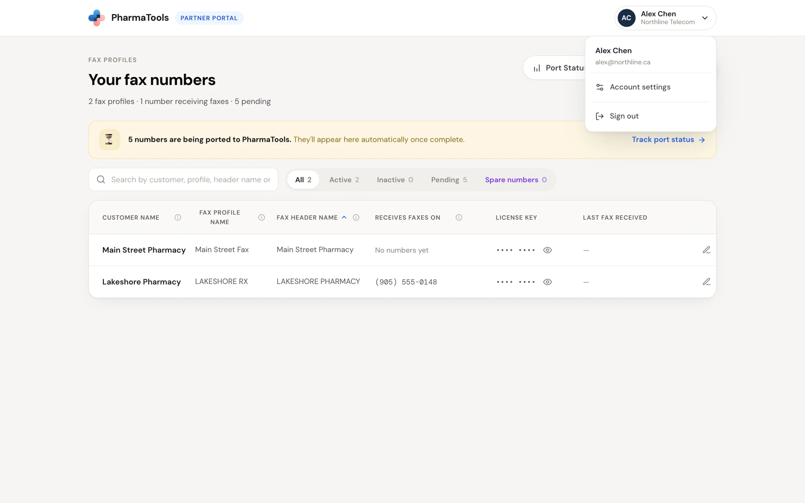

The **Partner portal** is for PharmaTools partners: the companies that set up and support PharmaTools faxing for their pharmacy customers. It is a separate site from the PharmaTools app that pharmacies use, with its own sign-in.

In the Partner portal you can:

- See every **fax profile** assigned to your organization, with the numbers that receive faxes on it and its license key. See [Fax profiles](/partner-portal/fax-profiles).
- Add a **spare number** from your carrier account to a profile, for example while a number is being ported.
- **Port an existing number** from a customer's current provider to PharmaTools. See [Port a number](/partner-portal/starting-a-port).
- Follow each port on **Port status**, download the Letter of Authorization, upload the signed copy and choose the port date. See [Track a port](/partner-portal/monitoring-a-port).
- Manage your account, your security and your team. See [Account settings](/partner-portal/account-settings).

## Sign in

Open the Partner portal address your PharmaTools account manager gave you. On **Welcome back**, enter your **Email address** and **Password** and click **Sign In**.

<Frame caption="The Partner portal sign-in page">
  
</Frame>

- If two-factor authentication is on for your account, PharmaTools then asks for the 6-digit code from your authenticator app. You can type one of your backup codes instead.
- **Forgot password?** opens **Reset your password**. Enter your email and PharmaTools emails you a link. The link opens **Set a new password**.
- No account yet? Ask your PharmaTools account manager. An owner at your organization can also invite you (see [Team](/partner-portal/account-settings#team)).

## Find your way around

The portal has three screens, plus your account settings:

| Screen | How to get there | What it is for |
| --- | --- | --- |
| **Your fax numbers** | Opens after sign-in. From anywhere else, click **Fax profiles** at the top left. | Your fax profiles, their numbers and license keys, pending numbers and spare numbers |
| **Port status** | **Port Status** on **Your fax numbers**, or **Track port status** on the port banner | Every port request you have submitted |
| **Port an existing number** | **Port Existing Number** on **Your fax numbers** or **Port status** | The form and Letter of Authorization for a new port |
| **Account settings** | Your name at the top right › **Account settings** | Your profile, password, two-factor authentication, sessions, the fax API log, and (for owners) your team |

<Frame caption="The account menu at the top right">
  
</Frame>

To sign out, click your name at the top right, then **Sign out**.

## Owners and members

Everyone in your organization has one of two roles:

| Role | What they can do |
| --- | --- |
| **Owner** | Everything, plus the **Team** and **Team activity** settings and each profile's **Team access** tab. An owner always has access to every fax profile. |
| **Member** | Sees and works on the fax profiles an owner gave them access to, and every port request of the organization |

## The three names of a fax profile

A fax profile has exactly three names. Each one has its own job:

| Name | Where it shows | Who sets it |
| --- | --- | --- |
| **Customer name** | Only in your Partner portal. Use it for your own label, such as your customer number. PharmaTools support never sees it, and it is never sent to your carrier. | You |
| **Fax profile name** | In the Partner portal and at PharmaTools. Quote it when you contact PharmaTools support about a fax. It is never printed on a fax. | PharmaTools |
| **Fax header name** | Printed across the top of every page faxed from this profile, and shown as the sender on the receiving fax machine. Up to 20 characters; caller ID shows the first 15. | You |

<CardGroup cols={2}>
  <Card title="Fax profiles" icon="printer" href="/partner-portal/fax-profiles">
    Numbers, license keys and spare numbers.
  </Card>
  <Card title="Port a number" icon="arrow-right-left" href="/partner-portal/starting-a-port">
    Move a customer's existing number to PharmaTools.
  </Card>
</CardGroup>
