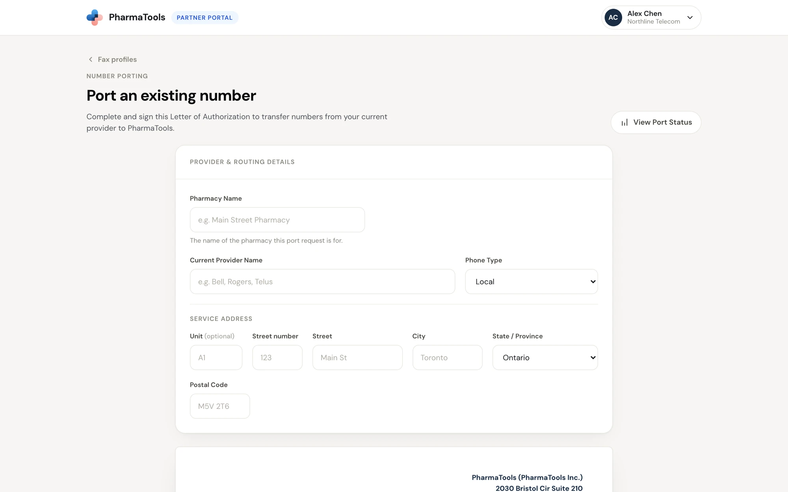
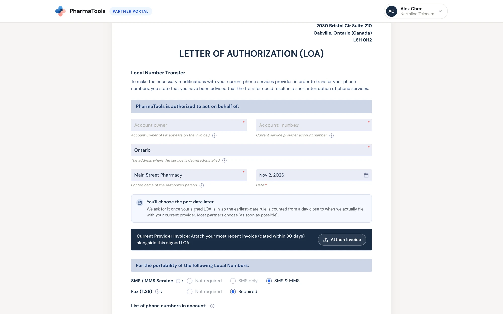
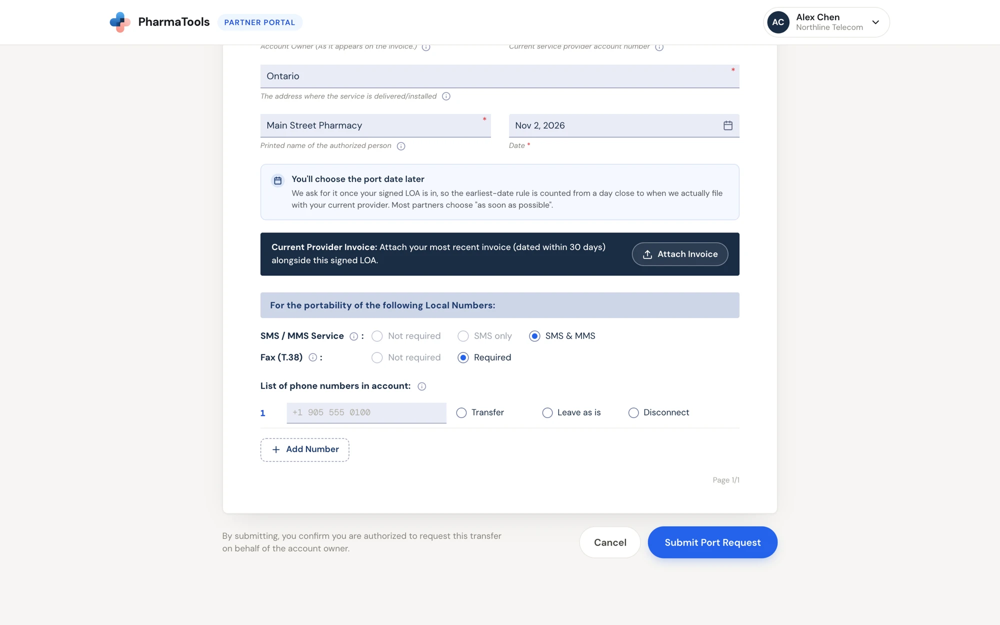

When a customer wants to keep the fax number they already have, port it to PharmaTools. You fill in one form: the provider and routing details, then the **Letter of Authorization (LOA)**. PharmaTools reviews it before anything goes to the current provider.

Click **Port Existing Number** on **Your fax numbers** or on **Port status**. The form **Port an existing number** opens. **View Port Status** at the top right takes you to your existing requests.

<Info>
**Before you start, have these from the customer:**

- Their **most recent invoice** from the current provider, dated within the last 30 days.
- **Every number** on that account, and for each one whether to **Transfer**, **Leave as is** or **Disconnect** it.
- The **service address**: where the numbers are in use. It is often not the billing address on the invoice.
- The **account owner** exactly as it appears on the invoice, and the **account number**.
- The name of the person **authorized** to approve the transfer.
</Info>

## Provider & routing details

<Frame caption="The top of the port form: the pharmacy, its current provider and the service address">
  
</Frame>

| Field | What to enter |
| --- | --- |
| **Pharmacy Name** | The name of the pharmacy this port request is for. It names the request on **Port status**. |
| **Current Provider Name** | The phone company the numbers are with today |
| **Phone Type** | **Local** or **Toll-Free** |
| **Service Address** | **Unit** (optional), **Street number**, **Street**, **City**, **State / Province** and **Postal Code** of the place the numbers are installed |

## The Letter of Authorization

The LOA authorizes PharmaTools Inc. to act for the account owner with the current provider. The service address you entered above fills in on its own.

<Frame caption="The Letter of Authorization: account details, the invoice and the services">
  
</Frame>

| Field | What to enter |
| --- | --- |
| **Account Owner** | Exactly as it appears on the current provider's invoice |
| **Current service provider account number** | The account ID from the invoice. Call the provider if you're not sure. |
| **The address where the service is delivered/installed** | Filled in from the service address above |
| **Printed name of the authorized person** | The person who approves the transfer. Your name is filled in; change it if someone else signs. |
| **Date** | Today's date is filled in |
| **Current Provider Invoice** | Click **Attach Invoice** and choose the invoice (PDF, PNG or JPG). Required. |
| **SMS / MMS Service** | **Not required**, **SMS only** or **SMS & MMS** |
| **Fax (T.38)** | **Not required** or **Required** |

<Note>
**You'll choose the port date later.** PharmaTools asks for it once your signed LOA is in, so the earliest date is counted from close to when the request is filed with the current provider. See [Choose the port date](/partner-portal/monitoring-a-port#choose-the-port-date).
</Note>

### List the numbers

Under **List of phone numbers in account**, type each number on the account and choose what happens to it:

- **Transfer**: port it to PharmaTools.
- **Leave as is**: it stays with the current provider.
- **Disconnect**: cancel it with the current provider.

Click **Add Number** for another line. Every number needs a choice.

<Frame caption="The numbers on the account, each with Transfer, Leave as is or Disconnect, and Submit Port Request">
  
</Frame>

## Submit the request

<Steps>
  <Step title="Click Submit Port Request">
    If a required field is empty, the form marks it and doesn't continue. By submitting, you confirm you are authorized to request this transfer on behalf of the account owner.
  </Step>
  <Step title="Go through the Pre-Submission Checklist">
    Tick each item, or **Select all** once you've checked them. Then click **Confirm & Submit**. **Cancel** takes you back to the form.
  </Step>
  <Step title="Wait for PharmaTools' review">
    The request shows on **Port status** as **Pending Approval by PharmaTools**. PharmaTools checks the details and emails you when it is approved, or asks for changes. See [Track a port](/partner-portal/monitoring-a-port).
  </Step>
</Steps>

### The Pre-Submission Checklist

- **Failed ports may incur a fee.** A fee is charged if the current carrier rejects the port, or if the customer changes their mind after the request has gone to the current carrier: **Cancelled Porting Attempt: $34.95 CAD**, **Failed Porting Attempt (when applicable): $15.00 CAD**.
- Invoice is dated within the last 30 days.
- All numbers are from the same provider and the same invoice.
- Account holder name matches carrier records exactly.
- Account number verified.
- Cascade / sequential routing has been disabled.
- **Do Not Cancel Your Phone Service Before Porting.** See the warning below.
- Toll-free numbers ported first, if they point to these numbers.
- Service address provided, not the billing address.
- All numbers are active.

<Warning>
**Don't let the customer cancel their phone service before the port completes.** If their internet runs over the same copper line as their phone (a wet loop), they should ask their internet provider to convert it to a dry loop (naked DSL) before porting, and to assign an administrative number to keep the internet signal on the line. Otherwise the internet can go down when the port completes.
</Warning>

## Common questions

<AccordionGroup>
  <Accordion title="Which address do I use, the one on the invoice?">
    Use the **service address**, where the numbers are physically in use. It is often different from the billing address printed on the invoice.
  </Accordion>
  <Accordion title="The numbers are on more than one invoice or provider.">
    Send one port request per provider and invoice. The checklist asks you to confirm that every number on a request is from the same provider and the same invoice.
  </Accordion>
  <Accordion title="Can I pick the port date now?">
    No. You choose it after PharmaTools approves the request and you upload the signed LOA.
  </Accordion>
  <Accordion title="I made a mistake on a request I already submitted.">
    While it is **Pending Approval by PharmaTools**, you can replace the invoice or cancel the request from its drawer on **Port status**. For other changes, contact PharmaTools with the request ID, such as **PT-00002**. Don't submit a second request for the same account.
  </Accordion>
  <Accordion title="Should the customer cancel their old service once we submit?">
    No. Only after the port is **Completed**, and only for numbers marked **Disconnect** that the old provider didn't cancel.
  </Accordion>
</AccordionGroup>

<Card title="Next: track a port" icon="arrow-right" href="/partner-portal/monitoring-a-port">
  Follow the request, upload the signed LOA and choose the port date.
</Card>
