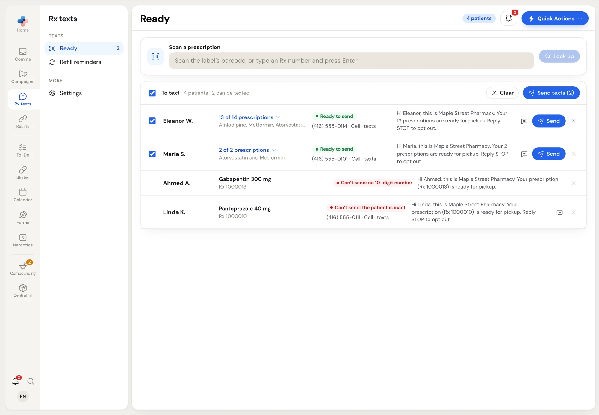

**Rx texts** sends patients short texts about their own prescriptions:

- **Ready**: scan a prescription label and text the patient that it's ready for pickup.
- **Refill reminders**: build a list of patients whose refills are due and text each one once. A patient who replies **YES** becomes a refill request in **Patient requests**.

Rx texts reads patients, phone numbers and prescriptions live from your pharmacy software. Nothing is copied into PharmaTools ahead of time, and nothing is sent until a staff member clicks **Send**.

<Info>
Rx texts is in a pilot and isn't available to every pharmacy yet. If you don't see **Rx texts** in the rail, it isn't turned on for your pharmacy.
</Info>

## What you need

<Steps>
  <Step title="Rx texts turned on">
    It's added in **Setup › Modules** or **Settings › Plan & modules**, and costs $0 a month for now.
  </Step>
  <Step title="Your own texting number">
    Rx texts are sent from your pharmacy's own texting number (SMS), so patients can reply to you. Without one, every row says *Your pharmacy doesn't text from its own number* and nothing can be sent.
  </Step>
  <Step title="PharmaTools Desktop on the pharmacy software PC">
    Install PharmaTools Desktop from **Settings › Desktop app** on the PC that runs your pharmacy software, and choose that PC as the pharmacy system connector there. The connector is how Rx texts looks up prescriptions. The PC has to be on and the app running while you use Rx texts.
  </Step>
</Steps>

## Find your way around

Click **Rx texts** in the rail. The side menu has:

| Side menu item | What it's for | Who sees it |
| --- | --- | --- |
| **Texts › Ready** | Scan prescriptions and send ready-for-pickup texts. The count beside it is how many patients can be texted right now. | Everyone |
| **Texts › Refill reminders** | Build the list of patients due for a refill and send reminders. | Everyone |
| **More › Settings** | Barcode rules, how far back a scan looks, the messages, and the default refill window. | Managers and Admins |

<Frame caption="Rx texts › Ready, with the side menu on the left">

</Frame>

Any signed-in employee can scan and send Ready texts and refill reminders. Only Managers and Admins can change **Settings**.

## When your pharmacy software can't be reached

An amber banner sits over every Rx texts page when the connector isn't working:

| Banner | What to do |
| --- | --- |
| *…isn't reachable. Check that the PharmaTools Desktop app is running on the pharmacy PC…* | Make sure that PC is on, signed in, and PharmaTools Desktop is running. Then click **Check Again** on the banner. |
| *Choose the PC that runs your pharmacy software in Settings → Desktop app* | No connector PC has been chosen yet. A Manager or Admin picks it in **Settings › Desktop app** (the banner links there). |
| *…was updated and some Rx texts features are off until PharmaTools Desktop is updated.* | Your pharmacy software changed. Update PharmaTools Desktop on that PC. |

The banner checks again every 30 seconds while the page is open.

## Safeguards

Rx texts protects patients from too many texts and from texts they asked not to get:

- **Opt-outs.** Every text a patient's number gets from you for the first time ends with "Reply STOP to opt out." A patient who replies **STOP** to your number gets no more Rx texts and gets a reply confirming it. Replying **START** lifts it. A STOP reply also opts them out of your [Campaigns](/campaigns/overview). Unsubscribing from a campaign with an opt-out link does not stop Rx texts.
- **Repeats.** A prescription that had a ready text in the last 24 hours is flagged (*Texted 2 hours ago*), and you're asked before it's sent again.
- **Daily cap.** One number gets at most 3 Rx texts (ready and refill together) in 24 hours. Extra ones are skipped (*Already texted 3 times today*).
- **Refill reminders once per due date.** A prescription already reminded for its current due date is skipped (*Already reminded for these due dates*).
- **Checked again before sending.** Every text is looked up again in your pharmacy software right before it goes, so a prescription that was put on hold or a patient who replied STOP in the meantime is skipped.
- **Queue limit.** At most 500 texts can wait to go out at once (*There are already 500 texts waiting to go out.*).

Texts go out one every 1.5 seconds. You can leave the page while they send; sending carries on.

<Note>
Rx texts don't wait for quiet hours. They go out when you send them.
</Note>

## Where texts and replies show up

Every Rx text is a normal text from your number, so it appears in that patient's conversation in **Comms**. Replies land there too. The **Message** button on any row opens the patient's conversation in **Comms**, or a new message to them if there isn't one yet, so you can write your own text.

<CardGroup cols={2}>
  <Card title="Ready for pickup" icon="scan-barcode" href="/rx-texts/ready-for-pickup">
    Scan, check and send.
  </Card>
  <Card title="Refill reminders" icon="refresh-cw" href="/rx-texts/refill-reminders">
    Build the due list and send reminders.
  </Card>
  <Card title="Rx texts settings" icon="settings" href="/rx-texts/settings">
    Barcode rules, messages and the default window.
  </Card>
</CardGroup>
