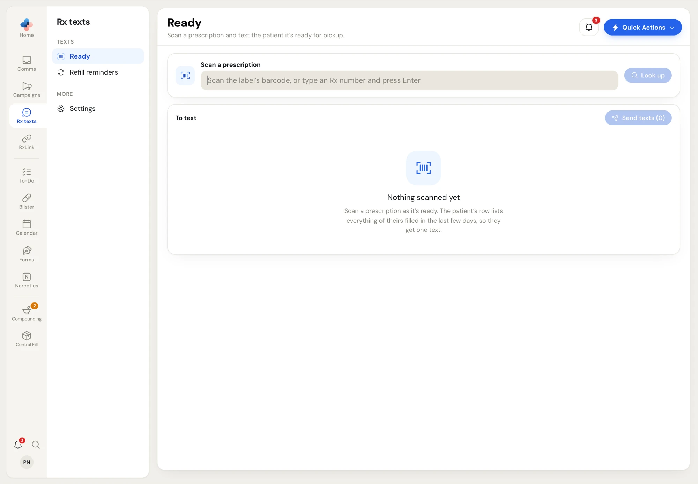
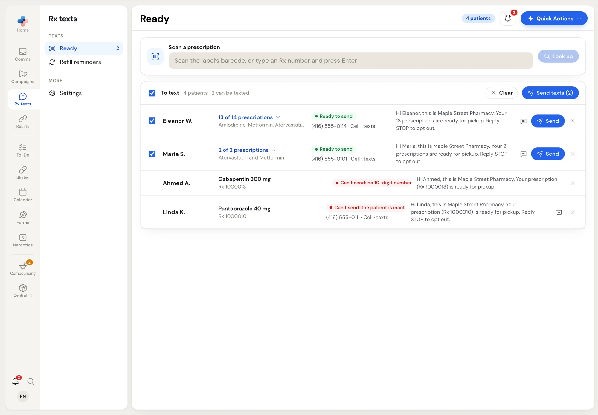
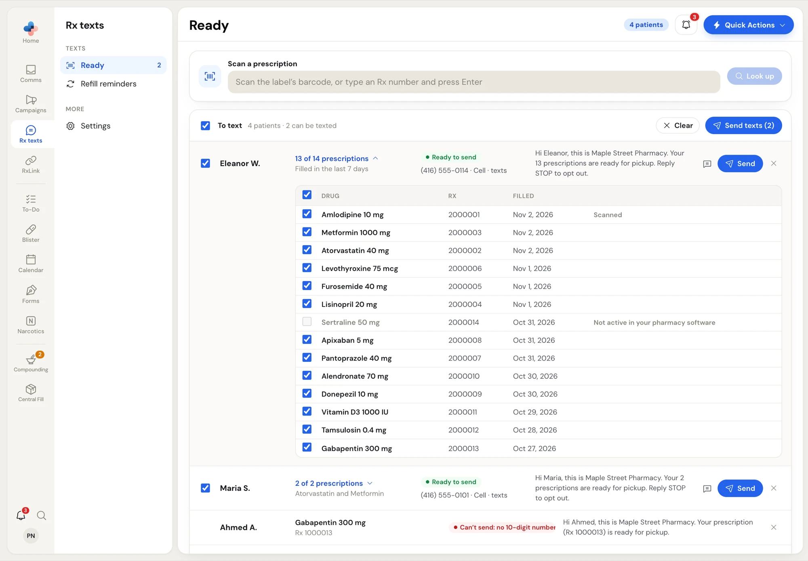

Open **Rx texts › Ready**. The cursor starts in the scan box, so you can scan straight away.

<Frame caption="Ready, before anything is scanned">

</Frame>

## Scan and send

<Steps>
  <Step title="Scan the label">
    Scan the barcode on the prescription label with your barcode scanner, or type the Rx number and press Enter (or click **Look up**). A row appears for that patient while it's looked up in your pharmacy software.
  </Step>
  <Step title="Keep scanning">
    Scan each prescription as it's ready. Each patient gets **one row**: it lists every prescription of theirs filled in the last 7 days (the **Days back** setting), with the one you scanned first. Scanning another of the same patient's prescriptions ticks it on their row (*Rx … ticked on …'s row*). Scanning the same Rx twice just says *Rx … is already in the list*.
  </Step>
  <Step title="Check each row">
    Untick any prescription that isn't ready yet, pick the right phone number, and read the text in the row. See [Read a row](#read-a-row).
  </Step>
  <Step title="Send">
    Click **Send texts (N)** to send every ticked patient, or **Send** on one row to send just that patient. The rows leave the list and a progress panel appears.
  </Step>
</Steps>

<Frame caption="Four patients scanned: two can be texted, two can't">

</Frame>

The scanned list stays while you visit **Refill reminders** or **Settings**, so you can come back to it. **Clear** empties it without sending anything.

## Read a row

| Part of the row | What it shows |
| --- | --- |
| **Tick box** (left) | Whether this patient is in **Send texts (N)**. Click anywhere on the row to tick or untick. The box in the **To text** header ticks or unticks every patient who can be texted. |
| **Name** | First name and last initial, for example *Eleanor W.* |
| **Prescriptions** | One drug and its Rx number, or *13 of 14 prescriptions* with the drug names. Click it to open the table. |
| **Status** | **Ready to send** (green), **Texted 2 hours ago** (amber: had a ready text in the last 24 hours), or **Can't send: …** (red) with the reason. |
| **Phone** | The number the text goes to. When your pharmacy software has several numbers for the patient, pick one from the list; a number that replied STOP is marked. |
| **Message** | The text exactly as it will go out. |
| **Buttons** | **Message** (speech bubble) opens the patient's conversation in **Comms** for a text of your own, **Send** sends this patient now, **×** removes the row. |

The header says, for example, *4 patients · 2 can be texted*. The count beside **Ready** in the side menu shows the same number.

### Choose which prescriptions to include

Click the prescription count to open the table: **Drug**, **Rx**, **Filled** (with the year), and a note (*Scanned*, *Texted 2 hours ago*, or *Not active in your pharmacy software*).

<Frame caption="An opened row: tick only what's in the bag">

</Frame>

- Untick anything that isn't ready. The text updates as you tick: one prescription uses the **Ready for pickup: one prescription** message (with the Rx number), several use **Ready for pickup: several prescriptions** (*Your 13 prescriptions are ready for pickup*), so drug names never appear on the patient's screen.
- Prescriptions that aren't active (on hold, discontinued) can't be ticked.
- With nothing ticked, the row says *Can't send: No prescription ticked*.

If a row says *Only the scanned Rx is listed*, PharmaTools Desktop on the pharmacy software PC needs an update before it can list the patient's other prescriptions.

## Why a row can't be sent

| Status | What it means | What to do |
| --- | --- | --- |
| **Can't send: no 10-digit number on file** | No usable mobile number in your pharmacy software. | Add the number in your pharmacy software and scan again, or call the patient. |
| **Can't send: the patient replied STOP** | The number opted out of your texts. | Pick another number if there is one. |
| **Can't send: the patient is inactive …** | The patient is marked inactive in your pharmacy software. | Check the patient's profile. |
| **Can't send: the Rx isn't active …** | The prescription is on hold or discontinued. | Check the prescription. |
| **Can't send: already texted 3 times today** | That number has had 3 Rx texts in 24 hours. | Try tomorrow, or call. |
| **Can't send: your pharmacy doesn't text from its own number** | No texting number of your own. | See [What you need](/rx-texts/overview#what-you-need). |
| **Couldn't look it up** | The scan isn't an Rx number, the Rx wasn't found, or the connector didn't answer. | Click **Try again**, or check the barcode rules in [Settings](/rx-texts/settings). |

## Texting the same patient again

If a ticked prescription already had a ready text in the last 24 hours:

- **Send** on that row asks **Text … again?** with when they were last texted. Click **Send again** to go ahead.
- **Send texts (N)** asks, for example, **2 of these were texted in the last 24 hours** with **Send again** or **Skip them**. Skipping still sends everyone else.

## Watch the texts go out

After you send, a **Ready texts: sending** panel shows the progress, for example *3 of 12 · one text every 1.5 seconds. You can leave this page; sending goes on.* When it's finished it reads **Ready texts: done** with a summary such as *11 sent, 1 skipped*.

Click **Show texts** to see each patient with **Sent**, **Failed**, **Skipped** or **Waiting** and the reason, for example *Replied STOP to your texts* or *The carrier didn't confirm it. Check Communications before sending again*. Click **Close** to dismiss the panel. Every text also appears in the patient's conversation in **Comms**.
