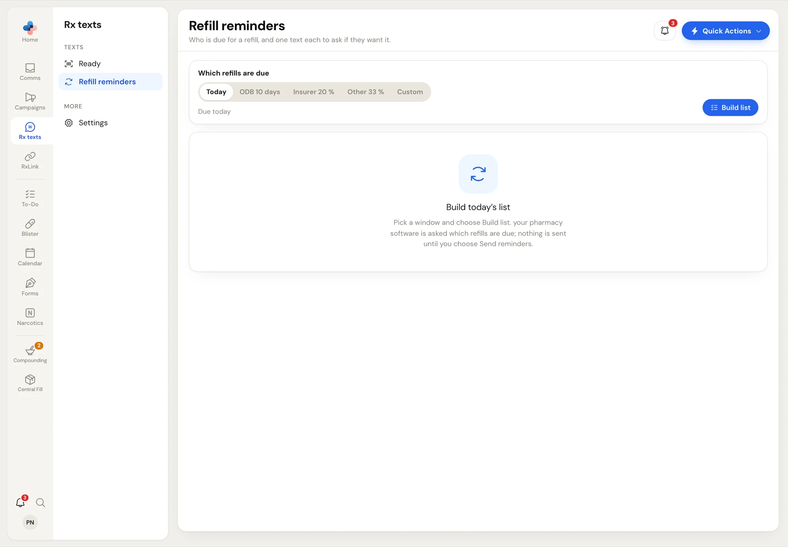
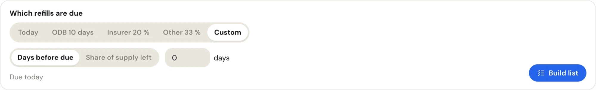
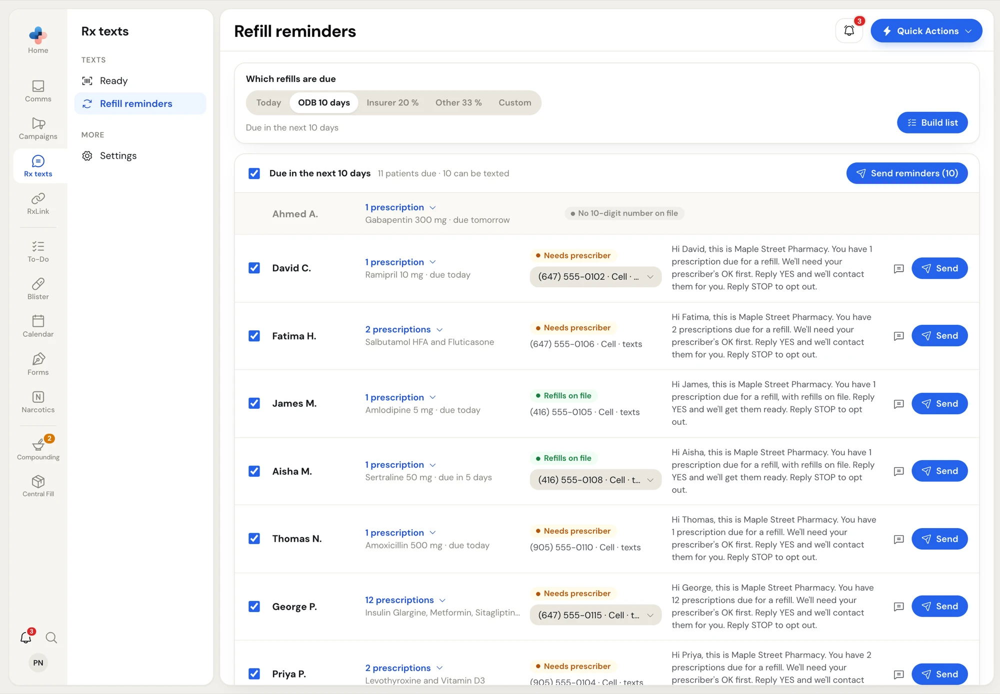
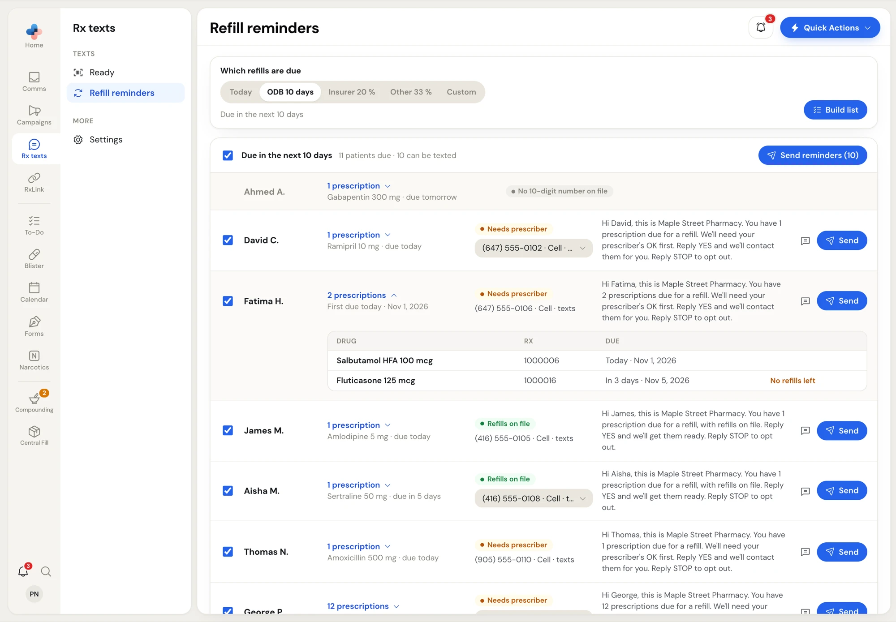

Open **Rx texts › Refill reminders**. Building the list only reads your pharmacy software; nothing is sent until you click **Send reminders** or a row's **Send**.

<Frame caption="Refill reminders, before the list is built">

</Frame>

## Every morning at 9:00

Each day at 9:00 AM (Toronto time), PharmaTools checks your pharmacy software with your default window. If anyone could be reminded, it adds a **To-Do** task for today: *Refill reminders ready to review (N patients)*. Nothing is sent and no patient details go in the task. Open **Rx texts › Refill reminders** to review and send. The task isn't made when the pharmacy software PC is off.

## Build the list

<Steps>
  <Step title="Pick which refills are due">
    Under **Which refills are due**, pick a window. It starts on your default from [Settings](/rx-texts/settings).

    | Choice | Shows |
    | --- | --- |
    | **Today** | Prescriptions due today. |
    | **ODB 10 days** | Due in the next 10 days. |
    | **20 %** preset | Patients with 20 % of their supply left or less. In the app this preset is labelled with an insurer's name. |
    | **Other 33 %** | 33 % of their supply left or less. |
    | **Custom** | Choose **Days before due** (0 to 60) or **Share of supply left** (0 to 100 %) and type the number. |

    The line under the choices says what you picked, for example *Due in the next 10 days*.
  </Step>
  <Step title="Build it">
    Click **Build list**. Each patient who is due shows once, with all their due prescriptions. Patients who can be texted are ticked to start.
  </Step>
</Steps>

<Frame caption="A custom window">

</Frame>

## Read the list

<Frame caption="The built list: 11 patients due, 10 can be texted">

</Frame>

The header shows the window and, for example, *11 patients due · 10 can be texted*. The header tick box ticks or unticks everyone who can be texted.

Each row shows:

- **Name** (first name and last initial).
- **Prescriptions**: *1 prescription* with the drug and when it's due (*due today*, *due tomorrow*, *due in 5 days*), or a count with the drug names. Click it to open the table of **Drug**, **Rx** and **Due** (with the date and year). *No refills left* marks a prescription that needs the prescriber.
- **Status**: **Refills on file** (green), **Needs prescriber** (amber: at least one due prescription has no refills left), or a grey reason the patient can't be texted.
- **Phone**: the number it goes to. Each patient starts on their first number that hasn't replied STOP; pick another from the list if they have several.
- **The text** exactly as it will go out. **Refills on file** patients get *…with refills on file. Reply YES and we'll get them ready.* **Needs prescriber** patients get *…We'll need your prescriber's OK first. Reply YES and we'll contact them for you.*
- **Message** opens the patient's conversation in **Comms**; **Send** sends just this patient's reminder right away, without asking.

<Frame caption="An opened row with its due prescriptions">

</Frame>

### Patients who can't be texted

They're greyed, with no tick box, and the reason where the status goes:

| Reason | Meaning |
| --- | --- |
| **No 10-digit number on file** | No usable mobile number in your pharmacy software. |
| **Replied STOP to your texts** | Every number on file opted out. |
| **Already texted 3 times today** | The 24-hour cap for that number. |
| **Already reminded for these due dates** | They already got a reminder for these due dates. |
| **Inactive …** | The patient is inactive in your pharmacy software. |
| **Your pharmacy doesn't text from its own number** | See [What you need](/rx-texts/overview#what-you-need). |

If the list is very long, it shows the first 2,000 due prescriptions with a note to narrow the window.

## Send the reminders

<Steps>
  <Step title="Tick who gets one">
    Untick anyone you don't want to remind. Click anywhere on a row to tick or untick it.
  </Step>
  <Step title="Send">
    Click **Send reminders (N)**. **Send N refill reminders?** explains that each patient gets one text listing their due prescriptions, and that a YES reply lands in **Patient requests**. Click **Send reminders**.
  </Step>
  <Step title="Watch the progress">
    A **Refill reminders: sending** panel shows the progress, then **Refill reminders: done** with a summary. **Show texts** lists each patient's result; **Close** dismisses it.
  </Step>
</Steps>

Before sending, PharmaTools runs the list again in your pharmacy software and texts only patients who can still be texted. A patient whose prescription is no longer due is skipped (*No longer due …*).

## When a patient replies YES

A patient who replies **YES** (or **Y**) within 7 days of a reminder:

- gets your **Reply to YES** message (*Thanks, … got your refill request. We'll text you when it's ready.*);
- becomes one refill request in **Patient requests**, listing the prescriptions from their reminders. Process it there like any refill request.

Any other reply, and the YES itself, stays in the patient's conversation in **Comms**. A YES still counts even if Rx texts was switched off after the reminder went.
