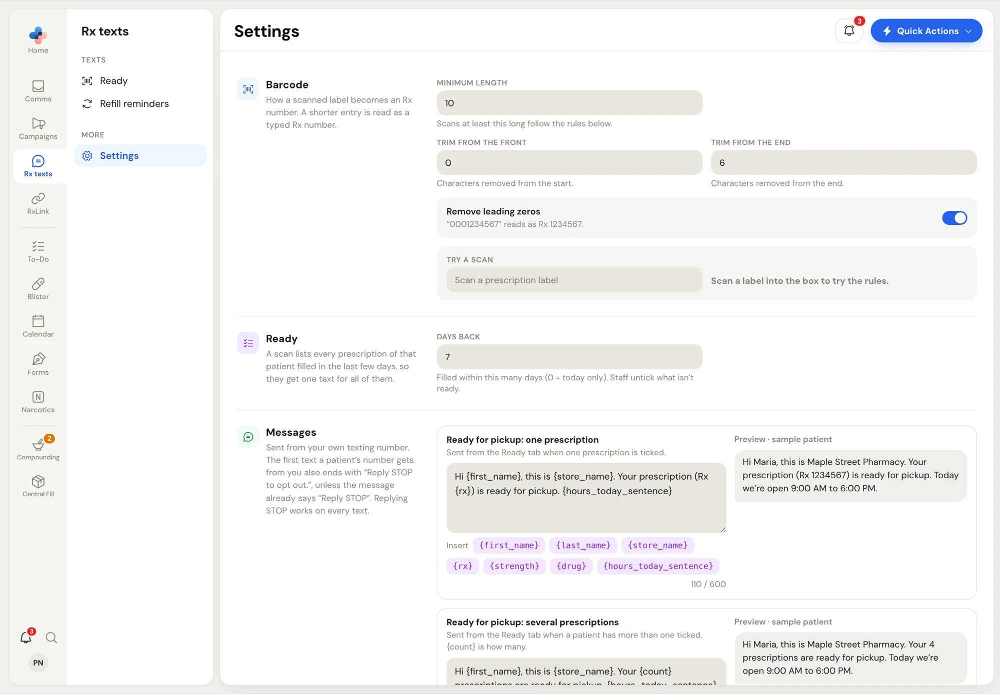
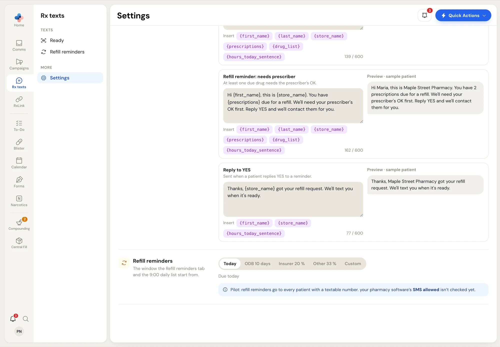

Open **Rx texts › Settings**. Only Managers and Admins see it; others who open the address see *Only a manager or an admin can change these.* Change what you need, then click **Save changes** in the bar at the bottom, or **Discard** to undo.

<Frame caption="Rx texts settings: Barcode, Ready and the first message">

</Frame>

## Barcode

How a scanned label becomes an Rx number. A label's barcode often carries extra characters around the Rx number; these rules strip them.

| Setting | What it does |
| --- | --- |
| **Minimum length** | Scans at least this long follow the rules below. Anything shorter is read as a typed Rx number. |
| **Trim from the front** | Characters removed from the start of a scan. |
| **Trim from the end** | Characters removed from the end. |
| **Remove leading zeros** | "0001234567" reads as Rx 1234567. |

**Try a scan**: scan a real label into the box and it shows the Rx number it reads, or *That isn't an Rx number with these rules.* While you have unsaved changes it tests the rules on screen; save to use them on the **Ready** page.

## Ready

**Days back**: a scan lists every prescription of that patient filled within this many days (0 = today only, up to 60), so they get one text for all of them. Staff untick what isn't ready. The default is 7.

## Messages

Every text is sent from your own texting number. The first text a patient's number gets from you also ends with "Reply STOP to opt out.", unless your message already says "Reply STOP". Replying STOP works on every text.

There are five messages. Each has a text box (up to 600 characters), **Insert** buttons for its placeholders, a character count, and a **Preview · sample patient**.

| Message | Sent when | Placeholders |
| --- | --- | --- |
| **Ready for pickup: one prescription** | One prescription is ticked on a **Ready** row. | `{first_name}` `{last_name}` `{store_name}` `{rx}` `{strength}` `{drug}` `{hours_today_sentence}` |
| **Ready for pickup: several prescriptions** | A patient has more than one ticked. | `{first_name}` `{last_name}` `{store_name}` `{count}` `{hours_today_sentence}` |
| **Refill reminder: refills on file** | Every due drug has refills left. | `{first_name}` `{last_name}` `{store_name}` `{prescriptions}` `{drug_list}` `{hours_today_sentence}` |
| **Refill reminder: needs prescriber** | At least one due drug needs the prescriber's OK. | same as above |
| **Reply to YES** | A patient replies YES to a reminder. | `{first_name}` `{store_name}` `{hours_today_sentence}` |

- `{store_name}` is your pharmacy name. `{hours_today_sentence}` becomes, for example, *Today we're open 9:00 AM to 6:00 PM.*, read from your hours in **Settings › Profile**. On a day you're closed, or if the hours can't be read, it's left out.
- `{count}` and `{prescriptions}` say how many (*Your 4 prescriptions*, *2 prescriptions*). `{drug_list}` names every due drug.

<Warning>
Drug names show on a locked phone's screen. Using `{drug}` warns: *Leave* `{drug}` *out unless the patient agreed.* Using `{drug_list}` warns that every due drug's name shows and that a long list takes 2 or 3 texts.
</Warning>

If a message mentions STOP without saying "Reply STOP", a note says "Reply STOP to opt out." will still be added at the end.

## Refill reminders

The window the **Refill reminders** page and the 9:00 AM daily list start from: **Today**, **ODB 10 days**, the **20 %** preset, **Other 33 %** or **Custom**.

<Frame caption="The default refill window">

</Frame>

<Note>
During the pilot, refill reminders go to every patient with a textable number. The **SMS allowed** flag in your pharmacy software isn't checked yet.
</Note>
