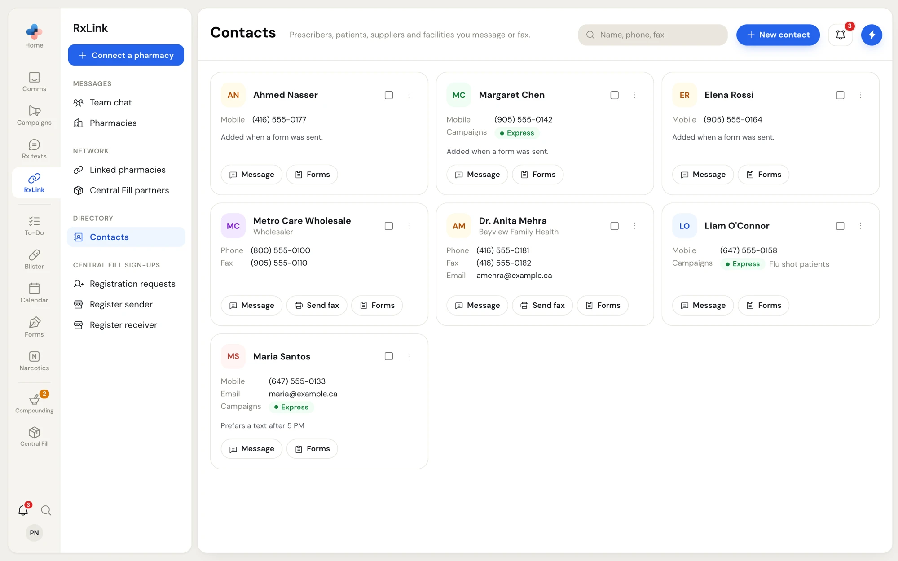
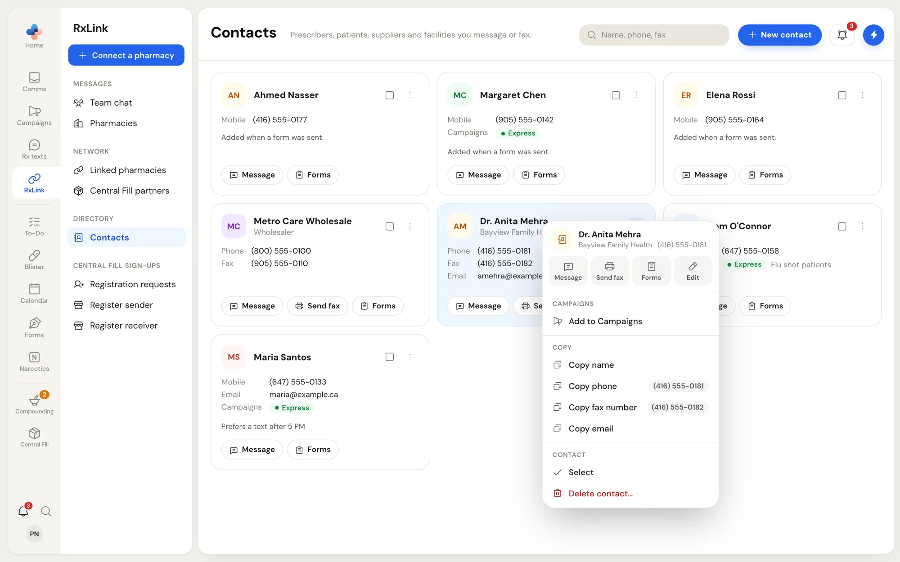
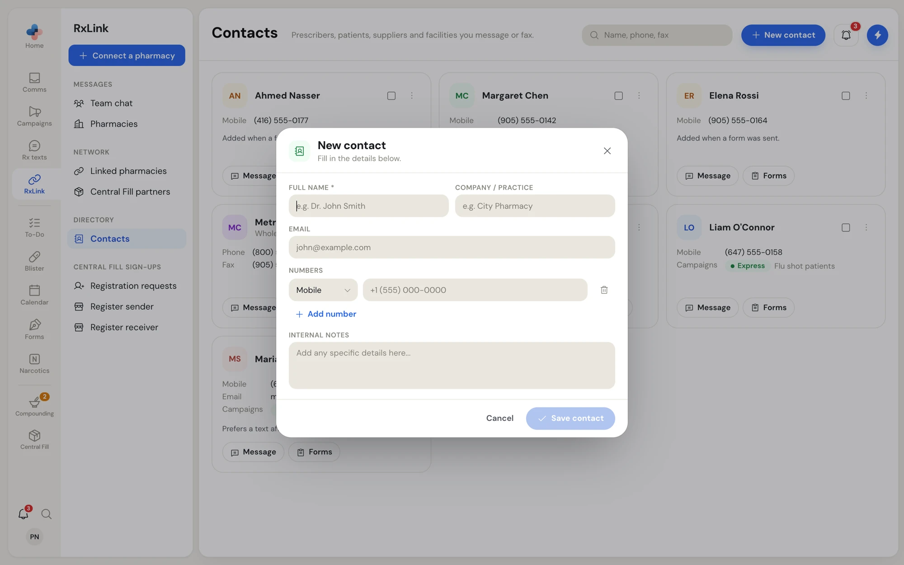

**RxLink › Contacts** is your pharmacy's shared contact book: prescribers, patients, suppliers and facilities you message or fax. Contacts give names to the numbers in **Comms**, and they fill the suggestions in **Send fax** and **New message**.

<Note>
  **Contacts** shows in the RxLink side menu once your pharmacy has a fax number.
</Note>

<Frame caption="RxLink › Contacts">
  
</Frame>

## Find a contact

Type in **Name, phone, fax** at the top. Search matches the name, the company or practice, the email address and the phone and fax numbers. Typing 4 or more digits matches any part of a number.

## Read a contact card

Each card shows:

- The contact's initials, name, and company or practice.
- Each number with its type: **Mobile**, **Phone** or **Fax**, and the **Email** address.
- **Campaigns**: when your pharmacy has Campaigns and the contact is on a list, the contact's texting consent and the lists they are on.
- The internal notes, for example **Added when a form was sent.** for a contact PharmaTools created when your pharmacy sent a form.
- The buttons:
  - **Message** (when the contact has a mobile or phone number) opens **New message** to them.
  - **Send fax** (when the contact has a fax number) opens **Send fax** to them.
  - **Forms** (when your pharmacy has Forms and the contact has a number) opens their forms.

## The contact menu

Right-click a card, or click **⋮** on it.

<Frame caption="The contact menu">
  
</Frame>

| Section | Items |
| --- | --- |
| Top buttons | **Message**, **Send fax**, **Forms**, **Edit** |
| **Campaigns** | **Add to Campaigns**, or **Open in Campaigns** when the contact is already in Campaigns. Shown when your pharmacy has Campaigns. |
| **Copy** | **Copy name**, **Copy phone**, **Copy fax number**, **Copy email**, for whatever the contact has. |
| **Contact** | **Select** (or **Deselect**) to add the card to a bulk selection, and **Delete contact…** |

## Add a contact

<Steps>
  <Step title="Click New contact">
    Click **New contact** at the top of the page.

    <Frame caption="The New contact form">
      
    </Frame>
  </Step>
  <Step title="Fill in the details">
    - **Full name** is required, for example **Dr. John Smith**.
    - **Company / practice**, for example the clinic's name.
    - **Email**.
    - **Numbers**: pick **Mobile**, **Phone** or **Fax** and type the number. Click **Add number** for another one, or the trash icon to remove one. Add the fax number for prescribers so they show in **Send fax**, and the mobile number for patients so they show in **New message**.
    - **Internal notes**: anything your team should know. Patients never see it.
  </Step>
  <Step title="Save">
    Click **Save contact**. If it does not save, the form says **Save failed. Try again.**
  </Step>
</Steps>

You can also add a contact from a text conversation with an unknown number: click **Add contact** in the conversation's toolbar. The form opens with the number already filled in.

## Edit a contact

Right-click the card and click **Edit**. The **Edit contact** form opens with the contact's details. Change what you need and click **Save contact**.

## Delete contacts

- **One contact**: right-click the card and choose **Delete contact…**. A red bar on the card asks you to confirm; click **Delete**, or **Keep**.
- **Several contacts**: tick the checkbox on each card. A dark bar at the bottom shows how many are selected. Click **Delete**, then confirm **Delete** when it asks **Delete 3 contacts?** Click **×** to clear the selection.

A toast says **Contact deleted** (or how many were deleted). There is no Undo: deleting a contact removes it for your whole pharmacy. The faxes and texts with that number stay in Comms; they show the number instead of the name.

With Campaigns on, the bulk bar also has **Add to Campaigns** to add every selected contact at once.
