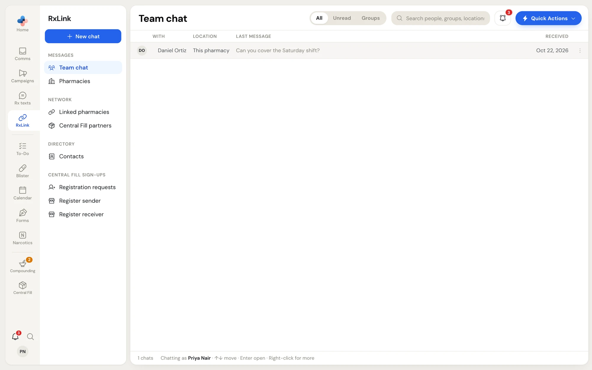
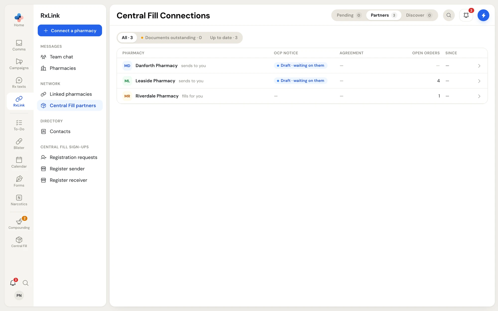

**RxLink** is everything that stays inside PharmaTools: chat with the people you work with, messages with other pharmacies that use PharmaTools, the pharmacies you are linked with, and your contact book. RxLink messages never go out as text messages, never use your SMS number, and never leave PharmaTools.

To open it, click **RxLink** in the left rail. It opens on **Team chat**. A number on the rail icon counts your unread team chats.

<Frame caption="RxLink opens on Team chat, with the RxLink side menu beside the rail">
  
</Frame>

## The side menu

| Group | Item | What it is | Guide |
| --- | --- | --- | --- |
| Messages | **Team chat** | Direct messages and group chats with colleagues at your pharmacy and your other locations. The number counts unread chats. | [Team chat](/rxlink/team-chat) |
| | **Pharmacies** | Message threads with pharmacies you are linked with. The number counts unread threads. | [Linked pharmacies](/rxlink/pharmacies) |
| Network | **Linked pharmacies** | The pharmacies you message and fax with on PharmaTools: your network, pending requests, and pharmacies to discover. A dot means a pharmacy is waiting for your answer. | [Linked pharmacies](/rxlink/pharmacies#linked-pharmacies) |
| | **Central Fill partners** | Pharmacies you have a Central Fill agreement with. Only shown when your pharmacy has Central Fill. | [Central Fill partners](/central-fill/partners) |
| Directory | **Contacts** | Prescribers, patients, suppliers and facilities you message or fax. Only shown when your pharmacy has a fax number. | [Contacts](/rxlink/contacts) |
| Central Fill sign-ups | **Registration requests**, **Register sender**, **Register receiver** | Signing pharmacies up for Central Fill. Shown depending on your pharmacy's Central Fill role. | [Central Fill partners](/central-fill/partners) |

The blue button at the top of the side menu follows the page you are on:

- **New chat** on **Team chat**.
- **New message** on **Pharmacies**.
- **Connect a pharmacy** everywhere else. It opens **Discover**, the list of pharmacies you can ask to link with (or Central Fill's **Discover** when you are on **Central Fill partners**).

<Frame caption="RxLink › Central Fill partners, shown when your pharmacy has Central Fill">
  
</Frame>

**Central Fill partners** and the **Central Fill sign-ups** pages belong to Central Fill and are covered in [Central Fill partners and connections](/central-fill/partners).

## RxLink and Comms

Comms and RxLink share some things:

- Message threads with linked pharmacies show in both **RxLink › Pharmacies** and **Comms › Messages** (marked **RxLink partner**). They work the same in either place.
- **New message** in Comms can send to patients and linked pharmacies at once. Patients get a text or a Secure Portal link; pharmacies always get RxLink.
- **Contacts** feed the recipient suggestions in **Send fax** and **New message**.

<CardGroup cols={2}>
  <Card title="Team chat" icon="users" href="/rxlink/team-chat">
    Message colleagues one to one or in groups.
  </Card>
  <Card title="Linked pharmacies" icon="building-2" href="/rxlink/pharmacies">
    Link with other pharmacies and message them inside PharmaTools.
  </Card>
  <Card title="Contacts" icon="contact" href="/rxlink/contacts">
    Keep prescribers, patients and suppliers with their numbers.
  </Card>
  <Card title="Comms inbox" icon="inbox" href="/communications/overview">
    Faxes, patient texts, voicemail and patient requests.
  </Card>
</CardGroup>
