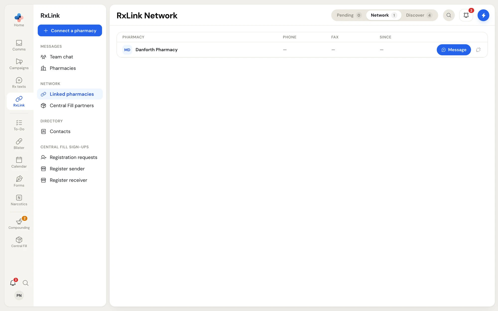
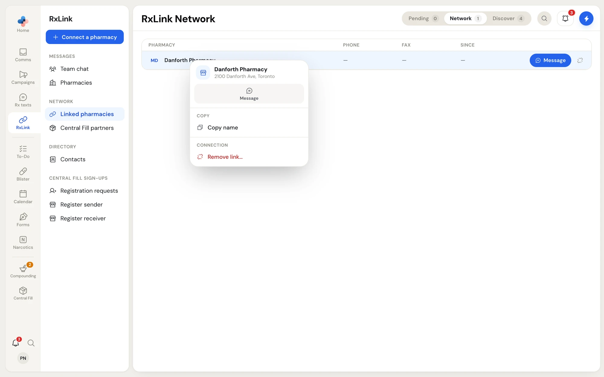
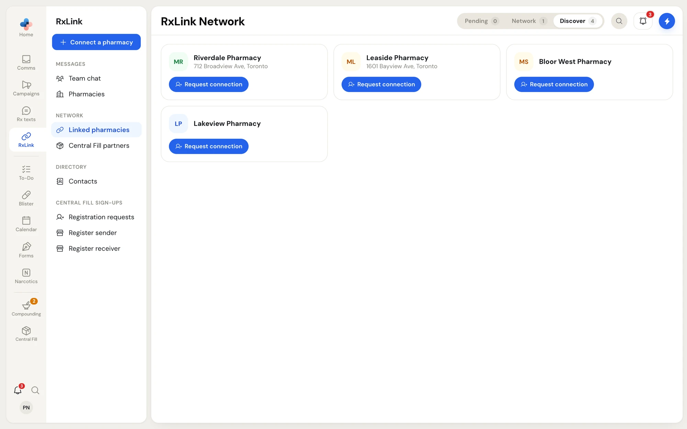
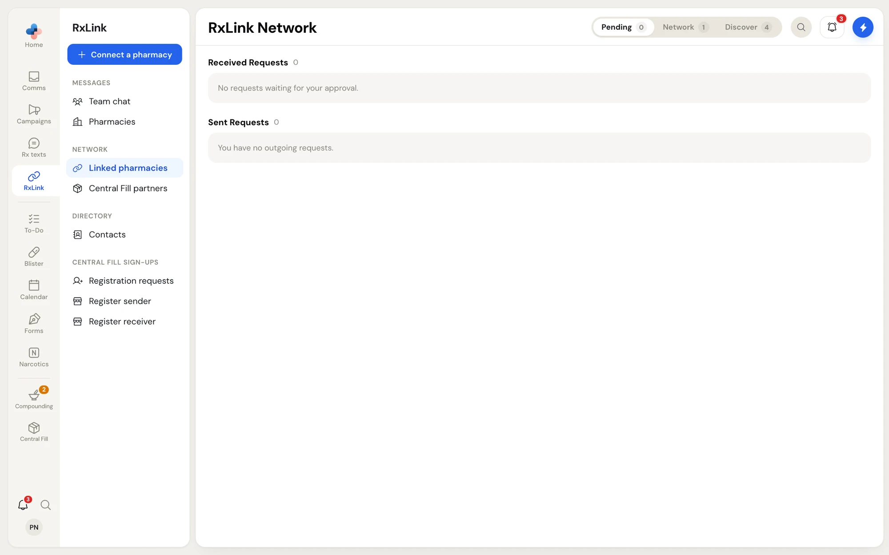
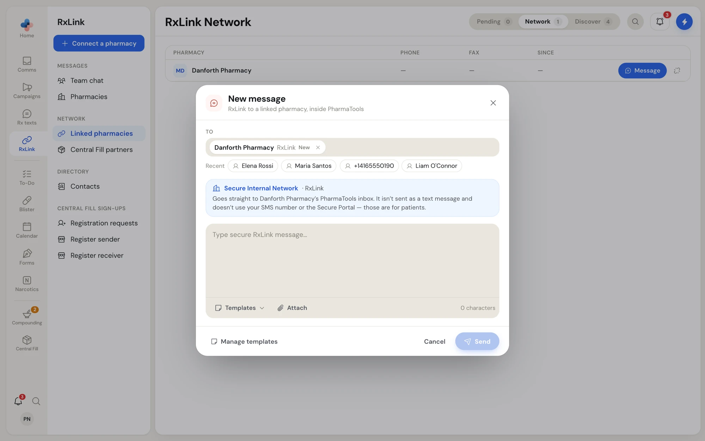
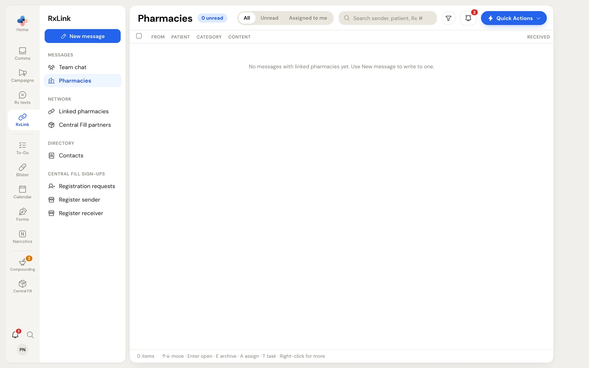

Pharmacies that both use PharmaTools can link with each other. Once linked, you can message each other over RxLink, and a fax you send to that pharmacy is **Delivered directly** into its Comms inbox instead of going over the phone network.

RxLink messages go straight to the other pharmacy's PharmaTools inbox. They are not text messages, do not use your SMS number or the Secure Portal, and never leave PharmaTools.

There are two places in **RxLink** for this:

- **Messages › Pharmacies**: your message threads with linked pharmacies.
- **Network › Linked pharmacies**: who you are linked with, requests waiting for an answer, and pharmacies you can link with.

## Linked pharmacies

Click **Linked pharmacies** in the RxLink side menu. The page is titled **RxLink Network** and has three tabs in the header:

| Tab | What it lists |
| --- | --- |
| **Pending** | Requests to link: ones other pharmacies sent you, and ones you sent. The number counts both. |
| **Network** | The pharmacies you are linked with. |
| **Discover** | Pharmacies on PharmaTools you are not linked with yet. |

The page opens on **Network**, or on **Pending** when a pharmacy is waiting for your answer. A dot beside **Linked pharmacies** in the side menu also means a pharmacy is waiting. Use the magnifier in the header to search.

### Your network

<Frame caption="RxLink › Linked pharmacies, Network tab">
  
</Frame>

Each linked pharmacy shows its **Phone**, **Fax** and **Since** (the month and year you linked). On each row:

- **Message** opens **New message** addressed to the pharmacy over RxLink.
- The printer, when the pharmacy has a fax number, opens **Send fax** addressed to it.
- The broken link, **Remove link**, asks **Remove link with** the pharmacy. Click **Remove** to unlink, or **Keep**.

When some of your linked pharmacies are also Central Fill partners, a switch above the list shows **All**, **Central Fill partners** and **Messaging only**. A Central Fill partner is linked by your Central Fill agreement, so you cannot remove it from this list; manage it in **RxLink › Central Fill partners**.

Right-click a pharmacy for its menu:

<Frame caption="The menu on a linked pharmacy">
  
</Frame>

- **Message** and **Send fax**.
- **Copy name**, **Copy phone**, **Copy fax number** and **Copy address**, for whatever the pharmacy has on file.
- **Remove link…** under **Connection**.

### Link with a pharmacy

<Steps>
  <Step title="Find the pharmacy">
    Click **Connect a pharmacy** at the top of the side menu, or the **Discover** tab. Each card shows the pharmacy's name and address.

    <Frame caption="Discover lists pharmacies on PharmaTools you can link with">
      
    </Frame>
  </Step>
  <Step title="Send the request">
    Click **Request connection** on the pharmacy's card (or right-click it and choose **Connect**). A toast says **Request sent to** the pharmacy, and the request moves to **Pending › Sent Requests**, marked **awaiting their approval**.
  </Step>
  <Step title="Wait for them to accept">
    The other pharmacy sees your request under **Pending › Received Requests**. Once they accept, they appear in your **Network** tab. To withdraw the request, click **Cancel request** on it.
  </Step>
</Steps>

### Answer a request

<Frame caption="The Pending tab">
  
</Frame>

Under **Received Requests**, each pharmacy that **wants to connect** has two buttons:

- **Accept** links you. A toast says the pharmacy was added to **My Network**.
- **Decline** turns the request down. A toast says **Declined** and the pharmacy's name.

When there are none, the sections say **No requests waiting for your approval.** and **You have no outgoing requests.**

## Message a linked pharmacy

<Steps>
  <Step title="Open New message">
    Click **Message** on the pharmacy in **Linked pharmacies**, or click **New message** in **RxLink › Pharmacies** or **Comms**, and type the pharmacy's name in **To**. Linked pharmacies show **RxLink** beside their name.

    <Frame caption="A message to a linked pharmacy goes over RxLink">
      
    </Frame>
  </Step>
  <Step title="Write and attach">
    A blue **Secure Internal Network · RxLink** note confirms where it goes. Type your message, insert a template if you want, and attach up to 10 files. There is no character limit or segment count.
  </Step>
  <Step title="Send">
    Click **Send**. The thread appears in **RxLink › Pharmacies** and in **Comms › Messages**.
  </Step>
</Steps>

## Pharmacies

**RxLink › Pharmacies** lists your message threads with linked pharmacies. It works like the Comms inbox: the same columns, the same preview pane, the same right-click menu, assign, label, task and archive. See [Working an item](/communications/working-items).

<Frame caption="RxLink › Pharmacies before any messages">
  
</Frame>

In an open thread, the message box is marked **Secure Internal Network · RxLink** and **Internal — never leaves PharmaTools**. Type and press **Enter** to send. Use the note icon for templates and the paperclip for files.

Texting is not needed for RxLink. A pharmacy without an SMS number can still message linked pharmacies.
