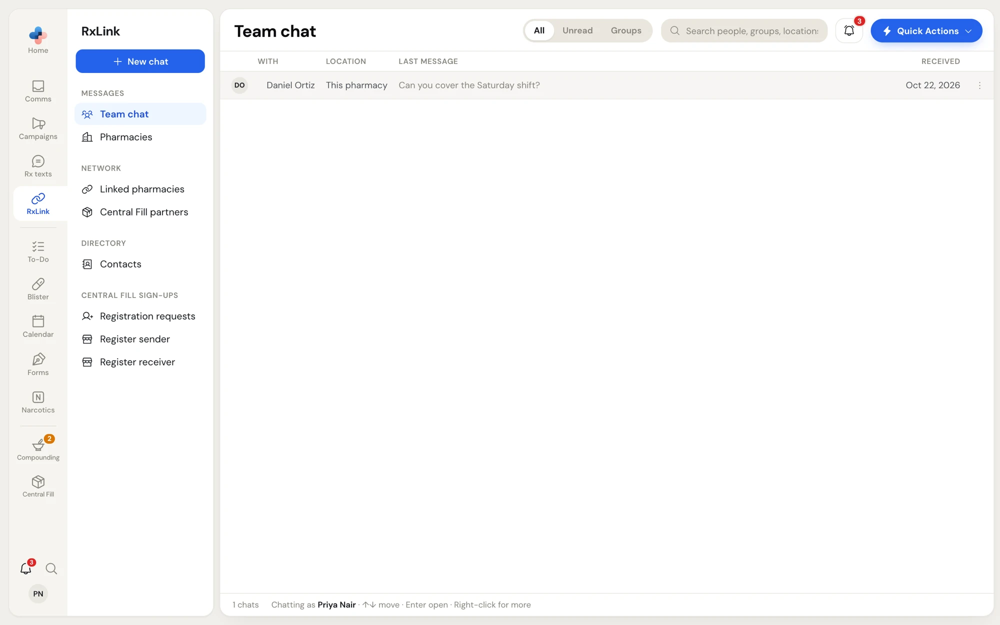
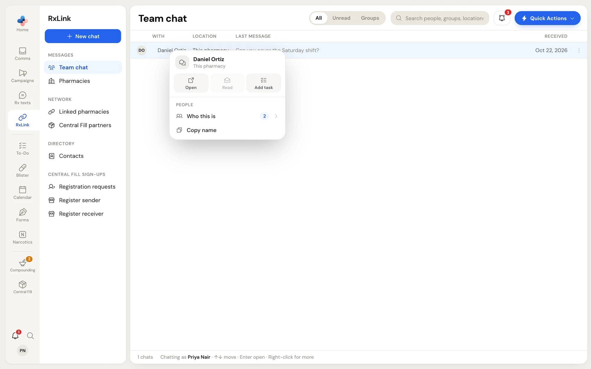
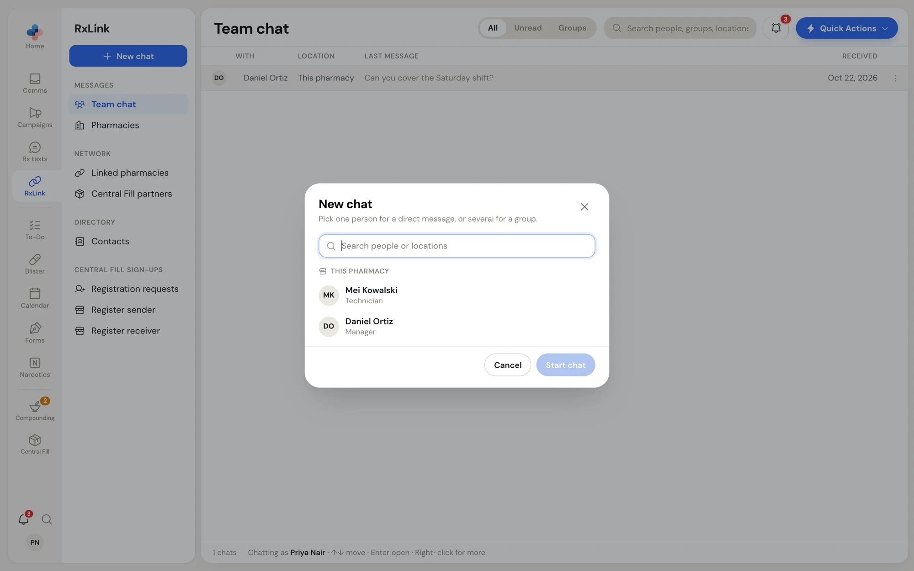
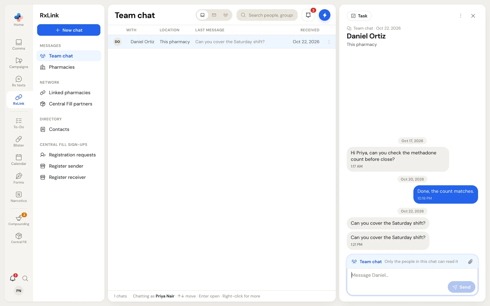

**RxLink › Team chat** is private messaging between the people who work at your pharmacy and at your pharmacy's other locations. Use it for shift swaps, handovers and quick questions instead of texting personal phones. Only the people in a chat can read it.

Team chat is between people, so it uses the employee you are signed in as. The footer of the list says **Chatting as** and your name. If PharmaTools is signed in as the pharmacy without an employee, the page says **Sign in as an employee**; use **Change Employee** to sign in with your own PIN.

## The chat list

<Frame caption="RxLink › Team chat">
  
</Frame>

| Column | What it shows |
| --- | --- |
| **With** | The colleague's name, or the group's name. A blue number counts unread messages. |
| **Location** | **This pharmacy**, the name of your other location, the number of people in a group, or **Former colleague** for someone who no longer works at your locations. |
| **Last message** | The latest message in the chat. |
| **Received** | When the last message came in. |

The switch in the header shows **All**, **Unread** or **Groups**. Search finds people, groups and locations.

Use **↑** and **↓** to move through the list and **Enter** to open a chat. Right-click a chat, or click **⋮**, for its menu.

<Frame caption="The chat menu">
  
</Frame>

| Item | What it does |
| --- | --- |
| **Open** | Opens the chat. |
| **Read** | Marks the chat read. Greyed out when it already is. |
| **Add task** | Opens a To-Do task titled **Follow up with** the chat's name. |
| **Leave** | Groups only. Asks **Leave this group?** The group and its history disappear from your chats; someone in it can add you back. |
| **Rename group**, **Add people** | Groups only. |
| **Who this is** / **In this group** | Lists the people in the chat. |
| **Copy name** | Direct chats only. Copies the colleague's name. |

## Start a chat

<Steps>
  <Step title="Click New chat">
    Click **New chat** at the top of the RxLink side menu.

    <Frame caption="Pick one person for a direct message, or several for a group">
      
    </Frame>
  </Step>
  <Step title="Pick people">
    Your colleagues are grouped under **This pharmacy** and then under each of your other locations, each with their role. Type in **Search people or locations** to narrow the list. Click a person to pick them; click again to take them off.
  </Step>
  <Step title="Name a group">
    Pick one person and the button reads **Start chat**. Pick two or more and it reads **Create group**, and a **Group name** field appears (for example **Front counter** or **Night shift**). A group needs a name.
  </Step>
  <Step title="Start it">
    Click **Start chat** or **Create group**. The chat opens beside the list.
  </Step>
</Steps>

Everyone added in **Settings › Manage employees** shows in the list. If nobody shows, the window says so.

## Send messages and files

<Frame caption="An open chat">
  
</Frame>

1. Type in the box at the bottom. Press **Enter** to send, or **Shift + Enter** for a new line.
2. To share a file, click the paperclip or drag files onto the chat. You can attach PDF, PNG, JPG, WEBP or GIF files, up to 10 MB each and 5 files per message.
3. Images show in the chat; click one to see it larger. Other files open in a new tab.

What you type but do not send stays in the box while you move between chats.

A red **New messages** line marks where the messages you have not read start. Scroll to the top and click **Load earlier messages** to see older ones.

## The chat toolbar

At the top of an open chat:

- **Task** opens a To-Do task titled **Follow up with** the chat's name.
- **Add people** (groups only) adds colleagues. They see messages from then on, not the earlier ones.
- **Rename** (groups only) lets you type a new group name; press **Enter** to save or **Esc** to cancel.
- **⋮** opens the chat menu.
- **×** closes the chat.

Drag the left edge of the chat to make it wider. On a narrow screen the list and the chat take turns, with **Back to chats** at the top of the chat.

## Work with one message

Right-click a message for its menu:

- **Copy** copies the text.
- **Add task** starts a To-Do task with the message's text.
- **Delete** (your own messages only) asks **Delete this message?** Everyone in the chat then sees **Message deleted** instead, and files on it are deleted too. You can also hover over your message and click the trash icon.
- **Attached** lists the files on the message.

## Notifications

When a team chat message arrives while Team chat is not open, a pop-up appears in the corner with the sender's name and **New message**. It never shows the message itself, because the screen may face your counter. Click it to open the chat. The **RxLink** icon on the rail shows how many chats are unread.
