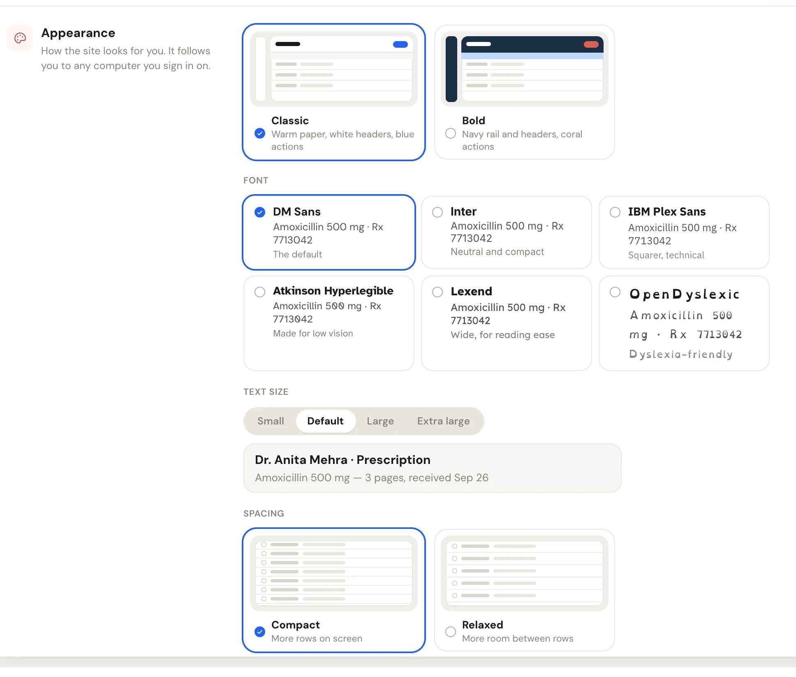

Each staff member picks their own look. It doesn't change what anyone else at the pharmacy sees, and it follows you to any computer you sign in on with your name and PIN.

There are two places to change it:

- **Settings › Profile › Appearance**, with every choice and a preview of each.
- Your menu (click your initials at the bottom of the side menu), with quick **Theme** and **Text size** switches.

Every choice applies and saves the moment you click it. There is no save button.

<Frame caption="Settings › Profile › Appearance">

</Frame>

## Theme

| Theme | What it looks like |
| --- | --- |
| **Classic** | Warm paper, white headers, blue actions. The default. |
| **Bold** | Navy side menu and headers, coral actions. |

## Font

Each card shows a sample line in its own font.

| Font | Good for |
| --- | --- |
| **DM Sans** | The default. |
| **Inter** | Neutral and compact. |
| **IBM Plex Sans** | Squarer, technical. |
| **Atkinson Hyperlegible** | Made for low vision. |
| **Lexend** | Wide, for reading ease. |
| **OpenDyslexic** | Dyslexia-friendly. |

## Text size

Pick **Small**, **Default**, **Large** or **Extra large**. Only the text grows or shrinks: icons, spacing and the layout stay the same. The sample line under the switch shows the size you picked.

In your menu, the same four sizes are four **A** buttons, smallest to largest. Hover over one to see its name.

## Spacing

| Spacing | What it does |
| --- | --- |
| **Compact** | The default. More rows on screen. |
| **Relaxed** | Taller rows in lists and tables, and roomier side menus. |

<Tip>
If a list feels crowded at the counter, try **Large** text with **Relaxed** spacing. Both are yours alone, so the rest of the team keeps their own.
</Tip>
