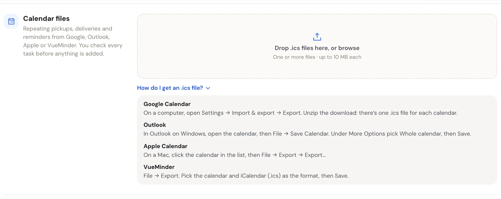
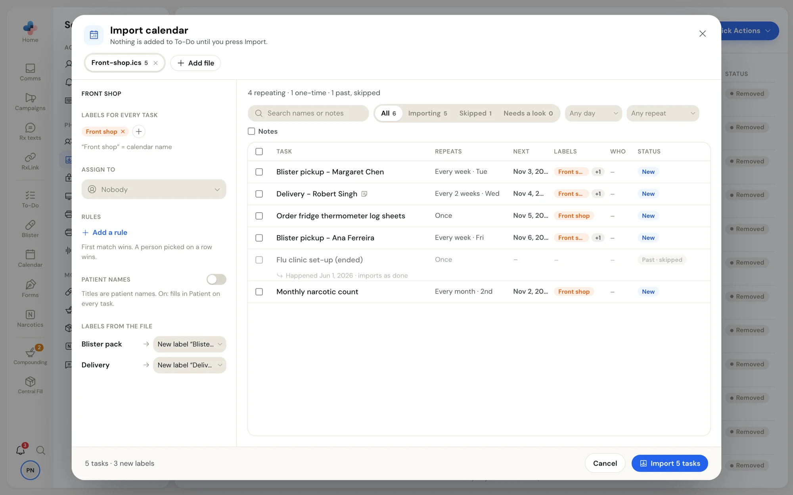
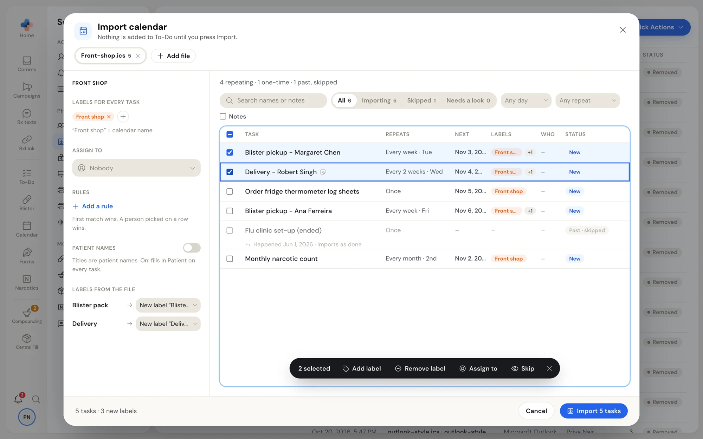
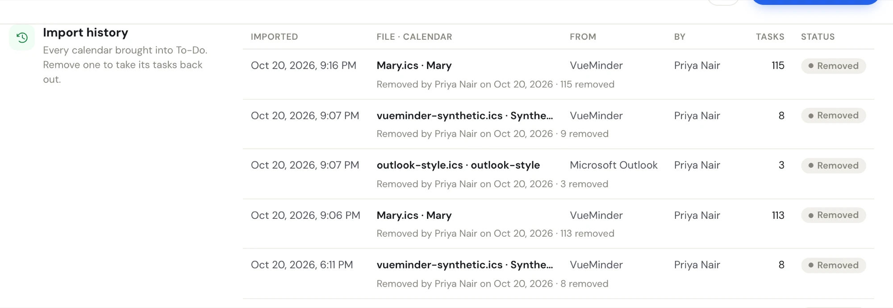

**Settings › Import data** brings tasks into To-Do from calendar files (**.ics**), the standard file most calendar and to-do apps can export. It's made for pharmacies moving their repeating blister pickups, deliveries and reminders over to PharmaTools.

You check every task before anything is added, and you can take a whole import back out later.

**Who can import:** managers and admins (the header shows **Managers & admins**). Other staff don't see **Import data** in Settings, and dropping a file on To-Do tells them only managers and admins can import.

You can start an import from three places. They all open the same review window:

- **Settings › Import data**;
- the **⋯** menu on the **To-Do** page;
- dragging .ics files from your computer onto the **To-Do** page (the list or calendar turns blue with **Drop to import your calendar**).

## Get an .ics file

Under the drop zone, click **How do I get an .ics file?** for short steps for the calendar apps pharmacies most often move from. In most apps it's under **File › Export** or **Settings › Import & export**. Some apps download a zip: unzip it first, there's one .ics file for each calendar.

<Frame caption="Settings › Import data, with How do I get an .ics file? open">

</Frame>

## Import a calendar

<Steps>
  <Step title="Add the files">
    Drop one or more .ics files on **Drop .ics files here, or browse**, or click it to pick them. Each file can be up to 10 MB. The **Import calendar** window opens, with a tab for each file.
  </Step>
  <Step title="Set what applies to every task">
    On the left, set the labels, the person and the rules for the whole file (see [File settings](#file-settings)).
  </Step>
  <Step title="Check the rows">
    On the right, check each task. Skip the ones you don't want and include any that were skipped (see [Check the rows](#check-the-rows)).
  </Step>
  <Step title="Import">
    Click **Import N tasks** at the bottom right. Nothing is added to To-Do until you press it.
  </Step>
</Steps>

<Frame caption="The Import calendar window for one file: file settings on the left, its tasks on the right">

</Frame>

Each file is its own import. If one file fails part-way, the files before it are in and nothing of the failed one is added; the window stays open so you can try again.

After an import, a message says, for example, **Imported 5 tasks · from Front-shop.ics** for 10 seconds, with **Undo** (takes those tasks back out) and **History**.

### Files in the window

- Each file has a tab with its name and how many tasks it will import. The **×** on a tab removes that file from this import.
- **Add file** adds another .ics file.
- A file that's already open again is marked **Duplicate · won't import**.
- Closing the window (the **×** at the top right, or **Esc**) after you've changed something asks **Close without importing?** Click **Keep checking** to go back.

### File settings

The left panel applies to every task in the open file. On a narrow screen it folds behind **File settings**.

| Setting | What it does |
| --- | --- |
| **Labels for every task** | Labels added to every task. A label named after the calendar is added for you ("Front shop" = calendar name); remove it with its **×** if you don't want it. Click **+** to add another. |
| **Assign to** | Who every task goes to. Starts on **Nobody**. |
| **Rules** | **Add a rule** sends tasks with a label to a person: **Labelled** *label* → **Goes to** *person*. The first rule that matches wins, and a person you pick on a row wins over every rule. |
| **Patient names** | Turn on **Titles are patient names** when each calendar entry is named after a patient. It fills in the Patient on every task. **Put before the name** adds words in front of each title, for example "Blister pack –". |
| **Labels from the file** | Categories found in the file. For each, pick **New label "…"**, an existing label (**Use existing**), or **Leave out**. |

### Check the rows

The line at the top counts what's in the file, for example **4 repeating · 1 one-time · 1 past, skipped**.

Filter the rows with:

- **Search names or notes**;
- **All**, **Importing**, **Skipped** and **Needs a look**, each with a count;
- **Any day** (weekday) and **Any repeat**;
- **Notes**, to show only rows with notes.

Each row shows the **Task**, how it **Repeats**, the **Next** date, its **Labels**, **Who** it goes to and its **Status**:

| Status | Meaning |
| --- | --- |
| **New** | Will be imported. |
| **Needs a look** | Will be imported, but something in it may need checking. |
| **Skipped** | You chose not to import it. |
| **Ended · skipped**, **Past · skipped**, **Cancelled · skipped**, **Done · skipped** | Skipped for you because the series has ended, the one-time entry is in the past, or the file marks it cancelled or done. Include it to bring it in; a past entry then imports as done. |
| **Already imported** | Already in To-Do and unchanged. It won't be imported again. |
| **Updated in file** | Already in To-Do, but the file has changed it. |

Click a row's status to switch it between importing and skipped.

Repeating tasks start at their next date on or after today, in the same rhythm.

To change several rows at once, tick them. A bar shows how many are selected, with **Add label**, **Remove label**, **Assign to**, **Skip** or **Include**, and **Update from file** for rows the file has changed. **Select all** ticks only the rows your filters show.

<Frame caption="Two rows ticked, with the bar for changing them together">

</Frame>

The bottom of the window counts what will happen, for example **5 tasks · 3 new labels**, next to **Cancel** and **Import 5 tasks**.

### Import the same calendar again

You can import an updated export of a calendar you already brought in. Entries that haven't changed show **Already imported** and are left alone. Changed ones show **Updated in file**: select them and click **Update from file** to update the tasks in To-Do. An import that only updates tasks can't be undone; its message offers **History** only.

## Import history

**Import history** lists every calendar brought into To-Do, newest first.

<Frame caption="Import history">

</Frame>

| Column | Shows |
| --- | --- |
| **Imported** | The date and time, with the year. |
| **File · Calendar** | The file name and the calendar's name, with the labels the import made under it. |
| **From** | The app that made the file. |
| **By** | Who imported it. |
| **Tasks** | How many tasks it added. |
| **Status** | **Active**, or **Removed** with who removed it, when and how many were removed or kept. |

## Remove an import

<Steps>
  <Step title="Click Remove…">
    On an **Active** row, click **Remove…**. PharmaTools counts the import's tasks (**Counting tasks…**).
  </Step>
  <Step title="Choose what to keep">
    The dialog lists how many tasks are **untouched** (always removed), **completed since import**, **edited since import** and **already deleted**. Completed and edited tasks have someone's work on them, so you choose:

    - **Keep the N touched ones**: removes the untouched tasks and keeps the completed and edited ones. Kept repeating tasks keep their history but stop repeating.
    - **Remove all**: removes every task from the import.

    With nothing touched, there is one button, **Remove N tasks**.
  </Step>
</Steps>

A message confirms, for example **Removed 112 tasks · from Front-shop.ics · kept 5**, and the row's status changes to **Removed**.

<Note>
Master formula and SOP mass imports are separate. See [Master formulas](/compounding/mfr-list) and [SOP manual](/compounding/sops).
</Note>
