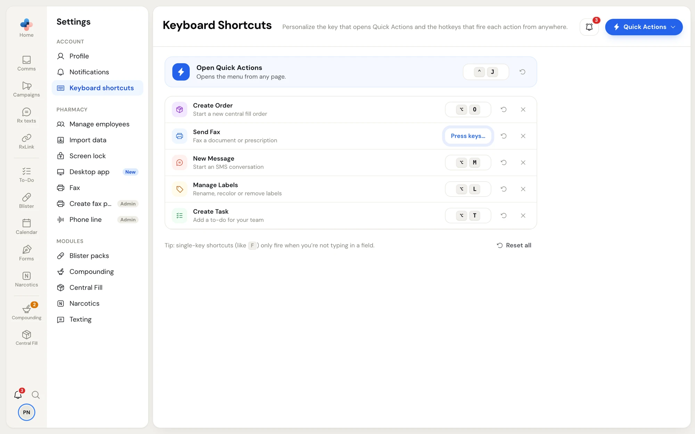

PharmaTools has two kinds of shortcuts:

- **Quick Actions keys**, which you can change in **Settings › Keyboard shortcuts**. They are yours alone and follow you to any computer you sign in on.
- **Fixed keys**, which are the same for everyone. They are listed at the end of this page.

On a Mac, **Alt** is the **Option** key (⌥) and **Ctrl** is the **Control** key (⌃). PharmaTools shows the Mac symbols on a Mac.

## Quick Actions keys

**Quick Actions** is the blue button at the top right of most pages. It opens a menu of common actions you can run from any page. Each action also has its own key, so you can skip the menu.

| Action | What it does | Default key |
| --- | --- | --- |
| **Open Quick Actions** | Opens the menu from any page | **Ctrl+J** |
| **Create Order** | Starts a new Central Fill order. Only for pharmacies with Central Fill. | **Alt+O** |
| **Send Fax** | Opens a new fax | **Alt+F** |
| **New Message** | Starts a text conversation. Only for pharmacies with their own texting number. | **Alt+M** |
| **Manage Labels** | Opens the labels window to rename, recolour or remove labels | **Alt+L** |
| **Create Task** | Opens the To-Do flyout to add a task | **Alt+T** |

Inside the Quick Actions menu, use **↑** and **↓** to move, **Enter** to run the highlighted action and **Esc** to close it.

<Frame caption="Settings › Keyboard shortcuts with the default keys, shown with Mac symbols">

</Frame>

### Change a key

<Steps>
  <Step title="Click the key button">
    In **Settings › Keyboard shortcuts**, click the key button on the action's row. It says **Press keys…**.
  </Step>
  <Step title="Press the new keys">
    Press the combination you want, for example **Alt+P**. Holding a modifier key on its own keeps it listening. **Esc** cancels; **Backspace** or **Delete** leaves the action with no key (**Not set**).
  </Step>
  <Step title="Save">
    Click **Save shortcuts** on the bar at the bottom. A message says **Shortcuts saved**. If your account can't be reached, it says **Saved on this device** and the keys work only on that computer for now.
  </Step>
</Steps>

<Frame caption="A key button waiting for keys">

</Frame>

On each row:

- the round arrow (**Reset to default**) puts back that action's default key;
- the **×** (**Clear shortcut**) leaves it with no key.

**Reset all**, under the list, puts every key back to its default at once and saves straight away.

Two actions can't share a key. If they would, both rows turn red with **Already used by another action**, the bar says **Two actions share a shortcut**, and you can't save until you change one.

<Tip>
A single-key shortcut (like **F** with no Alt or Ctrl) only fires when you're not typing in a field. Keys with **Alt** or **Ctrl** work even while you type.
</Tip>

## Fixed keys

These work for everyone and can't be changed.

### Anywhere in PharmaTools

| Key | What it does |
| --- | --- |
| **Ctrl+K** (⌘K on a Mac) | Opens Search. Works even while you type in a field. |
| **Alt+E** | **Change Employee**: hand the computer to another staff member. |
| **Alt+D** | Goes to **Home**. |
| **Alt+N** | Opens the full **Create Task** window. |
| **T** | Opens the To-Do flyout, linked to whatever you have open. |
| **Shift+T** | Opens or closes the To-Do flyout. |
| **Space** | In the To-Do flyout, ticks off the task under the mouse. |
| **Shift+N** | Opens or closes the notifications (the bell). |
| **Esc** | Closes the open window, menu, flyout or notifications. |

**T**, **Shift+T**, **Space**, **Shift+N**, **Alt+D** and **Alt+N** don't fire while you type in a field. **Ctrl+K** and **Alt+E** work anywhere.

### In lists

| Where | Key | What it does |
| --- | --- | --- |
| **Home** and **Comms** | **↑** / **↓** | Move between rows. |
| **Home** and **Comms** | **Enter** | Open the highlighted row. |
| **Home** and **Comms** | **E** | Archive the ticked rows, or the highlighted one. In **Comms › Archived**, **E** unarchives. |
| **Home** and **Comms** | **A** | Opens **Assign** for the highlighted row. |
| **RxLink › Team chat** | **↑** / **↓**, **Enter** | Move between chats and open one. |
| **To-Do**, Week and Month views | **←** / **→** | Go to the previous or next week or month. |

These list keys don't fire while a menu, a window or Quick Actions is open, or while you type in a field.
