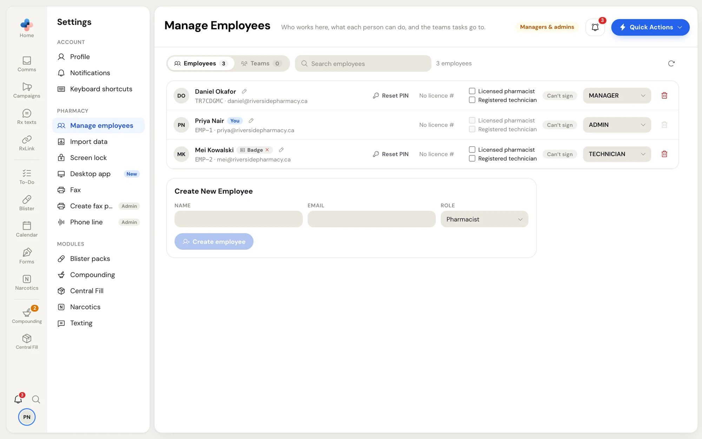
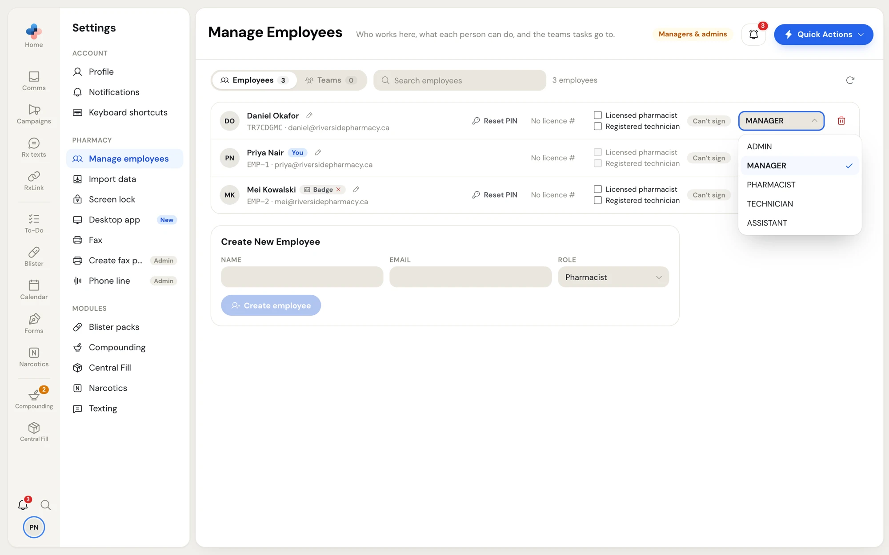
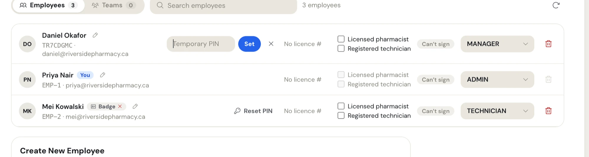
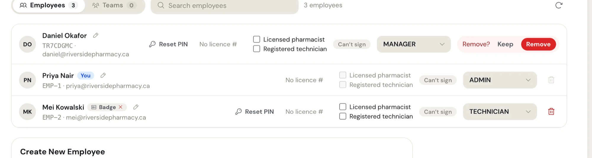

**Settings › Manage employees** lists everyone who works at the pharmacy. It is for **managers and admins**; the header shows a **Managers & admins** pill. Other staff don't see it in Settings.

The page has two tabs at the top: **Employees** and **Teams**, each with a count. This page covers **Employees**. For groups of people that tasks go to, see [Teams](/settings/teams).

<Frame caption="Settings › Manage employees, Employees tab">

</Frame>

## The employee list

Each row shows:

- the person's initials, **full name** and a pencil to edit the name;
- **You** on your own row, **Temporary PIN** when they haven't chosen their own PIN yet, and **Badge** when they have a sign-in badge linked;
- their employee ID and email;
- **Reset PIN**;
- the Blister packs signing ticks, when your pharmacy uses Blister packs;
- a role dropdown;
- a delete (bin) button.

Use **Search employees** to filter by name, email, role or ID. The count beside it says how many match. The round arrow at the right reloads the list.

## Roles

Pick a role for each person in the dropdown on their row. The change saves at once, and a message says, for example, **Mei Kowalski is now technician**.

<Frame caption="The role dropdown on an employee's row">

</Frame>

| Role | What changes for them |
| --- | --- |
| **Admin** | Everything a Manager can do, plus adding, changing and removing other admins. The pharmacy's top role: changes the pharmacy's sign-in email and password and two-step sign-in. Signs compounding records and formulas as a pharmacist. |
| **Manager** | Opens **Manage employees**, **Teams**, **Import data**, **Screen lock**, **Desktop app**, **Fax**, and **Plan & modules** and **Billing** where they show. Sees and edits **Pharmacy Information** and the sign-in security sections in Profile. Changes **Texting** and **Online requests**. Has the **Show All tasks** switch for To-Do. Signs compounding records and formulas as a pharmacist. When the pharmacy has no Admin, the Manager is its top role. |
| **Pharmacist** | Signs compounding records and formulas as a pharmacist. Always counts as a licensed pharmacist in Blister packs. |
| **Technician** | Day-to-day work in every module the pharmacy has. In Settings, sees **Profile**, **Notifications**, **Keyboard shortcuts** and the module settings. |
| **Assistant** | The same as a Technician. |

Rules that protect admins:

- Only an Admin can give someone the **Admin** role. A Manager doesn't see **Admin** in the list.
- A Manager sees admins' rows read-only: the role dropdown is greyed out (**Only an admin can change an admin**) and there is no **Reset PIN**, name pencil or delete.

## Add an employee

<Steps>
  <Step title="Fill in Create New Employee">
    Under the list, in **Create New Employee**, type the person's **Name** and **Email**, and pick a **Role** (it starts on **Pharmacist**).
  </Step>
  <Step title="Click Create employee">
    Click **Create employee**. The person appears in the list, and a message says **Employee created · temporary PIN emailed**.
  </Step>
  <Step title="The new person signs in">
    PharmaTools emails them a temporary PIN. On a pharmacy computer, they pick their name, type the temporary PIN, and choose their own PIN. Until then their row shows **Temporary PIN**.
  </Step>
</Steps>

The email is used to send the temporary PIN. It is not how they sign in: staff sign in by picking their name and typing their PIN on a computer that is already signed in to the pharmacy.

### Someone who already uses PharmaTools

If the email belongs to someone who already has a PharmaTools account (for example, they also work at another PharmaTools pharmacy), an amber box opens: **This person already has a PharmaTools account. To add them here, ask them to type their own PIN.**

Hand them the keyboard. They type their PIN in **Their PIN**, then click **Add employee**. A message says they were added. No temporary PIN is emailed: they sign in at your pharmacy with the PIN they already have.

## Edit a name

Click the pencil next to the person's name, type the new name, and press **Enter** or click away. Press **Esc** to cancel. A message says **Name updated**.

## Reset a forgotten PIN

You can't see anyone's PIN. When someone forgets theirs, give them a temporary one:

<Steps>
  <Step title="Click Reset PIN">
    On their row, click **Reset PIN**. A **Temporary PIN** field opens.
  </Step>
  <Step title="Type a temporary PIN">
    Type at least 4 characters and click **Set** (or press **Enter**). Click the **×** to cancel.
  </Step>
  <Step title="Tell them the temporary PIN">
    A message says **Temporary PIN set.** and that they pick their own at their next sign-in. Their row shows **Temporary PIN** until they do.
  </Step>
</Steps>

<Frame caption="Reset PIN open on an employee's row">

</Frame>

You can't reset your own PIN in **Manage employees**. Change it in [Profile](/settings/profile#change-your-pin).

## Remove a lost badge

If someone loses their sign-in badge or gets a new one, click the small red **×** on the **Badge** tag beside their name. A message says the badge was removed. They link the new one themselves in **Settings › Profile › Sign-in badge**.

## Remove an employee

<Steps>
  <Step title="Click the bin">
    On their row, click the bin at the right. The row asks **Remove?**
  </Step>
  <Step title="Confirm">
    Click **Remove**, or **Keep** to change your mind. A message says they were removed.
  </Step>
</Steps>

<Frame caption="The Remove? question on an employee's row">

</Frame>

What removing does:

- They can no longer sign in at your pharmacy.
- They are taken out of every team.
- If they also work at another PharmaTools pharmacy, only their link to your pharmacy is removed; their account stays for the other pharmacy.

You can't remove yourself, and a Manager can't remove an Admin.

## Blister packs signing ticks

When your pharmacy uses Blister packs, each row also shows the person's licence # and two ticks that only Blister packs reads:

| Tick | Meaning |
| --- | --- |
| **Licensed pharmacist** | Can sign the clinical check and the product check. Always ticked and locked for the **Pharmacist** role. |
| **Registered technician** | Can sign the product check. |

A tag beside the ticks says what the person can sign: **Clinical + Product**, **Product**, **Can't sign**, or **Needs a licence #** when a tick is on but they haven't added their licence number. Each person adds their own licence number in **Settings › Profile**.

Ticking or unticking saves at once, with a message such as **Mei can sign as a registered technician**. You can't change your own ticks: ask another manager.
