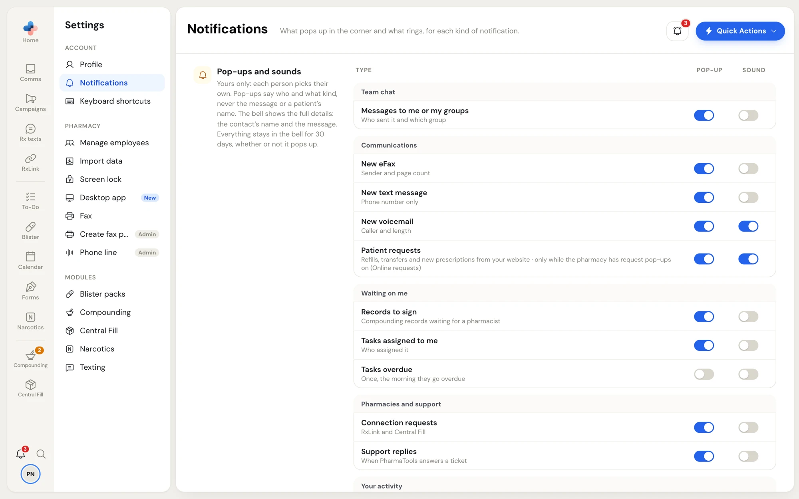

**Settings › Notifications** is yours alone: each person picks their own, and the choices follow you to any computer you sign in on. Every switch saves the moment you click it.

Whatever you choose in **Settings › Notifications**, every notification is kept in the bell at the bottom of the side menu for 30 days. The switches only decide what interrupts you.

<Frame caption="Settings › Notifications. Each row has a Pop-up switch and a Sound switch.">

</Frame>

## What a pop-up shows

Pop-ups appear in the corner of the screen and say who and what kind, never the message itself or a patient's name, because the screen may face the counter. The bell shows the full details: the contact's name and the message.

A pop-up doesn't show for something you are already looking at. For example, a new eFax doesn't pop up while you are in **Comms**, and a chat message doesn't pop up while you are in **RxLink › Team chat**.

## The kinds of notification

| Group | Kind | The pop-up says | Pop-up | Sound |
| --- | --- | --- | --- | --- |
| Team chat | **Messages to me or my groups** | Who sent it and which group | On | Off |
| Communications | **New eFax** | Sender and page count | On | Off |
| Communications | **New text message** | Phone number only | On | Off |
| Communications | **New voicemail** | Caller and length | On | On |
| Communications | **Patient requests** | Refills, transfers and new prescriptions from your website | On | On |
| Waiting on me | **Records to sign** | Compounding records waiting for a pharmacist | On | Off |
| Waiting on me | **Tasks assigned to me** | Who assigned it | On | Off |
| Waiting on me | **Tasks overdue** | Once, the morning they go overdue | Off | Off |
| Pharmacies and support | **Connection requests** | RxLink and Central Fill | On | Off |
| Pharmacies and support | **Support replies** | When PharmaTools answers a ticket | On | Off |
| Your activity | **Something didn't go through** | A fax or text that didn't send, or a save that failed | On | Off |

The **Pop-up** and **Sound** columns show the settings every new employee starts with.

<Note>
**Patient requests** pop up only while the pharmacy has **Pop-up and sound for new requests** turned on in [Settings › Online requests](/settings/online-requests#alerts-for-your-team). A manager turns that on for the whole pharmacy; this row then decides it for you.
</Note>

## Sign in as yourself first

Notifications belong to a person. If nobody has picked their name on the computer, the page says **Notifications belong to a person. Sign in as an employee (Change Employee) to choose yours.** Click your initials, then **Change Employee**, pick your name and type your PIN.
