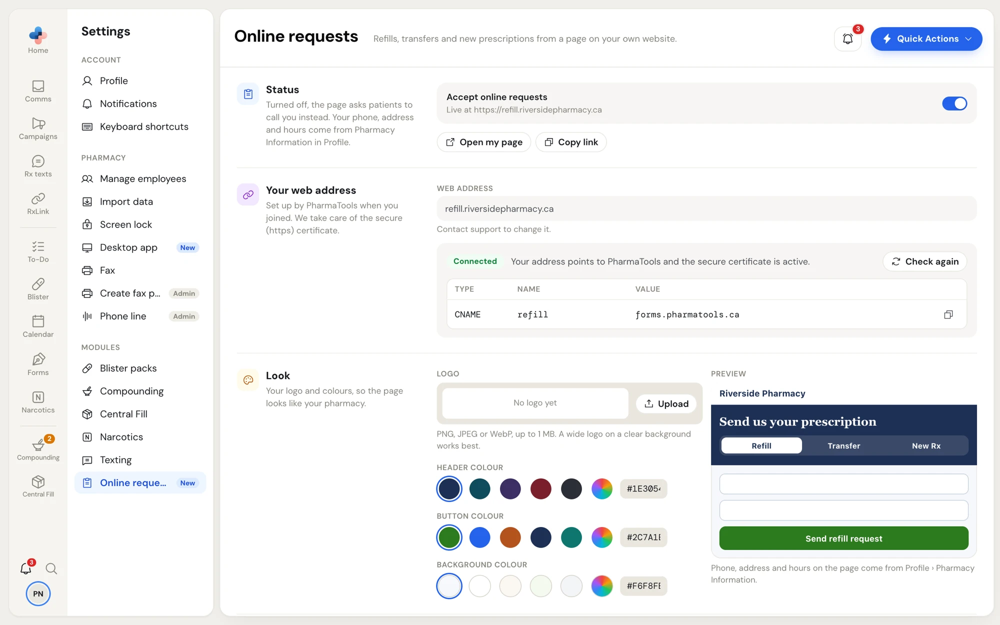
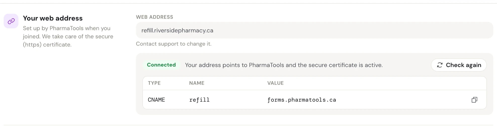
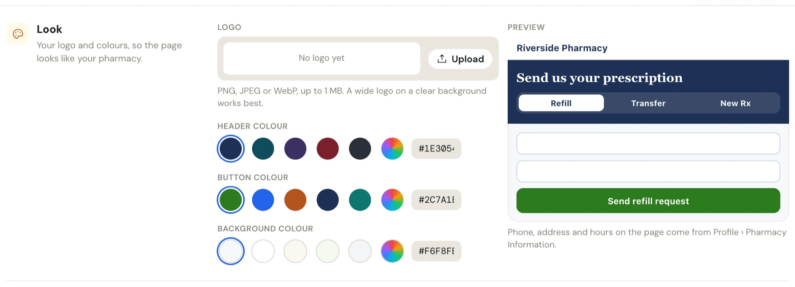
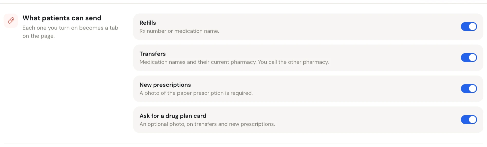
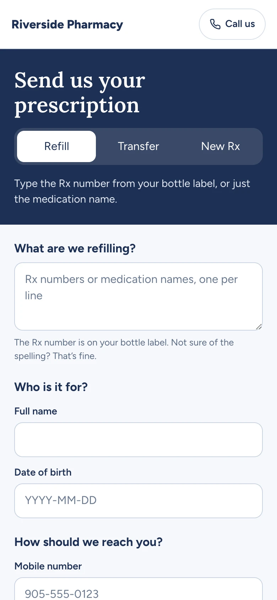
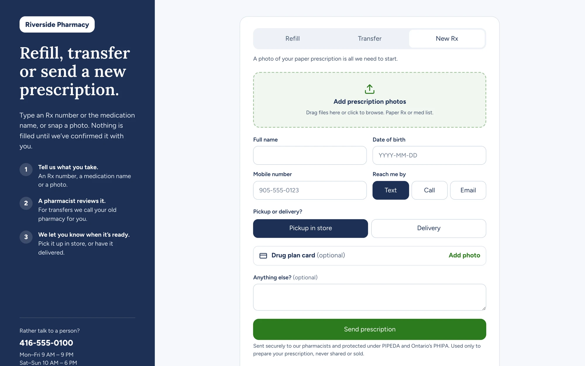
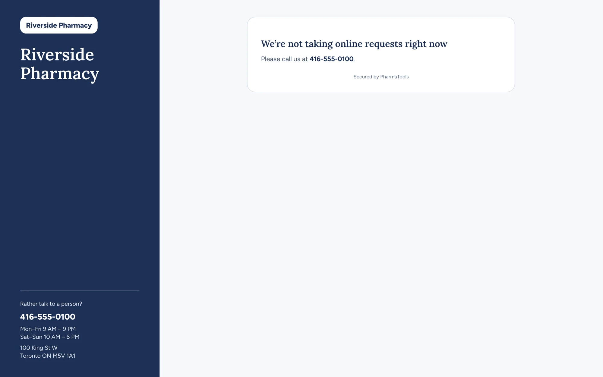

Online requests gives your pharmacy a page on its own web address, for example **refill.yourpharmacy.ca**, where patients send:

- **Refills**, by Rx number or medication name;
- **Transfers** from another pharmacy;
- **New prescriptions**, with a photo of the paper prescription.

Every request lands in **Comms › Patient requests** for your team to work through.

**Who sees it:** **Settings › Online requests** shows under **Modules** once PharmaTools has turned Online requests on for your pharmacy. Everyone can open it; only **managers and admins** can change it. Everyone else sees **Only managers can change these.** If PharmaTools has switched it off, the page says **Online requests are switched off for this pharmacy. Contact PharmaTools support to turn them on.**

Change what you need, then click **Save changes** on the **Unsaved changes** bar. The logo is the exception: uploading or removing it saves at once.

<Frame caption="Settings › Online requests">

</Frame>

## Set up your page

<Steps>
  <Step title="PharmaTools sets up your web address">
    When you join, PharmaTools sets up your web address and tells you the one record to add where your website's domain is managed. Until then, **Your web address** says **Not set up yet** and the page can't go live.
  </Step>
  <Step title="Add the record">
    Copy the record from **Your web address** into your domain's settings. Then click **Check again** until the tag says **Connected**.
  </Step>
  <Step title="Make it look like your pharmacy">
    Upload your logo and pick your colours in **Look**. The preview beside it updates as you go.
  </Step>
  <Step title="Choose what patients can send">
    Turn on the request types you take in **What patients can send**, and delivery if you offer it.
  </Step>
  <Step title="Go live">
    Turn on **Accept online requests** in **Status** and save. Link to the page from your website: **Copy link** copies its address.
  </Step>
</Steps>

## Status

| Control | What it does |
| --- | --- |
| **Accept online requests** | On: the hint reads **Live at** and your page's address. Off: **Off. Patients are asked to call you.** The page then shows your phone number instead of the form. |
| **Open my page** | Opens your page in a new tab, as patients see it. |
| **Copy link** | Copies your page's address, to paste into your website or social media. |

The page's phone number, address and hours come from **Settings › Profile › Pharmacy Information**. Change them in Profile; **Online requests** doesn't edit them.

## Your web address

**Web address** is read-only: contact support to change it. PharmaTools takes care of the secure (https) certificate.

<Frame caption="Your web address, connected">

</Frame>

Under it is the one record to add, with a copy button for its value:

| Type | Name | Value |
| --- | --- | --- |
| CNAME | the first part of your web address, for example **refill** | **forms.pharmatools.ca** |

| Tag | Meaning |
| --- | --- |
| **Not set up** | Add the record where your website's domain is managed, then click **Check again**. |
| **Waiting for your record** | PharmaTools checks every few minutes. A new record can take up to an hour to show up. |
| **Connected** | Your address points to PharmaTools and the secure certificate is active. |

## Look

<Frame caption="Look: your logo, three colours and a live preview of the page">

</Frame>

- **Logo**: click **Upload** (or **Replace**) and pick a PNG, JPEG or WebP image up to 1 MB. A wide logo on a clear background works best. **Remove** takes it off. Without a logo, the page shows your pharmacy's name.
- **Header colour**, **Button colour**, **Background colour**: click a swatch, click the rainbow swatch to pick any colour, or type a hex code. If white text would be hard to read on a header or button colour, PharmaTools warns you: **White text is hard to read on this colour. A darker one works better.**

## What patients can send

Each one you turn on becomes a tab on your pharmacy's request page, the page patients open.

<Frame caption="What patients can send">

</Frame>

| Switch | What the patient gives |
| --- | --- |
| **Refills** | Rx numbers or medication names. |
| **Transfers** | The medication names and, optionally, their current pharmacy. You call the other pharmacy. |
| **New prescriptions** | A photo of the paper prescription, which is required. |
| **Ask for a drug plan card** | An optional photo of their drug plan card, on transfers and new prescriptions. |

If the page is live with none of the three types on, a note says **Turn on at least one, or turn off "Accept online requests" above.**

## Pickup and delivery

Pickup is always offered. Turn on **Offer delivery** to let patients pick **Delivery** instead. They never type an address: you confirm it when you call or text them. **Delivery note** (up to 200 characters, for example **Free same-day delivery in town.**) shows under the delivery option.

## Texts to the patient

These texts go from your pharmacy's own texting number and never name a medication. Replies arrive in **Comms › Messages**.

| Setting | What it does |
| --- | --- |
| **Text a confirmation right away** | Texts the patient the moment a request comes in, using **Confirmation**. |
| **Confirmation** | The confirmation text. |
| **Ready for pickup** | The text for when an order is ready to pick up. |
| **Out for delivery** | The text for when an order is out for delivery. |

Each text can be up to 480 characters and can use `{pharmacy}`, `{ref}` (the request's reference), `{phone}`, `{address}` and `{closes}` (today's closing time). Anything else in braces is flagged: **PharmaTools won't fill in** and the word.

Without your own texting number, this section says PharmaTools doesn't text patients, and your team calls or texts them another way.

## Alerts for your team

| Switch | What it does |
| --- | --- |
| **Pop-up and sound for new requests** | A pop-up and a soft chime on every computer signed in to the pharmacy when a request arrives, for example **New patient request · Refill · Online form**. It names the kind and the source, never the patient or a medication. Each person can still turn **Patient requests** off for themselves in [Notifications](/settings/notifications). |
| **Email the pharmacy** | Emails the pharmacy that a request came in, nothing more: no patient details. |

## What the patient sees

The page has your logo, colours and contact details, and a small **Secured by PharmaTools** at the bottom. It's never listed in search engines.

On a computer, the left panel explains the steps (**Tell us what you take.**, **A pharmacist reviews it.**, **We let you know when it's ready.**) and shows **Rather talk to a person?** with your phone number, hours and address. The form is on the right.

<Frame caption="The patient's page on a computer, Refill tab">

</Frame>

On a phone, the top of the page is in your header colour with **Send us your prescription**, the tabs and a hint, and a **Call us** button in the corner.

<Frame caption="The same page on a phone">

</Frame>

### The form, tab by tab

| Tab | What the patient fills in | Button |
| --- | --- | --- |
| **Refill** | **What are we refilling?**: Rx numbers or medication names, one per line. | **Send refill request** |
| **Transfer** | **Which medications should we move over?** (names, or "everything") and **Your current pharmacy** (optional). | **Send transfer request** |
| **New Rx** | **Add prescription photos**: up to 5 photos of the paper prescription or a medication list. | **Send prescription** |

Every tab then asks:

- **Full name** and **Date of birth** (YYYY-MM-DD) of the person it's for;
- **Mobile number**, and **Reach me by**: **Text**, **Call** or **Email** (with an email field). **Text** is offered only when your pharmacy has its own texting number;
- **Pickup or delivery?**: **Pickup in store** or **Delivery**, when you offer delivery;
- **Drug plan card** (optional, up to 2 photos), on **Transfer** and **New Rx** when you ask for it;
- **Anything else?** (optional).

<Frame caption="The New Rx tab, with the photo drop zone and the optional drug plan card">

</Frame>

If something is missing or wrong, the field says what, for example **Enter a 10-digit phone number, like 905-555-0123.**, and the page moves to it.

After sending, the patient sees **Got it, thank you**, a line saying how a pharmacist will reach them when it's ready (and that a confirmation text was sent, if one was), their **Reference**, and **Send another request**.

When **Accept online requests** is off, or none of the request types is on, the page says **We're not taking online requests right now** and asks the patient to call your phone number.

<Frame caption="The page when the pharmacy isn't taking online requests">

</Frame>

## Where requests land

Every request goes to **Comms › Patient requests**, next to refill requests from your automated phone line. Each one shows the patient, the kind (**Refill**, **Transfer** or **New Rx**), the source (**Online form**) and its status: **New**, **In progress** or **Ready**. The Comms guide covers working through them.
