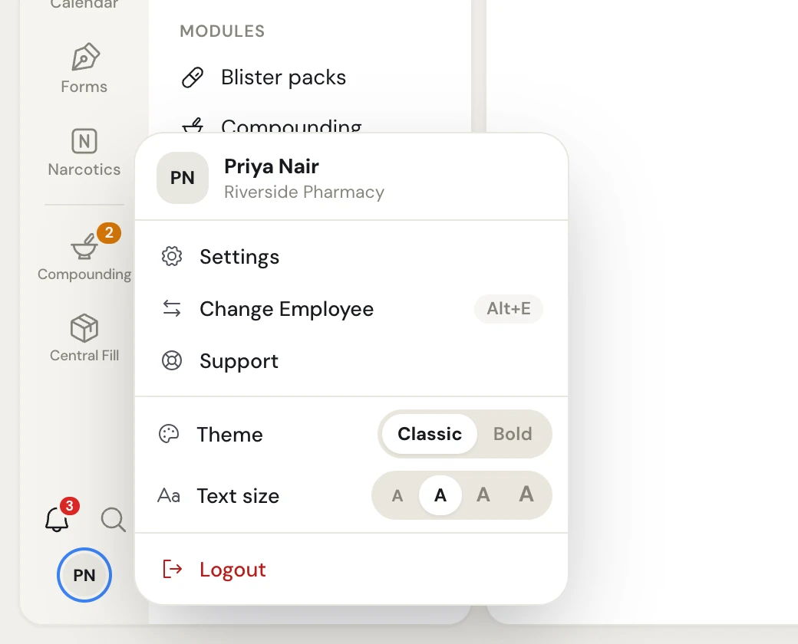
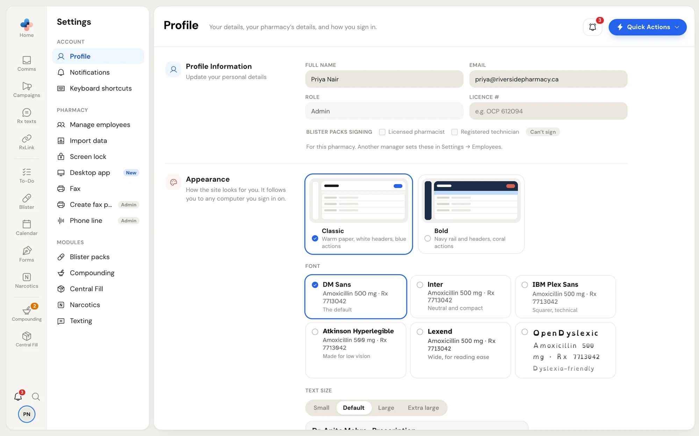

**Settings** holds everything about you (your name, PIN, look and keys), everything about the pharmacy (staff, sign-in security, imports, screen lock) and the settings of each module your pharmacy has.

## Open Settings

<Steps>
  <Step title="Click your initials">
    Click the circle with your initials at the bottom of the side menu. Your menu opens with your name and the pharmacy's name at the top.
  </Step>
  <Step title="Click Settings">
    Click **Settings**. It always opens on **Settings › Profile**.
  </Step>
</Steps>

<Frame caption="Your menu, opened from your initials at the bottom of the side menu">

</Frame>

The same menu also has:

| Item | What it does |
| --- | --- |
| **Change Employee** (**Alt+E**) | Hands the computer to another staff member: they pick their name and type their PIN. |
| **Support** | Opens your support tickets with the PharmaTools team. It shows **New reply** when the team has answered. |
| **Theme** | Switches between **Classic** and **Bold** for you. See [Appearance](/settings/appearance). |
| **Text size** | Four **A** buttons, smallest to largest, for your text size. |
| **Logout** | Signs you out of PharmaTools on this computer. |

## The Settings page

The left side of **Settings** lists every area you can open, in three groups. The area you pick opens on the right, under a header with its name, one line on what it is for and, for some areas, a pill that says who it is for (**Managers & admins** or **Admin**).

<Frame caption="Settings, open on Profile. The left list shows only the areas this person may open.">

</Frame>

You only see the areas you can use. An area you can't open is left out of the list. If you follow an old link to one, the page says **You don't have access to this section.**

| Group | Area | What it controls | Who sees it |
| --- | --- | --- | --- |
| Account | [Profile](/settings/profile) | Your name, email, licence #, PIN and sign-in badge. Managers and admins also see the pharmacy's details and sign-in security. | Everyone |
| Account | [Notifications](/settings/notifications) | Which notifications pop up and which ring, for you. | Everyone |
| Account | [Keyboard shortcuts](/settings/keyboard-shortcuts) | Your keys for Quick Actions. | Everyone |
| Pharmacy | [Manage employees](/settings/manage-employees) | Staff, roles, temporary PINs, badges, and [Teams](/settings/teams). | Managers and admins |
| Pharmacy | [Import data](/settings/import-data) | Bring tasks into To-Do from calendar files (.ics), and remove past imports. | Managers and admins |
| Pharmacy | [Screen lock](/settings/sign-in-security#screen-lock) | How long an unused computer waits before it locks. | Managers and admins |
| Pharmacy | **Desktop app** | PharmaTools Desktop for Windows: the installer, the PCs connected to the pharmacy and its add-ons. | Managers and admins |
| Pharmacy | [Fax](#fax-direct-delivery-between-pharmatools-pharmacies) | Direct delivery of faxes to other PharmaTools pharmacies. | Managers and admins |
| Pharmacy | [Plan & modules](/settings/plan-and-billing) | Add or remove modules, or move to a 1-year term. | Managers and admins, once online billing is on for your pharmacy |
| Pharmacy | [Billing](/settings/plan-and-billing#billing) | The card or bank account you pay with, what you pay and when. | Managers and admins, when the pharmacy pays by card or bank account |
| Pharmacy | [Phone line](/settings/phone-line) | What the automated phone line says. | Marked **Admin**. See the page for who sees it. |
| Modules | **Blister packs**, **Compounding**, **Central Fill**, **Narcotics** | Each module's own settings. Their guides cover them. | Everyone at a pharmacy with that module |
| Modules | [Texting](/settings/texting) | How campaign texts go out, the opt-out page details, quiet hours. | Everyone at a pharmacy with Campaigns. Only managers and admins can change it. |
| Modules | [Online requests](/settings/online-requests) | The refill, transfer and new prescription page on your own website. | Everyone at a pharmacy where PharmaTools has turned it on. Only managers and admins can change it. |

<Note>
"Admin" in this guide is the **Admin** employee role at your pharmacy. Roles are explained in [Manage employees](/settings/manage-employees#roles).
</Note>

## How changes are saved

Settings saves in one of two ways, and each area tells you which.

- **Saved as soon as you change it.** Switches and choices that only affect you (theme, font, text size, spacing, the To-Do **Show All tasks** switch, every switch in **Notifications**) and a few pharmacy switches (**Fax**) save the moment you click them. There is no save button for these.
- **Saved with the Unsaved changes bar.** Areas with several fields (**Profile**, **Keyboard shortcuts**, **Screen lock**, **Texting**, **Online requests**, **Phone line**) wait for you. As soon as you change something, a dark bar rises at the bottom of the page with **Unsaved changes**, **Discard** and a save button (**Save changes**, **Save shortcuts** or **Save phone line**). Click the save button to keep the changes, or **Discard** to put everything back.

When something is wrong, the bar says what instead of **Unsaved changes**, for example **Two actions share a shortcut** or **Quiet hours must end after they start**, and the save button stays grey until you fix it.

<Tip>
Changes to the pharmacy's details ask for the pharmacy password first, in a window titled **Confirm with the pharmacy password**. That is the password the pharmacy signs in with on a new computer, not your PIN.
</Tip>

## Fax: direct delivery between PharmaTools pharmacies

**Settings › Fax** (managers and admins) has one switch: **Direct delivery between PharmaTools pharmacies**. When it's on, a fax you send to a number that gets its faxes on PharmaTools skips the phone network and lands in that pharmacy's inbox in seconds. Both pharmacies' fax logs mark it **Delivered directly**. Faxes to anyone else go over the phone network as usual.

- The switch is on by default and saves as soon as you click it.
- It applies to every fax the pharmacy sends: from the web app, PharmaTools Desktop and the fax API.
- When it's off, every fax goes over the phone network, even to pharmacies on PharmaTools.
- If PharmaTools has switched direct delivery off for every pharmacy, an amber note says so. Your own choice is kept and applies when PharmaTools switches it back on.
