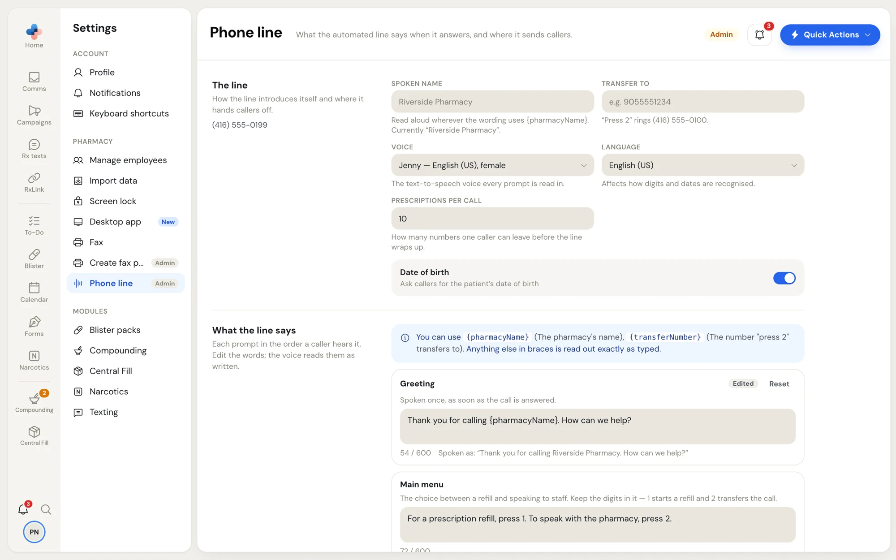

When PharmaTools answers your pharmacy's phone, the automated line greets callers, takes refill requests by prescription number, and transfers callers who press 2 to your staff. **Settings › Phone line** is where its wording and settings are kept.

Refill requests taken by the line arrive in **Comms › Patient requests**, with the source **Phone line**.

<Note>
**Settings › Phone line** is marked **Admin** and shows only once PharmaTools has set up the automated phone line for your pharmacy. Right now it is open to PharmaTools-managed accounts only. If your pharmacy has the line and you want its wording changed, ask the PharmaTools team in **Support**.
</Note>

<Frame caption="Settings › Phone line">

</Frame>

If the pharmacy has more than one line, a switch at the top picks which line you are editing. If a line is switched off, an amber note says **This line is switched off and is not answering calls. Contact support to turn it back on.** If no number has been pointed at PharmaTools yet, the page says so and there is nothing to edit.

Change what you need, then click **Save phone line** on the bar at the bottom, or **Discard**.

## The line

The left side shows the line's phone number.

| Setting | What it does |
| --- | --- |
| **Spoken name** | The name read aloud wherever the wording uses `{pharmacyName}`. Leave it empty to use your pharmacy's name; the hint shows what it says now. |
| **Transfer to** | The number "press 2" rings, for example 9055551234. With no number, "press 2" apologizes instead of transferring. |
| **Voice** | The voice every prompt is read in. |
| **Language** | Affects how digits and dates are recognised. |
| **Prescriptions per call** | How many prescription numbers one caller can leave (1 to 25) before the line wraps up. |
| **Date of birth** | When on, the line asks callers for the patient's date of birth. |

## What the line says

Each prompt is listed in the order a caller hears it, with a line on when it plays. Edit the words in the box; the voice reads them exactly as written.

You can use `{pharmacyName}` (the pharmacy's name) and `{transferNumber}` (the number "press 2" transfers to). Anything else in braces is read out exactly as typed.

Under each box:

- a counter, for example **54 / 600**, turns red when the prompt is too long;
- **Spoken as:** shows the prompt with the placeholders filled in.

A prompt you have changed is tagged **Edited**; one you are changing is tagged **Unsaved**. **Reset** puts the prompt back to PharmaTools' wording.

| Prompt | When the caller hears it |
| --- | --- |
| **Greeting** | Once, as soon as the call is answered. |
| **Main menu** | The choice between a refill and speaking to staff. Keep the digits: 1 starts a refill and 2 transfers the call. |
| **Invalid menu choice** | When the caller presses something that isn't on the menu. The menu repeats straight after. |
| **Ask for the prescription number** | Asks for the number. Tell callers to finish with the pound key, or they wait out the timeout on every number. |
| **No prescription number heard** | When the caller entered nothing, or something too short to be a prescription number. |
| **Ask for the date of birth** | Only when **Date of birth** is on. |
| **Anything else?** | After each prescription number. Keep all three digits in it. |
| **Prescription limit reached** | When the caller reaches **Prescriptions per call**. |
| **Request received** | The last thing a successful refill call hears. |
| **Nothing was requested** | When the caller reaches the end without giving a single prescription number. |
| **Transferring to the pharmacy** | Just before the call is connected to staff. |
| **Cannot transfer** | Instead of the transfer, when no number is set or the pharmacy doesn't pick up. |
| **No input at all** | When a prompt is answered with silence twice. Every prompt ends with this one rather than in dead air. |
