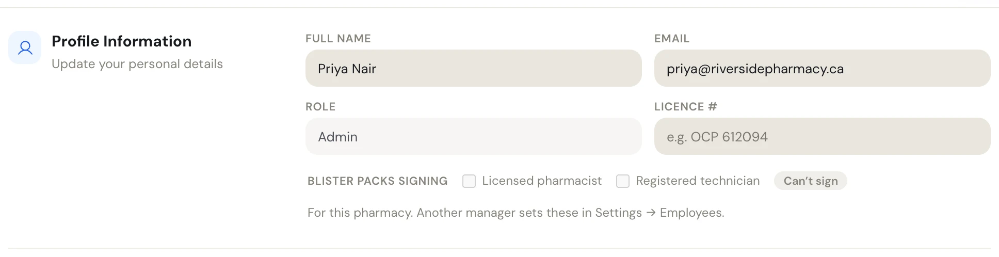
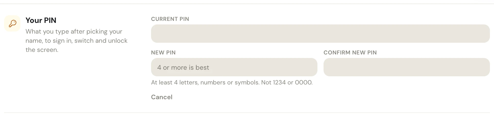
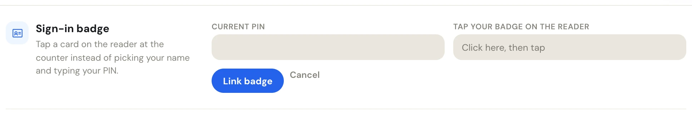
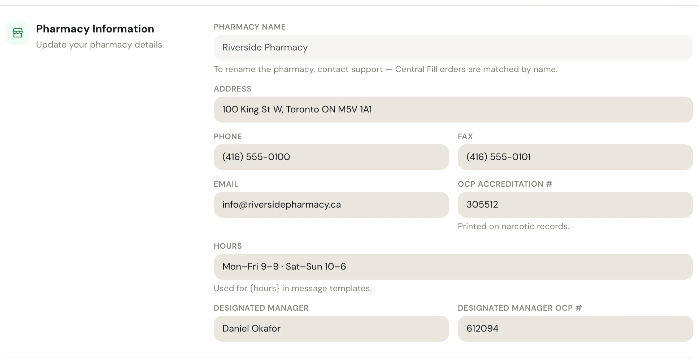

**Settings › Profile** is the first page of Settings. Everyone sees their own details, PIN and badge. Managers and admins also see the pharmacy's details and its sign-in security.

To open it, click your initials at the bottom of the side menu, then **Settings**.

| Section | What it holds | Who sees it |
| --- | --- | --- |
| **Profile Information** | Your name, email, role and licence # | Everyone |
| **Appearance** | Theme, font, text size and spacing. See [Appearance](/settings/appearance). | Everyone |
| **To-Do** | Whether your To-Do lists show every task in the pharmacy | Managers and admins |
| **Your PIN** | The PIN you sign in, switch and unlock with | Everyone |
| **Sign-in badge** | A card you tap on the reader instead of typing your PIN | Everyone |
| **Pharmacy Information** | The pharmacy's address, phone, fax, email, OCP accreditation #, hours and designated manager | Managers and admins |
| **Pharmacy Password**, **Two-step sign-in**, **Signed-in computers** | The pharmacy's sign-in security. See [Sign-in security](/settings/sign-in-security). | Managers and admins |

## Profile information

<Frame caption="Profile Information. Role is set by a manager in Manage employees.">

</Frame>

| Field | What to enter |
| --- | --- |
| **Full name** | Your name as it should appear on tasks, chats, records and signatures. |
| **Email** | Your own email. PharmaTools uses it to send you a temporary PIN. |
| **Role** | Read-only. A manager or admin changes it in [Manage employees](/settings/manage-employees). |
| **Licence #** | Your Ontario College of Pharmacists registration number, for example **OCP 612094**. Pharmacists and registered technicians need it to sign in modules that check it. |

When you change your name and save, the page reloads so the side menu and your menu show the new name.

**Blister packs signing** appears under your licence # when your pharmacy uses Blister packs. It shows your two ticks, **Licensed pharmacist** and **Registered technician**, and what you can sign (**Clinical + Product**, **Product**, **Needs a licence #** or **Can't sign**). You can't change them in Profile: another manager sets them in [Manage employees](/settings/manage-employees#blister-packs-signing-ticks).

## To-Do: show all tasks

Managers and admins have a **To-Do** section with one switch, **Show All tasks**.

- **On** (the default): your To-Do lists include an **All tasks** view with every task in the pharmacy, whoever it's for.
- **Off**: you see what everyone else sees, your tasks and the unassigned ones.

It saves as soon as you click it and follows you to any computer you sign in on.

## Change your PIN

Your PIN is what you type after you pick your name, to sign in, to switch to yourself with **Change Employee**, and to unlock the screen.

<Steps>
  <Step title="Click Change PIN">
    In **Your PIN**, click **Change PIN**. Three fields open.
  </Step>
  <Step title="Type your current PIN and the new one twice">
    Fill in **Current PIN**, **New PIN** and **Confirm new PIN**. A PIN needs at least 4 letters, numbers or symbols, and can't be **1234** or **0000**.
  </Step>
  <Step title="Save">
    Click **Save changes** on the **Unsaved changes** bar. If the two new PINs don't match, the page says **PINs do not match** and nothing is saved.
  </Step>
</Steps>

<Frame caption="Your PIN, open after Change PIN. Cancel closes the fields without changing anything.">

</Frame>

<Tip>
Forgot your PIN? You can't reset it yourself. Ask a manager or admin to set you a temporary PIN in **Settings › Manage employees**. You choose your own at your next sign-in.
</Tip>

## Link a sign-in badge

If your pharmacy has a card reader at the counter, you can link a badge to yourself. Tapping it on the reader signs you in, switches to you or unlocks the screen, without picking your name or typing your PIN.

<Steps>
  <Step title="Click Link a badge">
    In **Sign-in badge**, click **Link a badge**. (If you already have one, the button is **Replace badge**.)
  </Step>
  <Step title="Type your current PIN">
    Type your PIN in **Current PIN**.
  </Step>
  <Step title="Tap the badge">
    Click in **Tap your badge on the reader**, then tap the card on the reader.
  </Step>
  <Step title="Link it">
    Click **Link badge**. A message says **Badge linked**. This saves straight away; it doesn't use the Unsaved changes bar.
  </Step>
</Steps>

<Frame caption="Sign-in badge, open after Link a badge">

</Frame>

Once a badge is linked, the section says **A badge is linked to you.** and offers **Replace badge** and **Remove badge**. If you lose your badge, click **Remove badge**, or ask a manager to remove it in **Manage employees**.

## Pharmacy information

Managers and admins keep the pharmacy's shared details in **Pharmacy Information**. Other parts of PharmaTools read them, so fill in every field you can.

<Frame caption="Pharmacy Information, with the hint under each field that another module reads">

</Frame>

| Field | Where it's used |
| --- | --- |
| **Pharmacy name** | Read-only. To rename the pharmacy, contact support: Central Fill orders are matched by name. |
| **Address**, **Phone**, **Fax** | The pharmacy's contact details. The [Online requests](/settings/online-requests) page shows the phone, address and hours to patients. |
| **Email** | The email the pharmacy signs in with on a new computer. Only the pharmacy's top role can change it (see [Sign-in security](/settings/sign-in-security#who-can-change-the-pharmacy-sign-in)); everyone else sees it greyed out. |
| **OCP accreditation #** | Printed on narcotic records. |
| **Hours** | For example **Mon–Fri 9–9 · Sat–Sun 10–6**. Used for `{hours}` in message templates and shown on your online request page. |
| **Designated manager**, **Designated manager OCP #** | The pharmacy's designated manager and their OCP number. |

When you save changes to this section, PharmaTools asks for the pharmacy password in **Confirm with the pharmacy password**, because these details are shared by everyone at the pharmacy. Type it and click **Save changes**, or **Cancel** to go back without saving. If you are changing the pharmacy password at the same time, the current password you typed there is used instead and you aren't asked again.

To clear a field, empty it and save.
