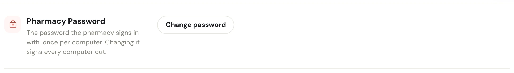
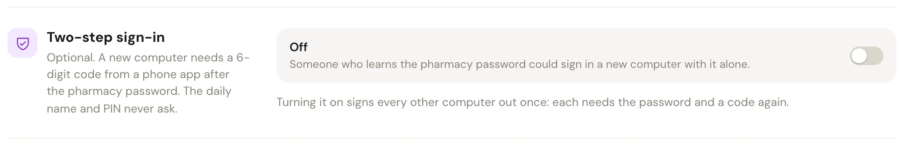
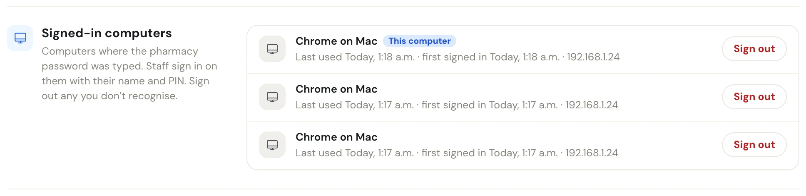
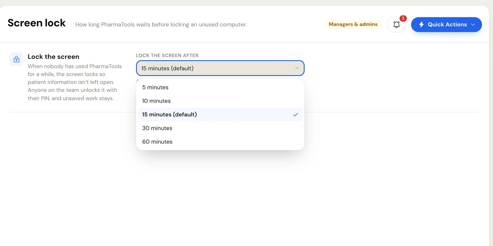

PharmaTools signs in at two levels:

1. **The pharmacy**, once per computer, with the pharmacy's email and password (and a 6-digit code if two-step sign-in is on).
2. **The person**, every time someone starts work, switches or unlocks: they pick their name and type their PIN, or tap their badge.

This page covers the pharmacy level and the screen lock. Your own PIN and badge are in [Profile](/settings/profile#change-your-pin).

Everything on this page is for **managers and admins**. The first three sections are at the bottom of **Settings › Profile**; **Screen lock** has its own page in **Settings**.

## Who can change the pharmacy sign-in

The pharmacy's sign-in email, the pharmacy password and two-step sign-in belong to the pharmacy's **top role**: an Admin employee, or a Manager when the pharmacy has no Admin. Other managers see:

- the **Email** field in **Pharmacy Information** greyed out, with the hint **The pharmacy signs in with this. Only its admin can change it, or the password.**
- no **Pharmacy Password** section;
- the two-step switch greyed out, with **Only the pharmacy's admin can turn it on or off.**

## Change the pharmacy password

Changing the pharmacy password signs every computer out. Each one then needs the pharmacy email and the new password before staff can pick their names again.

<Frame caption="Pharmacy Password, closed. Change password opens the fields.">

</Frame>

<Steps>
  <Step title="Click Change password">
    In **Pharmacy Password**, click **Change password**.
  </Step>
  <Step title="Fill in the three fields">
    Type the **Current password**, then the **New password** twice (**Confirm new password**). The new password must meet the same rules as at sign-up; if it doesn't, a message says **Choose a stronger password** and lists what it needs.
  </Step>
  <Step title="Save">
    Click **Save changes** on the **Unsaved changes** bar. Click **Cancel** under the fields to close them without changing anything.
  </Step>
</Steps>

## Two-step sign-in

Two-step sign-in is optional. When it's on, a **new** computer needs a 6-digit code from an authenticator app on a phone after the pharmacy password. Computers already signed in, and the daily name and PIN, never ask for a code.

When it's off, the switch row reads **Off** with the warning **Someone who learns the pharmacy password could sign in a new computer with it alone.**

<Frame caption="Two-step sign-in, switched off">

</Frame>

### Turn it on

<Warning>
Turning it on signs every other computer out once. Each needs the pharmacy password and a code again, so pick a quiet moment.
</Warning>

<Steps>
  <Step title="Click the switch">
    Click the switch in **Two-step sign-in**. PharmaTools asks for the pharmacy password in **Confirm with the pharmacy password**.
  </Step>
  <Step title="Scan the QR code">
    On the owner's or manager's phone, open an authenticator app and scan the QR code. If the phone can't scan it, type the key shown under **Can't scan? Type this key into the app:** instead.
  </Step>
  <Step title="Type the code">
    Type the 6-digit code the app shows and click **Turn on**. A wrong code says **That code isn't right.**
  </Step>
  <Step title="Keep the backup codes">
    **Two-step sign-in is on** shows a set of backup codes. Each one works once, if the phone is lost. Click **Copy codes** or **Print**, keep them somewhere safe away from the computer, then click **Done**.
  </Step>
</Steps>

Once it's on, the switch row reads **On for new computers**, with the date it was turned on and how many backup codes are left.

### Turn it off

Click the switch again. PharmaTools asks for the pharmacy password and the current code from the app (or a backup code), then **Turn off**. A message says **Two-step sign-in is off**.

## Signed-in computers

**Signed-in computers** lists every computer where the pharmacy password was typed. Staff sign in on them with their name and PIN.

<Frame caption="Signed-in computers. The one you are using is marked This computer.">

</Frame>

Each row shows:

- the browser and system, for example **Chrome on Windows**, and **This computer** on the one you are using;
- **Last used** and **first signed in**, with the date, and the network address it last used;
- **until the browser closes** when that computer signed in without staying signed in.

Click **Sign out** on any computer you don't recognise, or one that has left the pharmacy. A message says **Computer signed out**: it needs the pharmacy email and password next time.

## Screen lock

**Settings › Screen lock** (managers and admins) sets how long PharmaTools waits on an unused computer before it locks, so patient information isn't left open. It applies to every computer at the pharmacy, including ones signed in with **Remember me**.

<Frame caption="Settings › Screen lock with the Lock the screen after list open">

</Frame>

<Steps>
  <Step title="Pick a time">
    Open **Lock the screen after** and pick **5 minutes**, **10 minutes**, **15 minutes (default)**, **30 minutes** or **60 minutes**.
  </Step>
  <Step title="Save">
    Click **Save changes** on the **Unsaved changes** bar. The computer you are on uses the new time at once; the others pick it up the next time they check in with PharmaTools.
  </Step>
</Steps>

What staff see:

- A one-minute warning shows before the screen locks.
- Anyone on the team unlocks it with their PIN or badge. Unsaved work stays where it was.

Staff who aren't managers or admins don't see **Screen lock** in the list.
