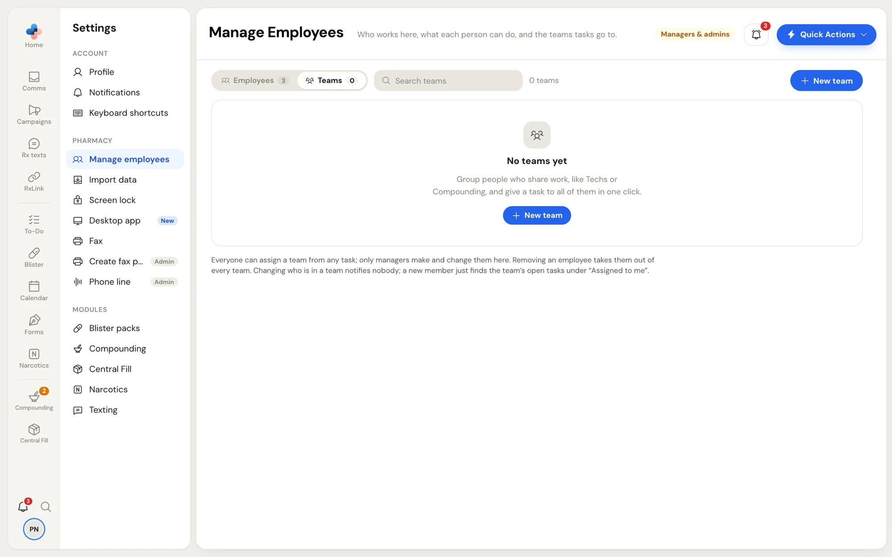
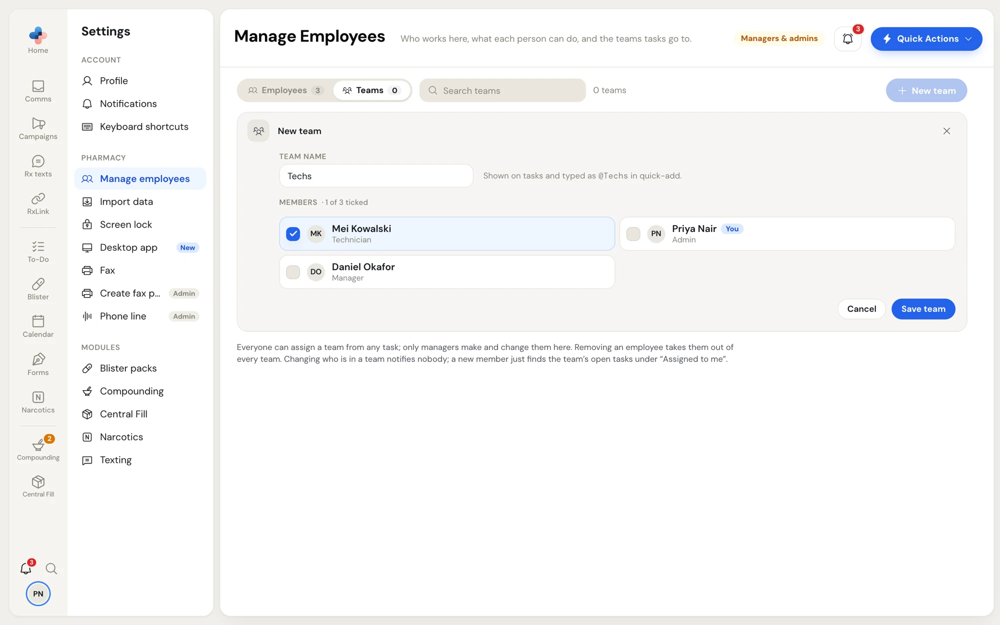

A team is a named group of employees. Give a task to a team and it goes to whoever is in the team now; when someone joins, they see the team's open tasks too.

- **Everyone** can pick a team on any task.
- Only **managers and admins** make and change teams, in **Settings › Manage employees › Teams**.

To open it, go to **Settings › Manage employees** and click the **Teams** tab at the top. "Manage teams" in a task's people picker also opens the **Teams** tab, and "Create a team" in that picker opens a new team straight away.

<Frame caption="The Teams tab before any team exists">

</Frame>

## Make a team

<Steps>
  <Step title="Click New team">
    Click **New team** at the top right (or in the middle when there are no teams yet). The **New team** editor opens as the first row.
  </Step>
  <Step title="Name it">
    Type a **Team name**, up to 60 characters. The hint shows how to add it in a task's quick-add: a team called **Techs** is typed **@Techs**.
  </Step>
  <Step title="Tick the members">
    Tick each person under **Members**. The heading counts them, for example **1 of 3 ticked**. With more than 8 employees, a **Search employees** box helps you find people.
  </Step>
  <Step title="Save it">
    Click **Save team**. A message says **Created "Techs"**. Click **Cancel**, the **×**, or press **Esc** to close without saving.
  </Step>
</Steps>

<Frame caption="The New team editor with one member ticked">

</Frame>

Two teams can't have the same name. If you try, the editor says **There's already a team called** and the name.

## The team list

Teams are listed by name. Each row shows the team's name, **You're in it** if you are a member, its members' names and faces, how many members it has and how many open tasks it is on. A team with nobody in it says **No members** in amber.

Use **Search teams** to find a team by its name or a member's name.

## Change a team

Click the pencil on its row. The same editor opens in place of the row. Change the name or the ticks, then click **Save team**. A message says **Saved** and the team's name.

Changing who is in a team notifies nobody. A new member finds the team's open tasks under **Assigned to me** in To-Do.

## Delete a team

Click the bin on its row. PharmaTools asks **Delete "Techs"?** and says what will happen before you confirm:

- how many open tasks the team is on;
- how many of those would be left with nobody and become unassigned (in bold);
- that the members stay employees;
- how many finished tasks it alone was on, which will show as unassigned too.

Click **Delete team** to delete it, or cancel to keep it.

<Note>
Removing an employee in **Manage employees** takes them out of every team automatically.
</Note>
