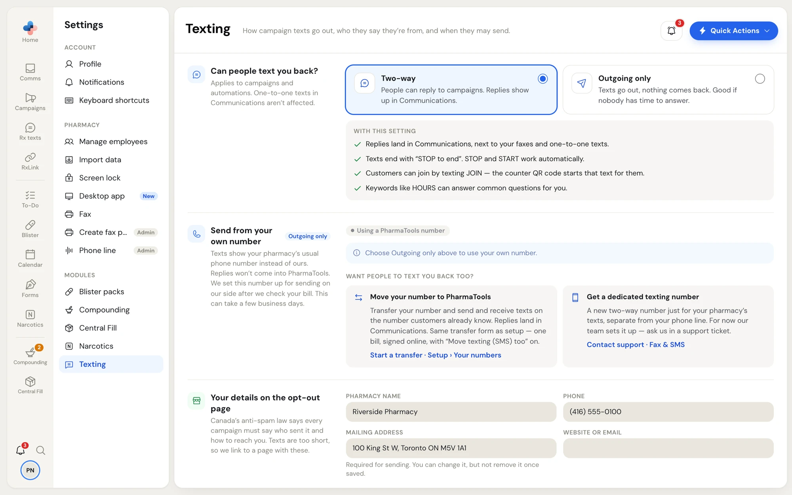
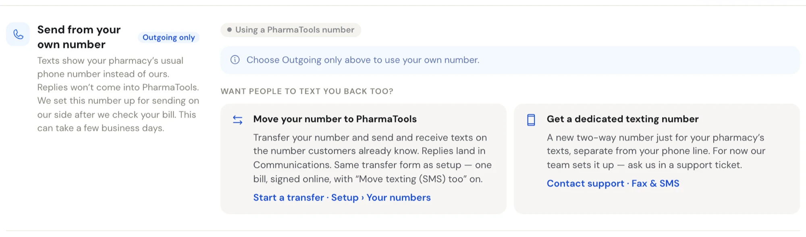
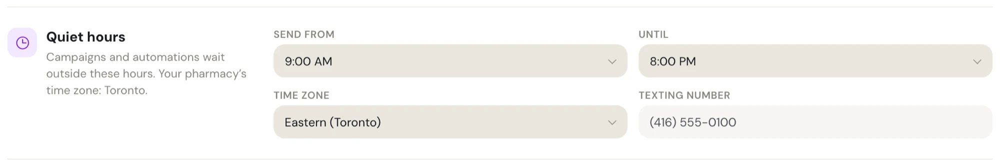

**Settings › Texting** sets how campaign texts and automations go out for the whole pharmacy. It shows under **Modules** for pharmacies with Campaigns.

- **Everyone** can open it and read the settings.
- Only **managers and admins** can change them. Everyone else sees **Only a manager or an admin can change these.** at the top and greyed-out fields.

One-to-one texts in **Comms** are never affected by **Settings › Texting**.

Change what you need, then click **Save changes** on the **Unsaved changes** bar.

<Frame caption="Settings › Texting">

</Frame>

## Can people text you back?

Pick one of two cards. Under them, **With this setting** lists exactly what changes.

| | **Two-way** | **Outgoing only** |
| --- | --- | --- |
| Replies | People can reply. Replies land in **Comms**, next to your faxes and one-to-one texts. | No replies come in, so there's no inbox to watch. |
| Opt-out | Texts end with a STOP line. STOP and START work automatically. | Texts end with a short opt-out link. One tap unsubscribes the person. |
| Joining your list | Customers text JOIN. The counter QR code starts that text for them. | Customers join on a sign-up page. The counter QR code opens it. |
| Keywords | Keywords like HOURS answer common questions for you. | Keywords are off. The campaign report shows link clicks instead of replies. |

**Two-way** needs your pharmacy's own texting number, which comes with SMS. Without it, the **Two-way** card is locked with **Needs your own texting number, which comes with SMS. Add SMS in Settings › Plan & modules.** In **Outgoing only**, texts then come from a shared PharmaTools number.

<Warning>
If **Two-way** is saved but the pharmacy no longer has its own texting number, an amber note says your campaigns and automations are waiting. Choose **Outgoing only** and save, or add SMS in **Settings › Plan & modules**.
</Warning>

## Send from your own number

This section, marked **Outgoing only**, lets campaigns show your pharmacy's usual phone number instead of a PharmaTools one. Replies to that number don't come into PharmaTools.

A tag shows where you stand:

| Tag | What it means |
| --- | --- |
| **Using a PharmaTools number** | Campaigns send from a PharmaTools number. Using your own costs extra per campaign, paid from your credits. |
| **Waiting for approval** | You sent a request. Our team checks your bill and sets the number up for sending, which can take a few business days. Campaigns keep sending from the PharmaTools number until it's approved, and you get an email when it's ready. |
| **Approved** | Campaigns can send from your number for an extra fee each. Pick it under **Send from** when you write a campaign. The fee comes from your credits. |
| **Not approved** | Our team couldn't approve it. Our note says why. Campaigns keep sending from the PharmaTools number. |

<Frame caption="Send from your own number, while Two-way is selected">

</Frame>

### Ask to use your own number

<Steps>
  <Step title="Switch to Outgoing only and save">
    The request needs **Outgoing only** saved first. While **Two-way** is selected, the section says **Choose Outgoing only above to use your own number.**
  </Step>
  <Step title="Click Use my own number">
    A short form opens.
  </Step>
  <Step title="Fill it in">
    Enter **Your pharmacy's number** (usually your main line) and the **Name on the phone account**, as printed on the bill. Under **Proof you own it**, click **Upload a recent phone bill** and pick a PDF or photo that shows the number and your pharmacy's name. Tick the box that says the number belongs to your pharmacy and that each campaign from it costs extra.
  </Step>
  <Step title="Send for approval">
    Click **Send for approval**. A message says **Sent for approval — we'll email you**, and the tag changes to **Waiting for approval**.
  </Step>
</Steps>

While it's waiting, a manager can click **Withdraw request**. Once it's approved, **Stop using this number** sends campaigns back to the PharmaTools number; to use yours again later, you send a new request. After **Not approved**, click **Send a new request**.

### Want people to text you back too?

Two more ways to get a number people can reply to:

- **Move your number to PharmaTools**: transfer your number so you send and receive texts on the number customers already know, with replies in **Comms**. Click **Start a transfer · Setup › Your numbers**. It's the same transfer form as setup, with **Move texting (SMS) too** on. Staff who aren't managers see **Ask a manager to start a transfer in Setup › Your numbers.**
- **Get a dedicated texting number**: a new two-way number just for texts, separate from your phone line. Our team sets it up for now: click **Contact support · Fax & SMS**.

## Your details on the opt-out page

Canada's anti-spam law says every campaign must say who sent it and how to reach you. Texts are too short, so each one links to a page with these details:

- **Pharmacy name**
- **Phone**
- **Mailing address**: required. Texts can't be sent until it's filled in. Once saved, you can change it but not remove it.
- **Website or email**

## Booking link

**Booking page** is where `{Booking link}` in a campaign takes people, like your online booking page. Each person gets their own short link, so the campaign report shows who tapped it.

Leave it empty if you don't take bookings online. Campaigns that use `{Booking link}` can't be sent until it's filled in. If what you type isn't a web address, the field says **Enter a web address, like yourpharmacy.ca/book.**

## Reply to HOURS

Shown with **Two-way** only. When someone texts HOURS to your texting number, they get the **HOURS reply** straight away. It doesn't use your credits. Under the box, PharmaTools counts the characters and how many texts the reply takes; keep it to one text (160 characters).

## Quiet hours

Campaigns and automations wait outside these hours, in your pharmacy's time zone.

<Frame caption="Quiet hours">

</Frame>

| Field | What to set |
| --- | --- |
| **Send from** | The earliest hour texts may go out, from 7:00 AM. |
| **Until** | The latest hour, up to 10:00 PM. It must be later than **Send from**. |
| **Time zone** | Your pharmacy's time zone. Starts on Eastern (Toronto). |
| **Texting number** | Read-only: the number campaign texts come from, or **Shared PharmaTools number**. |
