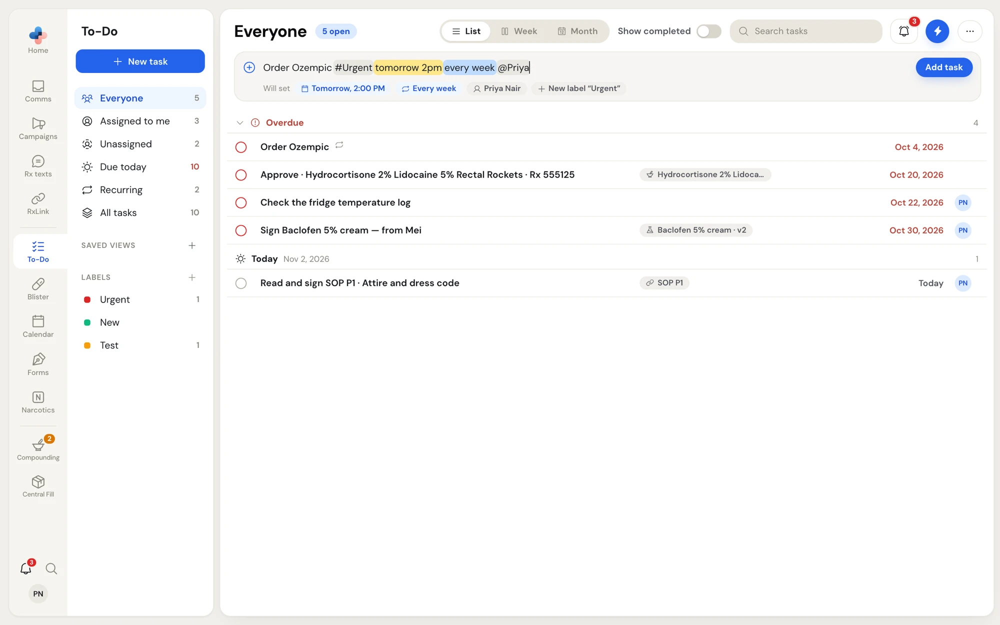

You add a task by typing one line. PharmaTools reads the date, time, repeat, people and labels out of what you type, highlights each part, and shows what it will set before you add it.

You can type a task in four places:

- The quick-add bar at the top of **To-Do** and **Calendar**.
- A day or time slot on the Week or Month calendar. See [Add a task on the calendar](/todo/calendar#add-a-task-on-the-calendar).
- The **To-Do flyout** (bell at the bottom of the side menu, or **Shift+T**). See [The To-Do flyout](/todo/flyout).
- **Add task** on a Comms message, a Team chat or a support ticket, which opens the flyout ready to type.

## Add a task from the quick-add bar

<Steps>
  <Step title="Click the quick-add bar">
    Click **Add a task — try "Order Ozempic tomorrow @Mei #Urgent"** at the top of the page, or click **New task** in the left menu, which puts the cursor there.
  </Step>
  <Step title="Type the task">
    Type the title and, anywhere in the line, any of the parts in the table below. Each part PharmaTools understands is highlighted: dates and times in yellow, repeats in blue, people in grey and labels in their own colour.
  </Step>
  <Step title="Check Will set">
    Under the line, **Will set** shows a chip for each thing the task will get, for example **Tomorrow, 2:00 PM**, **Every week**, **Priya Nair** and **New label "Urgent"**.
  </Step>
  <Step title="Add it">
    Press **Enter** or click **Add task**. The task appears in its day group with a short highlight, and its panel opens on the right.
  </Step>
</Steps>

<Frame caption="The quick-add bar reading a date and time, a weekly repeat, a person and a new label">

</Frame>

## What you can type

| Type | Example | What it sets |
| --- | --- | --- |
| A date | `tomorrow`, `Friday`, `next Monday`, `Nov 20`, `in 3 days` | The due date. With no date, the task is due today. |
| A time | `2pm`, `9:30am`, `2-4pm` | A start time. One time gives a one-hour slot; a range sets both ends. |
| A repeat | `every day`, `every week`, `every 2 weeks`, `every 3 months` | Makes the task recurring from its due date. |
| A person | `@Mei`, `@Priya Nair` | Assigns the task to them. `@` plus the start of a first name, last name or full name works. |
| A team | `@Compounding`, `@Front`, `@FrontCounter` | Assigns the task to a team. The start of a word in the team's name works. |
| A label | `#Urgent`, `#BlisterPackDeliveries` | Adds the label. A name that does not exist yet is created when you add the task. |

You can name several people, teams and labels in one line. PharmaTools reads labels first, so a label called `#May` is never read as a date. An `@` inside an email address, such as `info@front.ca`, is not read as a person.

While you type after `#`, a list of matching labels opens under the bar. Use the arrow keys and **Enter**, or click a label. The last row, **Create "…"**, makes a new label with that name.

## Who a new task goes to

| What you typed | Who the task goes to |
| --- | --- |
| `@` one or more people or teams | Those people and teams. |
| No `@`, but a label that has default people or teams | The label's default people and teams. **Will set** shows them with "from #label". |
| No `@` and no label defaults, on the To-Do page or calendar | You. |
| No `@` and no label defaults, in the To-Do flyout | Nobody; the task is unassigned and shows in **Everyone**. |

If you give a task to someone else and you cannot see **All tasks**, the task leaves your lists. A message at the bottom of the screen says **Added for Mei** · "It's on their list, not yours", and the task's panel still opens so you can check it.

<Tip>
Change any detail after adding the task: click it and use its panel. See [Work with a task](/todo/task-details).
</Tip>

## Add a task about a message or another item

Many items in PharmaTools have an **Add task** action: an eFax, SMS, voicemail or patient request in Comms, a Team chat conversation or message, and a support ticket.

<Steps>
  <Step title="Choose Add task">
    Right-click the item and choose **Add task**, or click the **Task** button at the top of its thread. In an SMS or a patient request, you can also select some text and choose **Add task** to start the task with that text.
  </Step>
  <Step title="Finish the task in the flyout">
    The To-Do flyout opens with the cursor in its quick-add field. Type or edit the line and click **Add**.
  </Step>
</Steps>

What the flyout fills in depends on where you started:

| Started from | Title | Link |
| --- | --- | --- |
| An eFax, SMS, voicemail or patient request in Comms | Empty, or the text you selected | A blue chip names the item. The task stays linked to it. |
| A Team chat conversation or message | "Follow up with …", or the message text | None |
| A support ticket or its message | "Follow up on …", or the message text | None |

A linked task's panel has a **Linked eFax** (or **Linked SMS**, **Linked Voicemail**, **Linked Patient request**) card with an **Open** button that takes you back to the item, and **Show preview** to read it without leaving To-Do. To add the task without the link, click **×** on the blue chip before you click **Add**.

With the flyout open, press **T** to start a task linked to the Comms item you have open.

## Tasks PharmaTools adds for you

Some modules add tasks on their own, such as "Read and sign SOP P1 · Attire and dress code" or "Renew Frequent Dispensing · Margaret Chen". They show in the same lists, link back to their item, and most close themselves when the work is done. See [Tasks other modules create](/todo/overview#tasks-other-modules-create).

## Bring tasks from another calendar

Managers and Admins can import tasks from `.ics` calendar files. See [Import data](/settings/import-data).
