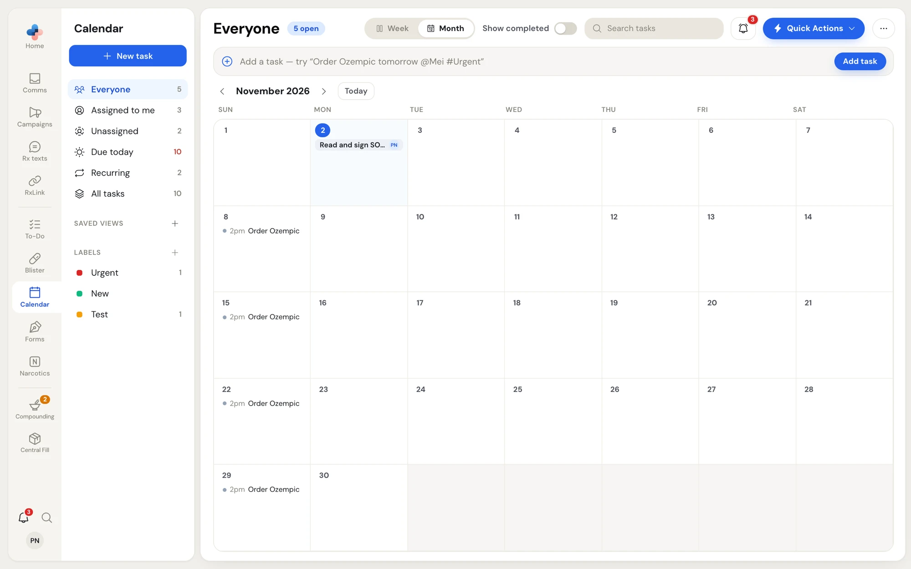
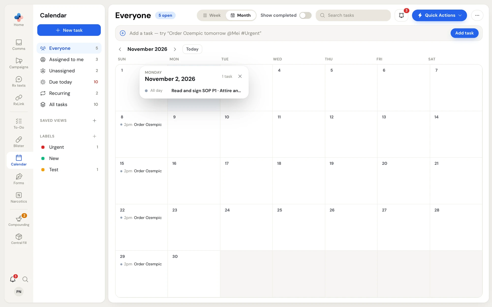
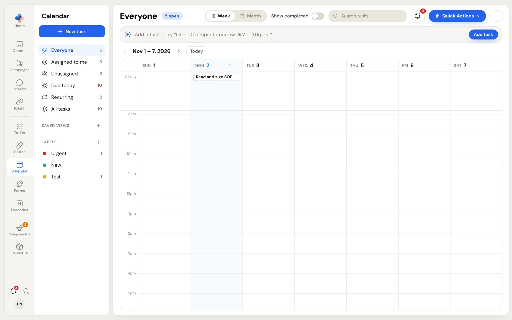
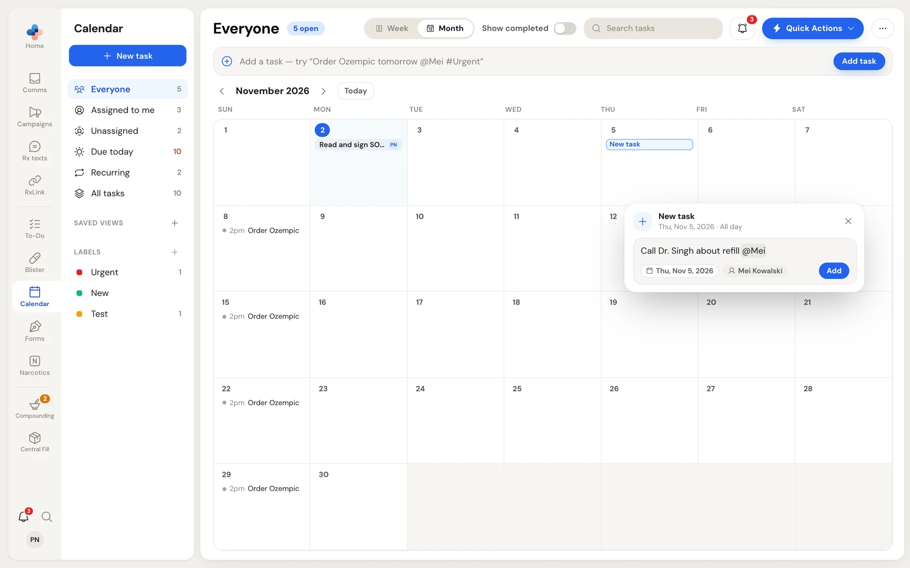
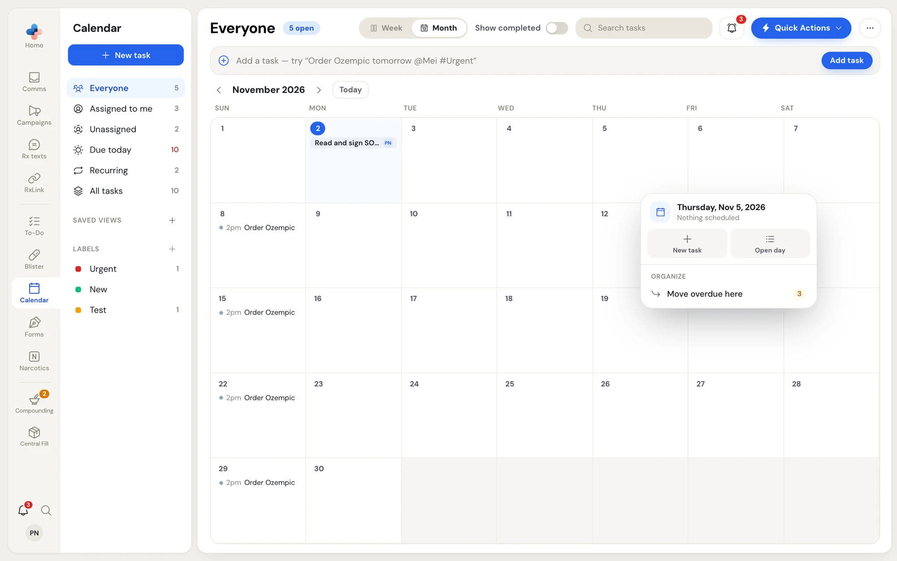
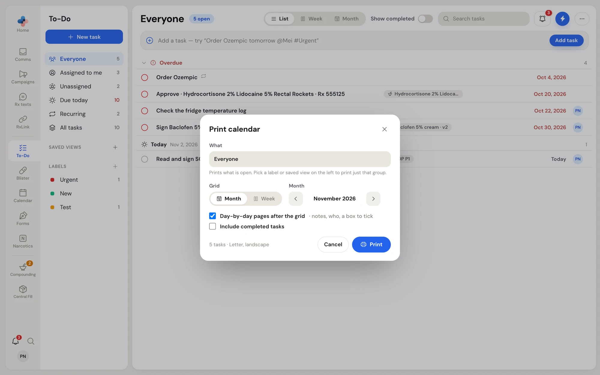

The calendar shows the same tasks as **To-Do**, laid out by day. Nothing is kept separately: a task you add, move or complete on the calendar changes in To-Do too, for everyone.

## Open the calendar

There are two ways in:

- Click **Calendar** in the side menu. It opens on **Month** and offers **Week** and **Month**.
- On the **To-Do** page, click **Week** or **Month** in the page header. Click **List** to go back to the list.

Each place remembers the layout you used last: **Calendar** reopens on the one you last picked there, and **To-Do** on its own last pick.

The left menu, the views, labels, saved views, **Show completed** and **Search tasks** all work the same as on the To-Do page, so you can show one label's month, or only your own tasks. See [Views](/todo/overview#views).

<Frame caption="Calendar on Month, showing everyone's tasks for November 2026">

</Frame>

## Move around

- Click the **‹** and **›** arrows beside the month or week name, or press **←** and **→** on your keyboard.
- Click **Today** to come back to the current week or month.

## Month

Each day shows its tasks as one line each: a time for timed tasks, then the title. Today's date is a blue circle.

- Click a task to open its panel on the right.
- Hover a task and click its tick circle to mark it done.
- Click a day's number, or **+N more** when a day is full, to list every task on that day.

<Frame caption="A day's list, opened from its date">

</Frame>

## Week

The week is an hour grid, Sunday to Saturday.

- Tasks without a time sit in the **All day** area at the top. Most pharmacy tasks are untimed, so this area grows with the busiest day.
- Timed tasks sit in the hours, sized by their start and end times.
- The small number beside a day's name counts its tasks.

<Frame caption="Week: all-day tasks at the top, timed tasks in the hour grid">

</Frame>

## Add a task on the calendar

<Steps>
  <Step title="Pick the day or time">
    Click empty space in a day, or the **+** that appears when you hover a day. In **Week**, click an hour to start at that time, or drag down the hours to set a start and end time.
  </Step>
  <Step title="Type the task">
    A **New task** box opens beside the day. Type the title, with `@people`, `#labels` or a repeat such as `every week`, the same way as the quick-add bar. See [What you can type](/todo/add-tasks#what-you-can-type).
  </Step>
  <Step title="Check the chips">
    Under the line, chips show the day (or time range) you picked, who it goes to (**Me**, unless you type an `@` name or a label brings its own people), and what else it will set. A date or time you type replaces the slot you clicked.
  </Step>
  <Step title="Add it">
    Press **Enter** or click **Add**. **Esc** or **×** closes the box without adding.
  </Step>
</Steps>

<Frame caption="Adding a task on Thursday, Nov 5, 2026, assigned to Mei">

</Frame>

## Move and resize tasks

- **Drag a task** to another day to change its due date. In **Week**, drag it to an hour to give it a time, or up to **All day** to take the time off.
- **Drag the bottom edge** of a timed task in **Week** to change when it ends, in 15-minute steps.

After a move, a message at the bottom of the screen says **Moved** with the task and its new day, with **Undo**. Moving a repeating task asks **Only this one** or **All future** first. See [Only this one or all future](/todo/task-details#only-this-one-or-all-future).

## Right-click a day

Right-click empty space in a day (or an hour in **Week**) for that day's menu. Its top line shows the day and how many tasks it has, how many are done and how many are overdue.

<Frame caption="The day menu on Thursday, Nov 5, 2026">

</Frame>

| Item | What it does |
| --- | --- |
| **New task** | Opens the **New task** box on this day or time. |
| **Open day** | Lists every task on this day. |
| **All done** | Marks every open task on this day done, with one **Undo**. Shown when the day has open tasks. |
| **Move overdue here** | Moves every overdue one-off task onto this day. The number shows how many. |
| **Move this day's tasks** | Moves this day's open one-off tasks to **Next day** or **Next Monday**. |

Repeating tasks keep their schedule: the two **Move** items only move tasks that do not repeat.

Right-clicking a task on the calendar opens the task's own menu. See [Right-click menu](/todo/task-details#right-click-menu).

## Print a calendar

Pharmacies often print a month for one group of tasks, such as blister pack deliveries, and pin it up.

<Steps>
  <Step title="Open what you want to print">
    In the left menu, pick the view, label, saved view or person you want on paper. The print uses what is open, including your search.
  </Step>
  <Step title="Open Print calendar">
    Click **⋯** in the page header and choose **Print calendar…**.
  </Step>
  <Step title="Choose the grid">
    Under **Grid**, choose **Month** or **Week**, then use the arrows to pick which month or week.
  </Step>
  <Step title="Choose what else prints">
    Leave **Day-by-day pages after the grid** ticked to add a page per day with each task's notes, who it is assigned to, and a box to tick. Tick **Include completed tasks** to print done tasks too.
  </Step>
  <Step title="Print">
    The line under the options counts the tasks and names the paper (Letter, landscape). Click **Print** to open your computer's print window.
  </Step>
</Steps>

<Frame caption="Print calendar for the Everyone view, November 2026">

</Frame>

On the printed month grid, each task takes one line. When a day holds more than fits, it ends with "+N more", and every task is on the day pages that follow. A task assigned to a team prints the team's name, not its members.
