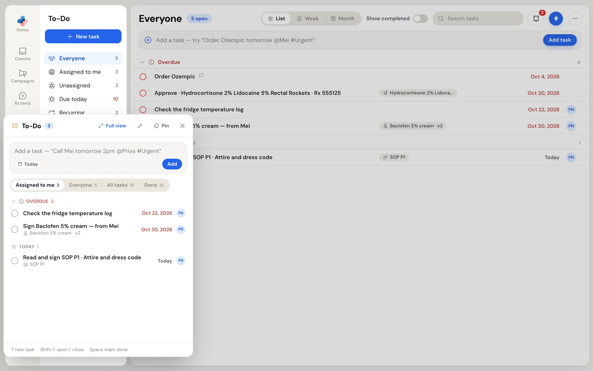

The **To-Do flyout** is a small panel of your tasks that opens over any page in PharmaTools. Use it to tick off a task or jot one down while you are in Comms, Compounding or anywhere else.

## Open and close it

- Click the **bell** at the bottom of the side menu, beside the search magnifier. Its badge counts the open tasks assigned to you; the badge is red when one of them is overdue.
- Or press **Shift+T** on any page (when you are not typing in a field).
- Press **Shift+T** again, **Esc**, or click **×** to close it. Clicking outside it closes it too, unless it is pinned.

<Note>
The bell at the bottom of the side menu opens To-Do. The bell in each page's header, at the top right, opens your notifications.
</Note>

<Frame caption="The To-Do flyout over the To-Do page, on Assigned to me">

</Frame>

## What it shows

Tabs across the top choose the tasks. Each shows a count.

| Tab | Shows |
| --- | --- |
| **Assigned to me** | Tasks with your name or one of your teams on them. The flyout opens on this tab. |
| **Everyone** | Your tasks plus tasks nobody is assigned to. |
| **All tasks** | Every task in the pharmacy. Managers and Admins only. |
| **Done** | Tasks completed in the last 7 days. |

Tasks are grouped as **Overdue** (click the heading to fold it), **Today** and **Upcoming**. **Upcoming** runs to every future task, with a repeating task shown at its next date, and loads more as you scroll. When the flyout opened from an item, a **Linked to this …** group (named for the item, such as an eFax or an SMS) sits on top with that item's tasks.

## Work in the flyout

| To | Do this |
| --- | --- |
| Add a task | Type in **Add a task — "Call Mei tomorrow 2pm @Priya #Urgent"** and press **Enter** or click **Add**. The same dates, `@people`, `#labels` and repeats work as on the To-Do page. A task with nobody named is left unassigned. |
| Mark a task done | Click its tick circle, or hover it and press **Space**. **Undo** shows for a few seconds. |
| Change a task | Click it. Its full panel opens inside the flyout. Click the back arrow or press **Esc** to return to the list. |
| Use the task menu | Right-click a task. See [Right-click menu](/todo/task-details#right-click-menu). |
| Open the To-Do page | Click **Full view**. |

## Keep it open, move it and resize it

- Click **Pin** to keep the flyout open while you click around the page. The button changes to **Unpin**.
- Drag the flyout's header to move it, and drag any edge or corner to resize it. It stays where you leave it.
- Click the shrink icon beside **Pin** to put it back to its usual size and place.

## Keyboard shortcuts

The footer of the flyout lists them:

| Key | Does |
| --- | --- |
| **T** | Opens the flyout ready to add a task, linked to the Comms item you have open. |
| **Shift+T** | Opens or closes the flyout. |
| **Space** | Marks the hovered task done. |
| **Esc** | Goes back from a task to the list, or closes the flyout. |
