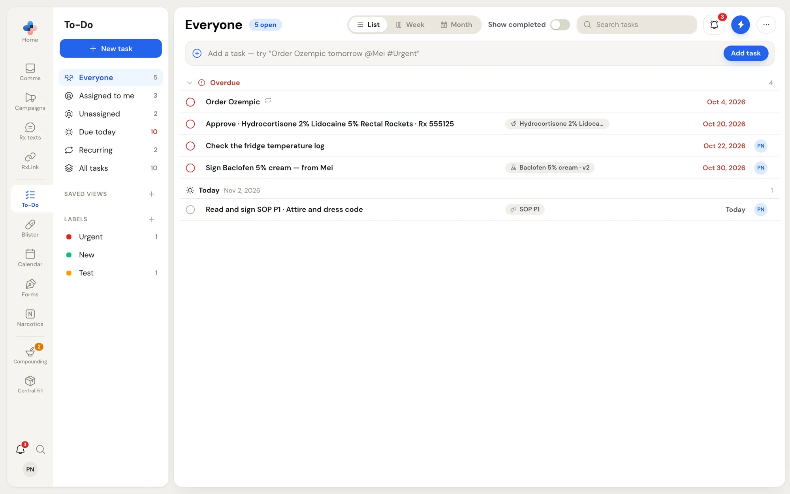
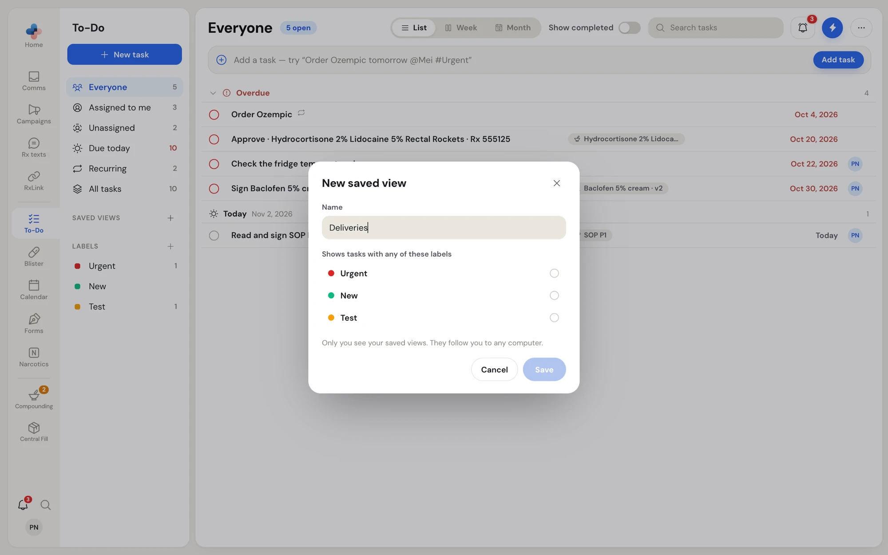
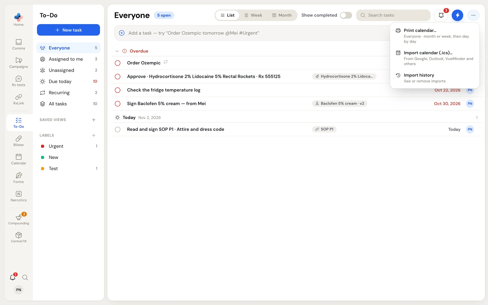

**To-Do** is the pharmacy's shared task list. Everyone in the pharmacy works from the same tasks, on every computer. You add your own tasks (order stock, call a prescriber, deliver a blister pack), and other parts of PharmaTools add tasks for you, such as "Read and sign SOP P1 · Attire and dress code" or "Sign Baclofen 5% cream — from Mei".

The same tasks show three ways:

- **To-Do** in the side menu: a list grouped by day, with a Week and Month calendar.
- **Calendar** in the side menu: the same tasks on a month or week calendar. See [Calendar and printing](/todo/calendar).
- The **To-Do flyout**: a small panel you open over any page with the bell at the bottom of the side menu, or **Shift+T**. See [The To-Do flyout](/todo/flyout).

## Open To-Do

Click **To-Do** in the side menu. The page has three parts:

| Part | What it holds |
| --- | --- |
| Left menu | **New task**, the six views, your **Saved views** and the pharmacy's **Labels**. |
| Middle | The page title and open count, the **List** / **Week** / **Month** switch, **Show completed**, **Search tasks**, the **⋯** menu, the quick-add bar and the tasks. |
| Right panel | The task you clicked, with every detail you can change. It opens when you click a task and closes with **×**. |

<Frame caption="To-Do on the Everyone view: overdue tasks in red at the top, then today's tasks">

</Frame>

## Views

The views in the left menu decide which tasks the list and the calendar show.

| View | Shows |
| --- | --- |
| **Everyone** | Tasks you are on (named, or through one of your teams) plus tasks nobody is assigned to. This is where To-Do opens. |
| **Assigned to me** | Tasks with your name on them, or one of your teams. Tasks you assigned to yourself are in this view too. |
| **Unassigned** | Tasks nobody is assigned to yet. |
| **Due today** | Tasks due today and every overdue task. |
| **Recurring** | Tasks that repeat. |
| **All tasks** | Every task in the pharmacy, whoever it is assigned to. Managers and Admins only. |

The number beside each view counts only tasks that are **overdue or due today**. Future tasks are listed but not counted. When anything is overdue, the **Due today** number turns red.

<Note>
**All tasks** is for Managers and Admins. Each of them can hide it for themselves in **Settings › Profile** with the **Show All tasks** switch; with it off, they see the same lists as everyone else. The views tidy the lists. They do not hide tasks from anyone: every task still reaches every computer in the pharmacy.
</Note>

## How the list is grouped

In **List**, tasks are grouped by their due date so you read a week ahead, day by day:

| Group | Holds |
| --- | --- |
| **Overdue** | Open tasks due before today, in red. Click the heading to fold it away. |
| **Today** | Tasks due today. |
| **Tomorrow** | Tasks due tomorrow. |
| Each of the next five days | Named by weekday, for example **Thursday** Nov 5, 2026. |
| **Next week** | Tasks due 7 to 13 days from today. |
| **Later** | Tasks due two weeks or more from today. Folded until you click it. |
| **Completed** | Done tasks, newest first. Shows only when **Show completed** is on. The first 50 show; click **Show 50 more** for older ones. |

A recurring task shows once: its open occurrence, or its next one. You see the repeat icon beside its title.

Each row shows, from left to right: the tick circle, the title with its labels and deadline flag, the item it came from (for example **SOP P1**), the patient's name if one is set, the due date or time, and who is on it. Hover a row to show **Edit** (pencil) and **Delete** (bin) at the end of it.

## Search and show completed

- **Search tasks** in the page header finds tasks by title, patient name or the name of the linked item.
- **Show completed** adds the **Completed** group to the list and done tasks to the calendar. PharmaTools remembers the switch on your computer.

## Labels

Labels are coloured tags the pharmacy shares across To-Do and Comms, for example **Urgent** or **Blister Pack Deliveries**.

- Click a label under **Labels** to list only tasks with that label. The number beside it counts its overdue and due-today tasks.
- Click **+** beside **Labels**, type a name and press **Enter** to add a label. **Esc** cancels.
- Type `#` and a label name in the quick-add bar to label a new task. A name that does not exist yet becomes a new label when you add the task.
- In a task's panel, click **Labels** to tick labels on or off, **Create** a new one, or open **Manage labels** to rename, recolour or delete labels.

A label can carry default people or teams. When you add that label to a task that nobody is assigned to, the task goes to those people. The quick-add bar shows them under **Will set**, for example "Priya Nair · from #Blister".

## Saved views

A saved view lists tasks with **any** of several labels under one name, for example "Blister packs" for **Blister Pack Deliveries** and **Blister Pack Pickups**.

<Steps>
  <Step title="Open the saved view window">
    Click **+** beside **Saved views** in the left menu.
  </Step>
  <Step title="Name it and pick labels">
    Type a **Name**, then tick each label under **Shows tasks with any of these labels**.
  </Step>
  <Step title="Save">
    Click **Save**. The view appears under **Saved views** with its label colours beside it.
  </Step>
</Steps>

<Frame caption="New saved view: a name and the labels it collects">

</Frame>

To change or remove a saved view, open it, click **⋯** in the page header and choose **Edit saved view…**. In that window you can rename it, change its labels, or click **Delete view**. Deleting removes only your copy; the labels and their tasks stay as they are.

<Info>
Saved views are personal. Only you see your saved views, and they follow you to any computer in the pharmacy.
</Info>

## The ⋯ menu

Click **⋯** at the right end of the page header.

<Frame caption="The ⋯ menu on the To-Do page">

</Frame>

| Item | What it does | Who sees it |
| --- | --- | --- |
| **Print calendar…** | Prints what is open as a month or week grid. See [Print a calendar](/todo/calendar#print-a-calendar). | Everyone |
| **Edit saved view…** | Edits the saved view that is open. | Everyone, when a saved view is open |
| **Import calendar (.ics)…** | Brings tasks over from a calendar file. | Managers and Admins |
| **Import history** | Shows past imports and lets you remove one. | Managers and Admins |

Importing calendar files is covered in [Import data](/settings/import-data). Managers and Admins can also drop `.ics` files onto the middle of the To-Do page to start an import.

## Tasks other modules create

Some tasks are made and closed by PharmaTools itself, from work in other modules. They link back to where the work is done, and most close themselves when that work is finished.

| Task title (example) | Comes from | Closes when |
| --- | --- | --- |
| Sign Baclofen 5% cream — from Mei | A master formula draft sent to a pharmacist to sign | The pharmacist signs the formula or sends it back |
| Fix Baclofen 5% cream — Priya Nair sent it back | A master formula draft sent back with notes | The drafter sends the formula again |
| Review the master formula for Baclofen 5% cream (v2) | A master formula's annual review falling due | The review is done on the formula |
| Check ingredients · … / Approve · … | A compounding record waiting on one person | That step is done in the record |
| Read and sign SOP P1 · Attire and dress code | An approved SOP version, one task per person who must read it | That person signs the SOP, or a newer version replaces it |
| Calibrate …, Area check · …, QA review · … | Compounding logs and quality dates (sent to the supervisor your compounding profile names) | The item is recorded, or you tick the task off |
| Renew Frequent Dispensing · Margaret Chen | A signed patient form that runs out in 14 days | Staff click **Send again** on the form |
| Refill reminders ready to review (12 patients) | Rx texts' 9:00 AM refill list | You tick it off |
| One task per blister pack step | A blister pack fill | The step is done in Blister packs |

For a task like "Sign … — from Mei", the panel's main button is **Review & sign** (or **Open and fix**) instead of **Mark done**, because ticking it off would close it with nothing signed.

## Who can do what

| Action | Who |
| --- | --- |
| Add, edit, assign, label, complete, duplicate and delete tasks | Everyone |
| See the **All tasks** view | Managers and Admins (each can hide it in **Settings › Profile**) |
| Import calendar files and see **Import history** | Managers and Admins |

Deleting a task removes it for everyone in the pharmacy, so PharmaTools asks you first.

## Next steps

<CardGroup cols={2}>
  <Card title="Add tasks" icon="plus" href="/todo/add-tasks">
    The quick-add bar, typed dates, @people and #labels.
  </Card>
  <Card title="Work with a task" icon="square-pen" href="/todo/task-details">
    Due dates, deadlines, repeats, assignees and the right-click menu.
  </Card>
  <Card title="Calendar and printing" icon="calendar" href="/todo/calendar">
    Week and Month, dragging tasks, and printing a month.
  </Card>
  <Card title="The To-Do flyout" icon="bell" href="/todo/flyout">
    Your tasks over any page, with keyboard shortcuts.
  </Card>
</CardGroup>
