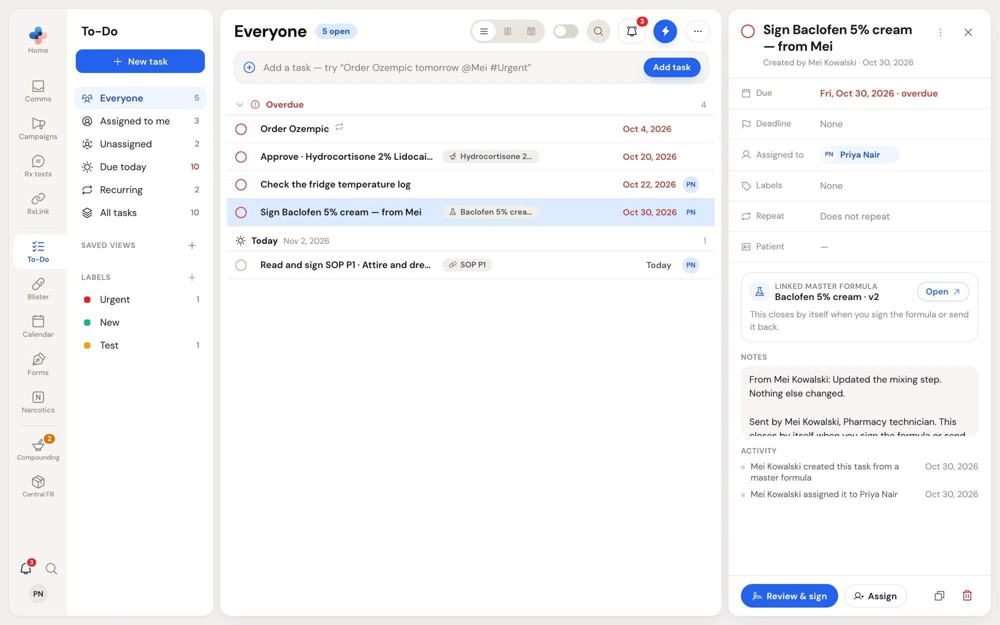
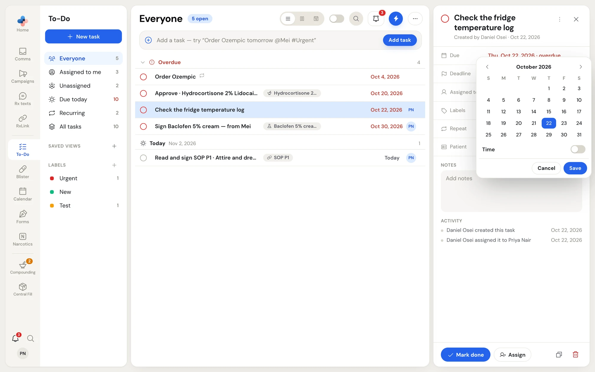
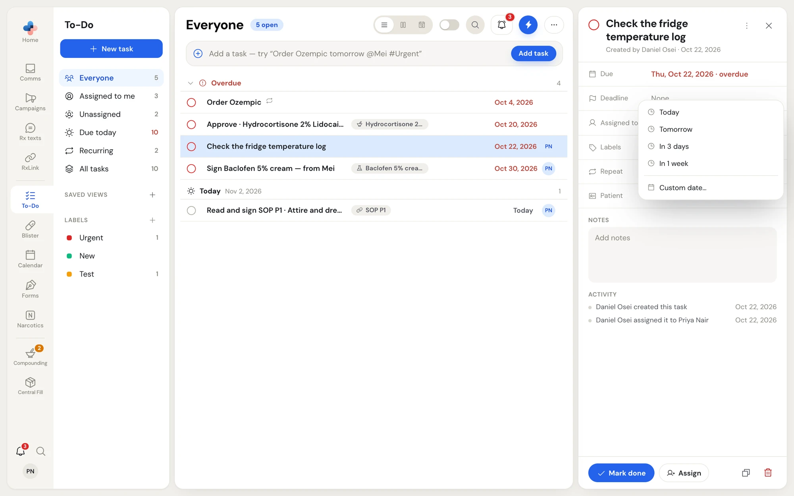
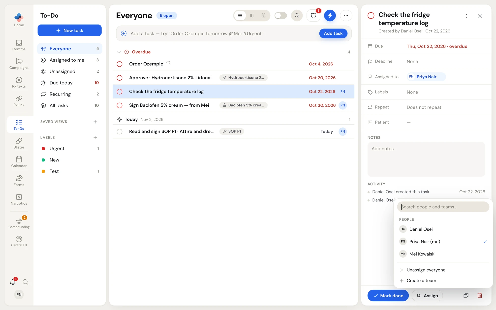
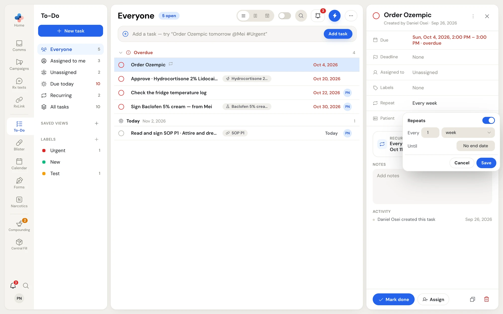
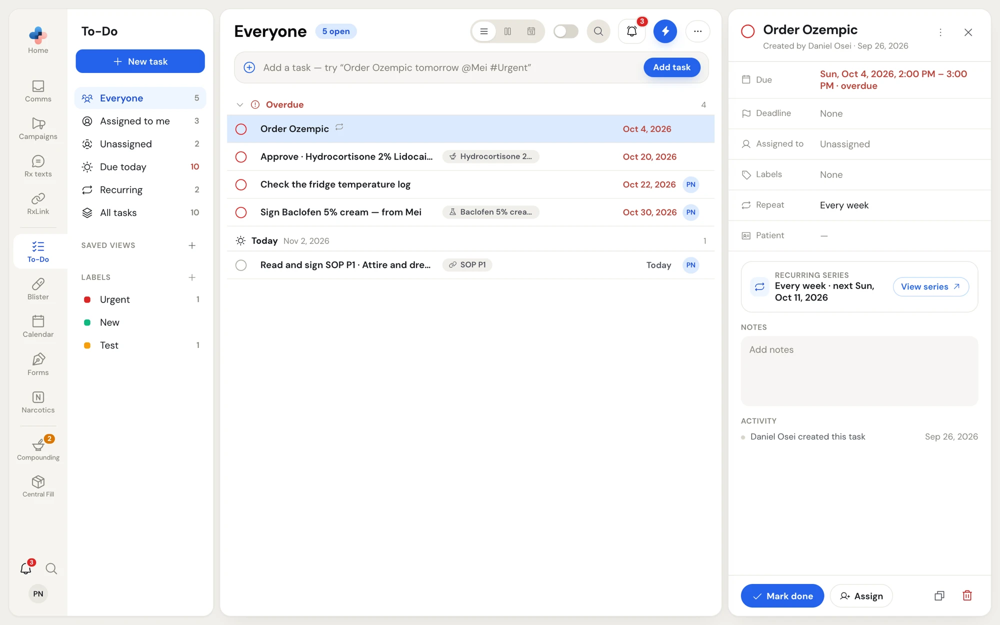
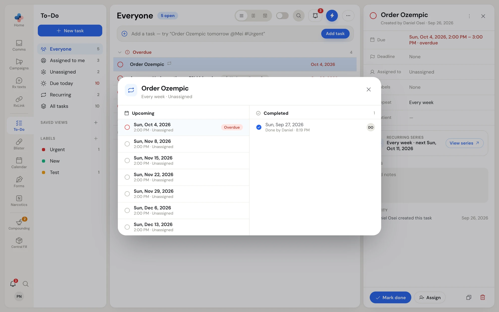
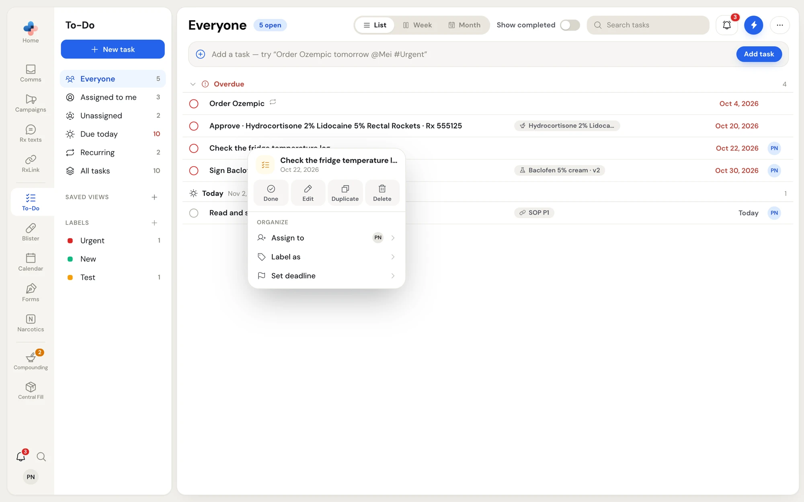

Click any task in **To-Do**, on the **Calendar**, or in the **To-Do flyout** to open its panel. Every change you make in the panel is saved as you make it and reaches everyone in the pharmacy.

<Frame caption="A task's panel. This one came from a master formula, so its main button is Review & sign">

</Frame>

## The panel at a glance

| Part | What you can do |
| --- | --- |
| Tick circle | Mark the task done, or reopen it. |
| Title | Click it to rename the task. **Enter** saves, **Esc** puts the old title back. Under it: who created the task and when. |
| **⋯** | Opens the same menu as right-clicking the task. |
| **×** | Closes the panel. |
| **Due** | The due date, and a time range if the task has one. Red with "overdue" when it is late. |
| **Deadline** | A second, hard date shown as an amber flag on the row, for example when a delivery must arrive by. |
| **Assigned to** | The people and teams on the task. Click **×** on a chip to take one person or team off. |
| **Labels** | The task's labels. |
| **Repeat** | **Does not repeat**, or the repeat, for example **Every 2 weeks until Dec 31, 2026**. |
| **Patient** | A patient's name for the task. Click and type; **Enter** saves. |
| **Recurring series** | Shown on a repeating task: the repeat, the next date, and **View series**. |
| **Linked …** | Shown on a task made from an item: what it links to, **Open**, and for Comms items **Show preview**. |
| **Notes** | Free text. Saved when you click out of the box. |
| **Activity** | Who created the task, who assigned it to whom, and who marked it done, with times. |
| Bottom bar | **Mark done** (or **Reopen**), **Assign**, **Duplicate** and **Delete**. |

## Change the due date and time

<Steps>
  <Step title="Click Due">
    A small calendar opens. Use the arrows to change month and click a day.
  </Step>
  <Step title="Add a time, if you need one">
    Turn on **Time**, then pick the start and end times. The end time list only offers times after the start.
  </Step>
  <Step title="Save">
    Click **Save**. **Cancel** or **Esc** closes without changing anything.
  </Step>
</Steps>

<Frame caption="Due: a day, and an optional time range">

</Frame>

## Set a deadline

Click **Deadline** and choose **Today**, **Tomorrow**, **In 3 days**, **In 1 week**, or **Custom date…** to pick a day. Choose **Clear deadline** to remove it. The deadline saves as soon as you pick it.

<Frame caption="Deadline choices">

</Frame>

## Assign people and teams

A task can go to any number of people and teams. Everyone named on it, and everyone in its teams, sees it under **Assigned to me**.

<Steps>
  <Step title="Open the picker">
    Click **Assign** in the bottom bar, or click the **Assigned to** row.
  </Step>
  <Step title="Tick people and teams">
    Type in **Search people and teams…** to narrow the list. Click a person or team to add them; click again to take them off. You can also use the arrow keys and **Enter**.
  </Step>
  <Step title="Close the picker">
    Click outside it or press **Esc**. Each click saved as you went.
  </Step>
</Steps>

<Frame caption="Assign: a tick marks each person or team on the task">

</Frame>

At the bottom of the picker, **Unassign everyone** takes everyone off the task. **Create a team** (or **Manage teams**, once your pharmacy has teams) opens the **Teams** tab of **Settings › Manage employees**.

## Add labels

Click **Labels**, then click labels to tick them on or off. Type in **Search labels…** to find one; if no label has that name, click **Create "…"** to add it. **Manage labels** opens the label manager to rename, recolour or delete labels.

## Make a task repeat

<Steps>
  <Step title="Click Repeat">
    The repeat options open.
  </Step>
  <Step title="Turn on Repeats">
    Set **Every** to a number and choose **day**, **week** or **month**. For a yearly task, choose every 12 months; PharmaTools shows it as **Every year**.
  </Step>
  <Step title="Choose an end, if it has one">
    Click **No end date** beside **Until** and pick the last day. Click **×** to go back to no end date.
  </Step>
  <Step title="Save">
    Click **Save**.
  </Step>
</Steps>

<Frame caption="Repeat: every 1 week, with no end date">

</Frame>

A repeating task shows the repeat icon in the list and a **Recurring series** card in its panel. Click **View series** to see the next seven occurrences under **Upcoming** and every completed one under **Completed**, with who did each and when.

<Frame caption="A weekly task's panel with its Recurring series card">

</Frame>

<Frame caption="View series: what is coming and what has been done">

</Frame>

### Only this one or all future

When you change or delete one occurrence of a repeating task, PharmaTools asks how far the change goes:

| Choice | What happens |
| --- | --- |
| **Only this one** | Only this date changes. It becomes a task of its own; the rest of the series stays as it was. |
| **All future** | This date and every later one change. Earlier occurrences stay as they were. |
| **Cancel** | Nothing changes. |

The window is titled **Edit recurring task** or **Delete recurring task**.

## Mark a task done

Do any of these:

- Click the tick circle on the row, in the panel or on a calendar chip.
- Click **Mark done** at the bottom of the panel.
- Right-click the task and click **Done**.
- In the To-Do flyout, hover the task and press **Space**.

A message at the bottom of the list says **Completed** with the task's title and an **Undo** button for a few seconds. For a repeating task it also shows the next date, for example **Next Nov 9, 2026**, and the next occurrence takes its place in the list.

To reopen a done task, turn on **Show completed**, then click its tick circle or **Reopen**.

<Warning>
Tasks that come from a master formula to sign or fix show **Review & sign** or **Open and fix** instead of **Mark done**. They close by themselves when you sign the formula, send it back, or send it again.
</Warning>

## Right-click menu

Right-click any task in the list, on the calendar or in the flyout, or click **⋯** in its panel.

<Frame caption="The right-click menu on a task">

</Frame>

| Item | What it does |
| --- | --- |
| **Done** / **Reopen** | Marks the task done, or not done. |
| **Edit** | Opens the task's panel. |
| **Open** | Opens the item the task came from (an eFax, a master formula, an SOP). Shown only on linked tasks. |
| **Duplicate** | Makes a copy with the same details and people. |
| **Delete** | Deletes the task. |
| **Assign to** | Adds or removes people and teams. |
| **Label as** | Adds or removes labels. |
| **Set deadline** | Sets or clears the deadline. |

## Duplicate or delete a task

- **Duplicate**: the copy icon in the panel's bottom bar, or **Duplicate** in the right-click menu. The copy opens in the panel.
- **Delete**: the bin icon on a hovered row, in the panel, or **Delete** in the right-click menu. PharmaTools asks **Delete task?** · "This task will be removed for everyone in the pharmacy." Click **Delete** to confirm.

## Open the linked item

A task made from something else shows a **Linked …** card in its panel, such as **Linked eFax** or **Linked master formula**.

- Click **Open** to go to the item.
- For Comms items, click **Show preview** to read the message, fax or voicemail inside the panel.
- If the item is no longer in your inbox, the card says **No longer in your inbox.**
- A task imported from a calendar file shows the file name instead, and has nothing to open.
